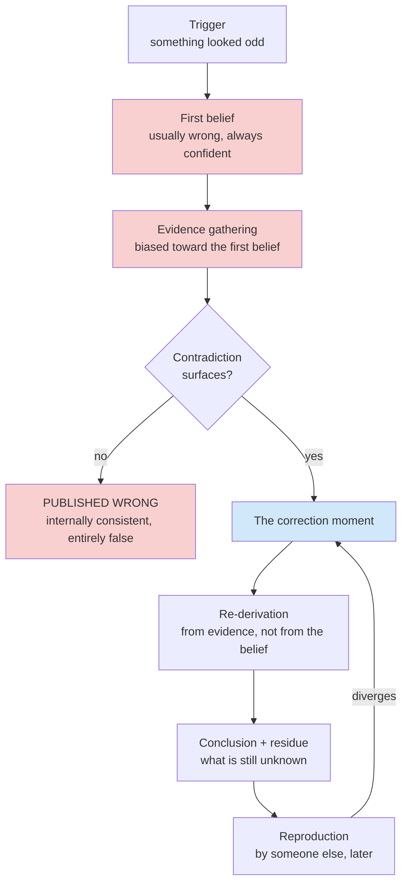
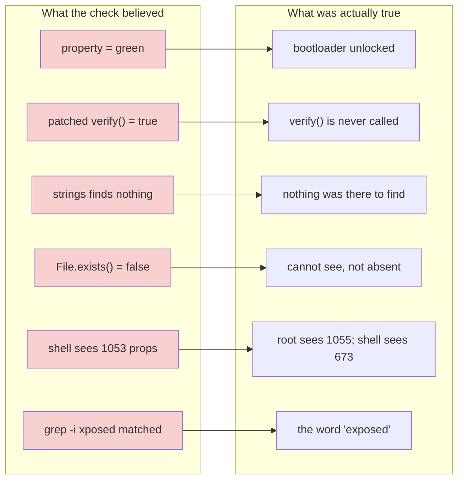
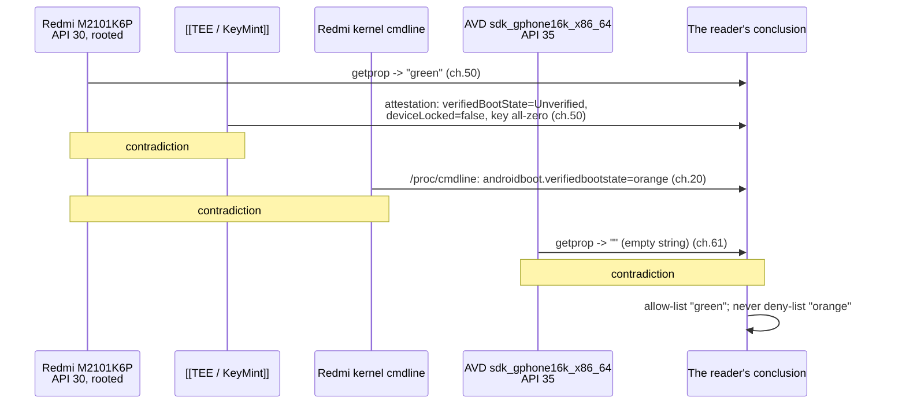
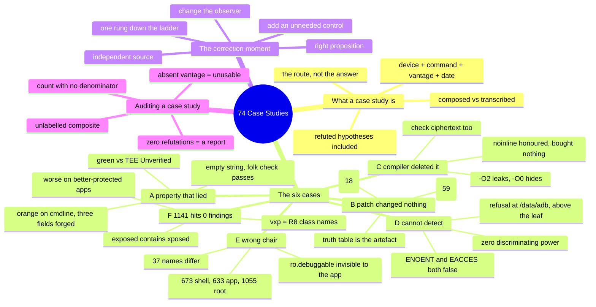

# 74 — Case Studies

> After this chapter you can read an investigation end to end — including the two hours it spent
> being wrong — identify the exact moment a wrong conclusion became a right one, and re-run someone
> else's case study on your own device to find out whether it still reproduces.

**Prerequisites:** [68-ReverseEngineering](../68-ReverseEngineering/README.md) for the method this
chapter shows worked instances of; [20-Security-Architecture](../20-Security-Architecture/README.md),
[37-RootDetection](../37-RootDetection/README.md) and [52-StaticAnalysis](../52-StaticAnalysis/README.md)
for the subject matter. [02-Linux-Basics](../02-Linux-Basics/README.md) if `errno`, `stat` and file
modes are new.

**Applies to:** the cases here were measured on Android 11 (API 30), Android 13 (API 33) and
Android 15 (API 35). Every claim carries the device it came from. The *method* is version-independent.

---

## Table of Contents

| § | Section | What it gives you |
|---|---|---|
| 1 | [Introduction](#1-introduction) | Why a finished report teaches you almost nothing |
| 2 | [High-Level Architecture](#2-high-level-architecture) | The anatomy of a case study, drawn |
| 3 | [Deep Internal Working](#3-deep-internal-working) | Six complete investigations, dead ends included |
| 4 | [Source Code Walkthrough (AOSP)](#4-source-code-walkthrough-aosp) | The code that makes each case inevitable |
| 5 | [Security Perspective](#5-security-perspective) | Severity, disclosure, and the honest report |
| 6 | [Reverse Engineering Perspective](#6-reverse-engineering-perspective) | What each case looks like in JADX, Smali and disassembly |
| 7 | [Dynamic Analysis](#7-dynamic-analysis) | Re-running a case study on your own device |
| 8 | [Static Analysis](#8-static-analysis) | Auditing a written case study for the four defects |
| 9 | [Examples](#9-examples) | Five graded worked cases |
| 10 | [Common Interview Questions](#10-common-interview-questions) | Five tiers, with model answers |
| 11 | [Common Mistakes](#11-common-mistakes) | Developer, pentester, reverse engineer |
| 12 | [Hands-on Labs](#12-hands-on-labs) | Four labs, the last a CTF |
| 13 | [Summary](#13-summary) | Mind map, cheat table, quick revision |
| 14 | [References](#14-references) | Sources, and the chapters that own each fact |

---

## 1. Introduction

### 1.1 A recipe is not a story

Imagine you want to learn to cook, and someone hands you a recipe. It says: heat the pan, add the
onions, cook for four minutes, add the garlic. You follow it and it works. You have learned to make
that dish, once.

Now imagine instead that a cook lets you stand in their kitchen for an evening. You watch them burn
the garlic because they added it too early, swear, scrape the pan, start again, and — this is the
part that matters — *explain why they added it early*, which was a reasonable belief about heat that
turned out to be wrong. At the end of the evening you cannot make that one dish any better than the
recipe would have taught you. But you can cook, because you have seen how a wrong belief gets
caught.

**Published security findings are recipes.** A CVE write-up, a bug bounty report, a pentest finding —
all of them are written *after* the answer is known, in the order that makes the answer look
inevitable. "The application stores the session token in SharedPreferences. An attacker with physical
access can extract it." Clean, correct, and a near-total lie about how anyone arrived there.

What actually happened is that somebody spent forty minutes convinced the token was in the SQLite
database, found four candidate values that all turned out to be analytics identifiers, noticed that
the database file's modification time was two days stale, and only then went looking in the right
place. **None of that is in the report, and all of it is the skill.**

> **Definition — case study.** In this repository, a case study is the complete record of one
> investigation, told in the order it happened, including every hypothesis that was refuted, the
> evidence that refuted it, and the moment a wrong conclusion turned into a right one. It is not a
> summary of a finding. A summary of a finding is a *finding*, and those live in
> [72-RealWorldFindings](../72-RealWorldFindings/README.md).

### 1.2 What breaks without this

Suppose this chapter did not exist and you learned only from finished reports. Three specific
failures follow, and all three are common enough that this repository has measured every one of them.

**You would not recognise a false positive.** A finished report never shows the fourteen leads that
were discarded, so you would have no calibration for how many leads a real investigation kills.
Chapter 52 swept a 17 MB commercial application and killed **13,220 of 16,836 raw hits** in the
validator alone. If your mental model comes from reports, you expect a hit to be a finding, and you
will publish fifteen things that are not.

**You would not recognise your own tooling failing.** Failures in tools are silent and look like
clean results. Chapter 48's biometric sweep reported zero for every signal across every application
in the corpus — twice, from two entirely different causes — and both runs "looked like results."
A report shows you the run that worked.

**You would not know what a correction feels like.** The single most valuable skill in this work is
noticing that you are wrong before you publish. That skill is trained by watching corrections happen,
and corrections are precisely what reports edit out.

> **Mental Model**
> A finished report is the *last frame* of a film. This chapter is the film. You cannot learn
> cinematography from a poster, no matter how good the poster is.

### 1.3 The six cases, in one line each

Every case below is drawn from this repository's own recorded investigations, and every one has a
**wrong middle**.

| # | Case | The wrong belief | What corrected it |
|---|---|---|---|
| A | **The property that lied** | One device's `ro.boot.verifiedbootstate` told the truth | A TEE-signed attestation on the same device, seconds later, disagreed |
| B | **The patch that changed nothing** | Patching the function named "verify" defeats verification | The program's output was byte-identical after a verified-correct patch |
| C | **The obfuscation the compiler deleted** | Encrypting a string at compile time hides it | `-O2` shipped the plaintext that `-O0` had hidden |
| D | **The detection that cannot detect** | `File.exists()` on a root artefact answers the question | It returns the same answer whether the artefact is there or not |
| E | **The count from the wrong chair** | A published property count was a shell measurement | Re-running it today produced the figure only as **root** |
| F | **1,141 hits, 0 findings** | A case-insensitive substring is a detection signal | Every single hit was the English word "exposed" |

Case E is new. It was produced *while writing this chapter*, by re-running case D's measurement, and
it corrects a number recorded elsewhere in this repository. That is not a coincidence — it is what
re-running case studies is for, and §3.5 tells the whole story including the part where I nearly
believed the wrong number twice.

### 1.4 Where this chapter stops

This repository divides the same raw material four ways, and confusing the divisions is the fastest
way to read the wrong chapter.

| Chapter | Unit of work | Evidence | Question it answers |
|---|---|---|---|
| [72-RealWorldFindings](../72-RealWorldFindings/README.md) | The **finding class** | **Counts** across a corpus | *How often does this turn up, and how bad is it usually?* |
| **74 — this chapter** | The **story** | A **trail** you can walk | *How did one person get from confusion to a conclusion?* |
| [68-ReverseEngineering](../68-ReverseEngineering/README.md) | The **method** | The evidence ladder | *What procedure makes an investigation trustworthy?* |
| [70-VulnerabilityResearch](../70-VulnerabilityResearch/README.md) | The **technique** | Reproducible discovery | *How do you find something nobody has found?* |
| [71-OWASP-Mobile](../71-OWASP-Mobile/README.md) | The **framework** | MASVS/MASTG identifiers | *What is the industry name for this?* |

The practical test: **if you are tabulating a rate across many applications, you are writing 72.**
If you are narrating one target in order, you are writing 74. If you are describing the procedure
without a target at all, you are writing 68.

68 additionally owns the notation this chapter uses throughout. Its
[`examples/worked-journal.md`](../68-ReverseEngineering/examples/worked-journal.md) is the reference
implementation: eighteen entries, nine of them failures, in the `H`/`P`/`R`/`E`/`O`/`V` form. This
chapter borrows the notation and supplies the worked instances.

> **Definition — the H/P/R/E/O/V block.** From
> [68 §1.5](../68-ReverseEngineering/README.md). `H` is the hypothesis; `P` is what you would
> predict if it were true; **`R` is what would refute it, written *before* you look**; `E` is the
> experiment; `O` is the raw observation; `V` is the verdict. Writing `R` first is the entire trick:
> without it, every observation is something you can explain away.

### 1.5 The rules this chapter holds itself to

Case studies are the easiest documents in security to fake, because a narrative is persuasive whether
or not it is true. Four rules, and every case below states which apply to it.

1. **No invented incidents.** Nothing here is a breach I heard about. Every case is a measurement
   recorded in this repository, with the owning chapter cited so you can check it.
2. **No invented identifiers.** No fabricated CVE numbers, bug bounty URLs or AOSP line numbers.
   Where §5 cites public CVEs it says plainly that you must verify each identifier at the source
   before repeating it.
3. **Composed is labelled composed.** Several cases below are assembled from measurements taken at
   different times, sometimes on different devices, into one narrative. **That is a reconstruction,
   not a transcript**, and each one says so in its provenance box. The distinction matters: a
   transcript proves the order of events, a reconstruction only proves the events.
4. **No named vendors.** Targets appear as "a 17 MB commercial application", "a banking application
   in the corpus". Every case here was measured on hardware belonging to the person doing the
   measuring, or on applications already installed on it, under the authorised-testing discipline in
   [06-Android-Architecture/scripts/device-posture.sh](../06-Android-Architecture/scripts/device-posture.sh).

> **Warning — the ethics of the case study form specifically.**
> A case study is a story about a real system, and stories travel further than caveats. If you write
> one about a client engagement, the vendor name, the version string, the hostnames and the
> screenshots all have to go, and you have to check that the *combination* of what remains does not
> identify the target. "A 17 MB HR application with thirteen environments in a `Domain` enum" is
> already quite specific. Ask whether the lesson survives further blurring; it almost always does.

---

## 2. High-Level Architecture

### 2.1 The five phases every investigation actually has



Read the red path first, because it is the default. A trigger produces a belief, the belief steers
what evidence you collect, and if nothing contradicts it you publish something that is *internally
consistent and completely wrong*. Every case in §3 spent time on that path. What distinguishes them
is that a contradiction surfaced — and in four of the six, the contradiction surfaced because
somebody deliberately went looking for one rather than waiting to trip over it.

The blue box is the subject of this chapter. **The correction moment is the only part of an
investigation that a finished report never contains**, and it is the part worth studying.

Note the loop at the bottom. Reproduction is not a formality that confirms what you already wrote;
it is a fresh chance for the contradiction to surface. §3.5 exists entirely because of that arrow.

### 2.2 What each case is really about — the same shape six times



Every left-hand box is a **true statement about a measurement**. Not one of them is a lie. The
property really did read `green`; `strings` really did find nothing; `File.exists()` really did
return `false`. The failure in all six is identical in shape:

> **Mental Model — the load-bearing sentence of this chapter.**
> **A measurement answers the question you actually asked, which is rarely the question you meant.**
> `File.exists()` does not answer "is this file present?" — it answers "can I, from here, with these
> credentials, obtain a successful stat of this path?" Those are different questions, and they
> diverge exactly on the devices where the answer matters.

### 2.3 Where the evidence for one case comes from

Case A is the most spread-out, and drawing it shows why a case study is a different artefact from a
finding. Three devices, three chapters, one property.



Three separate measurement sessions, on three devices, recorded in three chapters, none of which set
out to produce this conclusion. **The case study is the act of putting them next to each other.**
That is genuinely new work — the synthesis did not exist in any one of the three chapters until
someone laid them side by side — and it is a good illustration of what this chapter is for.

> **Pentester's Note**
> The `[[ ]]` shape on the TEE follows this repository's diagram convention: hardware and trusted
> execution environments are drawn with double brackets, kernel components with stadium shapes, and
> user-space processes as plain rectangles. See [STYLE-GUIDE.md](../STYLE-GUIDE.md) §6. It matters
> here because the entire case turns on which side of a trust boundary each reading came from.

---

## 3. Deep Internal Working

Six cases. Each one has a provenance box saying exactly what kind of document it is, then the story
in order, then what it cost, then what generalises.

---

### 3.1 Case A — The property that lied, three different ways

> **Provenance.** **Composed, not transcribed.** Assembled from three independent measurement
> sessions recorded in [50-HardwareBackedSecurity §5.1](../50-HardwareBackedSecurity/README.md),
> [20-Security-Architecture §3.10.1](../20-Security-Architecture/README.md) and
> [61-Fastboot §5.3](../61-Fastboot/README.md). The third leg was **re-run live while writing this
> chapter** and reproduced exactly; see §3.1.5. Devices: a rooted Redmi `M2101K6P` (Android 11 /
> API 30) and the AVD `sdk_gphone16k_x86_64` (Android 15 / API 35).

#### 3.1.1 The question, and the reasonable first belief

`ro.boot.verifiedbootstate` is the property every "is this device compromised?" check reads. Android
documents four values — `green`, `yellow`, `orange`, `red` — and the folk implementation is one line:

```java
// The single most-copied verified-boot check in existence.
boolean bootIsTrusted() {
    return !"orange".equals(SystemProperties.get("ro.boot.verifiedbootstate"));
}
```

The belief behind it is entirely reasonable: the bootloader sets this before Android starts, so it
predates anything an attacker in Android could touch.

```
H1  ro.boot.verifiedbootstate reports the bootloader's real verdict
P   on a device with an unlocked bootloader, it reads "orange"
R   it reads "green" on a device known to be unlocked
E   getprop ro.boot.verifiedbootstate on the rooted Redmi
O   green
V   SUPPORTED -- apparently
```

At this point the investigation could have stopped, and it would have been wrong. The device is
rooted. Its bootloader is unlocked. The property says `green`. Nothing in that observation is
inconsistent *with itself*.

#### 3.1.2 Contradiction one — ask the hardware instead

Chapter 50 did the thing that breaks the loop: it asked a **different source that an attacker in
Android cannot rewrite.** A key attestation certificate is signed inside the TEE, and the
`rootOfTrust` structure inside it carries the same three facts.

```
H2  the TEE agrees with the property
P   attestation rootOfTrust says verifiedBootState=Verified, deviceLocked=true
R   it says anything else
E   probe-security-levels.sh --attest | parse-attestation.py    (same device, seconds later)
O   attestationSecurityLevel : TrustedEnvironment
    HARDWARE-ENFORCED (trustworthy)
      rootOfTrust:
        verifiedBootState : Unverified
        deviceLocked      : False
        verifiedBootKey   : 0000000000000000000000000000000000000000000000000000000000000000
V   REFUTED -- H1 dies with it
```

**The property lies; the hardware does not.** The all-zero `verifiedBootKey` is the detail worth
staring at: it is not a key that failed to match, it is the absence of any key having verified this
boot at all.

> **Under the Hood — why this refutation is decisive and the previous observation was not.**
> Both readings came off the same device within seconds. The difference is *who signed them*. The
> property is a string in a shared-memory region that any root process can rewrite. The attestation
> is a certificate chain signed by a key that never leaves the TEE. **When two sources disagree, the
> question is not which is more recent — it is which one the attacker could have written.**
> [50-HardwareBackedSecurity](../50-HardwareBackedSecurity/README.md) owns the mechanism;
> [49-KeyStore](../49-KeyStore/README.md) owns the attestation format.

#### 3.1.3 Contradiction two — the forgery is targeted, and that is the finding

Chapter 20 asked a narrower question: *where does the property come from, and does the source agree?*
`init` derives `ro.boot.X` from `androidboot.X` on the kernel command line. Reading both:

```
H3  if the property is forged, the whole boot claim is forged
P   /proc/cmdline disagrees with getprop across the board
R   only some fields disagree
E   getprop, then su -c 'cat /proc/cmdline'   (rooted Redmi, API 30)
O   getprop ro.boot.verifiedbootstate     ->  green
    getprop ro.boot.vbmeta.device_state   ->  locked
    getprop ro.boot.flash.locked          ->  1

    androidboot.verifiedbootstate=orange
    androidboot.vbmeta.device_state=unlocked
    androidboot.vbmeta.digest=e8ff1960b98291b6a5ee5ffba80da2be5cdde2594a5a79966871675a47abe7d3
    androidboot.veritymode=enforcing
V   REFUTED -- exactly three fields were rewritten, and two were left alone
```

| Claim | Kernel command line | `getprop` | Verdict |
|---|---|---|---|
| Verified boot state | `orange` | **`green`** | **forged** |
| Device state | `unlocked` | **`locked`** | **forged** |
| Bootloader lock | *(not on the cmdline)* | `ro.boot.flash.locked=1` | **forged** |
| vbmeta digest | `e8ff1960…e7d3` | `e8ff1960…e7d3` | untouched |
| verity mode | `enforcing` | `enforcing` | untouched |

**Three fields changed, two left alone.** Whoever built the hiding module edited exactly the fields
detection code reads, because every extra edit is another chance to be caught in an inconsistency.

> **Warning — the conclusion most people draw here is wrong.**
> "This device failed the boot-state check, so every integrity signal on it is untrustworthy" is a
> reasonable-sounding inference and it is false. **The forgery is targeted.** `vbmeta.digest` and
> `veritymode` came through honestly and are still usable evidence. Grading a device as
> wholly-compromised throws away the two signals that would have caught the forgery.

#### 3.1.4 Contradiction three — the fifth value, which is the empty string

Chapter 61 measured the same property on an emulator and got something that is in no documentation
table:

```
H4  ro.boot.verifiedbootstate always holds one of green/yellow/orange/red
P   the AVD reports one of the four
R   it reports something else
E   getprop ro.boot.verifiedbootstate   (AVD sdk_gphone16k_x86_64, API 35)
O   (the empty string)
V   REFUTED -- there is a fifth state and it is "absent"
```

And now run the folk check against it. `!"orange".equals("")` is **`true`**. The most-copied
verified-boot check in existence **passes** on an emulator — the least trustworthy platform it can
ever meet.

61 also traced the cause rather than stopping at the symptom. `/proc/bootconfig` carries
`androidboot.veritymode`, `.vbmeta.size`, `.vbmeta.hash_alg` and `.vbmeta.digest`, and carries **no**
`androidboot.verifiedbootstate`, `.flash.locked`, `.vbmeta.device_state` or `.slot_suffix` for `init`
to derive the properties from. A `ro.boot.X` property is empty exactly when `androidboot.X` is
absent. **"Absent" and "reported a bad state" are different conditions, and code that conflates them
gets the wrong answer in the dangerous direction.**

#### 3.1.5 The re-run, today

The AVD leg was re-executed while this chapter was written, on `emulator-5554`, the only device
attached. Full transcript in [`examples/reproduction-log.md`](examples/reproduction-log.md).

```bash
# host -- adb, against sdk_gphone16k_x86_64 (API 35), 2026-08-16
$ adb -s emulator-5554 shell getprop ro.boot.verifiedbootstate      # -> (empty)
$ adb -s emulator-5554 shell getprop ro.boot.flash.locked           # -> (empty)
$ adb -s emulator-5554 shell getprop ro.boot.veritymode             # -> enforcing
$ adb -s emulator-5554 shell getprop ro.boot.vbmeta.digest
2c9cddc5782070a7bad50e8178173f45bc36ec4603add76004d09e3bfce71eea
```

**REPRODUCED.** And the re-run added two things the original write-up does not have.

**First, the causal link is now proven rather than argued.** The `androidboot.vbmeta.digest` value in
`/proc/bootconfig` and the `ro.boot.vbmeta.digest` property are **byte-identical**:

```bash
# host -- note the su form: this AVD takes `su 0 <cmd>`, NOT `su -c <cmd>`
$ adb -s emulator-5554 shell "su 0 cat /proc/bootconfig" | grep vbmeta.digest
androidboot.vbmeta.digest = "2c9cddc5782070a7bad50e8178173f45bc36ec4603add76004d09e3bfce71eea"
```

So the derivation `androidboot.X` → `ro.boot.X` is demonstrated *positively* by a matching value and
*negatively* by a matching absence, on one device in one session. That is a complete causal argument
where the original had only the negative half.

**Second, and this is new: `/proc/bootconfig` is root-only here.**

```
$ adb -s emulator-5554 shell "cat /proc/bootconfig"
cat: /proc/bootconfig: Permission denied
```

The cross-check that catches the forgery in §3.1.3 **cannot be performed by the application doing the
checking**. On the Redmi, `/proc/cmdline` is `-r--r----- root radio`, so the same is true there for a
different reason. This is not a footnote — it is the reason client-side verified-boot checking is
structurally unsound rather than merely badly implemented. The app can read the forgeable source and
cannot read the honest one.

#### 3.1.6 What the case is worth

| | |
|---|---|
| Hypotheses | 4 |
| **Refuted** | **3** |
| Devices | 3 |
| Distinct values of one property | **4** (`green`, `orange`-at-source, empty, and the documented set) |
| Re-run today | **1 of 3 legs — reproduced exactly** |

The remediation is one line, and it is the inverse of what almost everyone writes:

```java
// Allow-list the good value. Never deny-list the bad one.
// "" , "orange", "red", "yellow" and any future value all fall through to false.
boolean bootIsTrusted() {
    return "green".equals(SystemProperties.get("ro.boot.verifiedbootstate"));
}
```

And the honest severity finding, which is what a report should actually say: **a client-side
verified-boot check is not a control.** It reads attacker-writable data, and the non-forgeable
alternative — a TEE-signed attestation validated on your server — exists and is what
[50-HardwareBackedSecurity](../50-HardwareBackedSecurity/README.md) is about.

---

### 3.2 Case B — The patch that was correct, verified, and changed nothing

> **Provenance.** **Transcribed from two chapters' recorded runs**, not re-executed here.
> [59-radare2 §5.4](../59-radare2/README.md) measured the short-circuit case on the AVD
> `sdk_gphone16k_x86_64` (API 35, x86_64, running an AArch64 binary through
> `libndk_translation.so`). [18-ARM §5.4](../18-ARM/README.md) measured the inlining case on a
> **physical** arm64-v8a device (Android 13 / API 33). **These are different devices and different
> mechanisms**; the value of the case is in the contrast, so do not merge them.

#### 3.2.1 The belief, which is nearly always true

You find a function called `lt_verify_license`. You patch it to return 1. You have defeated the
licence check. This works often enough that it becomes reflex.

```
H5  patching lt_verify_license to return success opens the gate
P   the program accepts a wrong key after the patch
R   the program's behaviour is unchanged
E   write mov w0,#1 (20 00 80 52) and ret (c0 03 5f d6) at file offset 0x854;
    confirm with llvm-objdump; run with a wrong key and with the right key
O   4854: 20 00 80 52   mov   w0, #1
    4858: c0 03 5f d6   ret
    ... behaviour identical to the unpatched binary in both cases
V   REFUTED
```

The patch is correct. The patch is present. The bytes are verified in the file. Nothing changed.

#### 3.2.2 The truth table that makes it undeniable

59 did not stop at "it didn't work." It built the full matrix, which is what turns a frustration into
a finding:

| Binary | `key=wrongkey` | `key=radare2` |
|---|---|---|
| Unpatched | `gate=0` | **`gate=0`** |
| `lt_verify_license` patched to `mov w0,#1; ret` | `gate=0` | **`gate=0`** |
| `lt_probe_paths` patched to `mov w0,#0; ret` | `gate=0` | **`gate=1`** |
| Both patched | `gate=1` | `gate=1` |

Read row 1, right-hand column. **The correct key alone yields `gate=0`.** The licence check was never
the thing standing in the way. Read row 2: the function named for the protection, patched to always
succeed, changes nothing at all.

#### 3.2.3 The diagnosis — read the caller

```
00000000000048a0 <lt_gate>:
    48b0: db ff ff 97   bl    0x481c <lt_probe_paths>
    48b4: 60 00 00 34   cbz   w0, 0x48c0            ; if probe == 0, continue
    48b8: e0 03 1f 2a   mov   w0, wzr               ; else return 0 immediately
    48bc: 05 00 00 14   b     0x48d0
    48c0: e0 03 13 aa   mov   x0, x19
    48c4: e4 ff ff 97   bl    0x4854 <lt_verify_license>
```

An earlier guard runs first, and on failure the function returns before `lt_verify_license` is ever
reached. `lt_probe_paths` checks for `/system/xbin/su` — and the AVD ships that file (see §3.4). So
the root check fires, the gate closes, and the licence check is dead code on that path.

#### 3.2.4 The second mechanism, on a different device, with the same symptom

18-ARM hit the identical *symptom* from a completely different *cause*:

```
# adb shell, physical arm64 device, lc_verify_signature forced to 1, WRONG token
lc_verify_signature: 1              <-- the patch worked, observably
lc_decrypt_flag    : refused (-1)   <-- the thing you wanted still refuses
```

Here there is no upstream guard. At `-O2` clang **inlined** the body of `lc_verify_signature` into
`lc_decrypt_flag`, so the binary contains two copies of the logic and the patch landed on the one
nothing calls. There is no `bl lc_verify_signature` anywhere in `lc_decrypt_flag`. **The check was
copied, not called.**

> **Mental Model — one symptom, two mechanisms, and the test that separates them.**
> Both look like "my correct patch did nothing." Distinguish them by asking *who calls this
> function*:
>
> | Mechanism | Where measured | Tell |
> |---|---|---|
> | The check was **inlined**, so the standalone copy is dead | [18-ARM §5.4](../18-ARM/README.md) | Cross-references on the function return few or no callers, yet the logic demonstrably runs |
> | The check is **short-circuited** by an earlier guard | [59-radare2 §5.4](../59-radare2/README.md) | Cross-references find the caller; reading the caller shows an earlier call and a conditional branch |
>
> That table is 59's and is reproduced here because the *contrast* is the case study. Neither chapter
> can show it alone.

#### 3.2.5 What generalises

**Patch the decision, not the check.** The decision is the branch whose outcome you want changed;
the check is whatever happens to be named after the protection. They coincide often enough to build
a bad habit and diverge exactly when the target has had any thought put into it.

And the methodological point, which is larger: **a verified patch is evidence that you changed the
file, not evidence that you changed the program.** The verification step everyone performs
(`objdump` the patched bytes) confirms the wrong proposition. The one that matters is a behavioural
difference, which is why the truth table above is the artefact and the hexdump is not.

---

### 3.3 Case C — The obfuscation the compiler deleted, and the fix that did not fix it

> **Provenance.** Original measurement:
> [59-radare2 §3.8](../59-radare2/README.md), with a second instance in
> [58-IDA §11.4](../58-IDA/README.md). **Re-run from scratch while writing this chapter**, on an
> independently written 12-line fixture, with NDK 25.2.9519653 on the host. The re-run reproduced the
> original result **and refuted a fix the original recommended.** Fixture:
> [`examples/fold.c`](examples/fold.c).

#### 3.3.1 The belief

You do not want `/system/xbin/su` sitting in your binary where `strings` will find it, so you store
it XOR-encrypted and decode at runtime. You check your work: `strings` finds nothing. Done.

#### 3.3.2 The original finding

59 built the identical source at two optimisation levels:

```bash
# host -- llvm-strings from NDK 25.2.9519653
$ llvm-strings -n 4 libr2target.so | grep xbin        # the -O2 build
/system/xbin/su

$ llvm-strings -n 4 libr2target-O0.so | grep xbin     # -O0, IDENTICAL SOURCE
(no output)
```

**Higher optimisation made the secret more visible.** Both the ciphertext and the key were
compile-time constants, so clang was entitled to evaluate the decode loop during compilation and
store the result. It did.

58 hit the same class from the other side, and its version is worse because the test *passed*. Its
fixture's encoded strings were checked with `strings`, which correctly reported zero matches for both
plaintexts — so the construct looked verified. Dumping `.rodata` at the very end of the chapter
showed the **ciphertext was missing too**: clang had folded the XOR, proved a comparison always true,
and deleted both arrays and the whole decode path as dead.

> **Mental Model — a negative result has more than one cause.**
> "The plaintext is absent" is satisfied by *"it is encrypted"* and equally by *"there is nothing
> there at all."* 58's check passed **for exactly the wrong reason**, which is the version where your
> own test lies to you by succeeding. A test that can only pass is not a test.

#### 3.3.3 The re-run — and where it diverges from the original

I wrote a minimal fixture from scratch rather than reusing 59's, so that a reproduction would be
independent evidence rather than a re-execution of the same file. The whole thing is twelve lines,
and it carries `__attribute__((noinline))` on the decoder **from the start** — because that is the
fix 58 records having applied.

```c
/* examples/fold.c -- the decoder is noinline, which is supposed to be the fix */
static const unsigned char ct[] = { 0x88,0xd4,0xde,0xd4,0xd3,0xc2,0xca,0x88,
                                    0xdf,0xc5,0xce,0xc9,0x88,0xd4,0xd2 };
static const unsigned char key = 0xa7;

__attribute__((noinline))
static void decode(char *out, const unsigned char *in, unsigned n, unsigned char k) {
  for (unsigned i = 0; i < n; i++) out[i] = (char)(in[i] ^ k);
  out[n] = 0;
}
```

```
H6  noinline on the decoder prevents the constant folding
P   the -O2 build hides the plaintext, as the -O0 build does
R   the -O2 build leaks the plaintext despite noinline
E   aarch64-linux-android21-clang -Wall -Wextra -O{0,2} -fPIC -shared ; llvm-strings | grep xbin
O   -O0 : (no output)
    -O2 : /system/xbin/su
V   REFUTED -- noinline was honoured and bought nothing
```

The original result reproduces exactly. But `noinline` was supposed to prevent it, and did not. So
the interesting question became *what actually happened*, and `.rodata` answers it:

```
# -O2 .rodata -- the CIPHERTEXT IS GONE, the plaintext is what shipped
 04a0 2f737973 74656d2f 7862696e 2f737500  /system/xbin/su.

# -O0 .rodata -- the ciphertext, exactly as written in the source
 0498 88d4ded4 d3c2ca88 dfc5cec9 88d4d225  ...............%
 04a8 730a00                               s..
```

And the decoder itself, at `-O2`, having been told not to inline:

```
0000000000001640 <decode>:
    1640: e8 ff ff f0   adrp  x8, ...
    1644: 00 29 c1 3d   ldr   q0, [x8, #1184]
    1648: 00 00 80 3d   str   q0, [x0]
    164c: c0 03 5f d6   ret
```

**Thirty-one instructions at `-O0`; four at `-O2`.** The function still exists. It is still called —
`main` really does execute `bl 0x1640 <decode>`. `noinline` was obeyed to the letter. What clang did
instead was **interprocedural constant propagation**: every call site passes compile-time constants,
so it specialised the body against them, and the specialised body is a single 16-byte vector load of
the finished plaintext.

> **Warning — this refutes the general form of a fix recorded elsewhere in this repository.**
> [58-IDA §11.4](../58-IDA/README.md) records `__attribute__((noinline))` as the repair for this
> class, and in 58's fixture it worked. **It is not a general remedy.** `noinline` prevents one
> optimisation; the folding here is performed by a different one that `noinline` does not constrain.
> The remedy that does work is 59's: make a value the compiler cannot prove — 59 used
> `static volatile unsigned char` on the key, and with that the loop survives, vectorised into
> `dup`/`eor`, and the plaintext is absent from the `-O2` build.
>
> The general rule is stronger than either fix: **if the optimiser can prove your secret, it will
> store your secret.** The only durable answer is to make the value genuinely unknown at compile
> time — derived from a runtime input, not from a constant you also shipped.

#### 3.3.4 The two-line audit this produces

```bash
# host -- run this on the build you actually ship, not the one you tested with
llvm-strings -n 4 libyourthing.so | grep -F "$YOUR_SECRET"   # expect nothing
llvm-objdump -s -j .rodata libyourthing.so | grep -iF "$CIPHERTEXT_BYTES"  # expect SOMETHING
```

Both are needed, and the second is the one everyone omits. The first alone passes when the
obfuscation worked *and* when the compiler deleted everything.

---

### 3.4 Case D — The detection that cannot detect

> **Provenance.** Original: [63-LSPosed §3.17 and §5.5](../63-LSPosed/README.md) and its
> [lab-01](../63-LSPosed/labs/lab-01-mapping-the-injection-chain.md), with the same shape measured
> for `su` in [37-RootDetection](../37-RootDetection/README.md) and for classic Xposed artefacts in
> [64-Xposed](../64-Xposed/README.md). **Fully re-run live while writing this chapter** on
> `emulator-5554`; every row below is from today's run.

#### 3.4.1 The belief, and why it is so durable

```java
// The most-copied LSPosed detection check in existence.
if (new File("/data/adb/lspd").exists()) { /* the device has LSPosed */ }
```

It survives because it is *testable in the wrong direction*. Install LSPosed on a device you control,
run the check as root or from `adb shell`, watch it return `true`. It works. Ship it.

#### 3.4.2 The measurement that kills it — three vantages, live

The AVD used here is rooted with Magisk 30.7 and **LSPosed is genuinely not installed**, which is
what makes the result decisive: we know the ground truth.

```bash
# host -- three vantages on one device, one minute apart, 2026-08-16
# note: this AVD's su takes `su 0 <cmd>`, not `su -c <cmd>`
adb -s emulator-5554 shell "su 0 ls -ld /data/adb/lspd"          # root
adb -s emulator-5554 shell "ls -ld /data/adb/lspd"               # shell, uid 2000
adb -s emulator-5554 shell "run-as com.example.debuggable ls -ld /data/adb/lspd"   # app uid
```

| Path | root | `shell` (uid 2000) | app uid | `File.exists()` |
|---|---|---|---|---|
| `/data/adb` | `drwx------ root root` | `EACCES` | `EACCES` | — |
| `/data/adb/lspd` | **`ENOENT`** | `EACCES` | `EACCES` | **`false`** |
| `/data/adb/modules` | **PRESENT** | `EACCES` | `EACCES` | **`false`** |
| `/system/xbin/su` | `-rwsr-x--- root shell` | **visible, setuid root** | `EACCES` | **`false` from the app** |
| `/debug_ramdisk` | `drwx--x--x` (0711) | stat OK, **list refused** | stat OK, **list refused** | `true` |
| `/debug_ramdisk/magisk` | 428,416 bytes | readable | **readable** | `true` |

Look at the three middle rows. `File.exists()` returns **`false`** for all of them, **for three
entirely different reasons**:

- `/data/adb/lspd` is *genuinely absent* — and would read `false` even if it were present.
- `/data/adb/modules` *exists and is forbidden* — the check reports absence for something present.
- `/system/xbin/su` *exists, is setuid root, and is forbidden to the app* — the classic root probe
  returns `true` from `adb shell` and `false` from the application that would actually run it.

The refusal for the first two happens at `/data/adb`, which is mode `0700 root:root` — **above the
leaf**. The application never gets far enough to learn anything about the file it asked about.

> **Under the Hood — why `errno` vanishes.**
> `java.io.File.exists()` has no way to report *why*. It returns a `boolean`. Underneath, the native
> implementation performs a `stat`-family syscall and treats any failure identically: `ENOENT` (not
> there) and `EACCES` (there, but you may not look) both become `false`. **The distinction that
> carries all the information is discarded by the API's return type.** §4.3 walks the AOSP path.

#### 3.4.3 The consequence, stated precisely

> **Warning**
> `new File("/data/adb/lspd").exists()` has **zero discriminating power on a rooted device** — which
> is the only kind of device where it could ever have mattered. On an unrooted device `/data/adb`
> does not exist and the check correctly returns `false`; on a rooted device it returns `false`
> whether or not the artefact is there. **The check's output is uncorrelated with the thing it
> claims to detect, over exactly the population it was written for.**

#### 3.4.4 What does work, and the caveat that nearly voided it

The same session found a signal that needs no root and no path guessing:

```
# app uid, via run-as, on the test device
56 42 0:20 / /debug_ramdisk rw,relatime shared:13 - tmpfs magisk rw,seclabel,mode=755
57 56 0:26 / /debug_ramdisk/.magisk/worker rw,relatime shared:14 - tmpfs magisk rw,seclabel,mode=755
58 56 0:27 / /debug_ramdisk/.magisk/pts rw,nosuid,noexec,relatime shared:15 - devpts devpts rw,...
```

`/proc/self/mountinfo` is readable from every vantage tested and shows mounts whose source is the
string `magisk`. **But re-running it today produced a correction**, and it is a small, sharp one:

```
H7  three lines in mountinfo have a mount source of "magisk"
P   grep for magisk delimited as a field returns 3
R   it returns fewer
E   grep -c ' magisk ' /proc/self/mountinfo   vs   grep -c magisk /proc/self/mountinfo
O   ' magisk ' -> 2        magisk -> 3
V   REFUTED -- only TWO lines have magisk as the mount SOURCE
```

Line 58's source is **`devpts`**. The token `magisk` appears in it only as part of the *mount point
path*, `/debug_ramdisk/.magisk/pts`. So [63's](../63-LSPosed/README.md) "3 entries, source literally
`magisk`" is two entries by source and three by substring. The signal is real and the conclusion
stands; the count is off by one and the reason is the same reason case F exists — **a substring
matched something other than what the sentence claimed it matched.**

Three further caveats on the whole table, all of which the original chapter states and which must
travel with any re-use:

1. **The app vantage is `run-as`, so the SELinux domain is `runas_app`, not `untrusted_app`.** They
   are not the same domain and do not have the same access. The *refusals* above are safe to
   generalise — a real app has no more access than `runas_app`. The *successes* need confirming from
   a real application before they are published as detection signals.
2. **This proves the substrate, not the module.** The `magisk` mounts prove Magisk. They say nothing
   about LSPosed, and a detector that answers the first while claiming the second is wrong.
3. **`ENOENT` to root is a genuinely different result from `EACCES`**, and 64 measured the classic
   Xposed paths as `ENOENT` from all three vantages — absent for real. A check for those returns the
   correct answer *for the wrong reason*, and would return the same answer on a fully compromised
   device.

---

### 3.5 Case E — The count measured from the wrong chair

> **Provenance.** **This case is new.** It was produced while re-running case D for this chapter, and
> it corrects a figure published in [39-EmulatorDetection](../39-EmulatorDetection/README.md) and
> quoted onward into two other files before anyone re-ran it — which is the process lesson as much as
> the number: **a figure that makes a dramatic point deserves more scrutiny than one that does not.**
> All measurements below are mine, taken on
> `emulator-5554` on 2026-08-16, stable across three consecutive runs. **I have not edited chapter
> 39**; a number I disagree with is a claim to raise, not a row to silently rewrite.

#### 3.5.1 How it started — checking a citation, not looking for a bug

Case D rests on a rule this repository repeats constantly: *measure as the application, not as the
shell.* The most-cited evidence for that rule is chapter 39's property count. Its
`references/README.md` records both the claim and the method, which is what made this possible:

| Shell sees 1053 properties, an app 634 | `adb shell "getprop \| wc -l"` vs the same under `run-as` |

I ran the documented command to quote it accurately. That is all this was meant to be.

#### 3.5.2 The first observation, and the two hours I did not spend explaining it away

```
H8  the documented command reproduces the documented figures
P   shell ~1053, app ~634
R   either number differs materially
E   adb shell "getprop | wc -l"  and the same under run-as
O   shell = 673        app = 633
V   REFUTED for the shell figure; the app figure reproduces
```

The app figure lands within one of the published 634. The shell figure is **out by 380**.

This is the point where the investigation could have gone wrong, and the pull was strong in a
specific direction: *the device has changed since 39 measured it, properties come and go, close
enough.* That explanation is available, it is not absurd, and it is wrong. The reason to reject it is
arithmetic rather than taste — **one number in a pair moving by 380 while the other moves by 1 is not
drift.** Drift moves both.

So the next hypothesis was about the *instrument*, following 68's rule that a uniform or lopsided
result is a tool failure until proven otherwise:

```
H9  the shell figure is unstable and I caught a bad sample
P   repeated runs vary
R   repeated runs are identical
E   the same three commands, three times
O   run 1: shell=673 app=633 root=1055
    run 2: shell=673 app=633 root=1055
    run 3: shell=673 app=633 root=1055
V   REFUTED -- rock stable, and look at the third column
```

I had added the root measurement out of habit, not because I expected anything from it.
**`root = 1055`.** The published "shell" figure is 1053.

#### 3.5.3 The correction moment

| Vantage | Measured today | Chapter 39 records | Gap |
|---|---|---|---|
| root (`su 0`) | **1055** | — | — |
| `shell` (uid 2000) | **673** | **1053** (as *shell*) | **−380** |
| app uid (`run-as`) | **633** | **634** (as *app*) | −1 |

The published shell figure reproduces as the **root** figure, to within two lines. The published app
figure reproduces as the app figure, to within one. The most economical explanation by a wide margin
is that **the shell leg of that measurement was taken through `su` and recorded as `shell`.**

> **Warning — what I am *not* claiming.**
> I have not proven that. I have one device, one session, and a very suggestive arithmetic
> coincidence. The alternative — that this AVD's shell-visible property set shrank by 380 between
> the two sessions while its app-visible set moved by one — is not impossible, only unlikely.
> **The honest verdict is `DIVERGED, cause not established`**, and that is what
> [`examples/replay-journal.md`](examples/replay-journal.md) records. The value of the case does not
> depend on resolving it, and inventing a resolution would cost more than the ambiguity does.

> **RESOLVED, after this chapter was written — and the restraint above is why it resolved
> correctly.** A third independent measurement (three runs, stable) returned **root ~1,062, shell
> ~678, app ~638**, reproducing this chapter's numbers rather than 39's. Two further checks settled
> the cause beyond the arithmetic: `ro.boottime.qemu-props` reads **empty from the shell** and
> returns a value **only under `su 0`**, so 39's single-property transcript carries the same defect
> as its table; and the whole `ro.boottime.*` family counts **111 to root, 0 to shell, 0 to an app**.
>
> **[39-EmulatorDetection](../39-EmulatorDetection/README.md) has been corrected**, along with
> `37-RootDetection` and five other chapters that had quoted the figure onward.
>
> The methodological point is the one this section already made, now with an outcome attached:
> **reporting `DIVERGED, cause not established` and changing nothing in another chapter was the move
> that worked.** Editing 39 on one session's evidence would have been right by luck; leaving a
> precise, reproducible discrepancy for its owner to adjudicate was right by construction. The
> corrected finding is also *better* than the original — the shell-to-app gap is ~40 properties, not
> ~419, so a shell test is a fair proxy for app reachability and a **terrible** proxy for root.

#### 3.5.4 The better measurement, which the count was hiding

A count was always the weak form of this question. **Which** properties differ is answerable and far
more useful:

```bash
# host -- names only, sorted, then compared. Full script: scripts/vantage-diff.sh
adb -s emulator-5554 shell "getprop"                | sed -n 's/^\[\([^]]*\)\].*/\1/p' | sort -u > shell.txt
adb -s emulator-5554 shell "run-as $PKG getprop"    | sed -n 's/^\[\([^]]*\)\].*/\1/p' | sort -u > app.txt
comm -23 shell.txt app.txt      # visible to shell, invisible to the app
comm -13 shell.txt app.txt      # visible to the app, invisible to shell
```

**Thirty-seven** property names are visible to `shell` and invisible to the application. **Zero** go
the other way — the app's view is a strict subset, which is a useful sanity check that the
measurement is sound. And the thirty-seven are not a random sample:

| Property | Value to `shell` | Value to the app | SELinux type |
|---|---|---|---|
| `ro.debuggable` | `1` | **(empty)** | `userdebug_or_eng_prop` |
| `ro.secure` | `1` | **(empty)** | `userdebug_or_eng_prop` |
| `partition.system.verified` | `2` | **(empty)** | `verity_status_prop` |
| `ro.serialno` | `EMULATOR35X3X11X0` | **(empty)** | `serialno_prop` |
| `qemu.sf.lcd_density` | `560` | **(empty)** | `qemu_sf_lcd_density_prop` |

> **Pentester's Note — this is a bigger finding than the count it came from.**
> `ro.debuggable`, `ro.secure` and `partition.system.verified` are three of the most commonly
> recommended integrity properties in published root- and tamper-detection checklists. **An
> application cannot read any of them on this device.** A check that reads `ro.debuggable` gets the
> empty string and, written the usual way (`"1".equals(...)`), concludes the device is fine. It
> concludes that on a `userdebug` build where `ro.debuggable` is genuinely `1`.
>
> `qemu.sf.lcd_density` is the mirror image: a genuine emulator tell, invisible to the app that would
> want it, perfectly visible to the shell where you would test it.

And one more correction falls out. Chapter 39 describes the `ro.boottime.{qemu-props,ranchu-net,
goldfish-logcat}` family as "a goldmine from `adb shell`, unreachable from the app being assessed."
Measured today:

| Property | root | `shell` | app |
|---|---|---|---|
| `ro.boottime.qemu-props` | `11456737100` | **(empty)** | (empty) |
| `ro.boottime.ranchu-net` | `26535918900` | **(empty)** | (empty) |
| `ro.boottime.goldfish-logcat` | `31008210300` | **(empty)** | (empty) |

They are invisible to `shell` too. It is a goldmine **from root**, and root is not a vantage any
assessment target occupies. The direction of 39's conclusion is right; the vantage attached to it is
off by one rung.

#### 3.5.5 What this case is actually about

Not a wrong number. Three things larger than that:

1. **A citation check is a measurement.** This started as an attempt to quote a figure correctly.
   Most published numbers are never re-run by anyone, which is exactly why re-running one is cheap
   and high-yield work.
2. **The chapter that taught the repository "measure as the app, not as the shell" appears to have
   measured one leg from root.** That is not an indictment; it is the strongest possible illustration
   of the rule. **Knowing about a trap does not exempt you from it** — it is a fact about attention,
   not about knowledge.
3. **A count is nearly always the weak form of a question.** "How many?" survived for months because
   nobody could check it against anything. "Which ones?" produced a finding in ten minutes and
   answers the question the count was standing in for.

> **Mental Model**
> When you find a discrepancy in someone's published measurement, the first hypothesis to test is
> **"they measured something slightly different from what they labelled"** — not "they were careless"
> and not "the world changed." Labels drift from methods far more often than either.

---

### 3.6 Case F — 1,141 hits, 0 findings, and a scanner that manufactured its own false positives

> **Provenance.** Transcribed from [64-Xposed §8.2 and §8.3](../64-Xposed/README.md), measured over
> 237 APKs pulled from the API 35 AVD. Not re-run here — pulling and re-sweeping a 237-APK corpus was
> out of budget, and saying so is cheaper than implying otherwise.

#### 3.6.1 The first grep anybody runs

```bash
# The check that produces a number wrong in every digit.
grep -ic xposed *.apk
```

Over the corpus, 58 of 237 applications match. That is a 24% hit rate, and it is entirely spurious.

```
SUBSTRING AUDIT -- why `grep -i xposed` is not a check
  APKs containing the substring 'xposed' : 58
  total 'xposed' occurrences             : 1141
  accounted for by 'exposed'/'Exposed'   : 1141
  unexplained                            : 0
```

**The arithmetic closes exactly.** 1,141 hits, 1,141 explained, zero left over. The English word
"exposed" contains the substring "xposed". Verified per-application before the corpus was even
swept: one browser at 4 and 4; one settings package at 113 against 15 + 98; one Play-services
package at 30 against 15 + 15.

> **Mental Model — the arithmetic test.**
> This is what separates a measurement from an impression. It is not "most of these look like false
> positives" — it is **"explain every hit, or the signature is not evidence."** 1,141 and 1,141 is a
> closed account. Anything less than closure leaves room for the finding you wanted to be in.

#### 3.6.2 The second class, which the obfuscator generates

The same chapter's own scanner carried a high-confidence signature matching the three-character token
`vxp`. It produced **16 STRONG hits**, and hand-adjudication found all sixteen were R8-generated
class names — `Lvxp;`, `Lavxp;`, `Lbvxp;` — sitting inside alphabetical runs of minified identifiers.

This class is strictly worse than the first, and the reason is counter-intuitive enough to be worth
stating slowly. R8 renames classes to the shortest available identifiers, so **the more aggressively
minified an application is, the more short lowercase tokens it contains.** Therefore the
false-positive rate of a short signature **rises on better-protected applications** — exactly
backwards from the intuition that obfuscation makes detection harder. The population you most want to
scan is the population your signature is worst on.

The rule adopted: **never put a token shorter than about eight characters in a high-confidence tier**,
and keep the removed signature commented out in the script so nobody reintroduces it.

#### 3.6.3 The companion case — a tool that lied twice, in opposite directions

[48-Biometrics §8.3](../48-Biometrics/README.md) graded the three reference files in its own
`examples/` directory **wrong, twice**, before grading them right, and the two failures are
independent.

**It read the comments.** One file discusses `CryptoObject` at length in prose and never uses one;
another quotes a 30-second validity window as an example of what *not* to do. The grader read both:

```
[C] 01-CallbackOnlyVault.java   CryptoObject referenced but no setUserAuthenticationRequired(true)
[B] 02-CryptoBoundVault.java    time-bound key, validity 30s
```

Both are the inverse of the truth. A static tool matching on tokens cannot tell code from commentary
about code.

**It could not resolve a named constant.** A third file writes
`private const val VALIDITY_SECONDS = 86_400` and passes the *name* to the API. A regex hunting for a
literal argument found none, concluded there was no window, and graded the **worst** file **A**.
Real code names its constants; only a decompiler inlines them, which means **a grader validated
against decompiler output will systematically over-score real source.**

The same chapter's APK sweep also produced a clean zero for every signal across every application in
a 43-application run — twice, from two different causes. The first was a non-GNU `strings` on `PATH`
misbehaving on a pipe. The second was command substitution silently stripping NUL bytes and
truncating a DEX held in a shell variable. **Both runs looked like results.**

> **Warning — the standing lesson, now with four independent instances.**
> This repository has measured the same thing four separate times: chapter 38's mapper first reported
> a self-signature check in 18 of 18 APKs (real answer: 13); chapter 52 rejected 15 of 17
> high-confidence leads by hand; chapter 64's `vxp` signature scored 16 of 16 false; chapter 48's
> grader scored its own reference files backwards.
>
> **If a detector agrees with you about a lot of samples, suspect the detector.** Adjudicate the top
> confidence band by hand *before* you believe the bottom of it.

---

### 3.7 The correction moment — what the six cases have in common

Six investigations, six corrections. Lining up *what did the correcting* is the most portable thing
in this chapter.

| Case | What broke the wrong belief | Class |
|---|---|---|
| A | A second source the attacker could not write (TEE attestation) | **Independent source** |
| B | A behavioural difference, not a file difference (truth table) | **Right proposition** |
| C | Dumping `.rodata` instead of trusting `strings` | **Rung down the ladder** |
| D | Asking the same question from three vantages | **Change the observer** |
| E | Measuring a fourth column nobody asked for (root) | **Extra control** |
| F | Explaining every hit arithmetically | **Closed account** |

Five recurring techniques, and none of them requires a better tool:

1. **Find a source with a different trust story.** Not a second reading — a reading the adversary
   could not have produced. Case A's whole weight is here.
2. **Check the proposition you actually care about.** Case B's verified patch confirmed "the file
   changed." Nobody cared whether the file changed.
3. **Go one rung down the evidence ladder.** `strings` is a summary of `.rodata`. When the summary
   surprises you, read the thing it summarises. Case C.
4. **Change who is asking.** Same command, three uids, three answers. Cases D and E.
5. **Add a control you did not think you needed.** Case E turned on a column added out of habit.

> **Mental Model — the question that would have saved every case above.**
> *"What would I expect to see if I were wrong?"* Ask it before you look, and write the answer down.
> That is the `R` line in the H/P/R/E/O/V block, and every case in this chapter was rescued by
> something that amounts to having written one.

### 3.8 Reproduction is evidence, not bookkeeping

Three of the six cases were re-run for this chapter. The results are the argument for doing it:

| Case | Re-run | Result |
|---|---|---|
| A (AVD leg) | Yes | **Reproduced exactly**, plus a new causal link and a new vantage limit |
| C | Yes, on a fresh fixture | **Reproduced**, and **refuted a fix another chapter recommends** |
| D | Yes, in full | **Reproduced exactly**, plus an off-by-one correction to a related count |
| E | — | **Is** the product of re-running D's citation |
| B, F | No | Out of budget; recorded as not re-run |

**Two of the three re-runs produced something the original did not have, and one produced an entirely
new case.** That is a very high yield for work that feels like clerical checking, and it is why the
loop at the bottom of the §2.1 diagram is drawn as returning to the correction moment rather than to
the conclusion.

> **Definition — reproduced / diverged / not re-run.** This chapter uses three verdicts and no
> others. **Reproduced** means the same command produced the same observation. **Diverged** means it
> did not, and is *not* a synonym for "the original was wrong" — case E is filed as diverged with the
> cause unestablished. **Not re-run** is an honest state and appears above twice.
> [`scripts/case-replay.sh`](scripts/case-replay.sh) emits exactly these three.

---

## 4. Source Code Walkthrough (AOSP)

Each case is inevitable given how Android is built. This section traces the code that makes it so.
Paths are given at file granularity; **this chapter does not cite line numbers**, because they move
between releases and a wrong one is worse than none.

### 4.1 Where `ro.boot.*` comes from — case A

`init` is the first user-space process. Early in its life it parses the kernel command line and the
bootconfig blob, and turns every `androidboot.X` parameter into a `ro.boot.X` property.

| Component | AOSP path | Role in case A |
|---|---|---|
| `init` first stage | `system/core/init/init.cpp` | Reads `/proc/cmdline` and `/proc/bootconfig` |
| Command-line import | `system/core/init/util.cpp` | `ImportKernelCmdline` / bootconfig equivalents |
| Property service | `system/core/init/property_service.cpp` | Owns the property area; enforces write permission |
| Property labels | `system/sepolicy/private/property_contexts` | Assigns each property its SELinux type |
| Java accessor | `frameworks/base/core/java/android/os/SystemProperties.java` | `get()`, which every check calls |
| Native accessor | `bionic/libc/bionic/system_property_*.cpp` | The read that actually happens |

The call flow for one folk check, top to bottom:

```
SystemProperties.get("ro.boot.verifiedbootstate")          frameworks/base ... SystemProperties.java
  -> native_get(...)                                       android_os_SystemProperties.cpp  (JNI)
    -> __system_property_find / __system_property_read_callback     bionic
      -> read from the properties shared memory region     mapped read-only into every process
```

Two structural facts fall out, and they are the whole case:

**The property area is shared memory that `init` writes and everyone reads.** Any process running as
root can call the same setter path `init` uses — this is exactly what `resetprop` does. There is no
signature over a property value and no record of who last wrote it. **A `ro.` prefix means
"read-only after set", not "authentic".**

**The `ro.boot.` values are only as good as the parameter they came from.** They are a *transcription*
of the command line, and if nothing supplied the parameter, the property is the empty string — which
is §3.1.4's fifth state, and it is produced by ordinary correct behaviour rather than by anything
going wrong.

### 4.2 Property visibility — case E

`system/sepolicy/private/property_contexts` maps property name prefixes to SELinux types, and the
policy grants each domain read access per type. That is the mechanism behind the table in §3.5.4:

```
# the shape of a property_contexts line (illustrative, not quoted from a specific release)
ro.debuggable        u:object_r:userdebug_or_eng_prop:s0
ro.serialno          u:object_r:serialno_prop:s0
partition.system.    u:object_r:verity_status_prop:s0   prefix
```

A domain that cannot read a type **does not get that region mapped at all**, so the property does not
appear in `getprop` output rather than appearing with an empty value. That is why the difference
shows up as a count and as absent *names* — and why comparing names rather than counts, as §3.5.4
does, is the measurement that carries information.

> **Under the Hood**
> This also explains why the app's view is a strict subset of the shell's, which the measurement
> confirmed with zero properties in the other direction. The domains are not siblings with different
> grants; `untrusted_app` and `runas_app` hold strictly fewer property-read permissions than `shell`.
> A measurement that found a property visible to the app and not to the shell would have indicated a
> broken measurement, and checking for it is a free control.
> [22-SELinux](../22-SELinux/README.md) owns the policy language.

### 4.3 Why `File.exists()` throws away the answer — case D

| Component | AOSP path | Role |
|---|---|---|
| `java.io.File` | `libcore/ojluni/src/main/java/java/io/File.java` | `exists()` returns `boolean` |
| Filesystem abstraction | `libcore/ojluni/src/main/java/java/io/UnixFileSystem.java` | `getBooleanAttributes` |
| Native implementation | `libcore/ojluni/src/main/native/UnixFileSystem_md.c` | Performs the `stat`-family syscall |
| The syscall | `bionic/libc/` (`stat`, `faccessat`) | Sets `errno` — which is then discarded |

The flow:

```
new File("/data/adb/lspd").exists()
  -> fs.getBooleanAttributes(this)                  UnixFileSystem.java
    -> native getBooleanAttributes0                 UnixFileSystem_md.c
      -> stat(path, &sb)                            bionic -> kernel
         success -> attribute bits set, exists() == true
         failure -> ZERO attributes returned, regardless of WHY
  -> (attributes & BA_EXISTS) != 0   ->  false
```

**The `errno` is available in the native frame and is dropped before the Java frame ever sees it.**
`ENOENT` and `EACCES` produce the identical return. The API has no channel to express "I could not
find out," so it says "no."

This is not a defect in `File`; it is a POSIX-shaped API answering a POSIX-shaped question. It becomes
a security defect only when someone treats `exists() == false` as *"the file is not there"* rather
than *"I did not obtain a successful stat."* The remedy in Java is to go where the `errno` survives:

```java
// Distinguishes the three cases the boolean collapses. Requires API 21+.
import android.system.Os;
import android.system.ErrnoException;
import android.system.OsConstants;

static String probe(String path) {
    try {
        Os.stat(path);
        return "PRESENT";
    } catch (ErrnoException e) {
        if (e.errno == OsConstants.ENOENT) return "ABSENT";
        if (e.errno == OsConstants.EACCES) return "FORBIDDEN (tells you nothing about presence)";
        return "ERRNO " + e.errno;
    }
}
```

> **Pentester's Note**
> When you find `new File(...).exists()` in a root- or tamper-detection routine, you have found a
> check whose *output* is `false` on the devices it was written for. Do not report it as "the root
> detection can be bypassed" — report it as "this check does not function", which is both more
> accurate and harder for a developer to argue with. The bypass framing invites "we'll add more
> paths"; the correctness framing does not.

### 4.4 Constant folding — case C

There is no AOSP path here, because the case is about the *toolchain*, and that is the point worth
making. The transformation happens in LLVM, in passes that run under `-O2` regardless of anything
Android does:

| Pass (LLVM) | What it does to case C's fixture |
|---|---|
| Inter-procedural constant propagation | Notices every call to `decode` passes constants |
| Function specialisation / IPSCCP | Rewrites the body against those constants |
| Loop unrolling + constant folding | Evaluates fifteen XOR operations at compile time |
| Global DCE | Deletes the now-unreferenced ciphertext array |

`__attribute__((noinline))` constrains the *inliner*. None of the four passes above is the inliner.
That is the whole reason the fix in §3.3.3 did not fix anything, and it generalises: **an attribute
that names one transformation does not restrain the others.**

---

## 5. Security Perspective

### 5.1 How attackers use the same six cases

Every case is a defensive failure and an offensive playbook simultaneously.

| Case | The attacker's version |
|---|---|
| A | Rewrite three properties with `resetprop`. Leave the rest honest so nothing looks inconsistent |
| B | Do not fight the check named after the protection. Find the branch and move it |
| C | Read `.rodata` first. Somebody's obfuscation is often the compiler's plaintext |
| D | On a rooted device, most path-based detection is already inert. Verify from an app uid before you spend effort bypassing something that never worked |
| E | Detection code cannot read `ro.debuggable`, `ro.secure` or `partition.system.verified`. Those checks are already failing open |
| F | If the defender's scanner false-positives at 100%, their triage queue is noise and real signals are being discarded with it |

### 5.2 How developers get here

Not by carelessness. Each of these is a *reasonable* belief:

- **"A `ro.` property is read-only."** It is read-only *after being set*, by processes without root.
  The threat model for root detection is a device with root.
- **"I tested the detection and it worked."** From `adb shell`, which is a different SELinux domain
  with a different property set and different group memberships. Case D and case E are the same
  mistake at two altitudes.
- **"I encrypted the string."** You wrote source that describes an encryption. The compiler is
  permitted to perform it for you and ship the answer.
- **"I patched the verifier"** / **"I check the verifier is called."** Neither is the proposition.

### 5.3 Severity, and the argument for grading these low

> **Scope note.** [72-RealWorldFindings](../72-RealWorldFindings/README.md) owns severity as a
> subject — where it comes from, the adjudication gates a finding passes through, and who is allowed
> to define a denominator. The table below is not a severity model; it is six specific gradings for
> the six specific cases in this chapter, and where it and 72 disagree about method, 72 wins.

The temptation is to write all six as High. Resist it, and the reasoning is not politeness — it is
that an inflated report gets the *remediation* wrong.

| Case | Naive rating | Defensible rating | Why |
|---|---|---|---|
| A | High — "verified boot bypass" | **Medium**, as a design finding | Nothing is bypassed. A client-side check is being asked to do something no client-side check can do. Fix is architectural: attest server-side |
| C | High — "hardcoded secret" | **Depends entirely on the secret** | The mechanism is interesting; the severity is whatever the leaked value is worth. A leaked path constant is Informational |
| D | High — "root detection bypass" | **Low / Informational** | The check never functioned. There is no control to bypass. Reporting a bypass implies one existed |
| F | Critical — "58 apps use Xposed" | **Not a finding at all** | Zero of the 1,141 hits were genuine |

> **Pentester's Note — the sentence that makes these land.**
> For case D, do not write *"root detection can be bypassed."* Write: **"this check returns `false`
> on every rooted device, because the process cannot traverse `/data/adb`; it therefore provides no
> detection capability and should be removed or replaced."** The first invites the developer to add
> more paths. The second cannot be answered that way.

### 5.4 Public CVEs — how to read one, and a warning about this table

The root README describes this chapter as dissecting public reports, and the honest way to do that is
to teach the *reading* rather than to retell incidents I cannot verify from here.

> **Warning — verify every identifier below before you repeat it.**
> The four rows are widely-documented Android issues included to illustrate the *shape* of a public
> advisory. **I have not verified these identifiers against the NVD or the Android Security Bulletin
> in this session, and you should, before citing any of them.** One-line summaries are deliberately
> coarse; if a detail matters to your work, get it from the advisory, not from here. This is exactly
> the discipline [STYLE-GUIDE.md](../STYLE-GUIDE.md) §5 requires, and stating the limit is part of it.

| Identifier | Class, in one line | Why it is instructive here |
|---|---|---|
| CVE-2015-1538 | Media parsing memory corruption in the Stagefright media framework | The archetype of "attack surface reachable without user interaction"; drove the monthly bulletin process |
| CVE-2016-5195 | Kernel copy-on-write race ("Dirty COW"), Linux-wide, reachable on Android | A kernel bug becomes an Android root; shows why the platform boundary is not the kernel boundary |
| CVE-2017-13156 | APK signature scheme v1 verification flaw ("Janus") allowing a DEX to be prepended | Directly relevant to [10-APK-Internals](../10-APK-Internals/README.md) and to case B's theme: the check ran and verified the wrong bytes |
| CVE-2019-2215 | Use-after-free in the Binder driver | Ties to [25-Binder](../25-Binder/README.md); a local privilege escalation in the IPC layer everything depends on |

**What to extract from any advisory, in this order:**

1. **The precondition.** What did the attacker need first? Almost every "critical" is gated on
   something the summary omits.
2. **The primitive.** What did the bug actually give — a read, a write, a controlled free?
3. **The distance to impact.** How many further steps from primitive to the headline?
4. **The fix.** Frequently the most informative part, because it names the invariant that was
   missing.
5. **What is *not* said.** Advisories are negotiated documents. Silence about exploitability is not
   evidence of inexploitability.

> **Mental Model**
> A CVE entry is the *finding*, in this chapter's vocabulary — the last frame. The corresponding case
> study is the researcher's write-up or conference talk, where the dead ends occasionally survive.
> When both exist, read the talk.

### 5.5 OWASP MASVS / MASTG mapping

| Case | MASVS control area | What a tester actually does |
|---|---|---|
| A | **MASVS-RESILIENCE** — device integrity | Read the property *and* an attestation; report the delta, not the property |
| B | **MASVS-RESILIENCE** — anti-tampering | Patch and then prove a behavioural change; a verified patch is not a result |
| C | **MASVS-CRYPTO / MASVS-STORAGE** — secrets in the binary | Check the shipped release build, and check for the *ciphertext* as well as the plaintext |
| D | **MASVS-RESILIENCE** — root detection | Run every probe from an app uid; grade non-functioning checks as absent, not as bypassed |
| E | **MASVS-RESILIENCE** | Establish which signals the app can even read before assessing the logic that reads them |
| F | **MASVS-RESILIENCE** | Adjudicate the top confidence band by hand before reporting any count |

[71-OWASP-Mobile](../71-OWASP-Mobile/README.md) owns the framework and the identifier list; this table
is a pointer, not a substitute.

### 5.6 How malware uses these, and how forensics catches it

Malware's interest in cases A and D is exactly inverted from a defender's: it wants to *look* clean.
Property forgery (case A) is the standard hiding-module technique, and case A's §3.1.3 measurement is
what a forensic analyst uses against it — **compare the property against its own source.** The
targeted nature of the forgery is the analyst's advantage: the fields left untouched are the ones
that catch it.

For a forensic analyst working from an image rather than a live device, the ordering is:

1. `vbmeta` and its descriptors, from the partition — not from properties.
2. `dm-verity` device-mapper state — what is actually serving reads, per
   [61-Fastboot](../61-Fastboot/README.md).
3. Mount table residue — the `magisk`-sourced mounts of §3.4.4 survive in a memory image.
4. Properties, last, and only as a claim to be checked against the above.

---

## 6. Reverse Engineering Perspective

### 6.1 Case A in an APK

The check is a one-line property read, and it looks like this in JADX:

```java
// jadx output -- typical shape after R8, in a class named something like a.b.c
public static boolean a() {
    return !"orange".equals(SystemProperties.get("ro.boot.verifiedbootstate"));
}
```

R8 renames the class and method but **cannot rename the string literal**, which is the whole reason
this is easy to find. In Smali:

```smali
.method public static a()Z
    .registers 2
    const-string v0, "ro.boot.verifiedbootstate"
    invoke-static {v0}, Landroid/os/SystemProperties;->get(Ljava/lang/String;)Ljava/lang/String;
    move-result-object v0
    const-string v1, "orange"
    invoke-virtual {v1, v0}, Ljava/lang/String;->equals(Ljava/lang/Object;)Z
    move-result v1
    xor-int/lit8 v1, v1, 0x1          # the negation -- this is the bug, in one instruction
    return v1
.end method
```

The `xor-int/lit8 v1, v1, 0x1` **is** the deny-list. An allow-list version has no such instruction —
it is a bare `equals` whose result is returned. **You can distinguish a correct implementation from
the broken one by the presence of a single instruction**, which is a genuinely useful triage signal.

Applications that reach the property through reflection rather than the (hidden) `SystemProperties`
API look different and are more common in shipped code:

```smali
    const-string v0, "getprop ro.boot.verifiedbootstate"
    invoke-static {}, Ljava/lang/Runtime;->getRuntime()Ljava/lang/Runtime;
    move-result-object v1
    invoke-virtual {v1, v0}, Ljava/lang/Runtime;->exec(Ljava/lang/String;)Ljava/lang/Process;
```

That form is *worse*, because `Runtime.exec` spawns `/system/bin/getprop` as a child of the app — same
uid, same domain, so the same restricted view — while adding an easily-hooked seam.

### 6.2 Case D in an APK

```java
// jadx -- the shape to recognise
private static final String[] a = {"/data/adb/lspd", "/system/xbin/su", "/sbin/su",
                                   "/system/bin/su", "/data/adb/magisk"};
public static boolean b() {
    for (String s : a) { if (new File(s).exists()) return true; }
    return false;
}
```

An array of absolute paths followed by a `File.exists()` loop is the single most recognisable
detection idiom in Android. The paths survive obfuscation for the same reason as above — string
literals are data.

**What to do when you find it, in order:**

1. Extract the path list (`strings`, or the array initialiser in Smali).
2. Probe each path **from an app uid**, not from `adb shell`.
3. Classify each as `PRESENT` / `ABSENT` / `FORBIDDEN` using the `Os.stat` form from §4.3.
4. Any path that is `FORBIDDEN` from the app contributes **nothing**, whatever it is on the device.

That is a triage that takes two minutes and routinely converts an apparent "root detection" finding
into "this routine cannot fire."

### 6.3 Case C in a native library

Recognising compiler-folded obfuscation in a stripped `.so`:

| Signal | Meaning |
|---|---|
| A short function that is one `adrp`/`ldr q0`/`str q0`/`ret` | A specialised decoder; the plaintext is at the `adrp` target |
| A byte array in `.rodata` that is not printable and *is* referenced | Real ciphertext; the decode probably survived |
| A byte array in `.rodata` that is not printable and is referenced by **nothing** | Dead ciphertext; the compiler folded the decode and left the array |
| The plaintext in `.rodata` next to an unreferenced ciphertext array | Both — the belt-and-braces case, and the most common |

The `ldr q0` pattern is worth memorising. A 16-byte vector load feeding a store into a stack buffer,
inside a function whose name suggests decoding, means the decode already happened at compile time.

### 6.4 What obfuscation does to all of this

| Case | Effect of R8 / ProGuard | Effect of a native obfuscator |
|---|---|---|
| A | Class and method renamed; **string literal survives** | n/a — property reads are Java-side in practice |
| D | Same — the path array survives intact | n/a |
| C | n/a | This *is* the obfuscator's failure; a real one operates after the optimiser |
| B | Symbol names stripped; the control-flow shape is what you read anyway | Control-flow flattening makes §3.2.3's caller-read much harder — read the branch, not the names |

> **Pentester's Note**
> Note the asymmetry. Obfuscation hides *names*, and every case in this chapter is found by
> *literals* and *shapes*. That is not luck: the things a detection routine must name — a path, a
> property, a package — are exactly the things the obfuscator is not permitted to change, because
> changing them would break the routine.

---

## 7. Dynamic Analysis

### 7.1 Re-running a case study — the discipline

Before anything else, identify the instrument. This is 68's Q1 and it is first for a reason.

```bash
# host -- ALWAYS first, and record the output in your notes
adb devices -l
adb -s <serial> shell getprop ro.product.model
adb -s <serial> shell getprop ro.build.version.sdk
adb -s <serial> shell getprop ro.build.fingerprint
```

For this chapter's session, that produced exactly one device and it is recorded in every case above:

```
emulator-5554  device product:sdk_gphone16k_x86_64 model:sdk_gphone16k_x86_64 device:emu64xa16k
sdk_gphone16k_x86_64
35
google/sdk_gphone16k_x86_64/emu64xa16k:15/AE3A.240806.043/12960925:userdebug/dev-keys
```

Then establish the root convention, because getting it wrong reads as *"not rooted"*:

```bash
# host -- try BOTH. This AVD accepts only the second form.
adb -s emulator-5554 shell "su -c id"     # -> su: invalid uid/gid '-c'
adb -s emulator-5554 shell "su 0 id"      # -> uid=0(root) ... context=u:r:su:s0
```

> **Warning — the quoting bug this repository was riddled with, and has now been swept for.**
> `adb shell su -c 'cmd'` is **broken**. The outer shell splits on the space, `adb` sends <!-- lint:allow SU-DASH-C SU-DASH-C-BARE -- the broken form, quoted as the counter-example this warning teaches -->
> `su -c cmd`, and `su` consumes the fragments. Write `adb shell "su -c 'cmd'"` with the quoting
> inside, or `su 0 cmd`. The classic symptom is `adb shell su -c 'magisk -v'` printing *su's* <!-- lint:allow SU-DASH-C SU-DASH-C-BARE -- the broken form, quoted as the symptom being explained -->
> version, because `-v` is eaten by `su`.

### 7.2 The three-vantage probe — the tool of cases D and E

This chapter ships [`scripts/vantage-diff.sh`](scripts/vantage-diff.sh), which runs one command as
root, as `shell` and as an app uid and reports the three answers side by side. It is the instrument
that produced §3.4.2 and §3.5.4.

```bash
# host -- compare a file probe across the three vantages
./scripts/vantage-diff.sh -s emulator-5554 -p com.example.debuggable --file /data/adb/lspd

# host -- compare an arbitrary command
./scripts/vantage-diff.sh -s emulator-5554 -p com.example.debuggable --cmd "getprop ro.debuggable"

# host -- compare the full property NAME SETS (this is what found case E)
./scripts/vantage-diff.sh -s emulator-5554 -p com.example.debuggable --props
```

You need a debuggable package for the app vantage. Any will do:

```bash
# host -- find one
adb -s emulator-5554 shell "pm list packages -3" | sed 's/^package://' | while read p; do
  adb -s emulator-5554 shell "run-as $p id" < /dev/null 2>&1 | grep -q uid= && echo "OK $p"
done
```

> **Warning — two traps in that loop, both of which this repository has paid for.**
> The `< /dev/null` is mandatory: `adb shell` inherits stdin and will consume the `while read` loop's
> input, so the loop prints one row and exits cleanly, looking exactly like a device with nothing on
> it. And `run-as` gives you the `runas_app` domain, **not** `untrusted_app` — see §7.5.

### 7.3 Replaying case A

```bash
# host -- the whole of case A's AVD leg, in five commands
adb -s emulator-5554 shell getprop ro.boot.verifiedbootstate     # expect: (empty) on an AVD
adb -s emulator-5554 shell getprop ro.boot.flash.locked          # expect: (empty)
adb -s emulator-5554 shell getprop ro.boot.veritymode            # expect: enforcing
adb -s emulator-5554 shell getprop ro.boot.vbmeta.digest         # expect: a 64-hex-char digest
adb -s emulator-5554 shell "su 0 cat /proc/bootconfig" | grep androidboot
```

The last command is the one that turns an observation into an explanation, and confirm that it needs
root — the check's own vantage cannot perform it.

For the attestation half you need a device with a real TEE;
[50-HardwareBackedSecurity](../50-HardwareBackedSecurity/README.md) ships
[`50-HardwareBackedSecurity/scripts/probe-security-levels.sh`](../50-HardwareBackedSecurity/scripts/probe-security-levels.sh)
and [`50-HardwareBackedSecurity/scripts/parse-attestation.py`](../50-HardwareBackedSecurity/scripts/parse-attestation.py), which run without root and
without installing an APK. **On an emulator every key is `SOFTWARE` and `hardwareEnforced` is empty,
and the chain still verifies perfectly** — a valid chain proves the chain, not the hardware. Do not
run case A's attestation leg on an AVD and believe the output.

### 7.4 A Frida script for the case-D idiom

This chapter's contribution is not another root-detection bypass — [67](../67-BypassingProtections/README.md)
owns that. It is an **adjudicator**: it watches every `File.exists()` the application performs and
reports which of them could possibly have produced information.

```javascript
// scripts/exists-adjudicator.js  --  frida -U -f <pkg> -l scripts/exists-adjudicator.js
// Reports, per path: what the app concluded, and what the app COULD have concluded.
// A path that is FORBIDDEN from the app uid can only ever yield `false` -- so the check is inert.
Java.perform(function () {
    var File = Java.use("java.io.File");
    var Os = Java.use("android.system.Os");
    var Errno = Java.use("android.system.ErrnoException");
    var C = Java.use("android.system.OsConstants");
    var seen = {};

    File.exists.implementation = function () {
        var path = this.getAbsolutePath();
        var answer = this.exists();

        if (!(path in seen)) {
            var truth;
            try { Os.stat(path); truth = "PRESENT"; }
            catch (e) {
                var err = Java.cast(e.$h, Errno);
                if (err.errno.value === C.ENOENT.value)      truth = "ABSENT";
                else if (err.errno.value === C.EACCES.value) truth = "FORBIDDEN";
                else                                         truth = "ERRNO " + err.errno.value;
            }
            seen[path] = truth;
            var verdict = (truth === "FORBIDDEN")
                ? "  <== INERT: this check cannot distinguish present from absent"
                : "";
            console.log("[exists] " + path + "  app_saw=" + answer +
                        "  reality=" + truth + verdict);
        }
        return answer;
    };
    console.log("[*] exists-adjudicator installed");
});
```

Run it against any application with a path-based detection routine. Every `FORBIDDEN` line is a check
that has never worked and never will, in the process that contains it.

### 7.5 The vantage caveat you must carry

`run-as` runs your command in the `runas_app` SELinux domain. `untrusted_app` — the domain a normal
installed application actually gets — is **not identical**. The asymmetry is what makes `run-as`
usable anyway:

| Result from `run-as` | Safe to generalise to a real app? |
|---|---|
| **Refused** (`EACCES`) | **Yes.** A real app has no more access than `runas_app` |
| **Succeeded** | **No.** Confirm with a purpose-built probe APK before publishing it as a signal |

Every "cannot see it" conclusion in cases D and E is therefore sound. Every "can see it" conclusion —
the `/debug_ramdisk/magisk` read, the `mountinfo` lines — is labelled as needing confirmation, which
is what [63-LSPosed](../63-LSPosed/README.md) does with its own version of the same table.

### 7.6 Recording the session so it can be re-run

The minimum a case study needs to be reproducible by a stranger:

| Field | Why |
|---|---|
| Device serial, model, API, fingerprint | Every version-gated claim depends on it |
| Root convention (`su -c` vs `su 0`) | Getting it wrong reads as "not rooted" |
| Which vantage each measurement used | Case E exists because this was ambiguous |
| The exact command, not a description | "I checked the property" is not reproducible |
| Raw observation before interpretation | `O` lines stay true when conclusions do not |
| Date | Devices are updated; corpora change |

[`scripts/claim-ledger.py`](scripts/claim-ledger.py) checks a written case study for these and fails
if any claim lacks a device, a command or a verdict.

---

## 8. Static Analysis

### 8.1 Finding each case's idiom without running anything

| Case | What to grep for | Where |
|---|---|---|
| A | `verifiedbootstate`, `flash.locked`, `vbmeta.device_state` | DEX strings, native `.rodata` |
| A (indirect) | `getprop`, `SystemProperties`, `Runtime.exec` | DEX, Smali |
| D | `/data/adb`, `/system/xbin/su`, `/sbin/su`, `magisk` | DEX strings; the path array survives R8 |
| C | Non-printable byte arrays in `.rodata` **plus** the plaintext | `llvm-objdump -s -j .rodata` |
| B | Functions named `verify`, `check`, `is_valid` with **zero** call sites | Cross-references |

```bash
# host -- the case-D sweep over a decoded APK
apktool d target.apk -o out/
grep -rn --include=*.smali -E '"/(data/adb|system/xbin|sbin|system/bin)/' out/smali*/

# host -- the case-A sweep, including the tell-tale negation
grep -rn --include=*.smali -A6 'ro\.boot\.verifiedbootstate' out/smali*/ | grep -B2 'xor-int/lit8'

# host -- case C, on the release build you actually ship
llvm-strings -n 4 lib/arm64-v8a/libfoo.so | grep -F "$SECRET"
llvm-objdump -s -j .rodata lib/arm64-v8a/libfoo.so | head -40
```

> **Warning — a device-side `grep` over `.apk` files has a measured blind spot.**
> Chapter 64 measured 234 `classes*.dex` entries STORED versus 16 DEFLATED across a 237-APK corpus —
> and **all 16 DEFLATED were in `/data/app`**, across four applications, ten of them one browser's.
> Every preinstalled APK was STORED. So grepping APKs on-device silently skips the sideloaded and
> Play-updated applications, which are the interesting ones, and nothing in the output says so.
> Inflate first.

### 8.2 Auditing a written case study — the four defects

This is the section that has no analogue elsewhere in the repository, because 74 is the only chapter
whose *product* is a narrative.

| Defect | How it reads | The test |
|---|---|---|
| **The tidy narrative** | Every step leads to the next; no dead ends | If there are zero refuted hypotheses, it is a report wearing a case study's clothes |
| **The absent vantage** | "I checked and the file was there" | Which uid? Which domain? Unstated means unknown means unusable |
| **The unlabelled composite** | Reads as one session; is three | Do the device details change mid-narrative without comment? |
| **The count with no denominator** | "58 applications reference Xposed" | Out of how many, and were the hits adjudicated? |

```bash
# host -- mechanical first pass over a case study you are reviewing
python3 -B scripts/claim-ledger.py path/to/case-study.md

# Reports, per claim: missing device / missing command / missing verdict,
# and the refuted:supported ratio for the document as a whole.
```

The ratio is the interesting output. 68's worked journal runs **seven refuted of nine**. This
chapter's re-run journal runs four of nine. **A case study with no refutations has either been
edited into a report or was not an investigation.**

### 8.3 The evidence ladder, applied to a claim in someone else's write-up

Rungs, weakest first. The rule is that a claim inherits the strength of its *weakest* rung.

| Rung | Evidence | Example from this chapter |
|---|---|---|
| 0 | Someone said so | "This app has root detection" |
| 1 | A string is present | `/data/adb/lspd` in the DEX |
| 2 | Code referencing it exists | The `File.exists()` loop in §6.2 |
| 3 | It executes | Frida sees the call |
| 4 | **Its output changes behaviour** | The truth table in §3.2.2 |
| 5 | **Reproduced by someone else, later** | §3.8 |

Case B lives entirely in the gap between rungs 3 and 4: the patched function executes and returns 1
(rung 3) and changes nothing (rung 4 fails). Case D fails at rung 4 in the other direction — the code
executes and its output is constant.

---

## 9. Examples

Five worked cases, graded. Each states what kind of document it is.

### 9.1 Simple — one property, one contradiction

**Transcript, re-run today.** The smallest complete case study in this chapter.

```
Q   Does this device's ro.boot.verifiedbootstate tell me anything?
H   it holds one of green/yellow/orange/red
P   getprop returns one of the four
R   it returns something else
E   adb -s emulator-5554 shell getprop ro.boot.verifiedbootstate
O   (empty string)
V   REFUTED
```

**Consequence, immediately:** `!"orange".equals("")` is `true`, so the folk check passes here.
**Residue:** one device, one emulator; says nothing about physical hardware.

Everything a case study needs is present: a question, a refutation criterion written first, a raw
observation, a verdict, a consequence, and an honest limit. Six lines.

### 9.2 Intermediate — the vantage sweep

**Transcript, re-run today.** Full output in
[`examples/reproduction-log.md`](examples/reproduction-log.md).

```
Q   Can the application read the properties its detection code checks?
H   an app sees the same properties as adb shell
P   the name sets are equal
R   they differ
E   getprop from shell and from run-as; compare NAMES, not counts
O   shell 670 names, app 633 names; 37 shell-only; 0 app-only
    among the 37: ro.debuggable, ro.secure, partition.system.verified, ro.serialno
V   REFUTED -- and three of the 37 are standard integrity checks
```

The design decision worth copying: **comparing sets rather than counts.** The count had been
published and unchecked for months. The set comparison produced a finding on first run *and* a free
correctness control (zero app-only names confirms the subset relation).

### 9.3 Advanced — the compiler case, rebuilt from scratch

**Transcript, re-run today**, on a fixture written for this chapter:
[`examples/fold.c`](examples/fold.c).

```
Q   Does noinline prevent compile-time constant folding of an obfuscation?
H   yes -- it is the fix another chapter records
P   the -O2 build hides the plaintext
R   the -O2 build leaks it
E   clang -O0 and -O2, identical source; llvm-strings; then llvm-objdump -s -j .rodata
O   -O0 : no plaintext; .rodata holds the ciphertext; decode is 31 instructions
    -O2 : /system/xbin/su in .rodata; ciphertext ABSENT; decode is 4 instructions
V   REFUTED -- noinline honoured, folding happened anyway
```

Two things make this stronger than a re-execution of the original: the fixture is independent, and
**the third command was not in the original plan**. `llvm-objdump -s -j .rodata` was added only
because the `strings` result was confusing, and it is what revealed the mechanism. Going one rung
down the ladder when a result surprises you is §3.7's technique 3, applied.

Reproduce it in three commands:

```bash
# host -- NDK 25.2.9519653; writes OUTSIDE the repository
NDK=$HOME/Android/Sdk/ndk/25.2.9519653/toolchains/llvm/prebuilt/*/bin
OUT=$HOME/ch74-build && mkdir -p "$OUT"
$NDK/aarch64-linux-android21-clang -Wall -Wextra -O0 -fPIC -shared -o "$OUT/fold-O0.so" examples/fold.c
$NDK/aarch64-linux-android21-clang -Wall -Wextra -O2 -fPIC -shared -o "$OUT/fold-O2.so" examples/fold.c
$NDK/llvm-strings -n 4 "$OUT/fold-O2.so" | grep xbin        # the plaintext, from "encrypted" source
```

### 9.4 Real application — reading a sweep's output honestly

**Transcribed from [52-StaticAnalysis §9.4](../52-StaticAnalysis/README.md)**, not re-run.

A 17 MB commercial HR application, anonymised. Two runs, and **the numbers belong to different runs —
do not chain them**:

| Run | Files read | Raw hits | Validator kills | Leads |
|---|---|---|---|---|
| Whole tree | 20,091 | **16,836** | 13,220 | **168** |
| `--files app` | 13,050 | 6,883 | 4,375 | 96 |

The app-scoped run displayed 89 leads in three bands: 17 HIGH, 49 MEDIUM, 23 LOW. Hand-adjudicating
the HIGH band **rejected 15 of 17 — 88%.** Rejections included documentation links, UI preview
fixtures, an XML namespace and marketing URLs. Not one of the seventeen became a High-severity
finding by itself.

**And the best result in the run was a MEDIUM at confidence 0.50:** a `Domain` enum enumerating
**thirteen environments** — production, pre-production, eight QA hosts and three staging hosts — in
the shipped production build.

> **Mental Model**
> **Confidence orders your queue; it does not rank importance.** A confidence score answers "how
> likely is this to be what my rule was looking for", which is a question about the rule. Severity
> answers "how much does this matter", which is a question about the business. Sorting by the first
> and reporting from the top is how the thirteen-environment enum gets missed.

Corroborating measurements of the same shape, from three other chapters: chapter 33's `leak-hunter.py`
returned **132 high-confidence hits, all 132 false positives** (a browser's component-updater
signature manifests, which are signed JSON doing exactly the right thing); chapter 36 measured
**twelve of fourteen applications with a pinning surface and four with a pin value anywhere in the
APK** — note *value present*, which is a static claim, not *"actually pinning"*, which is a
behavioural one; chapter 38's mapper first reported a self-signature check in **18 of 18** APKs and
settled at a defensible **13 of 18** after the patterns were split into strong and weak tiers.

### 9.5 Enterprise — the composed report, and what to do with it

**Composed. This is a constructed artefact, not a captured one.**
[`labs/lab-04-ctf-the-confident-report.md`](labs/lab-04-ctf-the-confident-report.md) ships a complete
six-finding penetration test report against a fictional target, written in the confident register
real reports use. Every finding is derived from a real measurement in this repository. **Three of the
six do not survive adjudication**, and the lab is scored on rejecting them.

The reason to build it as an exercise rather than describe it: at enterprise scale the failure is
never one wrong finding, it is a *report* whose wrong findings are indistinguishable in tone from its
right ones. Confidence is uniform across a document; correctness is not. Learning to read for the
difference is a distinct skill from learning to test, and it is the one that gets you trusted with
other people's reports.

---

## 10. Common Interview Questions

### Beginner

**Q. What is the difference between a finding and a case study?**
A finding is a conclusion with evidence — what a report contains. A case study is the record of
arriving at it, including refuted hypotheses. A finding says the token is in SharedPreferences; a
case study says you spent forty minutes in the database first, and why that was reasonable.

**Q. Why would a root-detection check that "works" on your test device fail in production?**
Because `adb shell` is not an application. Different uid, different SELinux domain, different group
memberships, different visible property set. Measured on the AVD in §3.5.4: 37 properties visible to
`shell` and not to an app, including `ro.debuggable` and `ro.secure`.

**Q. What does `File.exists()` returning `false` tell you?**
That the process did not obtain a successful stat. Not that the file is absent. `ENOENT` and `EACCES`
both produce `false`, and on a rooted device the second is the common case for the paths detection
code probes.

### Intermediate

**Q. You patch a function called `verify_license` to return 1, confirm the bytes, and behaviour is
unchanged. Name two mechanisms and how you would distinguish them.**
Inlining (the check was copied into the caller; your standalone copy is dead) and short-circuiting
(an earlier guard returns before your function is reached). Distinguish by cross-references: inlining
leaves the function with few or no callers while the logic demonstrably runs; short-circuiting leaves the
caller intact, and reading it shows an earlier call and a conditional branch. See §3.2.4.

**Q. Why can `-O2` leak a string that `-O0` hides, from identical source?**
If ciphertext and key are compile-time constants, the optimiser is entitled to evaluate the decode
during compilation and store the plaintext. Measured in §3.3.3: at `-O2` the ciphertext array was
absent from `.rodata` and the plaintext present.

**Q. An app's check reads `ro.boot.verifiedbootstate` and requires it not to equal `"orange"`. Give
two devices where it passes and should not.**
A rooted phone with a hiding module, where the property was rewritten to `green` while the kernel
command line still says `orange`. And any emulator, where the property is the empty string because
nothing sets `androidboot.verifiedbootstate`, and `!"orange".equals("")` is `true`.

### Senior

**Q. Your scanner reports 58 of 237 applications referencing a framework. How do you validate it
before it reaches a client?**
Adjudicate the top confidence band by hand first, and require the arithmetic to close: every hit
explained or the signature is not evidence. In the measured case, all 1,141 occurrences were the
English word "exposed" — 58 of 58 false. Then check signature length: tokens under about eight
characters collide with minified identifiers, and that false-positive rate *rises* on
better-protected applications.

**Q. How do you grade a root-detection check that cannot function?**
Not as a bypass, because nothing was bypassed. Report it as non-functioning, with the mechanism: the
process cannot traverse `/data/adb`, so the check returns `false` on every rooted device. The bypass
framing invites "we'll add more paths"; the correctness framing forces an architectural answer.

**Q. When two integrity signals disagree, which do you believe?**
The one the attacker could not have written. Not the more recent, not the more specific. A TEE-signed
attestation beats a property because a property is shared memory any root process can rewrite.

### Staff Engineer

**Q. Design a verified-boot check you would actually ship.**
Do not evaluate it on the client at all. Generate an attestation-backed key in the Keystore, send the
certificate chain to your server, validate the chain against Google's roots there, and read
`rootOfTrust.verifiedBootState` and `deviceLocked` from the hardware-enforced list. The client-side
property read is worth keeping only as telemetry, and it must be labelled as unreliable in your own
data model so nobody builds a rule on it later.

**Q. Your team's static analyser has a 12% precision rate on its high-confidence band. What do you
change first?**
Not the rules — the *reporting contract*. A confidence score is about the rule, not about the world,
so stop letting it order the report. Require hand adjudication before anything is emitted at HIGH,
and instrument the false-positive rate per rule so you can retire rules on evidence. Chapter 52's
measured 88% HIGH-band rejection is the number to hold your own tooling against.

**Q. How do you keep a body of published measurements from decaying?**
Re-run them, and record which. Every claim needs a device, a command, a date and a vantage. Two of
three re-runs in this chapter produced something new, and one produced an entirely new case that
corrected a published figure. Decay is not detectable by reading.

### Principal Engineer

**Q. Argue against this chapter's own thesis.**
Case studies scale badly. They are long, they are one person's route, and much of that route is
idiosyncratic — someone else's dead ends are not yours. There is real risk of cargo-culting a
narrative's *steps* instead of its method, which is why 68 owns the method as a separate artefact and
why every case here ends with "what generalises" rather than "what I did". The honest position is
that case studies teach *calibration* — how often you should expect to be wrong — and are a poor
vehicle for procedure. Anyone using them as procedure is misusing them.

**Q. What is the strongest argument that a client-side integrity check is worth shipping anyway?**
Cost asymmetry against unmotivated attackers. It does not resist an attacker who reads this chapter,
but it does move the median attacker from "trivial" to "must install a framework", and that shifts
population volume. The argument fails the moment anyone treats the signal as *evidence* — telemetry
from a compromised client is attacker-controlled data, and feeding it into fraud rules gives the
attacker a write primitive into your risk engine. Ship it as friction, never as evidence, and make
that distinction structural in your data model rather than a comment.

**Q. This chapter corrects a published measurement in a sibling chapter. What should the process be?**
Publish the divergence with the verdict *diverged, cause not established* rather than editing the
other chapter's row, because you have one device and one session and the alternative explanation is
unlikely rather than impossible. Silently rewriting someone else's measurement destroys the record of
disagreement, which is the thing a future reader needs most. The correct artefact is a claim raised
with its evidence attached — §3.5 — and a decision made by whoever can re-measure on the original
hardware.

---

## 11. Common Mistakes

### 11.1 Developer mistakes

| Mistake | Why it happens | The fix |
|---|---|---|
| Deny-listing the bad value (`!"orange".equals(x)`) | The bad state is the one you were thinking about | Allow-list: `"green".equals(x)`. Handles empty, unknown and future values |
| Testing detection from `adb shell` | It is the convenient shell | Test from an app uid. 37 properties differ; three are integrity checks |
| Treating `ro.` as authentic | The name says read-only | Read-only for unprivileged processes. Root rewrites it freely |
| XOR-obfuscating with compile-time constants | It looks like encryption in the source | Make the value unprovable at compile time, or accept it will ship as plaintext |
| Verifying obfuscation with `strings` alone | It is the obvious check | Also check the *ciphertext* is present. Absence of both means the compiler deleted it |
| Testing at `-O0`, shipping at `-O2` | Debug builds are what you run | Run every binary check against the release artefact |

### 11.2 Pentester mistakes

| Mistake | Why it happens | The fix |
|---|---|---|
| Reporting a non-functioning check as "bypassed" | It sounds like a finding | Report it as non-functioning. It is more accurate and harder to deflect |
| Sorting by confidence and reporting from the top | Confidence looks like severity | They are different questions. The best lead in a measured sweep sat at MEDIUM 0.50 |
| Publishing a count without adjudicating it | Counts are easy and look rigorous | Explain every hit or the signature is not evidence. 1,141 hits, 0 findings |
| Believing a verified patch | The bytes are right there | A verified patch proves the file changed. Prove a *behavioural* difference |
| Mixing emulator and phone artefacts in one claim | Both are attached | Different ABI, API level, page size. Record which device produced each number |
| Testing TLS on a device with a modified CA store | The intercept works | A successful intercept there proves nothing about user-CA trust. Check `mount \| grep cacerts` first |
| Not writing the refutation criterion first | It feels like extra work | Without it every observation is explainable. It is the whole method |

### 11.3 Reverse engineer mistakes

| Mistake | Why it happens | The fix |
|---|---|---|
| Patching the function named after the protection | The name is a strong hint | Patch the decision. Read the caller first |
| Trusting a decompiler's output as the program | It compiles and reads cleanly | Decompiled Java can disagree with the bytecode. Chapter 56 built a case returning 100 in Java and 105 in bytecode |
| Trusting a tool's error summary | It prints a number | jadx reported 61 errors where the tree held 2,104 refused methods across 1,424 files. Count the tree |
| Assuming an attribute constrains all passes | `noinline` names a transformation | It constrains the inliner. Specialisation, propagation and folding are other passes — §3.3.3 |
| Grepping APKs on-device | It is fast and usually works | 16 of 250 DEX entries were DEFLATED and all 16 were in `/data/app` — the interesting apps. Inflate first |
| Reading `-U` as "the device I meant" | There is only one phone plugged in | It means the first USB-type device enumerated, and an AVD counts. Pin the serial |
| Concluding "no results" from a uniform zero | A clean zero looks like data | A uniform result across every sample is a tool failure until proven otherwise |

---

## 12. Hands-on Labs

Four labs. Each hands you the same evidence in the same order the original investigator had it, asks
you to reach a conclusion, and *then* shows you where they went wrong.

| Lab | Title | Level | Time | Device needed |
|---|---|---|---|---|
| [01](labs/lab-01-the-property-that-lied.md) | The property that lied | Beginner | 90 min | Any; an AVD is enough |
| [02](labs/lab-02-the-patch-that-changed-nothing.md) | The patch that changed nothing | Intermediate | 2–3 h | NDK on the host; device optional |
| [03](labs/lab-03-the-detection-that-cannot-detect.md) | The detection that cannot detect | Intermediate | 2 h | Rooted device or AVD, one debuggable package |
| [04](labs/lab-04-ctf-the-confident-report.md) | **CTF — The Confident Report** | Advanced | 3–4 h | None. Pure adjudication |

**Lab 01** gives you the property reading and asks what you conclude, before revealing the
attestation. Most readers conclude the device is fine, which is the point.

**Lab 02** has you build the fixture, patch it, verify the patch, and observe nothing happening —
then derive the truth table that makes it a finding. You will reproduce §3.3's compiler result on the
way, including the `noinline` refutation.

**Lab 03** is the three-vantage sweep, run by you, on your device. It ends with case E's method
applied to a claim of your own choosing.

**Lab 04** is the CTF and inverts the usual scoring: you are given a finished six-finding report and
scored on **rejections**. Three findings do not survive. Finding the flag is possible while scoring
zero, which is the lesson.

---

## 13. Summary

### 13.1 Key points

- A finished report is written backwards from the answer. **The route is the skill, and the route is
  what reports delete.**
- Every case here has a wrong middle. **A case study whose ending is "and the finding was real"
  teaches less than one whose ending is "and I was wrong for two hours."**
- **A measurement answers the question you asked, rarely the one you meant.** `File.exists()` answers
  "can I stat this from here", not "is this present".
- **The vantage is part of the measurement.** 37 properties differ between `shell` and an app uid on
  one device, and three of them are standard integrity checks the app cannot read.
- **A verified patch proves the file changed.** Prove a behavioural difference or you have proved
  nothing about the program.
- **If the optimiser can prove your secret, it will store your secret.** `noinline` constrains one
  pass, not the others.
- **Explain every hit or the signature is not evidence.** 1,141 hits, 1,141 explained, 0 findings.
- **If a detector agrees with you about a lot of samples, suspect the detector** — measured four
  independent times in this repository.
- **Reproduction is evidence.** Two of three re-runs here produced something the original lacked, and
  one produced a new case correcting a published figure.
- **A number you did not measure does not belong in your report**, and *diverged, cause not
  established* is a legitimate verdict.

### 13.2 Mind map



### 13.3 Condensed cheat table

| Symptom | First hypothesis | Test |
|---|---|---|
| Detection works in testing, not in production | Wrong vantage | Re-run from an app uid |
| `File.exists()` returns `false` | Cannot see it, not absent | `Os.stat`, read `errno` |
| Verified patch, no behaviour change | Inlined or short-circuited | Cross-references, then read the caller |
| `strings` finds nothing | Nothing was there to find | Dump `.rodata`, look for the ciphertext |
| A clean zero across every sample | Broken tool | Run the tool on one known-positive |
| A property disagrees with its source | Targeted forgery | Compare each field; note what was *not* forged |
| A count you cannot reproduce | Different vantage or different method | Compare *names*, not counts |
| High-confidence band full of hits | Signature too short | Adjudicate by hand; retire tokens under ~8 chars |

### 13.4 Quick revision

- Two conditions collapse into `File.exists() == false`. → `ENOENT` and `EACCES`.
- Three values of `ro.boot.verifiedbootstate` measured in this repository. → `green` (forged),
  `orange` (at source), the empty string.
- Which fields the hiding module did *not* forge. → `vbmeta.digest` and `veritymode`.
- Two mechanisms for "correct patch, no effect". → Inlining; short-circuiting.
- Why `-O2` leaked what `-O0` hid. → Compile-time constants let the optimiser fold the decode.
- What `noinline` constrains. → The inliner, and nothing else.
- Properties visible to `shell` and not to an app, on the API 35 AVD. → 37, including `ro.debuggable`
  and `ro.secure`.
- The three verdicts this chapter allows on a re-run. → Reproduced, diverged, not re-run.
- What makes a claim inherit its strength. → Its weakest rung on the evidence ladder.
- The one line that would have saved every case here. → *What would I expect to see if I were wrong?*

---

## 14. References

### Chapters that own the facts retold here

| Chapter | What it owns | What this chapter added |
|---|---|---|
| [20-Security-Architecture](../20-Security-Architecture/README.md) | The `/proc/cmdline` vs `getprop` forgery; the three-value synthesis in its §3.10.1 | The re-run of the AVD leg; the bootconfig causal proof |
| [50-HardwareBackedSecurity](../50-HardwareBackedSecurity/README.md) | The attestation contradiction; `rootOfTrust` parsing | Narrative placement as contradiction #1 |
| [61-Fastboot](../61-Fastboot/README.md) | The empty-string measurement; bootconfig key inventory | Confirmed `/proc/bootconfig` is root-only, so the app cannot cross-check |
| [59-radare2](../59-radare2/README.md) | The short-circuit truth table; the `-O2` string leak | An independent re-build refuting `noinline` as a general fix |
| [18-ARM](../18-ARM/README.md) | The inlining case, on physical arm64 hardware | The contrast with 59, which neither chapter can show alone |
| [58-IDA](../58-IDA/README.md) | The check that passed for the wrong reason | Evidence that its `noinline` fix does not generalise |
| [63-LSPosed](../63-LSPosed/README.md) | The `/data/adb/lspd` three-vantage result | Full re-run; correction to the `mountinfo` source count (2 by source, 3 by substring) |
| [37-RootDetection](../37-RootDetection/README.md) | `/system/xbin/su` vantage; the wrong-`su` finding | Re-run confirming `/debug_ramdisk/su` present, `/system/bin/su` and `/sbin/su` absent |
| [64-Xposed](../64-Xposed/README.md) | The 1,141-hit audit; the `vxp` signature | Placement as the closed-account archetype |
| [48-Biometrics](../48-Biometrics/README.md) | The grader that lied twice; the zero-across-the-corpus sweeps | Nothing — transcribed |
| [52-StaticAnalysis](../52-StaticAnalysis/README.md) | The 17 MB application sweep and the HIGH-band rejection rate | Nothing — transcribed, with the two runs kept separate |
| [39-EmulatorDetection](../39-EmulatorDetection/README.md) | The shell-versus-app property claim | **A divergence, raised not resolved** — see §3.5 |
| [68-ReverseEngineering](../68-ReverseEngineering/README.md) | The method, the evidence ladder, the H/P/R/E/O/V notation | Worked instances |
| [72-RealWorldFindings](../72-RealWorldFindings/README.md) | Finding classes, rates, severity distributions | The narrative counterpart |

### AOSP source

| Path | Relevance |
|---|---|
| `system/core/init/init.cpp` | First-stage init; reads the kernel command line and bootconfig |
| `system/core/init/property_service.cpp` | Property area ownership and write permission |
| `system/sepolicy/private/property_contexts` | Property-to-SELinux-type mapping — the mechanism behind §3.5.4 |
| `frameworks/base/core/java/android/os/SystemProperties.java` | The Java accessor every check calls |
| `bionic/libc/bionic/system_property_*.cpp` | The native read path |
| `libcore/ojluni/src/main/java/java/io/File.java` | `exists()`, returning `boolean` |
| `libcore/ojluni/src/main/java/java/io/UnixFileSystem.java` | `getBooleanAttributes` |
| `libcore/ojluni/src/main/native/UnixFileSystem_md.c` | Where `errno` exists and is discarded |
| `system/core/fs_mgr/libfs_avb/` | AVB / vbmeta verification |

### Official documentation

- Android Verified Boot — the four boot states and what each means.
- Android Keystore key attestation — the `rootOfTrust` structure, `verifiedBootState`, `deviceLocked`.
- `android.system.Os` / `ErrnoException` — the API that preserves what `File` discards.
- LLVM optimisation passes — inter-procedural constant propagation, function specialisation, global
  dead-code elimination.

### OWASP MASVS / MASTG

MASVS-RESILIENCE covers cases A, B, D, E and F; MASVS-CRYPTO and MASVS-STORAGE cover case C. See
[71-OWASP-Mobile](../71-OWASP-Mobile/README.md) for the identifier list — this chapter deliberately
does not reproduce identifiers it has not verified.

### CVEs

See the table and its warning in [§5.4](#54-public-cves--how-to-read-one-and-a-warning-about-this-table).
**Verify every identifier at the NVD or the Android Security Bulletin before repeating it.**

### Chapter files

| File | Contents |
|---|---|
| [`cheatsheet.md`](cheatsheet.md) | Tables and commands only |
| [`mindmap.md`](mindmap.md) | The whole chapter as one Mermaid map |
| [`faq.md`](faq.md) | The questions learners actually ask, including the dumb ones |
| [`examples/replay-journal.md`](examples/replay-journal.md) | This chapter's own re-run session, dead ends included |
| [`examples/reproduction-log.md`](examples/reproduction-log.md) | Raw commands and raw output for every claim |
| [`examples/fold.c`](examples/fold.c) | The independent fixture for case C |
| [`scripts/vantage-diff.sh`](scripts/vantage-diff.sh) | Root / shell / app comparison — the instrument of cases D and E |
| [`scripts/case-replay.sh`](scripts/case-replay.sh) | Replays recorded measurements; emits reproduced / diverged / not-re-run |
| [`scripts/claim-ledger.py`](scripts/claim-ledger.py) | Audits a written case study for the four defects |
| [`references/README.md`](references/README.md) | Annotated links and the related-chapters table |
