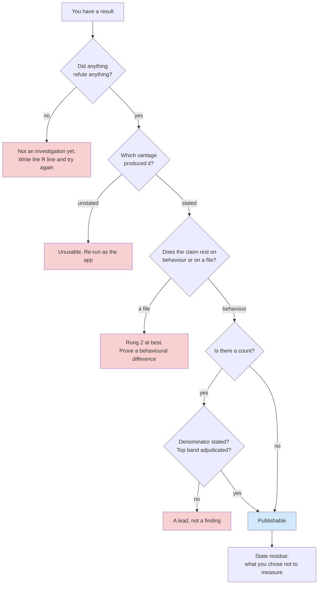

# 74 — Case Studies · Mind map

One map of the whole chapter. Narratives in [README.md](README.md), raw evidence in
[examples/reproduction-log.md](examples/reproduction-log.md).

```mermaid
mindmap
  root((74 Case Studies))
    What a case study IS
      the route not the answer
        reports are written backwards
        the route is the skill
        the route is what reports delete
      refuted hypotheses included
        zero refutations means a report
        reference journals sit near two thirds
      provenance stated
        transcript proves the ORDER
        composition proves only the events
        both legitimate, conflating them is not
      four fields per claim
        device model and API
        the exact command
        the vantage: root shell or app
        the date
    Boundaries
      72 owns breadth
        finding classes
        counts and rates
        severity distributions
      74 owns depth
        one story end to end
        a trail you can walk
      68 owns the method
        H P R E O V notation
        the evidence ladder
      70 owns discovery technique
      71 owns the framework
    Case A the property that lied
      green on a rooted phone
        TEE said Unverified
        deviceLocked false
        verifiedBootKey all zero
      orange on the kernel cmdline
        three fields forged
        digest and veritymode honest
        grade per signal not per device
      empty string on the AVD
        no androidboot key to derive from
        folk check PASSES
      re-run reproduced
        bootconfig is root only
        the app cannot cross-check itself
      fix allow-list green
    Case B patch changed nothing
      short circuit
        upstream guard returns first
        correct key alone also fails
      inlining
        the standalone copy is dead
        no bl to the patched function
      the truth table is the artefact
      objdump proves the FILE changed
    Case C compiler deleted it
      minus O2 leaks, minus O0 hides
        identical source
        higher optimisation more visible
      ciphertext GONE from rodata
      noinline honoured and useless
        constrains the inliner only
        IPCP and specialisation did it
        31 instructions became 4
      check for the ciphertext too
      if the optimiser can prove it, it stores it
    Case D cannot detect
      ENOENT and EACCES both false
      refusal at data adb, above the leaf
      zero discriminating power
        same answer installed or not
        only on rooted devices, the only ones that matter
      system xbin su
        visible to shell
        EACCES to the app
        not the su granting root
      0711 traverse not list
        path guessing beats listing
      report as non-functioning not bypassed
    Case E the wrong chair
      673 shell, 633 app, 1055 root
      published shell figure equals root
      DIVERGED cause not established
        do not edit another chapter
        publish the claim with evidence
      37 names differ, 0 the other way
        ro.debuggable invisible to app
        ro.secure invisible to app
        partition.system.verified invisible
        fails open silently
      prefer sets to counts
      drift is proportional and correlated
    Case F 1141 hits 0 findings
      exposed contains xposed
      arithmetic closes exactly
      vxp equals R8 class names
        worse on better protected apps
        never under 8 chars in a strong tier
      explain every hit or it is not evidence
    The correction moment
      independent source
        not a second reading
        one the attacker could not write
      the right proposition
      one rung down the ladder
      change the observer
      add a control you did not need
      the saving question
        what would I expect if I were wrong
    Evidence ladder
      0 someone said so
      1 a string is present
      2 code references it
      3 it executes
      4 output changes behaviour
      5 reproduced by someone else
      a claim inherits its WEAKEST rung
    Auditing a case study
      the tidy narrative
      the absent vantage
      the unlabelled composite
      the count with no denominator
    Vantage asymmetry
      run-as is runas_app not untrusted_app
      refusals generalise
      successes do not
    Verdicts
      REPRODUCED
      DIVERGED
        not a synonym for wrong
        rule out device vantage version command
      NOT RE-RUN
    Tooling
      vantage-diff.sh
      case-replay.sh
      claim-ledger.py
      examples fold.c
    Report language
      not bypassed, non-functioning
      not 58 apps, 58 matched 0 genuine
      severity is what leaked
      confidence orders the queue
      severity ranks importance
```

---

## The chapter as a decision procedure

Every red box is a state a published finding in the wild routinely sits in. The blue box is reachable
from any of them, and the path is always the same shape: name the vantage, prove the right
proposition, close the arithmetic, state what you did not do.
