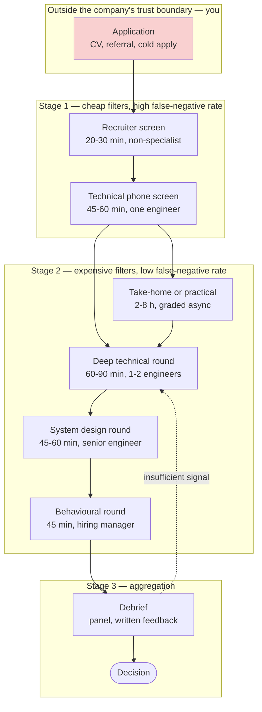
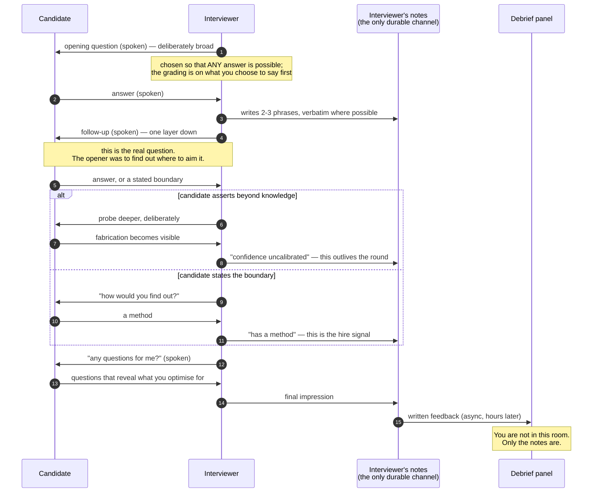
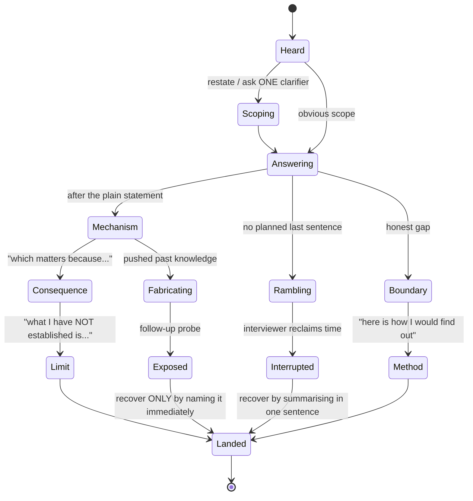
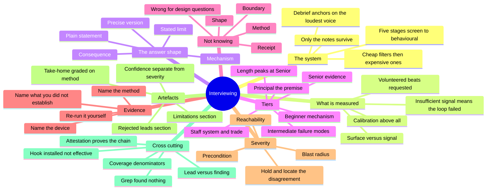

# 75 — Interview Questions

> After this chapter you will be able to explain what each stage of an Android security
> hiring process is actually measuring — which is almost never what the question literally
> asks — and to construct an answer in the shape that gets hired: analogy, plain definition,
> precise definition, mechanism, security consequence, honest limit. You will be able to say
> the same true thing at five escalating levels, to answer a question that belongs to no
> single topic, to defend a severity rating under pushback, and to say "I do not know"
> in the form that gains ground instead of losing it.

**Prerequisites:** none formally. This chapter is about *how* to answer, and its examples are
drawn from across the repository. It is most useful after you have read enough chapters to
have something to say — [00 Introduction](../00-Introduction/README.md) at minimum, and
ideally the stage you are interviewing for in the
[role tables](#316-the-curated-index-by-role-and-by-round).

**Applies to:** every Android security role this repository is written for. Nothing here is
version-gated to an API level, but several of the *answers* are, and the chapter is emphatic
about which.

---

## What this chapter is, and what it deliberately is not

**73 of this repository's 81 chapters are written, and every one of them already ends with a
five-tier interview section** — over 1,300 questions in total, measured rather than estimated
([§3.16](#316-the-curated-index-by-role-and-by-round) shows the count and the script that
produced it). The obvious version of chapter 75 is to concatenate them. That version would
be enormous, would duplicate content that is already better placed next to the mechanism it
tests, and would teach nothing that reading the chapters does not.

So this chapter contains **almost no new questions**. It contains the four things that no
individual chapter can contain:

| | What | Where |
|---|---|---|
| **1** | **The meta-layer** — how these processes are actually run, and what each stage measures as opposed to what it asks | [§2](#2-high-level-architecture), [§3.1](#31-the-five-stages-and-what-each-one-is-really-measuring)–[§3.2](#32-what-a-stage-measures-versus-what-it-asks) |
| **2** | **How to answer** — this repository's house style (*WHY before HOW*) is also the shape of a strong interview answer, and saying so explicitly is worth more than two hundred more questions | [§3.3](#33-the-answer-shape-and-why-it-is-this-repositorys-own-house-style) |
| **3** | **The tiering itself** — what separates a junior answer from a principal one **on the same question**. Each chapter covers one topic at five tiers; this one covers one tier across topics, and then escalates a single question through all five | [§3.4](#34-the-five-tiers-what-actually-escalates)–[§3.5](#35-one-question-escalated-through-all-five-tiers) |
| **4** | **Cross-cutting questions** — the ones spanning three or more chapters, which are therefore invisible in every per-chapter section, and which are what a senior candidate is actually asked | [§3.6](#36-cross-cutting-questions-the-ones-no-chapter-owns) |

Plus the thing that makes this repository unusually well placed to help: **a body of measured
results that contradict the received answer to common interview questions**
([§3.7](#37-the-measured-contradictions-and-how-to-use-them-without-being-insufferable)). A
candidate who can say *"the standard answer to that is wrong on a current device, and I have
measured it"* is in a different category — provided they can also say which device, which
method, and what they did **not** establish.

> **Warning — no real company's process appears here**
> Every stage, rubric and question in this chapter is described **generically**. Nothing is
> reproduced from any organisation's question bank, hiring guide, or NDA-covered material,
> and no real employer is named. If you are preparing for a specific company, the correct
> source is that company's own published guidance and your recruiter — not a leaked bank,
> which is both an integrity problem and, in practice, out of date.

---

## Table of Contents

- [1. Introduction](#1-introduction)
  - [1.1 What an interview is measuring, and why it is not what it asks](#11-what-an-interview-is-measuring-and-why-it-is-not-what-it-asks)
  - [1.2 The sampling problem](#12-the-sampling-problem)
  - [1.3 Why "I do not know" is a technical skill](#13-why-i-do-not-know-is-a-technical-skill)
  - [1.4 Who this chapter is for, including the interviewer](#14-who-this-chapter-is-for-including-the-interviewer)
- [2. High-Level Architecture](#2-high-level-architecture)
  - [2.1 The pipeline as a system](#21-the-pipeline-as-a-system)
  - [2.2 One round, end to end](#22-one-round-end-to-end)
  - [2.3 The state machine of a single answer](#23-the-state-machine-of-a-single-answer)
  - [2.4 Where candidates are actually lost](#24-where-candidates-are-actually-lost)
- [3. Deep Internal Working](#3-deep-internal-working)
  - [3.1 The five stages, and what each one is really measuring](#31-the-five-stages-and-what-each-one-is-really-measuring)
  - [3.2 What a stage measures versus what it asks](#32-what-a-stage-measures-versus-what-it-asks)
  - [3.3 The answer shape, and why it is this repository's own house style](#33-the-answer-shape-and-why-it-is-this-repositorys-own-house-style)
  - [3.4 The five tiers: what actually escalates](#34-the-five-tiers-what-actually-escalates)
  - [3.5 One question, escalated through all five tiers](#35-one-question-escalated-through-all-five-tiers)
  - [3.6 Cross-cutting questions: the ones no chapter owns](#36-cross-cutting-questions-the-ones-no-chapter-owns)
  - [3.7 The measured contradictions, and how to use them without being insufferable](#37-the-measured-contradictions-and-how-to-use-them-without-being-insufferable)
  - [3.8 Saying "I do not know" so that it gains ground](#38-saying-i-do-not-know-so-that-it-gains-ground)
  - [3.9 Time budgets, and the scoping failure that costs more than ignorance](#39-time-budgets-and-the-scoping-failure-that-costs-more-than-ignorance)
  - [3.10 Severity language, and defending a rating under pushback](#310-severity-language-and-defending-a-rating-under-pushback)
  - [3.11 The take-home: what is graded, and what is actually graded](#311-the-take-home-what-is-graded-and-what-is-actually-graded)
  - [3.12 The system-design round on mobile security](#312-the-system-design-round-on-mobile-security)
  - [3.13 The behavioural round is a technical round](#313-the-behavioural-round-is-a-technical-round)
  - [3.14 Red flags, from the interviewer's side of the table](#314-red-flags-from-the-interviewers-side-of-the-table)
  - [3.15 The questions you ask them](#315-the-questions-you-ask-them)
  - [3.16 The curated index, by role and by round](#316-the-curated-index-by-role-and-by-round)
- [4. Source Code Walkthrough (AOSP)](#4-source-code-walkthrough-aosp)
  - [4.1 The corpus this chapter is built from, and how it is parsed](#41-the-corpus-this-chapter-is-built-from-and-how-it-is-parsed)
  - [4.2 The AOSP files a strong answer can name](#42-the-aosp-files-a-strong-answer-can-name)
  - [4.3 One question traced to source](#43-one-question-traced-to-source)
- [5. Security Perspective](#5-security-perspective)
  - [5.1 What you may and may not say about past work](#51-what-you-may-and-may-not-say-about-past-work)
  - [5.2 The take-home that is unpaid work, or worse](#52-the-take-home-that-is-unpaid-work-or-worse)
  - [5.3 The disclosure question](#53-the-disclosure-question)
  - [5.4 Fabrication, and why it is caught](#54-fabrication-and-why-it-is-caught)
  - [5.5 OWASP MASVS as interview vocabulary](#55-owasp-masvs-as-interview-vocabulary)
- [6. Reverse Engineering Perspective](#6-reverse-engineering-perspective)
  - [6.1 Reading a job description as an artefact](#61-reading-a-job-description-as-an-artefact)
  - [6.2 Recognising which chapter a question came from](#62-recognising-which-chapter-a-question-came-from)
  - [6.3 What the follow-up question tells you](#63-what-the-follow-up-question-tells-you)
- [7. Dynamic Analysis](#7-dynamic-analysis)
  - [7.1 The live exercise: thinking aloud without narrating](#71-the-live-exercise-thinking-aloud-without-narrating)
  - [7.2 When the tool fails in front of them](#72-when-the-tool-fails-in-front-of-them)
  - [7.3 A live triage script that survives an audience](#73-a-live-triage-script-that-survives-an-audience)
- [8. Static Analysis](#8-static-analysis)
  - [8.1 The written artefact, and what graders mark](#81-the-written-artefact-and-what-graders-mark)
  - [8.2 A finding template that pre-empts the objections](#82-a-finding-template-that-pre-empts-the-objections)
  - [8.3 Linting your own answer](#83-linting-your-own-answer)
- [9. Examples](#9-examples)
- [10. Common Interview Questions](#10-common-interview-questions)
- [11. Common Mistakes](#11-common-mistakes)
- [12. Hands-on Labs](#12-hands-on-labs)
- [13. Summary](#13-summary)
- [14. References](#14-references)

---

## 1. Introduction

### 1.1 What an interview is measuring, and why it is not what it asks

Imagine you are hiring someone to service the brakes on your car. You cannot watch them work
for a year before deciding, and you cannot take the brakes apart yourself to check. So you
ask them questions, and from the answers you try to predict what they will do the thousand
times nobody is watching.

Now notice which questions are useful. "What is the torque specification for this caliper
bolt?" is nearly useless, because they can look it up in eleven seconds and you would want
them to. "What do you do when the bolt turns freely at half the specified torque?" is
enormously useful, because it asks what happens when the situation is not the one in the
book — which is the only situation where a mechanic's judgement is worth paying for.

Technical interviews are the same trade, and this is the single most important sentence in
this chapter: **the question is a probe, not the thing being measured.** The interviewer
asks "how do you detect root?" because it is a convenient, well-known, answerable question
whose answers happen to vary enormously in quality. They are not collecting your list of
`su` paths. They are collecting evidence about how you reason, what you consider evidence,
and what you do when the list runs out.

> **Definition — signal**
> In hiring, the **signal** of a question is the property of the candidate it lets the
> interviewer estimate. The **surface** of a question is what it literally asks. A
> well-designed question has a surface that is easy to answer at all and a signal that is
> hard to fake. A badly-designed question has a surface that is hard to answer and no signal
> at all — "what is the value of `FLAG_SECURE`?" is a trivia question with a signal of
> approximately zero, because the answer is `0x2000` and knowing it predicts nothing.

Once you internalise that, three things follow immediately, and they restructure how you
prepare:

**Memorising more facts has sharply diminishing returns.** Past a fairly low threshold, the
next hundred facts you memorise change your interview outcomes very little, because they
change the *surface* of your answers and not the *signal*. This is why strong engineers
sometimes interview badly and mediocre ones sometimes interview well.

**The same fact can be a weak or a strong answer.** "Root detection can be bypassed" is a
true statement that a beginner and a principal engineer will both make, and they will be
scored completely differently on it, because one is reciting a slogan and the other is using
it as a premise. [§3.4](#34-the-five-tiers-what-actually-escalates) is about that difference
and nothing else.

**The moments you cannot prepare for are the ones carrying the most signal.** The question
you cannot answer, the tool that breaks during the live exercise, the interviewer who
disagrees with your severity rating — these carry more information about you than anything
you rehearsed, precisely because you did not rehearse them. Sections
[3.8](#38-saying-i-do-not-know-so-that-it-gains-ground),
[7.2](#72-when-the-tool-fails-in-front-of-them) and
[3.10](#310-severity-language-and-defending-a-rating-under-pushback) are about performing
well in exactly those moments, which is a learnable skill and not a personality trait.

### 1.2 The sampling problem

Here is the interviewer's actual problem, stated honestly, because understanding their
constraint is the fastest route to being easy to hire.

They have between forty-five minutes and six hours. They need to predict your behaviour
across thousands of unsupervised decisions over several years. The ratio is absurd — they
are taking perhaps eight samples of your reasoning and extrapolating to a population of
thousands.

Everything strange about interviews follows from that ratio.

**Why they ask questions you would look up.** Because a question you would look up has a
*known* answer, which means the interviewer can grade the reasoning rather than the fact.
They are not testing recall; they are using a fact they can check as a fixed background
against which your reasoning becomes visible.

**Why one confident wrong answer costs so much.** With eight samples, one bad sample is
12.5% of the evidence. Worse, an *uncalibrated* answer is not one bad sample — it
retroactively degrades the other seven, because the interviewer now cannot tell which of
your confident statements to trust. This is precisely the reasoning this repository applies
to detectors: `64-Xposed` measured a signature producing **16 high-confidence hits of which
all 16 were false**, and the response was not to tune the signature but to distrust the
tier. An interviewer does the same to a candidate.

**Why "I do not know" is cheap and bluffing is expensive.** A stated gap is one sample that
says "does not know X" — narrow, bounded, and often irrelevant to the job. A bluff is a
sample that says "confidence is uncorrelated with correctness", which is unbounded and
relevant to every job.

> **Mental Model**
> Think of yourself as a detector the interviewer is calibrating. They feed you inputs whose
> ground truth they already know, and they are measuring your **false-positive rate** — how
> often you assert something confidently that is not so. This repository's standing rule is
> *"if a detector agrees with you about every sample, suspect the detector"*, measured
> independently three times ([`38`](../38-TamperDetection/README.md) at 18/18,
> [`52`](../52-StaticAnalysis/README.md) at 15 of 17 rejected,
> [`64`](../64-Xposed/README.md) at 16 of 16). A candidate with an answer to everything
> triggers exactly that suspicion.

### 1.3 Why "I do not know" is a technical skill

Most guidance on interviews treats admitting ignorance as damage control — the least bad
option when you are cornered. That framing is wrong, and it is wrong in a way that is
specific to security work.

Security is one of the few disciplines where **the boundary of your knowledge is part of the
finding**. A penetration test report that says "the application does not leak credentials"
is a different and much weaker document than one that says "we examined the four components
listed in the manifest and found no credential leak; we did not examine the two feature
splits, and dynamic coverage reached three of four components". The first is a claim about
the application. The second is a claim about the application *and* about the test, and only
the second is defensible.

That habit — stating the denominator — is the same habit as saying "I do not know the API
level, but here is how I would find out". A candidate who does it in an interview is
demonstrating the exact behaviour that makes their reports trustworthy. Interviewers who
have read a lot of reports recognise it instantly.

The measured version of this, from this repository:
[`52-StaticAnalysis`](../52-StaticAnalysis/README.md) and
[`51-DynamicAnalysis`](../51-DynamicAnalysis/README.md) between them recorded a session that
could be scored at **67% or 50% coverage of the same application** depending only on whether
the manifest or the device's resolver tables defined the total — and the flattering number
is the one that lets the device define it. A candidate who volunteers that distinction
unprompted has just told the interviewer more than any list of `su` paths could.

[`03-saying-i-do-not-know.md`](examples/03-saying-i-do-not-know.md) is six transcripts of
this going wrong and right; [§3.8](#38-saying-i-do-not-know-so-that-it-gains-ground) is the
mechanism.

### 1.4 Who this chapter is for, including the interviewer

Three audiences, and the material is the same for all three because it is one subject seen
from different sides.

**The candidate.** Read [§3.3](#33-the-answer-shape-and-why-it-is-this-repositorys-own-house-style)
first, then the tier you are targeting in
[§3.4](#34-the-five-tiers-what-actually-escalates), then run
[Lab 01](labs/lab-01-timed-mock-technical-round.md) before you read anything else. Doing the
lab before the reading is deliberate: it establishes what you actually do under time
pressure, which is different from what you believe you do.

**The interviewer.** [§3.2](#32-what-a-stage-measures-versus-what-it-asks) and
[§3.14](#314-red-flags-from-the-interviewers-side-of-the-table) are for you, and so is
[§11.2](#112-interviewer-mistakes). The single highest-value improvement available to
most interviewers is to write down what a question is *for* before asking it, and to discard
any question whose answer does not change the decision.

**The person building a team's process.** [§3.11](#311-the-take-home-what-is-graded-and-what-is-actually-graded)
and [§5.2](#52-the-take-home-that-is-unpaid-work-or-worse) are the ones with legal and
ethical edges. A take-home that hands a candidate a real client's application is not a
clever assessment; it is an unauthorised-testing problem with a hiring process attached.

> **Pentester's Note**
> This chapter is the only one in the repository whose subject is people rather than
> systems, and the temptation to write self-help is strong. The test applied throughout:
> **would this sentence survive being asked "how do you know?"** Where the answer is "I
> measured it", the measurement is cited. Where the answer is "this is a widely-held view
> among people who run these processes", it says so. Where it is neither, it has been cut.

---

## 2. High-Level Architecture

### 2.1 The pipeline as a system

A hiring process is a filter chain, and like any filter chain its behaviour is dominated by
the stage with the lowest throughput and the stage with the highest false-negative rate. It
is worth drawing, because the shape explains several things that feel arbitrary from inside
it.



Read it as a funnel with two very different halves.

**The first half is optimised for cost, not accuracy.** A recruiter screen costs the company
twenty minutes of a non-specialist's time and is applied to hundreds of people. It therefore
uses crude, cheap filters, and it has a **high false-negative rate by design** — it rejects
good candidates, and the company accepts that because the alternative is to spend engineer
hours on everyone. This is why a screen can go badly for reasons that have nothing to do
with your ability, and why the correct response to failing one is usually to fix the surface
(how you describe your work) rather than the substance.

**The second half is optimised for accuracy.** Once engineers are spending ninety minutes on
you, the company wants to be *right*, and the questions change character completely: from
"can this person plausibly do the job" to "what specifically can and cannot this person do".
This is where the tiering in [§3.4](#34-the-five-tiers-what-actually-escalates) starts
operating.

**The dotted feedback edge is real and worth understanding.** A debrief that produces
"insufficient signal" — nobody could tell whether the candidate is Senior or Staff — usually
produces an extra round rather than a rejection. Candidates read that as a bad sign. It is
not; it means you were interesting enough to spend more money on. But it does tell you
something specific: **your answers did not distinguish your level**, which is a solvable
problem and is exactly what [§3.4](#34-the-five-tiers-what-actually-escalates) solves.

### 2.2 One round, end to end

The single technical round is the unit everything else is built from. Here is what actually
happens inside one, with the transport of each exchange labelled the way this repository
labels a Binder trace — because the *channel* matters here too. What you say aloud, what you
type on a shared screen, and what the interviewer writes in their notes are three different
channels, and only one of them survives to the debrief.



Three structural facts fall out of that diagram, and each one changes how you should behave:

**The opener is not the question.** Broad openers — "tell me about Android's security model",
"how would you approach an APK" — exist to find out where you are strong so the interviewer
can aim the *real* question. It follows that the opener is the one place where you get to
choose the ground, and choosing well is worth more than answering thoroughly. A candidate who
answers a broad opener for six minutes has spent their advantage on it.

**Only the notes survive.** The interviewer's memory of you at debrief time is largely the
phrases they wrote down. This is the mechanical reason a **quotable sentence** outperforms an
exhaustively correct paragraph: "he said `File.exists` on `/system/xbin/su` returns false on a
rooted device because of directory mode, and he'd measured it" is a note. "He knew a lot about
root detection" is not, and it converts to nothing at debrief.

**The trap branch is entered on purpose.** When an interviewer probes deeper after an answer
you were not solid on, they are frequently not curious — they are checking whether you will
keep going. The branch is cheap for them and enormously informative.

### 2.3 The state machine of a single answer

Zooming in one more level, an answer is a small state machine, and most bad answers are
caused by taking a wrong transition rather than by being in a wrong state.



The two paths worth memorising are the ones that recover.

**From `Interrupted`:** the recovery is a single sentence that states your conclusion, offered
immediately and without apology. "Sorry — one sentence: the check is unreliable because it
cannot distinguish absent from forbidden." Candidates who instead apologise, restart, or trail
off convert a scoping problem into a composure problem.

**From `Exposed`:** the only recovery is to name it in the same breath. "Actually, I am
constructing that — I do not know it. What I do know is…" Interviewers forgive this readily,
because it converts an uncalibrated sample into a calibrated one, live. What they do not
forgive is a second layer of construction on top of the first.

Note also that the `Boundary → Method → Landed` path is **shorter** than the full
`Answering → Mechanism → Consequence → Limit` path and lands just as well. Not knowing is
cheap. This is the diagram form of [§1.3](#13-why-i-do-not-know-is-a-technical-skill).

### 2.4 Where candidates are actually lost

Ordered by how often each cause appears, in the collective experience of people who run these
processes. This is a qualitative ordering offered as such, not a measurement — this
repository's rule is that a number you did not measure does not get written down as one.

| Rank | Cause | The tell | Fix |
|---|---|---|---|
| 1 | **Scope** — answered for six minutes what was worth ninety seconds | The interviewer interrupts; the round covers three questions instead of eight | [§3.9](#39-time-budgets-and-the-scoping-failure-that-costs-more-than-ignorance), [Lab 01](labs/lab-01-timed-mock-technical-round.md) |
| 2 | **Calibration** — asserted past knowledge and got caught | A follow-up probe that goes quiet | [§3.8](#38-saying-i-do-not-know-so-that-it-gains-ground), [Lab 03](labs/lab-03-live-triage-and-honest-uncertainty.md) |
| 3 | **Altitude** — answered a Staff question at Intermediate level, or the reverse | "That is right, but I was asking about the trade-off" | [§3.4](#34-the-five-tiers-what-actually-escalates), [§3.5](#35-one-question-escalated-through-all-five-tiers) |
| 4 | **Severity** — could not defend a rating, or inflated everything | "Would you really rate that High?" and the candidate folds instantly | [§3.10](#310-severity-language-and-defending-a-rating-under-pushback) |
| 5 | **Tool-first** — every answer opens with a tool name | "…and if Frida is not available?" | [§3.3](#33-the-answer-shape-and-why-it-is-this-repositorys-own-house-style) |
| 6 | **Genuine knowledge gap** | Several unrelated boundaries in one round | Read the chapters. This is the one this repository's other 80 chapters address |

The ordering is the point. **The most common cause of failure is not the one candidates
prepare for.** Almost all preparation effort goes into rank 6, and ranks 1 to 5 are where
most of the losses are — and all five are *behaviours*, which means they are trainable in
hours rather than months.

---
## 3. Deep Internal Working

### 3.1 The five stages, and what each one is really measuring

Five stages appear, in some combination, in essentially every Android security hiring
process. Not every company runs all five, and the names vary, but the *functions* are stable
because they are driven by the sampling problem in [§1.2](#12-the-sampling-problem) rather
than by fashion.

For each stage below: **who runs it**, **what it asks**, **what it measures**, and **the
failure mode that is invisible from inside the room**.

---

#### Stage 1 — the recruiter screen

**Who runs it.** A recruiter or sourcer, almost never a security engineer. Twenty to thirty
minutes, usually the first contact.

**What it asks.** Your background, your interest in the role, your compensation
expectations, your availability, and — the part candidates underestimate — a request to
describe your work in plain language.

**What it measures.** Three things, none of them technical. Whether you are plausibly at the
level the role is scoped for. Whether the process is likely to end in an accepted offer
(which is why compensation comes up early; nobody wants to spend six hours on a candidate
who was never going to accept). And whether you can be understood by someone who is not a
specialist.

**The invisible failure mode.** *Not being describable.* The recruiter has to write two or
three sentences that will make an engineer agree to spend an hour on you. If your account of
your work is "I do mobile pentesting, mostly Android, some iOS", they have nothing to write.
If it is "I test Android banking apps — the last engagement was about whether their
biometric login actually protected anything, and it turned out it did not", they have
something that will get you the next round. Neither sentence is more technical. One is
*specific*.

> **Warning**
> This is the stage where NDA discipline first matters, and where candidates most often slip,
> because the register is casual and the question ("so what have you been working on?") is
> friendly. [§5.1](#51-what-you-may-and-may-not-say-about-past-work) is the rule set. The
> short version: describe the **class** of system and the **shape** of the finding, never the
> client, never enough detail to identify them, and never anything from a report that is
> still under embargo.

---

#### Stage 2 — the technical phone screen

**Who runs it.** One engineer, usually not the hiring manager. Forty-five to sixty minutes,
often with no shared screen.

**What it asks.** Ten to fifteen questions of increasing difficulty across a broad surface,
typically Beginner and Intermediate tier. Rapid fire. It sometimes feels like a quiz because
it is one.

**What it measures.** **Breadth, and the absence of holes.** The purpose of this stage is
cheap elimination, and the cheapest reliable elimination signal is a candidate who claims
five years of Android security work and cannot say what an APK contains. It is looking for
the *absence* of a specific kind of gap, not for the presence of depth.

**The invisible failure mode.** *Depth in the wrong place.* This is the stage where scoping
failure is most expensive: fifteen questions in sixty minutes is four minutes each, and a
candidate who spends twelve minutes on question two has guaranteed that six questions never
get asked. The interviewer's note reads "did not get through the material", which is
ambiguous at debrief and never in your favour.

The correct behaviour is counter-intuitive and worth stating explicitly: **answer briefly
and offer depth.** "Private storage, `/data/data/<package>`, protected by the app's UID —
happy to go into the failure modes if useful." You have demonstrated the depth exists without
spending the time, and you have handed the interviewer the choice, which is what they wanted.

---

#### Stage 3 — the take-home or practical exercise

**Who runs it.** Assigned asynchronously, graded by one or two engineers against a rubric.
Two to eight hours of your time; occasionally a live version in a shared session.

**What it asks.** Typically: here is an application, find and report what is wrong with it.
Sometimes: here is a scenario, design the control. Sometimes: here is a finding, write it up.

**What it measures.** This is the only stage that observes your *output artefact* rather than
your conversation, and it is graded on method far more than on findings. Specifically:
whether you state what you did and did not examine; whether your severities are defensible;
whether you distinguish a lead from a finding; whether the write-up would be usable by the
developer who has to fix it.

**The invisible failure mode.** *Finding-count optimisation.* Candidates submit twenty-two
findings, of which four are real, and are astonished to be rejected in favour of someone who
submitted five findings and a paragraph explaining which leads they had discarded and why.
The reason is direct: a grader who has to adjudicate eighteen false positives has learned
that hiring you means adjudicating false positives forever.

This repository has the numbers behind that instinct. `52-StaticAnalysis` swept a 17 MB
commercial application: **16,836 raw hits reduced to 168 leads**, and when the highest
confidence band was adjudicated by hand, **15 of 17 were rejected** — documentation links,
Compose preview fixtures, an XMP namespace, marketing URLs. The genuinely interesting finding
sat in the middle of the ranking. `33-Storage`'s leak hunter produced **132 high-confidence
hits against real browser data, all 132 false positives**. `64-Xposed` swept 237 APKs for a
keyword and got **1,141 occurrences, of which 1,141 were the substring inside the English
word "exposed" — zero unexplained, zero findings.**

> **Pentester's Note**
> Quoting one of those numbers in a take-home write-up — as the reason you discarded a
> confident-looking lead — is worth more than the lead would have been. It demonstrates that
> you know the base rate, and knowing the base rate is what separates a scanner operator from
> an analyst.

---

#### Stage 4 — the deep technical round

**Who runs it.** One or two senior engineers. Sixty to ninety minutes. Often a shared screen
or a whiteboard.

**What it asks.** Three to six questions, each pursued downward until you run out. That
downward pursuit is the entire design: the interviewer does not care where you start, they
care where you stop.

**What it measures.** **Depth, and the shape of your boundary.** Everyone has a floor. The
question is whether your floor is at "I know the API", "I know the mechanism", "I know the
source", or "I know why the source is the way it is" — and, critically, whether you can *tell
where your own floor is*.

**The invisible failure mode.** *Not noticing that you have been dropped a layer.* The
interviewer says "sure, and what does the platform do underneath that?" and the candidate
repeats their previous answer in different words. This reads as not understanding the
question, which is worse than not knowing the answer.

The tell is easy to train yourself on: **if the follow-up contains "underneath", "actually",
"mechanically", "how does it know", or "and then what", you have been dropped a layer.** If
you cannot go down, say so and describe the boundary — that is a landing, per
[§2.3](#23-the-state-machine-of-a-single-answer).

---

#### Stage 5 — the system-design and behavioural rounds

These are usually separate sessions, and they are the two most under-prepared stages in
security hiring.

**System design** ([§3.12](#312-the-system-design-round-on-mobile-security)) asks you to
build something: an authentication scheme, a device-integrity programme, a mobile security
review process. It measures whether you can reason about a system you cannot fully control,
which is the defining condition of mobile security — the client runs on the adversary's
hardware.

**Behavioural** ([§3.13](#313-the-behavioural-round-is-a-technical-round)) asks about
disagreement, failure, disclosure and pressure. In security these are not soft questions,
because the discipline's hardest problems are ones where the technical answer is clear and
the organisational path to it is not. "Tell me about a time you were wrong" is, in this
field, a question about your relationship with evidence.

### 3.2 What a stage measures versus what it asks

The single table this section exists for. If you read nothing else in
[§3](#3-deep-internal-working), read this.

| Stage | The literal question | What is actually being estimated | A strong answer therefore… |
|---|---|---|---|
| Recruiter screen | "Tell me about your background" | Can a non-specialist describe you to an engineer? | is specific and jargon-free, and names one concrete outcome |
| Phone screen | "Name five ways to detect root" | Do you have holes, and can you manage a clock? | gives five briefly, then offers depth rather than taking it |
| Phone screen | "What is in an APK?" | Have you actually opened one? | mentions something you only know from opening one — that `resources.arsc` is stored uncompressed, say |
| Take-home | "Find the vulnerabilities" | Will your reports need rewriting? | states the denominator, discards leads in writing, rates honestly |
| Deep technical | "How does Frida hook a Java method?" | Where is your floor? | descends until it stops, and then says "that is my floor" |
| Deep technical | "Why did that not work?" | Do you debug or do you guess? | names a hypothesis and how to test it, not a list of causes |
| System design | "Design device attestation" | Do you know what you cannot control? | starts by drawing the trust boundary, not by naming a technology |
| System design | "How would you stop rooted devices?" | Will you build the thing that was asked for even if it is wrong? | asks what the detection is *for* before designing it |
| Behavioural | "Tell me about a disagreement" | Do you escalate, capitulate, or persuade? | shows the evidence you gathered, and what would have changed your mind |
| Behavioural | "A time you were wrong" | Is your model of yourself accurate? | describes a *specific technical* error and its cost, not a humblebrag |
| Any stage | "Any questions for me?" | What do you optimise for? | asks something that only matters if you intend to do the job well |

> **Mental Model — the altitude of the question**
> [`20-Security-Architecture`](../20-Security-Architecture/README.md) uses the vocabulary of
> *altitude* for the layer at which a control operates, and
> [`67-BypassingProtections`](../67-BypassingProtections/README.md) maps its seams the same
> way. Borrow it here. Every question has an altitude — mechanism, system, or programme — and
> the most common non-obvious failure is answering at the wrong one. "How do you detect
> root?" asked by a senior engineer in a deep round is a mechanism question. The identical
> sentence asked by a hiring manager in a design round is a programme question, and a list of
> `su` paths is the wrong answer to it.

### 3.3 The answer shape, and why it is this repository's own house style

Here is the observation this chapter is most confident about, and it is not a coincidence.

[`STYLE-GUIDE.md`](../STYLE-GUIDE.md) specifies how every chapter in this repository
introduces a concept:

> analogy → plain definition → precise definition → internals → security consequence

and requires that every concept answer, in order: what problem existed before this; what
would break without it; what is it precisely; how does it work internally; how does it fail
and how is it attacked.

**That is also the shape of a strong interview answer.** Not approximately — exactly. The
reason is that both are solving the same problem: conveying understanding to someone who
must decide, quickly, how much of your model to trust, and who cannot read your mind.

Laid out as an answer template:

| Move | Duration | Purpose | Example fragment |
|---|---|---|---|
| **1. The plain statement** | 10–15 s | Give the listener somewhere to stand. Answers the literal question so they know you heard it | "Root detection is a set of checks an app runs to guess whether the device has been modified." |
| **2. The precise version** | 15–20 s | Show the model is real, not a slogan. This is where the vocabulary enters | "Concretely it is artefact checks — paths, packages, properties — and capability checks, which try to *do* something only root can do." |
| **3. The mechanism** | 30–60 s | The load-bearing move. Why does it work, at the level below the API? | "`File.exists()` is a `stat` under the hood, and `stat` returns `EACCES` when a parent directory is not traversable, which the Java API collapses into the same `false` as `ENOENT`." |
| **4. The consequence** | 15–30 s | Convert mechanism into security meaning. This is the move most candidates skip | "So on a rooted device, where `/system/xbin` is `0750 root:shell`, the check returns 'clean' — and that is the only kind of device where it could have mattered." |
| **5. The limit** | 10–15 s | State what you have not established. Cheap, and it calibrates everything above it | "That is measured on one Android 15 emulator from the shell. I have not checked it on a rooted retail phone, and the directory mode may differ." |

Ninety seconds to two and a half minutes, complete, with a planned last sentence.

Three properties make this shape hard to beat:

**It is interruptible.** If the interviewer stops you after move 2, they have a complete
answer. After move 3, they have a good one. Compare an answer that builds toward its point:
interrupted, it has said nothing. Since interviewers interrupt constantly — they are managing
a clock too — an answer that degrades gracefully is worth a lot.

**Each move invites the follow-up you want.** Move 3 invites "how do you know?", which is the
question you most want to be asked, because the answer is a measurement.

**It makes move 5 natural rather than defensive.** Bolted onto the end of an unstructured
answer, "but I'm not sure" sounds like retraction. As the designed final move, it sounds like
scope.

> **Warning — the tool-first opening**
> The commonest structural failure is opening at move 3 with a tool: *"I'd run Frida and hook
> the check."* [`STYLE-GUIDE.md`](../STYLE-GUIDE.md) rejects exactly this in prose — a chapter
> that opens with "To hook a method with Frida, run…" is wrong — and it fails in an interview
> for the same reason: it demonstrates a procedure without demonstrating that you know what
> the procedure is *for*. The follow-up is always some version of "and if that tool is not
> available?", and the candidate who opened with the tool rarely has an answer.
> [`../scripts/answer-shape-lint.py`](scripts/answer-shape-lint.py) detects this
> mechanically, because it is detectable mechanically.

### 3.4 The five tiers: what actually escalates

Every chapter's §10 uses the same five tiers. What none of them can show — because each
covers one topic — is what changes *between* tiers on a single question. That is this
section.

The wrong model, which almost every candidate holds: higher tiers mean more detail. It is
wrong in a way that actively harms people, because it produces Staff-tier answers that are
Intermediate answers with more words, and interviewers score those as Intermediate.

The right model:

| Tier | The answer is about | The question it silently answers | Length trend |
|---|---|---|---|
| **Beginner** | the mechanism | "What is it?" | short |
| **Intermediate** | the mechanism's failure modes | "When does it not work?" | longer |
| **Senior** | the evidence, and what it is evidence *for* | "How do you know, and what would change your mind?" | longest |
| **Staff Engineer** | the system it sits in, and the trade | "Should we build this at all, and what does it cost?" | shorter again |
| **Principal Engineer** | whether the question was the right question | "What are we actually trying to achieve?" | shortest |

**Length peaks at Senior and falls.** That surprises people. A Staff answer is shorter
because it has *stopped enumerating*: it does not need to list the detection signals, it
needs to price the programme. A Principal answer is shorter still because it is usually a
reframe plus a decision. A candidate who has learned "more senior means say more" will
overshoot at exactly the point where restraint is the signal.

The transitions, stated as the one thing that changes at each step:

**Beginner → Intermediate: from "how it works" to "how it breaks."** You stop describing the
happy path. The `su`-path check is not just "a check"; it is a check with a specific
structural inability to distinguish absent from forbidden.

**Intermediate → Senior: from facts to evidence.** You stop asserting and start citing —
which device, which method, which vantage, and what you did not establish. This is the
biggest single jump in the ladder and the one this repository is best at teaching, because
every chapter models it.

**Senior → Staff: from the finding to the system.** You stop optimising the answer and start
optimising the *decision*. Who owns this, what does it cost per year, what does it displace,
what happens when it decays, who is on call for the false positives.

**Staff → Principal: from the system to the question.** You interrogate the premise. Is
device integrity the goal, or is the goal transaction legitimacy with device integrity as one
weak input? A Principal answer is often a polite refusal to answer as asked — followed,
always, by answering as asked anyway, because a refusal without an answer is a dodge.

> **Under the Hood — why interviewers can tell**
> Level is estimated far more from **what you volunteer unprompted** than from what you can
> produce on request. A Senior candidate volunteers provenance without being asked. A Staff
> candidate volunteers the cost. A Principal candidate volunteers the premise. Anyone can
> produce any of these when asked directly — which is why the questions are open-ended, and
> why "what would you want to know before answering?" is such a common opener.

### 3.5 One question, escalated through all five tiers

The full worked version of this — three questions, five tiers each — is
[`examples/01-one-question-five-tiers.md`](examples/01-one-question-five-tiers.md). Here is a
compressed one, on a question that has appeared in every mobile security process any of us
have seen.

> **Q. Is it a finding if an application stores its session token in `SharedPreferences`?**

**Beginner.** `SharedPreferences` writes an XML file inside the app's private directory,
`/data/data/<package>/shared_prefs/`. That directory is owned by the app's own Linux UID, so
other apps cannot read it. Storing a token there is normal. It would be a problem on external
storage, or in a log.

*Correct, and it is a description of the mechanism.*

**Intermediate.** Same, plus the failure modes. UID protection stops another installed app;
it does not stop root, it does not stop a backup if `allowBackup` is on, and it does not stop
`run-as` on a debuggable build. So whether it is a finding depends on those three, and on
whether the token expires. Also worth knowing: deleting the row is not deleting the data — a
logout that deleted two rows left all four secrets readable in a 61 KB SQLite write-ahead
log while SQL reported them gone.

*Now the answer is about when the mechanism does not hold.*

**Senior.** No — not on its own, and I would push back on a report that said otherwise.
That is how essentially every Android application works, and on a stock, locked device it is
the intended mechanism. It becomes a finding when something makes it *reachable*: a
debuggable build, backup enabled, a world-readable path, an exported component that emits it,
or a token with no server-side expiry. I would name which. And I would want to say what I had
not established — whether the app's Keystore usage is genuinely hardware-backed is something
I would verify with a key attestation rather than infer from the API, because I have seen
`ro.boot.verifiedbootstate` read `green` on a device whose own TEE-signed attestation said
`Unverified` in the same session. The property is attacker-controllable; the attestation is
not. The reason I care about the distinction is that a report full of unconditional
"sensitive data in SharedPreferences" findings trains the client to skim, and then they skim
past the one that mattered.

*The answer is now about evidence, reachability, and the cost of getting severity wrong.*

**Staff.** The storage question is downstream of a design decision, which is that the client
holds a long-lived bearer credential. That is the decision that matters. If access tokens
are short-lived and the refresh token is bound to a non-exportable device key with
proof-of-possession, the storage question becomes almost uninteresting — and "the security
question became uninteresting" is what a good design looks like. Organisationally I would
want one component that issues, stores, refreshes and clears credentials, because the
failures I actually see are not cryptographic: a second code path added in a hurry, a crash
reporter capturing a breadcrumb, a WebView inheriting the token into a cookie jar with a
different lifetime. And I would want a build-time check that fails when a token appears in a
log or a backup, because a convention not enforced by a machine decays at the rate the team
grows.

*The answer is now about the system and its running costs.*

**Principal.** A bearer token is a design debt, not a storage problem. By construction it
works for whoever holds it, so every control we then build — encryption at rest, root
detection, obfuscation — is an attempt to make a thing that works for anyone work for exactly
one person, on hardware we do not control. That has an asymptote and the asymptote is not
zero. The alternative is to make possession insufficient, which is a protocol decision. I
would not pretend the migration is cheap: binding credentials to device keys breaks device
migration, interacts badly with multi-device usage, and puts a hardware dependency on the
login path across a device population whose Keystore quality varies more than the marketing
suggests — on some devices the "hardware-backed" key is software. So: bind refresh, not
access; fall back to unbound refresh with a shorter lifetime and a higher risk score rather
than locking users out; and instrument the fallback rate, because if it is 30% the design is
not what you think it is.

*The answer is now about whether the original question was the right one — and it still
answers the original question.*

Notice what did **not** happen. No tier introduced a fact the previous tier got wrong. The
Beginner answer is not incorrect; it is *complete for its altitude*. Seniority here is not
accumulated trivia. It is a widening of what the answer is about.

### 3.6 Cross-cutting questions: the ones no chapter owns

These are the highest-value questions in the whole repository and they appear in none of the
71 per-chapter sections, because each spans three or more chapters and no chapter can claim
it. They are also, for exactly that reason, disproportionately what senior candidates get
asked.

Each entry below gives the question, the chapters it spans, and an **answer skeleton** — the
load-bearing moves, not a script.

---

**Q1. Static analysis says the app has four components. Dynamic analysis exercised three. What
is your coverage?**
*Spans [10](../10-APK-Internals/README.md), [32](../32-Manifest/README.md),
[51](../51-DynamicAnalysis/README.md), [52](../52-StaticAnalysis/README.md),
[29](../29-BroadcastReceivers/README.md).*

Skeleton: the question has no single answer, and saying so *is* the answer. 3/4 is 75% if the
manifest defines the denominator; measured against the device's resolver tables the same
session scored 67% or 50%, and the flattering number is the one that lets the device define
the total. Then the deeper point: neither denominator is right, because most of the receiver
surface never appears in a manifest at all — parsing the live registration table and
subtracting manifest-declared receivers gave **299 of 431 distinct actions (69%) with zero
manifest-declared receivers anywhere on the device**, and a second measurement on a different
device at a different API level found 67%. So any APK-based coverage number is an upper bound
on a subset. Close with the operational consequence: report coverage as a fraction *with its
denominator named*, and never as a percentage alone.

---

**Q2. You grepped the decompiled output and found nothing. What have you established?**
*Spans [40](../40-Obfuscation/README.md), [47](../47-Authentication/README.md),
[52](../52-StaticAnalysis/README.md), [56](../56-JADX/README.md),
[64](../64-Xposed/README.md).*

Skeleton: that your grep found nothing. Then four distinct mechanisms by which a true
positive is invisible to a string search, each with a measurement:

1. **The identifier is never in the artefact.** `FLAG_SECURE` is a `public static final int`,
   so javac constant-folds it and only `0x2000` reaches the DEX. A string grep for
   `FLAG_SECURE` has a **true-positive rate of exactly zero**, and a first-pass tool that
   reported "3 of 17 apps use `FLAG_SECURE`" was matching apps that *mention the name* for
   another reason.
2. **The decompiler refused the method.** jadx reported `finished with errors, count: 61` on
   a real 17.5 MB app whose output tree contained **2,104 refused methods across 1,424
   files** — under-reporting by a factor of thirty.
3. **The code is not in the artefact you searched.** Splits, dynamically loaded DEX, native
   libraries. One large app showed zero controls in `base.apk` because its code ships in
   splits.
4. **The search could not read the container.** A device-side `grep` over `.apk` files is
   blind to compressed entries: measured **234 `classes*.dex` STORED versus 16 DEFLATED**,
   with all 16 in `/data/app` and ten of them one browser's — so the shortcut silently skips
   the largest third-party app present.

Land it: a negative result needs its method stated, or it is not a result.

---

**Q3. Your Frida hook installed successfully and the app's behaviour did not change. Why?**
*Spans [13](../13-ART/README.md), [53](../53-Frida/README.md), [65](../65-Hooking/README.md),
[54](../54-Objection/README.md), [67](../67-BypassingProtections/README.md).*

Skeleton: "installed" and "effective" are different claims, and the gap between them has at
least five causes. The method was **inlined** by the optimising compiler so no call site
remains — with plain `-O2`, a licence-check function remained exported while **zero `bl`
instructions targeted it**; the hook installs, verifies, and does nothing. The class came from
a **different ClassLoader** than `Java.use` searched. You hooked the **interface** and the app
calls the implementation. The check runs in **native code** or in `JNI_OnLoad`, before any
Java hook is installed. Or the hook is in the right place and the *verdict* is consumed
somewhere else. Diagnosis order: force interpretation with `cmd package compile -m verify -f
<pkg>` and retry — that eliminates the first cause, which is the most common — then enumerate
class loaders, then check for native code.

The senior extension: this is why a tool reporting success is not evidence of effect.
`objection`'s `android sslpinning disable` reported **three successful hooks against an app
with no network code at all**, because the hooks target platform classes rather than the app.
A "bypass succeeded" message means a hook installed.

---

**Q4. What does a valid key-attestation chain prove?**
*Spans [34](../34-Cryptography/README.md), [49](../49-KeyStore/README.md),
[50](../50-HardwareBackedSecurity/README.md), [20](../20-Security-Architecture/README.md).*

Skeleton: it proves the chain. On an emulator, **every key is `SOFTWARE`, the
hardware-enforced authorisation list is empty, and the chain still verifies perfectly.** So a
server that verifies the signature and stops has bought a signature. What it must additionally
do is read the security level and the root-of-trust **out of the hardware-enforced list**, not
the software-enforced one — an attacker supplies the latter. Then the contrast that makes the
whole thing worth doing: on a rooted phone `ro.boot.verifiedbootstate` read `green` while a
TEE-signed attestation pulled seconds later reported `verifiedBootState=Unverified`,
`deviceLocked=false` and an all-zero `verifiedBootKey`. **The property lies; the hardware does
not.** That single comparison is the entire argument for attestation, and it is a measurement
rather than an assertion.

---

**Q5. An app performs root detection, emulator detection, debugger detection and integrity
checking. Rate the protection.**
*Spans [37](../37-RootDetection/README.md), [38](../38-TamperDetection/README.md),
[39](../39-EmulatorDetection/README.md), [67](../67-BypassingProtections/README.md),
[20](../20-Security-Architecture/README.md).*

Skeleton: refuse to rate the list; rate the **shape**. Four families of check that collapse
into one boolean is one hook, and the fourth family bought nothing —
[`67`](../67-BypassingProtections/README.md) calls that the *verdict seam* and it is the
cheapest place in the pipeline to intervene. Then rate the individual checks on whether they
can fire from an app's vantage at all, which several published ones cannot
([§3.7](#37-the-measured-contradictions-and-how-to-use-them-without-being-insufferable)).
Then: does anything leave the device? A score with provenance evaluated server-side raises the
attacker's cost substantially, because the decision is made where they cannot reach it.
Finally the honest rating: as a security control, Low — it is friction with a price. As
anti-fraud friction it may be worth a great deal, and dismissing that as theatre is lazy. The
grading question is *who owns the false positives*.

---

**Q6. The app is obfuscated. How much harder is your job?**
*Spans [40](../40-Obfuscation/README.md), [41](../41-ProGuard/README.md),
[42](../42-R8/README.md), [56](../56-JADX/README.md), [68](../68-ReverseEngineering/README.md).*

Skeleton: less than the marketing suggests, and in one respect it makes *automated* analysis
worse rather than better — which is the interesting half. Renaming does not remove the
platform API calls, so the call graph into `android.*` survives intact and that is where the
security-relevant behaviour lives. Kotlin **property names** survive R8 structurally, because
R8 renames JVM members and a property is not one. What obfuscation genuinely costs you is
*orientation*, and the counter is to anchor on things that cannot be renamed: platform calls,
strings that must survive to be compared, resource identifiers, native symbol names.

Then the counter-intuitive measurement: **short signatures false-positive more on
better-protected apps.** A three-character detection token produced **16 high-confidence hits,
all 16 R8-generated class names** — `Lvxp;`, `Lavxp;` — in alphabetical runs of minified
identifiers. The more aggressively minified the app, the more short lowercase identifiers
exist, so the population you most care about is the one most likely to false-positive. Rule
adopted in this repository: never put a token shorter than about eight characters in a
high-confidence tier.

---

**Q7. Is this device a good testbed for what I am about to claim?**
*Spans [39](../39-EmulatorDetection/README.md), [44](../44-NetworkSecurityConfig/README.md),
[35](../35-SSL/README.md), [61](../61-Fastboot/README.md), [60](../60-ADB/README.md).*

Skeleton: almost the most useful question in practical mobile security, and one very few
candidates raise unprompted. Establish device posture *before* the test, not after. Three
concrete traps, all measured:

- **A modified system CA store invalidates every trust-store conclusion.** On one device
  `/system/etc/security/cacerts` had been replaced by a tmpfs with an interception CA
  bind-mounted in. A successful intercept there does **not** prove the app trusts user CAs,
  because the proxy CA is in the *system* store. Measuring the default trust anchors returned
  **139 at every `targetSdk` tried — 23, 24, 28, 30 and 34** — which looks like proof the API
  24 user-CA rule does not exist. It does. The CA is not a user CA any more. Check
  with `mount | grep cacerts` first.
- **The emulator is a fine Android and not a device.** It has no bootloader:
  `adb reboot bootloader` returns 0, reboots, and comes back as `device` in about 40 seconds
  while `fastboot devices` never sees it. There is no `misc`, `boot` or `recovery` partition.
  Nothing about fastboot can be learned there.
- **The shell is not the app.** Covered in the next section, and it is the one that
  invalidates results most silently.

---

**Q8. How do you know your tool did what it said?**
*Spans [51](../51-DynamicAnalysis/README.md), [54](../54-Objection/README.md),
[55](../55-MobSF/README.md), [56](../56-JADX/README.md), [70](../70-VulnerabilityResearch/README.md).*

Skeleton: you check the artefact, not the summary. Four measured instances: jadx's console
error count under-reported refused methods by **thirty times**; `objection android root
disable` is three hooks and thirteen hard-coded paths with a **measured coverage of one check
in five**, leaving nine of twelve catalogued root-detection families untouched; a fuzzing
campaign graded on exit codes reported a clean run against a real heap overflow, because
**two of the defect's three presentations exit 0** and one is completely silent; and a dynamic
session in which every capture channel went quiet produced a report identical to a
well-behaved app doing nothing wrong — the `am start` had been absorbed by a permission
dialog. Land it with the rule: **every automated run needs a liveness check before its silence
means anything.**

---

**Q9. What is the difference between a lead and a finding?**
*Spans [52](../52-StaticAnalysis/README.md), [33](../33-Storage/README.md),
[36](../36-CertificatePinning/README.md), [64](../64-Xposed/README.md),
[71](../71-OWASP-Mobile/README.md).*

Skeleton: a lead is something worth spending twenty minutes on. A finding is something you can
defend in a room with the developer who wrote it. The conversion rate is brutal and this
repository has published it four separate times: 16,836 hits → 168 leads → 2 of 17 surviving
in the top band; 132 high-confidence hits, 132 false positives; 12 of 14 apps with a pinning
surface but only 4 actually pinning; and 1,141 keyword occurrences, all 1,141 explained by an
English word, **zero findings**. Then the discipline that closes it: *explain every hit, or
the signature is not evidence.* The 1,141 case is the strongest version, because the
arithmetic closed exactly.

---

**Q10. You have found something the client will not want to hear. Walk me through the next
hour.**
*Spans [71](../71-OWASP-Mobile/README.md), [70](../70-VulnerabilityResearch/README.md),
[52](../52-StaticAnalysis/README.md), [80](../80-Appendix/README.md).*

Skeleton: this is a behavioural question wearing a technical costume, and it is graded on
sequence. Reproduce it independently before telling anyone — including checking the vantage
you used, since a shell-only reproduction is not a reproduction. Write the exploitation
preconditions down honestly, because that is what the argument will be about. Rate it before
the conversation, not during, so that the rating is not a negotiation. Then notify by the
agreed channel, and if the impact is severe enough to warrant it, say so explicitly rather
than burying it in the report. Where a candidate distinguishes themselves is on the last
step: what would change your rating? Naming that in advance is what makes you persuadable
without being movable.

> **Pentester's Note**
> All ten questions have a common structure: **a claim, and the method that would justify
> it.** That is not an accident of selection. It is what senior interviews are about, and it
> is why this repository — which insists on measurement over folklore in every chapter — is
> unusually good preparation for them.

### 3.7 The measured contradictions, and how to use them without being insufferable

This repository contains a body of measurements that **contradict the standard answer** to
questions that get asked constantly. Deployed well, one of them changes how the rest of the
interview goes. Deployed badly, you sound like someone correcting the interviewer for sport.

The table first, then the technique. **Every row is verified against the chapter that owns
it**, and the rows marked Yes were additionally re-measured on the AVD
`sdk_gphone16k_x86_64` (Android 15 / API 35) while this chapter was written, using
[`examples/04-evidence-behind-the-answer.sh`](examples/04-evidence-behind-the-answer.sh).

| The question | The received answer | What measurement showed | Owner | Re-run |
|---|---|---|---|---|
| "How do you detect an emulator?" | `Build.FINGERPRINT.startsWith("generic")`, `Build.MODEL.contains("Emulator")`, `/dev/qemu_pipe` exists | **All three false on a stock current AVD.** Fingerprint is `google/sdk_gphone16k_x86_64/emu64xa16k:15/…:userdebug/dev-keys`; `/dev/qemu_pipe` is `ENOENT` and the node is `/dev/goldfish_pipe_dprctd`. The most-copied `isEmulator()` on the internet returns `false` | [39](../39-EmulatorDetection/README.md) | Yes |
| "A property with `qemu` in the name means emulator" | surely true | **Inverted.** A retail Xiaomi sets `qemu.hw.mainkeys` and `ro.kernel.qemu.gles`; the AVD sets neither. The heuristic calls the phone an emulator and the emulator a phone. (`ro.kernel.qemu` itself does still read `1`, so be precise about *which* property) | [39](../39-EmulatorDetection/README.md) | Yes |
| "Emulators are slower, so time a loop" | surely true | **Inverted by 1.47×.** Identical C, same NDK, same app uid: **2.398 ns/iter on the AVD against 3.516 on the phone.** Modern AVDs virtualise on the host CPU | [39](../39-EmulatorDetection/README.md) | — |
| "How do you detect root? Check `/system/xbin/su`" | a file existence check | On a rooted API 35 AVD the file **is** there, setuid root — and `/system/xbin` is `0750 root:shell`, so an app gets `EACCES` and `File.exists()` returns `false`. **And that binary is not what grants root**: Magisk is, from `/debug_ramdisk` | [37](../37-RootDetection/README.md), [59](../59-radare2/README.md), [63](../63-LSPosed/README.md) | Yes |
| "Is biometric authentication secure?" | a `BiometricPrompt` success callback means the user authenticated | The callback proves nothing on its own. `dumpsys fingerprint` separates `accept` from `acceptCrypto`; a measured device read **`accept: 3`, `acceptCrypto: 0`**. And a 24-hour auth-bound key encrypted with **no authentication at all**, while a 30-second key opened because an *unrelated process* performed a credential check | [48](../48-Biometrics/README.md) | — |
| "How do you find `FLAG_SECURE` usage?" | grep the decompiled output | **True-positive rate of zero.** javac constant-folds `0x2000`; the identifier never reaches the class file or the DEX. Hook `Window.setFlags` instead | [47](../47-Authentication/README.md) | — |
| "Does a valid attestation chain prove hardware backing?" | yes, that is what it is for | **No.** On an emulator every key is `SOFTWARE`, `hardwareEnforced` is empty, **and the chain still verifies perfectly** | [50](../50-HardwareBackedSecurity/README.md), [49](../49-KeyStore/README.md) | — |
| "How do you know there are no hardcoded secrets?" | "I grepped and found nothing" | That is a statement about your grep. Four independent mechanisms make a true positive invisible ([Q2 above](#36-cross-cutting-questions-the-ones-no-chapter-owns)) | [56](../56-JADX/README.md), [52](../52-StaticAnalysis/README.md) | — |
| "What does `fastboot --disable-verity` do?" | turns verity off | Changes **one byte** — the AVB flags field at offset 120..124 — **inside the region AVB hashes**, so it breaks the image's own signature. It is a corruption an unlocked bootloader tolerates, not a supported option. Recomputing `sha256(header[0:256] ‖ aux)` after the change gave `3695fea8…` against a stored `93dfae21…` | [61](../61-Fastboot/README.md) | — |
| "The sweep found 1,141 hits" | 58 of 237 apps reference Xposed | **All 1,141 occurrences are the substring inside "exposed" / "Exposed". Zero unexplained. Zero findings** | [64](../64-Xposed/README.md) | — |
| "Is `TracerPid` how you detect a debugger?" | yes, it is *the* check | It detects `ptrace` attachment, not a Java debugger. `jdb` was attached, threads enumerated, and `TracerPid` read **0** throughout | [38](../38-TamperDetection/README.md) | — |
| "Verify the app has not been repackaged with a DEX CRC check" | sound approach | Re-signing with a different key changed the signature digest while `classes.dex` CRC stayed **identical**, because nothing in the code changed. DEX-integrity checks do not detect re-signing, which is the tampering that matters | [38](../38-TamperDetection/README.md) | — |

> **Warning — the vantage caveat belongs with every one of these**
> Most of the rows above were measured from `adb shell`, and **the shell is not an app.** This
> is the repository's most-repeated finding, hit independently by several chapters from
> several directions. Prove reachability **from an app** — `run-as`, a probe APK, or Frida
> in-process — or label the result as a shell measurement and say so.

#### 3.7.1 The number I nearly quoted, and why it was wrong

This deserves its own subsection, because it is the best worked example in the chapter of the
thing the chapter is about.

For a long time this repository published, and several chapters repeated, the figure
**"`shell` sees 1,053 properties and `untrusted_app` sees 634"** on the API 35 AVD. It is a
quotable statistic. It sounds authoritative. It is the kind of number a candidate deploys to
show they have measured something.

It was wrong, and it was wrong in the most instructive possible way: **the "shell" figure was
actually a `root` measurement**, taken with `adb root` in effect or through `su`.

Three things caught it, in this order:

1. **A re-measurement that did not reproduce.** While writing this chapter I counted
   `getprop` output on the same AVD and got **671** from `adb shell` and **1,058** as
   `su 0` — the published root figure, not the published shell one.
2. **A second chapter failing to reproduce it independently**, and — the part worth
   copying — **changing nothing in chapter 39.** It reported its own numbers and the exact
   command it ran, filed the discrepancy as unresolved, and left adjudication to the
   chapter's owner. *"I could not reproduce your result; here is exactly what I ran"* is a
   strong senior-tier behaviour, and it is a better move than either silently overwriting
   someone else's measurement or silently accepting it.
3. **The tell that was visible in the original table the whole time.** It listed `root` at
   **1050** and `shell` at **1053**. Two domains cannot see effectively the same property set
   when one is subject to `boottime_prop` and the other is not. The internal inconsistency was
   published alongside the claim and nobody read the two rows against each other.

The corrected figures, from three stable independent runs:

| | root | `shell` | app |
|---|---:|---:|---:|
| All properties | ~1,062 | ~678 | ~638 |
| `ro.boottime.*` | **111** | **0** | **0** |
| `init.svc.*` naming qemu / goldfish / ranchu | — | **36** | **35** |

Confirmed from this chapter, on the same AVD, in a fourth run using a different method
(`getprop` line counting rather than `__system_property_foreach`):

```
# adb shell — 2026-08-16
$ getprop | grep -c '^\['                          -> 675     (shell)
$ su 0 sh -c "getprop | grep -c '^\['"             -> 1059    (root)
$ getprop | grep -c ro.boottime                    -> 0       (shell)
$ su 0 sh -c 'getprop | grep -c ro.boottime'       -> 111     (root)
```

The `ro.boottime.*` row is the one to remember, and it reproduced **exactly**: 111 to root and
**zero** to the shell. A different counting method agreeing to within a few properties on the
totals, and exactly on the discriminating family, is what turns a corrected figure into a
settled one.

**The corrected answer is more useful than the one it replaces, and it changes the
conclusion.** The shell-to-app gap is roughly **40 properties, not roughly 419**. So:

- A shell test is a **decent proxy for app reachability** on the property store, and a
  **terrible proxy for root**. The expensive mistake is not "I tested from the shell" — it is
  *"I tested from root and called it shell"*, which is precisely the mistake that produced the
  original figure.
- The one place the gap is total is `ro.boottime.*`: **111 properties to root, zero to shell
  and zero to an app.** That family carries type `boottime_prop`, and it is exactly the family
  that looks like an ideal emulator signal from a privileged prompt and is unreachable by the
  application that would have to use it.
- And for emulator detection specifically, an app sees **35** of the relevant `init.svc.*`
  signals against the shell's **36**. Nearly identical — so **the most quotable statistic was
  also the least relevant one to the question it was being used to answer.**

> **Pentester's Note — the interview lesson, which is the whole chapter in one paragraph**
> A candidate who says *"the shell sees about 1,053 properties and an app 634"* sounds like
> someone who has measured. They are repeating a number **nobody re-ran**, and that is far more
> common in interviews than not knowing. The strong answer is not the memorised figure. It is:
> *"the numbers I remember are shell-versus-app, but I'd want to re-check whether that
> measurement was taken with root in effect, because those two are easy to confuse and the
> difference changes the conclusion."* That sentence costs nothing, is correct whichever way
> the re-check goes, and is exactly the calibration
> [§10, Principal tier](#10-common-interview-questions) argues is the most defensible thing an
> interview can measure.

**The technique for deploying one of these.** Three rules, and the third is the one people
get wrong.

1. **Answer the question first.** Give the standard answer, briefly and without irony, so the
   interviewer knows you know it. Then: "though when I measured it…". A correction that
   arrives before the answer reads as a dodge.
2. **Name the device and the method.** "On a stock Android 15 emulator, from the shell" is
   the difference between a measurement and a boast. It also pre-empts the obvious objection,
   which is that your result is device-specific — it is, and saying so first is strictly
   better than being told.
3. **Say what it does *not* establish.** The emulator-timing result does not mean timing
   checks are useless; it means one particular calibration is backwards. Overclaiming a
   contradiction is worse than not raising it, because it converts a calibration signal into
   an anti-calibration one.

One contradiction per interview is plenty. Two is a conversation. Three is a personality.

> **Mental Model**
> The reason these land is not that you know something obscure. It is that each one is
> evidence you have **run the check yourself rather than repeating it**, and that is the
> single property interviewers are least able to assess by any other means. It is the whole
> reason [`04-evidence-behind-the-answer.sh`](examples/04-evidence-behind-the-answer.sh)
> exists and takes twenty seconds: run it on your own device the morning of the interview and
> quote today's output, not this chapter's.

### 3.8 Saying "I do not know" so that it gains ground

Six transcripts of this, at length, are in
[`examples/03-saying-i-do-not-know.md`](examples/03-saying-i-do-not-know.md). Here is the
mechanism.

There are exactly six responses available when you reach a question you cannot answer. Five
of them lose ground and four of those five feel safe in the moment, which is why this needs
rehearsing rather than merely reading.

| Response | What it sounds like | What the interviewer records | Verdict |
|---|---|---|---|
| **Bluff** | a confident, plausible, wrong answer | "confidence uncalibrated" — and it retroactively discounts everything else you said | worst available |
| **Retreat** | "I don't know." (full stop) | "honest, no method" — a wasted minute of signal | honest, weak |
| **Deflect** | "that's more of a platform thing; shall I talk about X instead?" | "steering to prepared material" | recognisable, and recognised |
| **Over-hedge** | "maybe, possibly, I'm not sure, could be either…" | nothing — the correct answer is in there, unrecoverable | self-cancelling |
| **The four-part answer** | boundary, shape, method, receipt | "has a method" | strong |
| **The reframe** | "the location is the less load-bearing half; here is what decides the outcome" | "reframed correctly, and still answered" | strongest, and riskiest |

The four-part answer takes about twenty seconds:

| Part | Wording pattern | Why it earns its place |
|---|---|---|
| **1. The boundary** | "I don't know *X*, and I'd rather not guess at it." | Tells them where your certainty ends, which makes everything else you said **more** credible |
| **2. The shape** | "What I do know is…" | Shows a populated model with one fact missing, rather than a missing model |
| **3. The method** | "I'd find out by…" | Survives the next API level. **This is the part that gets hired** |
| **4. The receipt** | "I've been caught by that before: on device *D*, I saw…" | Converts a claim about you into evidence about a device |

Part 3 is this repository's entire thesis compressed into an interview sentence. Every
chapter here prefers a measurement to a table; **"I would measure it" is the spoken form of
that preference**, and it is the only answer still correct after the platform changes.

> **Warning — where "I would measure it" is the wrong answer**
> Design questions. "How would you architect credential storage?" cannot be answered with "I'd
> measure it", and reaching for the phrase there reads as avoidance. Measurement answers
> questions about **what is true on a device**. Design questions are about **what should be
> built**, and they want a position, a trade-off, and a stated cost. Knowing which kind of
> question you are in is itself part of the signal.

There is a second, subtler place the phrase fails: when the thing you would measure is
unmeasurable at the interview's altitude. "How would you know whether this control is worth
its cost across the fleet?" is not answered by a device measurement; it is answered by naming
the metric and the experiment.

### 3.9 Time budgets, and the scoping failure that costs more than ignorance

The most common cause of a failed technical round is not a knowledge gap
([§2.4](#24-where-candidates-are-actually-lost)). It is spending six minutes on a
ninety-second question and then being cut off on the one you would have answered best.

**Budgets that reflect how these rounds are actually run:**

| Round | Questions | Per question | The failure |
|---|---|---|---|
| Recruiter screen | 5–8 | 60 s | over-technical; the listener stops following at second forty |
| Technical phone screen | 10–15 | 90–180 s | going deep on question two |
| Deep technical | 3–6 | 5–10 min | staying shallow, because you kept the phone-screen habit |
| System design | 1–2 | 20–40 min | naming a technology before drawing the boundary |
| Behavioural | 4–6 | 4–6 min | narrating the whole project instead of the decision |

Two adjustments matter more than any technique.

**Decide your last sentence before you start the first.** This is the single highest-value
habit in this chapter. Knowing where you are going to land converts an open-ended answer into
a bounded one, and it is what makes the `Landed` state in
[§2.3](#23-the-state-machine-of-a-single-answer) reachable at all. Practically: after hearing
the question, take one second to decide the conclusion, then build toward it.

**Offer depth instead of taking it.** "Happy to go deeper on the failure modes if that's
useful" costs three seconds, demonstrates that the depth exists, and hands the interviewer the
clock — which they were managing anyway.

[Lab 01](labs/lab-01-timed-mock-technical-round.md) is a timed round built on this, and
[`scripts/mock-round.py`](scripts/mock-round.py) will generate one against the repository's
own question bank with a per-question budget and a running clock. The first time most
people run it, they discover their unconstrained answers are two to three times the budget —
which is precisely the measurement worth having before an interview rather than during one.

### 3.10 Severity language, and defending a rating under pushback

Severity is where security interviews find out whether you have written reports that were
argued with.

The exchange is predictable. You rate something. The interviewer says some version of *"would
you really call that High? It needs a rooted device."* What happens next is the whole
question, and there are three responses:

**Fold.** "You're right, maybe Medium." Records as: ratings are negotiable, so they are not
evidence.

**Dig in.** "No, it's High." Records as: cannot be reasoned with, will lose an argument with
a client by winning it.

**Hold and locate the disagreement.** *"I rated it High because of X, Y and Z. If you're
saying the rooted-device precondition should cap it, that's a defensible position and it's a
disagreement about the **rating scale**, not about the finding. What would you rate it, and
what's the reasoning?"* Records as: has a rubric, applies it consistently, and can be moved by
argument rather than by pressure.

The move that makes this possible is preparation, not composure: **state your reasoning at the
same time as your rating**, so that the pushback has something to attach to. A bare rating
invites a bare counter-rating and the exchange has nowhere to go.

**The severity vocabulary that survives contact:**

| Term | What it means precisely | The interview trap |
|---|---|---|
| **Reachability** | can the defect be triggered by someone who is not already privileged | "an app with root can read it" is usually not reachability |
| **Precondition** | what must already be true. Debuggable build? Rooted? Physical access? | omitting it is the single commonest reason a rating is disputed |
| **Blast radius** | one user, all users on that device, or all users everywhere | separates Medium from Critical more reliably than the bug class does |
| **Honest severity** | the rating you would still give if the client were paying you to say otherwise | the phrase interviewers listen for |
| **Denominator** | out of how many components, apps, devices | a percentage without one is not a measurement |

> **Pentester's Note — a worked example of honest severity**
> [`33-Storage`](../33-Storage/README.md) measured an ordinary zero-permission app reading
> another package's private file on a stock Enforcing device — structurally, because
> `privapp_data_file` carries no per-app MCS categories, the directory is `0711` and the file
> `0664`. That sounds Critical. The contents were SDK feature flags, so the chapter rates it
> **Informational** and uses it as the spine of its honest-severity section. Being able to
> tell that story — a genuine cross-app read, rated Informational, with the reasoning — is
> worth more in an interview than five inflated findings, because it demonstrates the one
> judgement that cannot be taught by a checklist.
>
> The companion example is [`30-Activities`](../30-Activities/README.md), whose mapper rates a
> cross-app `startActivity()` without `FLAG_ACTIVITY_NEW_TASK` as **HIGH** and a squatted task
> affinity as **INFO** — the inverse of most published checklists, because affinity-based
> hijacking was measured to fail on the device (effective affinities are uid-namespaced) while
> the unglamorous path still works.

### 3.11 The take-home: what is graded, and what is actually graded

The rubric you are given lists findings, severity and clarity. The rubric that is actually
applied has more rows, and the extra rows are where candidates separate.

**What a grader marks, in the order they notice it:**

| Weight | What | Why it dominates |
|---|---|---|
| **Highest** | **Method stated** — what you examined, what you did not, in what order | It is the only part of the submission that generalises to work they cannot see |
| High | **Severity defensibility** — is each rating argued, with preconditions | Predicts whether your reports need rewriting |
| High | **False positives** — did you submit leads as findings | One unadjudicated HIGH costs more than three missed MEDIUMs |
| Medium | **Reproducibility** — could the grader re-run your steps | Predicts whether a developer can act on it |
| Medium | **Remediation** — is the fix specific and correct, ideally as code | Separates "found it" from "understood it" |
| Low | **Finding count** | Almost uncorrelated with outcome |
| Low | **Tooling breadth** | Nobody is impressed by seven tools producing one conclusion |

**The three submissions that get rejected, in descending frequency:**

1. **The scanner dump.** MobSF output, lightly edited. It is recognisable in seconds — the
   severity distribution is wrong, the findings are ordered by tool section rather than by
   importance, and there is no denominator anywhere. It also fails the reachability test
   throughout, because a scanner cannot compute reachability.
2. **The wall of true-but-irrelevant.** Twenty-two findings, four of them real, no
   adjudication. See the rejected-HIGH-band numbers in
   [§3.6 Q9](#36-cross-cutting-questions-the-ones-no-chapter-owns).
3. **The silent negative.** "No issues found." Without a stated scope and method this is
   unfalsifiable and therefore worthless — and it is often *wrong* in the specific ways
   [§3.6 Q2](#36-cross-cutting-questions-the-ones-no-chapter-owns) enumerates.

**The submission that gets hired** usually has fewer findings and a section most candidates
never write: *what I looked at and rejected, and why.* Three lines each. It converts your
false-positive rate from an unknown into a stated one, and it is the closest thing to a
guarantee about your future work that a take-home can carry.

[Lab 02](labs/lab-02-take-home-with-a-rubric.md) is a take-home with the full grader's rubric
included, so you can mark your own submission before anyone else does.

> **Warning**
> If a take-home hands you a **real, named third-party application** and asks you to find
> vulnerabilities in it, stop and read [§5.2](#52-the-take-home-that-is-unpaid-work-or-worse)
> before you start. There is an authorisation question there, and the correct response is to
> raise it — which is itself, in a well-run process, a passing answer.

### 3.12 The system-design round on mobile security

The design round is the least-prepared stage in security hiring, and it has a specific shape
that makes it learnable.

**The defining constraint, and it must be your first move:** in mobile security, the client
runs on the adversary's hardware. Every design conversation reduces to *what is on the
attacker's side of the boundary and what is not*, and a candidate who draws that line first
has structured the whole session correctly.

**The order that works:**

1. **Draw the trust boundary.** Literally draw it. What runs on a device the user controls;
   what runs where you control it; what crosses between them and in which direction.
2. **State what the client cannot be trusted to do.** Decide, verify, keep a secret, report
   its own state honestly. This is where you name the measured contradictions if they are
   relevant — a client-reported boot state is attacker-controlled data.
3. **Move the decision, or move the secret.** Those are the only two structural fixes.
   Everything else is friction. Server-side decisions, and secrets that live in hardware the
   process cannot read out.
4. **Then, and only then, name technologies.** Keystore, attestation, PoP-bound refresh
   tokens, network security config.
5. **Price it.** Engineering cost, support cost, decay rate, false-positive population,
   on-call owner.
6. **Name the failure mode of your own design.** Every design has one. Volunteering it is a
   strong signal; being shown it is a weak one.

**The trap questions, and what they are for:**

| Question | The trap | The strong response |
|---|---|---|
| "How would you stop rooted devices from using the app?" | building what was asked without asking what it is for | ask what the detection is *for* — fraud, compliance, DRM, or user protection each lead to a different system, and one of them concludes "don't build this" |
| "Design an unbypassable integrity check" | accepting the premise | there is no such thing in a process the adversary controls; the question is cost-to-bypass and who pays for the false positives |
| "Should we obfuscate?" | yes/no | it raises orientation cost and lowers nothing else; the measurement is that automated detection gets *worse* on better-obfuscated apps ([§3.6 Q6](#36-cross-cutting-questions-the-ones-no-chapter-owns)) |
| "How do you know the device is genuine?" | naming attestation and stopping | attestation, **and** reading the security level from the hardware-enforced list, **and** a graceful path for the population that legitimately has no attestation |
| "We have three weeks. What do we build?" | designing the ideal system | pick the one control that removes a class of failure, and say what you are consciously not doing |

> **Mental Model**
> [`13-ART`](../13-ART/README.md) states the underlying principle better than any design
> framework: *the managed/native boundary inside a process is not a security boundary.* It
> follows that all client-side integrity checking is defeatable by an attacker who can execute
> native code, which on a rooted device is everyone — and therefore that the real boundary is
> at the process/UID/SELinux line and at the server. Every good answer in this round is a
> corollary of that sentence.

### 3.13 The behavioural round is a technical round

In security, "soft" questions are questions about your relationship with evidence, and they
are graded technically.

| Question | What is being estimated | What a strong answer contains |
|---|---|---|
| "Tell me about a time you disagreed with a colleague" | do you escalate, capitulate, or persuade | the *evidence you gathered* to resolve it, and what would have changed your mind |
| "Tell me about a time you were wrong" | is your self-model accurate | a **specific technical** error, its cost, and the process change that followed |
| "A client disputes your severity" | can you be persuaded without being pressured | the rubric, the disagreement located precisely, and a stated condition for changing the rating |
| "You found something serious mid-engagement" | do you know the disclosure sequence | reproduce independently → document preconditions → rate → notify by the agreed channel → then continue |
| "You are asked to sign off on something you are not comfortable with" | will you record the risk or absorb it | state the residual risk in writing, name the owner, and do not silently accept it |
| "How do you keep up to date?" | is your input a feed or a practice | one or two specific sources, and — far stronger — something you have *measured* rather than read |

**The "time you were wrong" question deserves special attention**, because most candidates
answer it with a humblebrag and it is the most informative question in the round.

The strong answer is a real technical error with a real cost, told without flinching, ending
in a process change. This repository is full of usable shapes — and telling one honestly is
better than inventing one:

- A detector that reported a control present in **18 of 18 sample apps**. That was a lie: the
  pattern matched `getPackageInfo`, which is how every SDK reads its own version name, so a
  0.3 MB stub matched. Splitting patterns into strong and weak tiers and anchoring the regexes
  brought it to a defensible 13/18. The rule that came out: **if a detector agrees with you
  about every sample, suspect the detector.**
- A predicted failure mode that measurement refuted: an agent predicted an overflow would
  surface as an invalid free; it was silently absorbed inside the same allocation, exit code
  0. Both the source and the write-up were corrected.
- An hour lost to `set -o pipefail` plus `grep -q`, where a **successful** match killed the
  writer with SIGPIPE and the pipeline reported failure — so the fallback branch fired
  *because* the pattern matched.
- A quotable statistic repeated across several chapters that turned out to be a **root**
  measurement labelled as a shell one, with the internal inconsistency published in the same
  table nobody read against itself
  ([§3.7.1](#371-the-number-i-nearly-quoted-and-why-it-was-wrong)).

Each has the same structure: a confident belief, a measurement that contradicted it, a
correction, and a generalised rule. That structure is what the question is looking for.

There is a companion answer worth having ready, for the version of the question that asks about
**someone else** being wrong. The strong version is not "I found their mistake". It is: *"I
could not reproduce their result, so I published exactly what I ran and filed the difference as
unresolved rather than correcting their number — because they knew things about their setup that
I did not."* That is what surfaced the error in the bullet above, and it is a better answer than
a story about being right, because it demonstrates a behaviour that scales to colleagues you
cannot check.

> **Pentester's Note**
> A candidate who says "I was wrong about X, here is how I found out, here is what I changed"
> is demonstrating, in miniature, the loop that the entire job consists of. It is the most
> transferable thing you can show in a behavioural round, and it is much easier to prepare
> honestly than to fake.

### 3.14 Red flags, from the interviewer's side of the table

Useful to candidates as a list of things to avoid, and to interviewers as a list of things to
listen for. None of these is disqualifying alone; each shifts the estimate.

| Flag | What it sounds like | Why it matters |
|---|---|---|
| **Tool as understanding** | every answer names a tool and no mechanism | the tool will change; the mechanism will not |
| **Uncalibrated confidence** | no hedge anywhere in an hour | you cannot tell which claims to trust, so you discount all of them |
| **Severity inflation** | everything is High | predicts reports the client learns to skim |
| **Severity deflation** | everything is "not really exploitable" | predicts missed findings and an unwillingness to have the hard conversation |
| **No denominator** | "the app is secure", "we found nothing" | an unfalsifiable claim is not a result |
| **Certainty about the unmeasured** | version-gated claims with no device named | this field's claims decay in months |
| **NDA looseness** | naming clients, quoting unpublished findings | predicts exactly the same behaviour about *your* clients |
| **Contempt** | "the developers were idiots" | you will work with developers; also, they usually were not |
| **Unfalsifiable experience** | grand claims, no specifics, no numbers | one follow-up question usually settles it |
| **Cannot say "I don't know"** | constructs an answer under probe | the single strongest negative signal in the list |

The converse — the signals that reliably produce a hire — is a much shorter list:

1. Volunteers the limit of a claim before being asked.
2. Has measured something, and can say which device and which method.
3. Changes position when given evidence, and says which evidence.
4. Rates severity with reasoning attached, and can defend it without rigidity.
5. Asks what the question is *for* when it is ambiguous.

### 3.15 The questions you ask them

"Any questions for me?" is a graded question, and it is graded on what your questions reveal
about what you optimise for.

**Questions that carry signal:**

- "What does the security team do when a finding is disputed by a product team? Walk me
  through the last time it happened." — tests whether findings have teeth, and the answer is
  usually very informative.
- "How is severity decided here — is there a rubric, and who owns it when it is contested?"
- "What proportion of the work is reactive versus programme work?"
- "What is the last thing the team measured that surprised them?" — this one is
  disproportionately effective, because it distinguishes a team that measures from a team that
  reads.
- "What would you want the person in this role to have changed after a year?"

**Questions that carry none:** anything on the careers page, anything about perks in a
technical round, "what's the culture like" (unanswerable and everyone says the same thing).

**And the diagnostic question**, when you want to know whether the role is real: *"what does
this team do that it wishes it didn't have to?"* Every honest engineering organisation has an
answer. A long pause is itself the answer.

> **Warning**
> This section cuts both ways. Interviewers: a candidate whose only questions are about
> compensation and remote policy is not necessarily uninterested in the work — they may have
> been told by three previous processes that technical questions read as arrogant. Ask them
> directly what they want to know.

### 3.16 The curated index, by role and by round

The last thing this chapter owes you is navigation. The repository's thirteen-hundred-odd
questions are
organised by **topic**, which is right for learning and wrong for preparing: nobody
interviews for "chapter 27".

Three index files are **built mechanically** from the chapter READMEs by
[`scripts/build-interview-index.py`](scripts/build-interview-index.py), so they cannot go
stale as chapters change:

| File | Grouping | Use it when |
|---|---|---|
| [`references/question-index.md`](references/question-index.md) | every question, by tier, with a link to the chapter that answers it | you want the full corpus at your level |
| [`references/question-index-by-role.md`](references/question-index-by-role.md) | six role tracks, with per-tier counts per chapter | you know the job title |
| [`references/question-index-by-round.md`](references/question-index-by-round.md) | six rounds, with the tiers each draws from | you know which stage is next |

**Measured corpus** — produced by `build-interview-index.py --stats`, not estimated. Both
columns are real runs, taken about ninety minutes apart on 2026-08-16, and the gap between them
is the most useful thing in the table:

| Tier | First run | Second run |
|---|---:|---:|
| Beginner | 321 | 337 |
| Intermediate | 333 | 346 |
| Senior | 272 | 286 |
| Staff Engineer | 177 | 187 |
| Principal Engineer | 155 | 164 |
| **Total** | **1,258** | **1,320** |
| **Chapters with a section** | **71** | **75** |

> **Warning — do not quote either column**
> Three sibling chapters were being written **in parallel with this one** and acquired their
> interview sections between the two runs. The corpus is a **timestamped measurement, not a
> constant**, and by the time you read this it is larger again. That is not a defect in the
> figure; it is the argument for generating the index rather than transcribing it. **Run
> `--stats` and quote your own number.**
>
> The same run's `--check` reported one chapter with a README and no interview section, which
> was correct: that chapter was mid-write at the time. A gate that reports a real in-flight
> state is working. The two reference chapters that have a README —
> [`79-Glossary`](../79-Glossary/README.md) and [`80-Appendix`](../80-Appendix/README.md) —
> carry no interview section by design under [STYLE-GUIDE §4a](../STYLE-GUIDE.md) and are
> excluded from the gate.

#### The role tracks

| Role | Pool | The chapters that matter most, and why |
|---|---:|---|
| **Mobile Application Pentester** | 493 | [10](../10-APK-Internals/README.md), [21](../21-App-Sandbox/README.md), [26](../26-Intent/README.md), [27](../27-ContentProviders/README.md), [32](../32-Manifest/README.md), [33](../33-Storage/README.md), [35](../35-SSL/README.md)/[36](../36-CertificatePinning/README.md), [43](../43-WebView/README.md), [45](../45-OAuth/README.md)–[49](../49-KeyStore/README.md), [51](../51-DynamicAnalysis/README.md)–[56](../56-JADX/README.md), [71](../71-OWASP-Mobile/README.md). The engagement chapters |
| **Android Platform / OS Security Engineer** | 302 | [02](../02-Linux-Basics/README.md), [06](../06-Android-Architecture/README.md)–[08](../08-Build-System/README.md), [20](../20-Security-Architecture/README.md)–[25](../25-Binder/README.md), [50](../50-HardwareBackedSecurity/README.md), [61](../61-Fastboot/README.md), [62](../62-Magisk/README.md). Boundaries, policy and boot |
| **Reverse Engineer / Malware Analyst** | 365 | [12](../12-DEX-Internals/README.md)–[19](../19-Memory/README.md), [40](../40-Obfuscation/README.md)–[42](../42-R8/README.md), [56](../56-JADX/README.md)–[59](../59-radare2/README.md), [64](../64-Xposed/README.md), [65](../65-Hooking/README.md), [68](../68-ReverseEngineering/README.md), [69](../69-MalwareAnalysis/README.md). Formats and instruction-level work |
| **Product Security / AppSec (defensive)** | 314 | [08](../08-Build-System/README.md), [20](../20-Security-Architecture/README.md), [23](../23-Permissions/README.md), [34](../34-Cryptography/README.md)–[36](../36-CertificatePinning/README.md), [41](../41-ProGuard/README.md)/[42](../42-R8/README.md), [44](../44-NetworkSecurityConfig/README.md)–[50](../50-HardwareBackedSecurity/README.md), [71](../71-OWASP-Mobile/README.md). Building the control, not breaking it |
| **Vulnerability Researcher / Exploit Developer** | 234 | [01](../01-Computer-Science-Basics/README.md), [15](../15-Native-Code/README.md)/[16](../16-JNI/README.md), [18](../18-ARM/README.md), [19](../19-Memory/README.md), [22](../22-SELinux/README.md), [24](../24-IPC/README.md)–[30](../30-Activities/README.md), [65](../65-Hooking/README.md), [70](../70-VulnerabilityResearch/README.md). Memory, IPC surface, fuzzing |
| **Detection / Anti-Fraud Engineer** | 146 | [37](../37-RootDetection/README.md)–[39](../39-EmulatorDetection/README.md), [50](../50-HardwareBackedSecurity/README.md), [62](../62-Magisk/README.md)–[64](../64-Xposed/README.md), [67](../67-BypassingProtections/README.md). The smallest pool and the one where the measured contradictions hit hardest |

#### The rounds

Pool sizes below are the mechanically-computed intersection of the round's tiers with its
chapters, from `mock-round.py --list-pools`.

| Round | Tiers drawn from | Pool | Default drill |
|---|---|---:|---|
| Recruiter screen | Beginner | 15 | 5 questions × 60 s |
| Technical phone screen | Beginner, Intermediate | 96 | 8 × 150 s |
| Deep technical round | Intermediate, Senior | 143 | 6 × 420 s |
| Practical / take-home | Intermediate, Senior | 90 | 5 × 480 s |
| System design | Senior, Staff, Principal | 77 | 3 × 900 s |
| Behavioural / values | Senior, Staff, Principal | 46 | 4 × 300 s |

```bash
# host — from this chapter's directory. Build the bank once, then drill.
python3 -B scripts/build-interview-index.py --format json --out /tmp/bank.json
python3 -B scripts/mock-round.py --bank /tmp/bank.json --list-pools
python3 -B scripts/mock-round.py --bank /tmp/bank.json --round "Deep technical round" --timed
```

> **Mental Model — why an index and not a concatenation**
> An index is aggregation done well; concatenation is aggregation done badly. The index adds
> a dimension the source did not have (role, round, tier-across-topics) and costs nothing to
> keep correct, because a script rebuilds it. A concatenation adds no dimension, duplicates
> thirteen hundred answers away from the mechanism that justifies them, and is wrong the moment any
> chapter is edited. **An answer separated from its derivation is how people end up reciting
> a claim they cannot defend** — which is the exact failure mode
> [§3.7](#37-the-measured-contradictions-and-how-to-use-them-without-being-insufferable)
> warns about.

---
## 4. Source Code Walkthrough (AOSP)

This chapter has two kinds of source. The first is the repository itself, which is where the
question corpus comes from and which is parsed mechanically. The second is AOSP, which is
where the *answers* bottom out — and being able to name the file is one of the cheapest
credibility signals available to a candidate.

### 4.1 The corpus this chapter is built from, and how it is parsed

The interview corpus is not a file. It is a section inside each of 71 chapter READMEs, and
[`scripts/build-interview-index.py`](scripts/build-interview-index.py) extracts it. Walking
that extraction is worth doing, because the two bugs it hit are the same bugs every detector
in this repository has hit.

**Step 1 — locate the section.** The section is defined by its **title**, not by its number.
[`STYLE-GUIDE.md`](../STYLE-GUIDE.md) names it *Common Interview Questions*; every chapter
currently numbers it `## 10.`, but nothing in the contract makes that number binding, and a
chapter that renumbered its sections would fall out of a number-keyed matcher **silently** —
no error, no warning, just a corpus quietly missing a chapter's worth of questions. That is
the same shape as every other defect in this chapter's tooling: the failure is absence, and
absence does not announce itself. So the matcher keys on the word:

```python
# scripts/build-interview-index.py
SECTION_RE = re.compile(r"^##\s+(\d+)\.\s*(.*interview.*)$", re.I)
```

The section ends at the next `^## `, which is how a numbered-heading document defines a
section boundary without needing a parser.

**Step 2 — normalise the tier.** Chapters write the tier heading three ways —
`### Beginner`, `### 10.1 Beginner`, `### Tier 1 — Beginner` — so the tier is derived by
pattern rather than by exact match, most specific first, because `Staff Engineer` and
`Principal Engineer` both contain the word "Engineer".

**Step 3 — extract the question.** This is where the first bug lived. The obvious matcher is:

```python
Q_RE = re.compile(r"^\*\*Q[0-9]*\s*[.:]\s*(.+?)\*\*\s*$")   # the FIRST version
```

It reported **1,242 questions across 70 chapters** and flagged
[`25-Binder`](../25-Binder/README.md) as having no interview section at all. That was a defect
in the script, not the chapter: 25 writes its questions as `**What is a Parcel?**`, with no
`Q.` prefix. The corrected matcher accepts any whole-line bold run that either carries a `Q`
prefix or ends in a question mark, and restricting it to *whole-line* bold is what keeps
ordinary emphasis inside an answer from being counted:

```python
Q_RE = re.compile(r"^\*\*(?:Q[0-9]*\s*[.:]\s*)?(.+?)\?\*\*\s*$"
                  r"|^\*\*Q[0-9]*\s*[.:]\s*(.+?)\*\*\s*$")
```

True count on that run: **1,258 across 71 chapters** — and **1,320 across 75** ninety minutes
later, because three sibling chapters landed in between. See the warning in
[§3.16](#316-the-curated-index-by-role-and-by-round).

> **Under the Hood — the lesson is the repository's own**
> A detector that disagrees with **one sample out of 71** is more likely to be wrong than the
> sample is. This is the same reasoning that corrected `38-TamperDetection`'s 18-of-18 claim
> and `64-Xposed`'s 16 R8 class names — except inverted: there, the detector agreed with
> everything and was wrong; here, it disagreed with one thing and was wrong. **Both extremes
> of a detector's output distribution are worth auditing by hand.**

**Step 4 — do not extract the answer.** Deliberate. The index links to the answer inside the
chapter that derives it. An answer lifted away from its derivation is a claim you can recite
and cannot defend, which is precisely what
[§3.7](#37-the-measured-contradictions-and-how-to-use-them-without-being-insufferable) warns
against, and precisely why this chapter is not a concatenation.

**Step 5 — the anchor.** Links must land on the section, so the script reproduces GitHub's
heading-anchor algorithm — lower-case, strip everything that is not a word character, space
or hyphen, spaces to hyphens — which turns `## 10. Common Interview Questions` into
`#10-common-interview-questions` and `## 23. Interview Questions` into
`#23-interview-questions`. Hard-coding the first form would have produced 70 working links
and one silently broken one.

### 4.2 The AOSP files a strong answer can name

Naming the file is not showing off; it is the cheapest possible evidence that your model came
from the source rather than from a summary of it. **Never quote a line number** — they move,
and a wrong one is worse than none. File paths are stable.

| Question family | The file | What it settles |
|---|---|---|
| Java hooking, method dispatch, inlining | `art/runtime/art_method.h` | `ArtMethod`, and `entry_point_from_quick_compiled_code_` — the one field every Java hooking framework rewrites |
| Where entry points are first set | `art/runtime/class_linker.cc` | `LinkCode`; why the entry point is designed to be mutable |
| Deoptimization, instrumentation | `art/runtime/instrumentation.h` | why forcing the interpreter defeats inlining |
| Compilation state | `art/runtime/oat.h`, `art/dex2oat/dex2oat.cc` | the OAT header's `compiler-filter` key, which answers "is this method interpreted" without guessing |
| Binder caller identity | `frameworks/native/libs/binder/IPCThreadState.cpp` | why `getCallingUid()` is unforgeable — the kernel overwrites the sender's value |
| Binder driver | `drivers/android/binder.c` (kernel tree) | `sender_euid`, the one-copy transaction |
| `FLAG_SECURE` | `frameworks/base/core/java/android/view/WindowManager.java` | `LayoutParams.FLAG_SECURE = 0x2000` — the constant javac inlines, which is why grepping for the name cannot work |
| Permission model, protection levels | `frameworks/base/core/res/AndroidManifest.xml`, `frameworks/base/data/etc/platform.xml` | which permissions map to which GIDs, and the measured fact that the shell GID is granted only `INTERNET` |
| Network trust decisions | `frameworks/base/core/java/android/security/net/config/NetworkSecurityConfig.java` | how `targetSdk` changes the default trust anchors |
| Keystore and attestation | `system/security/keystore2/` | where the security level and the authorisation lists are produced |
| Verified boot | `external/avb/libavb/` | the vbmeta header, the flags field, and what `--disable-verity` actually modifies |
| Property store and its policy | `bionic/libc/system_properties/`, `system/core/init/property_service.cpp` | why property visibility differs by SELinux domain |
| File existence from Java | `libcore/ojluni/src/main/java/java/io/File.java`, `.../java/io/UnixFileSystem.java` | why `File.exists()` cannot distinguish `ENOENT` from `EACCES` — traced in [§4.3](#43-one-question-traced-to-source) |
| App startup and process creation | `frameworks/base/core/java/android/app/ActivityThread.java` | the path from Zygote fork to the first line of app code |

Android Code Search — https://cs.android.com/ — is the practical way to reach all of them, and
saying "I'd look it up on cs.android.com" is a perfectly good answer to "do you know where
that lives?".

### 4.3 One question traced to source

The single most useful trace for interview purposes, because it converts a folklore answer
into a mechanical one.

> **Q. Why is `new File("/system/xbin/su").exists()` unreliable on a rooted device?**

The folklore answer is "because Magisk hides it". True sometimes, and it is not the
interesting reason. The mechanical answer is four steps down.

**Step 1 — the public API.** `java.io.File.exists()` lives in
`libcore/ojluni/src/main/java/java/io/File.java`. It does not do the work; it delegates to the
platform filesystem object after a `SecurityManager` check that is a no-op on Android:

```java
// libcore/ojluni/src/main/java/java/io/File.java  (shape, not a verbatim quote)
public boolean exists() {
    return ((fs.getBooleanAttributes(this) & FileSystem.BA_EXISTS) != 0);
}
```

**Step 2 — the platform filesystem.** `UnixFileSystem.getBooleanAttributes` in
`libcore/ojluni/src/main/java/java/io/UnixFileSystem.java` calls into native code, which
performs a `stat`-family syscall on the path.

**Step 3 — the syscall.** The kernel resolves the path component by component. To reach the
inode for `su`, it must **traverse** `/system/xbin`, and traversal requires the execute bit
for the calling uid on that directory. Measured on the AVD `sdk_gphone16k_x86_64` (API 35),
this chapter's own run:

```
# adb shell — verbatim output, 2026-08-16
drwxr-x--- 2 root shell  4096 /system/xbin
-rwsr-x--- 1 root shell 51224 /system/xbin/su
```

`0750 root:shell`. `adb shell` runs as uid 2000 in group `shell`, so it traverses. An app runs
as its own uid in none of those groups, so the kernel returns `EACCES` **before ever reaching
the file**.

**Step 4 — the collapse.** The Java API returns a `boolean`. `ENOENT` ("no such file") and
`EACCES` ("you may not ask") both become `false`. The API has no vocabulary for the difference
and the caller has no way to recover it.

**Therefore:** on a rooted device — the only kind where the check could matter — the classic
probe returns the value that means "clean", for a reason that has nothing to do with hiding.
And the file it is looking for is not the one granting root anyway: on that AVD, root comes
from Magisk 30.7 with its binary under `/debug_ramdisk`, while `/system/xbin/su` is AOSP's own
`userdebug` `su`, which is present by design on a `userdebug` build.

Two corroborations from elsewhere in the repository, both of which make the same argument in a
second location: `File.exists()` on `/data/adb/lspd` returns `false` from every vantage —
`ENOENT` to root, `EACCES` to shell and to an app, because the refusal happens at `/data/adb`
(mode `0700 root:root`) above the leaf — and conversely, a directory you cannot *list* is not
a directory you cannot *read from*: `/debug_ramdisk` is `0711`, so `ls` is refused to both
shell and an app, while `/debug_ramdisk/magisk` was read successfully from an app uid, ELF
header and all. **Path-guessing beats directory listing.**

And the signal that actually works needs no permission at all. Same device, same session:

```
# adb shell — 2026-08-16
$ grep -c magisk /proc/self/mountinfo
3
```

Three mount entries whose source is literally `magisk`, readable from every vantage tested.
That reproduces [`63-LSPosed`](../63-LSPosed/README.md)'s measurement on a second occasion.

> **Pentester's Note**
> The reason this trace is worth memorising is that it converts you from someone who *knows a
> fact about root detection* into someone who *can derive it*. When the interviewer follows up
> with "what about `/data/adb/magisk`?" you do not need to have measured that specific path —
> you have a procedure: check the mode of every ancestor directory, decide whether the calling
> uid can traverse, and remember that the Java API cannot tell you which failure you got.

---

## 5. Security Perspective

This section is about the ethics and the risk of the hiring process itself — for the
candidate, for the interviewer, and for the third parties who are not in the room.

### 5.1 What you may and may not say about past work

Almost every security professional is under at least one NDA, and interviews are the most
common place they are breached — not maliciously, but because the register is conversational
and the question ("what's the most interesting bug you've found?") is exactly designed to
elicit the material you cannot share.

**The rule that works, in three parts:**

| Layer | May you share it? | Example |
|---|---|---|
| **The class of system** | Yes | "a retail banking application", "a large e-commerce Android app" |
| **The shape of the finding** | Usually | "a session token that survived logout because the deletion path only cleared the in-memory copy" |
| **Anything that identifies the client** | **No** | the name, the sector plus geography plus size, the distinctive feature, the screenshot |
| **Anything under embargo** | **No** | an unpatched issue, a report not yet published, a CVE not yet assigned |

This repository's own convention is the model: it refers to *"a 17 MB commercial app"* and
*"a public training APK"*, never to a vendor. Adopt the same phrasing verbatim — it sounds
professional because it is.

Two things worth knowing:

**"I can't discuss that one" is a strong answer, not an evasion**, provided you immediately
offer a substitute: *"I can't go into that engagement, but here's an equivalent finding from a
public target."* Interviewers who work in this field respect it instantly, because they are
under the same constraints.

**Interviewers must not fish.** If a candidate declines and you push, you have learned nothing
about their skill and taught them something unflattering about your organisation. Move on.

### 5.2 The take-home that is unpaid work, or worse

Two distinct problems, often conflated.

**The unpaid-work problem** is commercial. A take-home that asks you to assess the company's
own production application, or to build tooling they will keep, is asking for free
consultancy. The signal is scope: an assessment exercise is bounded, uses a deliberately
vulnerable or public target, and has a stated time budget. A "please look at our app and tell
us what you find" is a different thing. It is reasonable to ask, politely, what the exercise
is used for and whether it is retained.

**The authorisation problem is more serious, and it can put you on the wrong side of the
law.** If a take-home hands you a **real, named third-party application** — a competitor's
app, a bank's app, an app from the store — and asks you to find vulnerabilities in it, you are
being asked to test a system you have no authorisation to test. That the request came from a
prospective employer is not authorisation. Neither is the app being publicly downloadable.

**The correct response, and it is a passing answer in any well-run process:**

> "Happy to do this. Before I start — what is the authorisation position for this target? I
> test against systems I have permission to test, and I'd want that in writing, or I'd be glad
> to do the same exercise against an intentionally vulnerable app instead."

A good employer answers immediately, because they have thought about it. An employer who
reacts badly to that question has told you something valuable at zero cost.

> **Warning**
> The same rule governs every practical exercise in this chapter. The labs in
> [`labs/`](labs/) use either the reader's own device, an emulator they control, or
> intentionally vulnerable applications. **Nothing in this chapter is an invitation to test an
> application you are not authorised to test**, and the same authorised-testing framing
> applies to the evidence script in [`examples/`](examples/), which is read-only and runs
> against a device you own.

### 5.3 The disclosure question

"You find a serious vulnerability in a widely-used app. What do you do?" is a values question
with a technical answer, and it is graded on sequence and on what you do when the sequence
stalls.

The sequence that a strong answer follows:

1. **Reproduce it independently**, and check the vantage — a finding reproduced only from
   `adb shell` has not been reproduced as an app.
2. **Document the preconditions honestly**, because they are what the disagreement will be
   about.
3. **Rate it before the conversation**, so the rating is not a negotiation.
4. **Find the disclosure channel** — a security.txt, a VDP, a bug bounty programme, a
   published contact. Use the one they published.
5. **Report privately, with a reproducer** and a proposed timeline.
6. **If the channel does not respond**, escalate through a CERT or coordinating body rather
   than through social media.
7. **Do not test beyond what proves the issue.** Reading one record proves it; enumerating
   ten thousand is a different act with a different legal character.

Points 6 and 7 are where candidates separate. The strong answer also says what it would *not*
do: no publication before a reasonable window, no exploitation for gain, and no access to
other people's data even when the bug permits it.

> **Pentester's Note**
> Where the strongest candidates go next is to name the tension honestly: an indefinite
> embargo protects the vendor and not the users, and a fixed 90-day clock can publish into an
> unpatched estate. Saying "there is no policy that is right in every case, and here is how I
> would decide" is a better answer than reciting a policy.

### 5.4 Fabrication, and why it is caught

Fabrication in interviews is common, and it is caught more often than people expect, for a
structural reason: **a fabricated claim has no supporting detail**, and technical follow-ups
are made of supporting detail.

The mechanism is simple. Every real technical experience carries incidental facts — which
device, what went wrong first, what the error message said, what you tried that did not work.
A constructed one carries none, because nobody constructs the boring parts. So the follow-up
"what was the actual output?" or "which Android version?" is not an attack; it is a
low-effort, high-signal probe, and it is why interviewers ask questions that seem irrelevant.

**The three fabrications that get caught most reliably:**

| Fabrication | The question that catches it |
|---|---|
| A CVE you did not work on | "What was the patch?" |
| A tool you have not used | "What annoys you about it?" — every real user has an answer |
| A finding you read about | "What did you try first that didn't work?" |

This repository's own standing rule applies to candidates as much as to chapters: **never
fabricate a CVE identifier, a bug bounty report URL, or an AOSP line number.** If you are not
certain of the identifier, describe the class of issue. That is a correct and respected answer,
and it costs nothing.

### 5.5 OWASP MASVS as interview vocabulary

MASVS is the lingua franca of mobile security interviews, and its main interview value is as
**shared vocabulary**, not as a checklist. Being able to say "that is a MASVS-STORAGE issue,
specifically the one about sensitive data in application storage" gets you to the substance
faster than five sentences of description.

Three things to know, all of which come up:

- **MASVS states what must be true; MASTG explains how to test it; MASWE catalogues the
  weaknesses that violate the requirements.** Confusing MASVS with MASTG is the single most
  common vocabulary error at this level.
- **The Mobile Top 10 is an awareness list, not a verification standard.** They serve
  different audiences and a candidate who conflates them is signalling checklist-depth.
- **The standard does not reach everywhere**, and saying where it stops is a senior move.
  [`70-VulnerabilityResearch`](../70-VulnerabilityResearch/README.md) §5.11 maps its output
  onto MASVS and states explicitly where the mapping runs out — memory-safety research in an
  app's own native code is not well served by a control-based standard.

[`71-OWASP-Mobile`](../71-OWASP-Mobile/README.md) owns this material in full.

---

## 6. Reverse Engineering Perspective

The process itself is an artefact, and it can be read. This section is about extracting
information from a job description, from the questions you are asked, and from the follow-ups.

### 6.1 Reading a job description as an artefact

A job description is written by three people — a hiring manager, a recruiter and a compliance
function — and it is possible to tell which sentences came from which. That tells you what the
role actually is.

| Signal in the text | What it usually means |
|---|---|
| Specific tool names (Frida, Objection, jadx) with versions or workflow detail | written by a practitioner; the technical rounds will be concrete |
| Long generic list of every tool in the field | written by a recruiter from a template; expect a broad screen and a vague loop |
| "MASVS", "MASTG", "PCI", "SOC 2" as requirements | a compliance-driven role; severity discipline and report quality will matter more than exploitation depth |
| "Build tooling", "automation", "scale" | an engineering role that happens to be in security; expect coding |
| "Threat modelling", "secure design review" | a defensive role; the design round is the real round |
| "Research", "novel", "0-day", "CVE" | a research role; expect depth on memory safety and platform internals |
| "Fast-paced", "wear many hats", no team size given | a small or new function; ask who else does this work today |

The single most informative question you can ask about a JD, and it is fair to ask a recruiter:
*"is this a new role or a backfill, and if it's a backfill, what did the previous person spend
their time on?"*

### 6.2 Recognising which chapter a question came from

Interview questions cluster into families, and recognising the family tells you which
follow-up is coming — which is worth more than knowing the answer, because it lets you
structure the first answer so the follow-up lands where you are strong.

| Question shape | Family | The follow-up that is coming |
|---|---|---|
| "How would you get *X* out of an app?" | static analysis, [52](../52-StaticAnalysis/README.md)/[56](../56-JADX/README.md) | "how do you know your tool processed everything?" |
| "Why didn't *X* work?" | dynamic analysis, [13](../13-ART/README.md)/[53](../53-Frida/README.md)/[65](../65-Hooking/README.md) | "what would you check first, and why that one first?" |
| "Is *X* secure?" | any control chapter | "what would change your answer?" |
| "How does *X* work internally?" | a platform chapter | "…and underneath that?" until you stop |
| "Design *X*" | [20](../20-Security-Architecture/README.md)/[45](../45-OAuth/README.md)–[50](../50-HardwareBackedSecurity/README.md) | "what does it cost, and what breaks?" |
| "Rate this finding" | [71](../71-OWASP-Mobile/README.md)/[80](../80-Appendix/README.md) | "would you really call that High?" |
| "Tell me about a time…" | behavioural | "what would you do differently?" |

**The practical use:** when you recognise the family, spend your first sentence positioning
for the follow-up. If you know "how do you know your tool processed everything?" is coming,
mention the tool's blind spot in your first answer and you have pre-answered it — which reads
as fluency rather than as recitation.

### 6.3 What the follow-up question tells you

The follow-up is the most information-dense part of the exchange, and most candidates listen
only to its content.

| Follow-up | What it means | What to do |
|---|---|---|
| "…and underneath that?" | you are being dropped a layer, deliberately | go down, or name your floor |
| "Sure, but why?" | your answer was mechanically correct and did not explain itself | give the reason, not more mechanism |
| "Have you seen that in practice?" | your answer sounded read rather than lived | give a specific instance, or say honestly that it is read |
| "Would you really rate that High?" | severity probe, and possibly a genuine disagreement | [§3.10](#310-severity-language-and-defending-a-rating-under-pushback) — hold, and locate the disagreement |
| "Interesting — what if *X* were different?" | they are enjoying it; you are doing well | keep going, and keep the budget |
| "OK, moving on." (early) | that thread produced no signal | do not chase it; take the new question cleanly |
| a long silence | either thinking, or leaving space for you to fill | let it sit for three seconds; do not fill it with hedging |

> **Mental Model**
> The follow-up is the interviewer's *instrumentation*. Just as an analyst forces
> interpretation with `cmd package compile -m verify -f <pkg>` to make execution observable,
> an interviewer asks a follow-up to make your reasoning observable. Neither is an attack. In
> both cases the observation is the point, and in both cases resisting it produces less
> information and a worse outcome.

---

## 7. Dynamic Analysis

The live rounds — where you are observed working rather than talking about working.

### 7.1 The live exercise: thinking aloud without narrating

You will be asked to think aloud. There is a difference between *thinking aloud* and
*narrating*, and it is the whole of the grade.

**Narrating** is describing what your hands are doing: "now I'm running jadx… okay, it's
opening… I'm going to look at the manifest…". It conveys nothing the interviewer cannot see.

**Thinking aloud** is exposing the decision: "I'm going to the manifest first because it tells
me the attack surface for free, and if `debuggable` is set that changes everything else I'd
do." Same action, and it makes your reasoning observable — which is all the interviewer wants.

**The three sentences that carry the most weight in a live round:**

1. *"I expect to see X here — if I don't, that tells me Y."* A prediction before an
   observation is the strongest thing you can say, because it is falsifiable in front of them
   and it demonstrates a model rather than a habit.
2. *"That's a lead, not a finding — I'll come back to it."* Demonstrates the discipline in
   [§3.6 Q9](#36-cross-cutting-questions-the-ones-no-chapter-owns) live.
3. *"I don't know why that happened. Here's how I'd find out."* Under observation this is
   worth more than in conversation, because they can see you were surprised.

**And the one to avoid:** silence for more than about thirty seconds. Not because thinking is
bad, but because the interviewer cannot grade what they cannot see, and a long silence gets
recorded as "stalled". "Give me twenty seconds, I want to read this properly" solves it
completely.

### 7.2 When the tool fails in front of them

It will. Frida will not attach, the emulator will hang, the APK will not install. **This is
the highest-signal moment in the entire process** and most candidates treat it as a disaster.

The reason it carries so much signal: debugging your own broken toolchain under observation is
the closest an interview gets to watching you do the actual job.

**The sequence that reads well:**

1. **Say what you expected and what you got.** "That should have attached and it returned
   `unable to connect to remote frida-server`."
2. **Form one hypothesis, not five.** "Most likely the server isn't running or the versions
   don't match."
3. **Test the cheapest one first, and say why it is cheapest.** "`frida-ps -U` costs two
   seconds and separates those."
4. **Narrate the elimination, not the panic.**
5. **Have a fallback, and name it before you need it.** "If this doesn't resolve in two
   minutes I'll do this statically instead, which answers the same question more slowly."

**Failures worth recognising instantly**, because each has been measured in this repository
and each looks like something it is not:

| Symptom | Looks like | Actually |
|---|---|---|
| `su -c id` returns `invalid uid/gid '-c'` on an emulator | not rooted | the AVD's `su` takes `su 0 <cmd>`. `su 0 id` returns uid 0 |
| `CANNOT LINK EXECUTABLE … empty/missing DT_HASH` | broken device | a frida-server built with a toolchain newer than the image's linker. `frida-ps -U` still lists processes, so it only fails on attach |
| a compiled binary exits **139** on an emulator | your code | 16 KiB pages. `int main(void){return 42;}` segfaults too. Fix: `-Wl,-z,max-page-size=16384` |
| `adb shell su -c 'a; b'` runs only `a` | the command is wrong | `adb shell` does not preserve quoting. Use `adb shell "su -c 'a; b'"` | <!-- lint:allow SU-DASH-C SU-DASH-C-BARE -- symptom table: the first cell IS the wrong form, the third is the fix -->
| a loop over `adb shell` prints one row and exits cleanly | nothing to find | `adb shell` inherits stdin and eats the loop's input. Add `< /dev/null` |
| a hook installs, verifies, and changes nothing | anti-hooking | the method was inlined. Force `-m verify` and retry |
| a pipeline reports failure on a successful `grep -q` | extraction failed | `grep -q` exits on match, the writer dies of SIGPIPE, `pipefail` propagates it |

Being able to name any one of these *while it is happening* is a stronger signal than
anything you could have said about it in the abstract.

### 7.3 A live triage script that survives an audience

If you are allowed to bring tooling, bring something small that you understand completely. A
large framework you half-remember will embarrass you; twenty lines you can explain line by
line will not.

The one in this chapter is deliberately tiny and read-only:

```bash
# host — twenty seconds, no root required for most of it, writes nothing
./examples/04-evidence-behind-the-answer.sh emulator-5554
```

It identifies the device, runs the three checks of the most-copied `isEmulator()` and shows
they all return false, prints the inverted properties, shows the `/system/xbin` mode that
makes the classic `su` probe unable to answer, counts the property store from two vantages,
and prints the boot-state properties next to a note about why they cannot be trusted. Every
line of it is a measurement about the device named in its first section.

**Why this specific shape works under observation:** it is short enough to explain while it
runs, every output is a fact rather than a verdict, and its conclusions contradict things the
interviewer probably believes — which converts a demo into a conversation.

Its real output on the AVD used for this chapter is reproduced in the script's own footer, so
you can compare against your device and investigate the difference rather than assuming your
setup is broken.

---

## 8. Static Analysis

The written artefacts — take-homes, reports, and the answers you write down.

### 8.1 The written artefact, and what graders mark

A written submission is graded differently from a spoken answer in one crucial respect:
**the grader can re-read it, and they will re-read the parts that look wrong.** A hand-waved
sentence survives conversation and does not survive a second reading.

The structural marks, in the order a grader hits them:

| Section | Graded on | The common failure |
|---|---|---|
| **Scope and method** | is it there at all | omitted entirely — this is the most common single defect |
| **Findings** | reachability and preconditions stated | severity asserted, not argued |
| **Evidence** | can the grader reproduce it | screenshots without commands |
| **Remediation** | specific, ideally code | "use secure storage" |
| **Rejected leads** | present, with reasons | absent, so your false-positive rate is unknown |
| **Limitations** | what you did not examine | absent, so the negative results are unfalsifiable |

The last two sections are the ones almost nobody writes and the ones that most reliably
separate submissions. Together they take fifteen minutes and they convert your report from a
list of assertions into a bounded claim.

### 8.2 A finding template that pre-empts the objections

Each field exists because a grader or a client has previously objected to its absence.

```markdown
### F-01 — <one line, the impact, not the mechanism>

**Severity:** Medium
**Confidence:** High
**MASVS:** MASVS-STORAGE-1
**Affected:** com.example.app 4.2.1 (versionCode 4201), base.apk + 2 splits

**Precondition.** What must already be true for this to be exploitable.
Debuggable build? Rooted device? Physical access? Another malicious app installed?
State it plainly here so the argument about severity happens against the real facts.

**What I observed.** The command, and its actual output. Not a description of the output.

**Why it happens.** The mechanism, one level below the API.

**Impact, and its bound.** What an attacker gains, and — equally — what they do not.

**Reproduction.**
1. exact command
2. exact command
Expected: <output>

**Remediation.** Specific, as code where possible.

**What I did not establish.** The honest boundary of this finding.
```

Two fields are unusual and both earn their place:

**`Confidence`, separate from `Severity`.** They are different axes and conflating them is the
commonest reporting error. A high-severity issue you are 60% sure of and a low-severity issue
you are certain of need different actions from the reader. This repository's measured numbers
are the argument: **confidence ranking is not severity ranking**, and the best lead in a real
17 MB sweep sat at MEDIUM 0.50 while 15 of 17 in the HIGH band were rejected by hand.

**`What I did not establish`.** One or two lines. It is the single field most likely to make a
grader trust the rest of the document.

### 8.3 Linting your own answer

You can mechanically check a written answer for the failures in
[§3.3](#33-the-answer-shape-and-why-it-is-this-repositorys-own-house-style):

```bash
# host — from this chapter's directory
python3 -B scripts/answer-shape-lint.py --budget 240 my-answer.md

# a multi-answer submission: each markdown H2/H3 is graded separately
python3 -B scripts/answer-shape-lint.py --split --min 7 submission.md
```

It scores six axes out of twelve — shape, scope, boundary, evidence, honesty, severity — and
flags claims that this repository has measured to be false.

**It is a lint, not a grader, and its own calibration is published rather than claimed.** Run
against [`examples/02-weak-and-strong-at-the-same-tier.md`](examples/02-weak-and-strong-at-the-same-tier.md),
which holds three questions each answered twice at the same tier:

| | Weak | Strong |
|---|---:|---:|
| Q1 — assessing root detection | 5/12 | **11/12** |
| Q2 — detecting an emulator | 3/12 | **9/12** |
| Q3 — biometric authentication | 3/12 | **10/12** |

Every pair separates in the right direction, which is the only claim being made. It is not a
claim that the tool would rank two unseen answers correctly.

> **Warning — two defects in the first version, both instructive**
> The vocabulary lists were substrings, and `"i measured"` does not match `"i have
> measured"` — so a heavily-evidenced answer scored **0 out of 2 for evidence**. And every
> fallacy pattern fired on the *strong* answers too, because a strong answer discusses a
> fallacy to refute it; hits are now downgraded when the surrounding sentence reads
> as a rebuttal. Unfixed, the tool would have punished the best answers hardest. That is the
> shape of detector failure this repository keeps measuring, reproduced inside this chapter's
> own tooling.

---

## 9. Examples

Five worked examples of increasing scope. The first four have full text in
[`examples/`](examples/); the fifth is a process rather than a document.

### 9.1 Simple — one question, five tiers

[`examples/01-one-question-five-tiers.md`](examples/01-one-question-five-tiers.md) takes three
questions and answers each at all five tiers, so the escalation is visible in isolation:

- "How does an application detect that the device is rooted?"
- "Where should an Android app store a session token?"
- "You have an APK and thirty minutes. Go."

**What to notice:** no tier corrects a lower one. The Beginner answer is complete for its
altitude. Length peaks at Senior and falls, because the Staff and Principal answers have
stopped enumerating.

### 9.2 Intermediate — weak and strong at the same tier

[`examples/02-weak-and-strong-at-the-same-tier.md`](examples/02-weak-and-strong-at-the-same-tier.md)
answers three questions twice, **at the same tier**, by two candidates who know the same
facts.

**The property that makes it useful: none of the three weak answers contains a false
statement.** Every one would pass a checklist. The difference is entirely shape, provenance
and honesty — which is the argument of
[§3.3](#33-the-answer-shape-and-why-it-is-this-repositorys-own-house-style) demonstrated
rather than asserted. Lint both halves and the scores separate 5/3/3 against 11/9/10.

### 9.3 Advanced — six ways to not know the answer

[`examples/03-saying-i-do-not-know.md`](examples/03-saying-i-do-not-know.md) runs the same
question — "where does the system CA trust store live on Android 14 and 15, and what changed?"
— through six candidate responses: bluff, retreat, deflect, over-hedge, the four-part answer,
and the reframe.

**What to notice:** the fifth response never answers the question and comfortably passes it,
because it supplies calibration, a method, and a measurement that *contradicts the simple
version of the story*. Nobody invents an inconvenient measurement, which is why one is worth
more than three convenient ones.

### 9.4 Real — producing your own evidence in twenty seconds

[`examples/04-evidence-behind-the-answer.sh`](examples/04-evidence-behind-the-answer.sh) is
runnable, read-only, and dependency-free beyond `adb`. It was executed against the AVD
`sdk_gphone16k_x86_64` (Android 15 / API 35) while this chapter was written, and its real
output is in its own footer.

```bash
# host
./examples/04-evidence-behind-the-answer.sh emulator-5554
```

**What to notice:** the script's value is not the facts it prints — they are all in
[§3.7](#37-the-measured-contradictions-and-how-to-use-them-without-being-insufferable). It is
that running it converts "I read that the standard emulator checks are dead" into "I ran the
three checks this morning on an Android 15 image and all three returned false". Those are
different claims and interviewers can tell them apart.

The script is also how the correction in
[§3.7.1](#371-the-number-i-nearly-quoted-and-why-it-was-wrong) surfaced. Its property-visibility
section failed to reproduce a figure this repository had published and several chapters had
repeated; rather than quietly printing whichever number looked better, it printed both and said
they disagreed. The figure turned out to be a **root** measurement mislabelled as a shell one,
and the corrected version changes the operational conclusion rather than just the digits. The
script now carries the corrected table and the reason the old number was wrong, which is more
useful to read out loud in an interview than the number ever was.

### 9.5 Enterprise — a four-week preparation programme

Not a document; a schedule. It assumes you already know the material and are optimising the
*delivery*, which is what [§2.4](#24-where-candidates-are-actually-lost) says the losses
actually come from.

| Week | Focus | Concretely |
|---|---|---|
| **1** | Establish the baseline | [Lab 01](labs/lab-01-timed-mock-technical-round.md) cold, before reading anything. Record the score and the over-budget count. Most people discover their answers are 2–3× the budget |
| **2** | Shape | Answer 20 questions from your role's index file in writing, lint each with `answer-shape-lint.py --budget 150`, and rewrite anything below 7/12. Shape is trainable in a week; knowledge is not |
| **3** | Depth and evidence | Pick five questions where you can *measure* the answer. Run [`04-evidence-behind-the-answer.sh`](examples/04-evidence-behind-the-answer.sh) and two probes of your own. Write down the device for each. This is what converts Intermediate answers into Senior ones |
| **4** | The artefact and the edges | [Lab 02](labs/lab-02-take-home-with-a-rubric.md) full, self-marked. Then [Lab 03](labs/lab-03-live-triage-and-honest-uncertainty.md) for the honest-uncertainty drill, and [Lab 04](labs/lab-04-ctf-the-panel.md) as the final pass |

**The one non-obvious instruction:** do week 1 before any reading. What you need to know is
what you actually do under time pressure, and that is not what you believe you do. Every other
week is calibrated against that measurement.

---
## 10. Common Interview Questions

A structural oddity worth naming: this is section 10 of a chapter *about* section 10s. It
would be worthless as a duplicate of the body, and worthless as a sample of the other thirteen
hundred questions — those are indexed in
[`references/question-index.md`](references/question-index.md) and belong next to the chapters
that derive them.

So this section does what every other §10 does — it asks questions about **its own chapter's
subject**. That subject is *how interviews work*, which means these are the questions you get
asked when you are being hired to **run** hiring: as an interviewer, as an interview-loop
designer, or as a manager building a security team. They are also, at the lower tiers, exactly
what a candidate should be able to answer about the process they are inside.

### Beginner

**Q. What is the difference between what an interview question asks and what it measures?**
The literal text is the *surface*; the property of the candidate it lets the interviewer
estimate is the *signal*. "Name five root-detection checks" has a surface of five facts and a
signal about breadth, structure and clock management. A question with a hard surface and no
signal — "what is the numeric value of `FLAG_SECURE`?" — is a bad question, because the answer
(`0x2000`) predicts nothing about performance in the role.

**Q. Why do interviewers ask questions whose answers you could look up?**
Because a fact they can check gives them a fixed background against which your reasoning
becomes visible. They are not measuring recall. They are using a known answer to grade the
route you take to it.

**Q. What are the five stages of a typical Android security hiring process?**
Recruiter screen, technical phone screen, take-home or practical exercise, deep technical
round, and system-design plus behavioural rounds. Not every company runs all five, but the
functions are stable: cheap breadth filtering first, expensive depth assessment second.

**Q. What is the single most common reason a candidate fails a technical phone screen?**
Scope, not knowledge. Spending six minutes on a ninety-second question means the round covers
three questions instead of ten, and the interviewer's note reads "did not get through the
material".

**Q. Why is "I don't know" a better answer than a guess?**
A stated gap is one narrow, bounded data point. A confident wrong answer is a data point
saying your confidence is uncorrelated with your correctness, which retroactively devalues
every other confident thing you said in the same hour.

**Q. What is a rubric, and why does a take-home need one?**
A written statement of what is being marked and how it is weighted, agreed before submissions
arrive. Without one, graders mark against their own preferences, two graders disagree
systematically, and the process quietly selects for similarity to the grader rather than for
skill.

### Intermediate

**Q. What actually escalates between a Beginner answer and a Principal answer on the same
question?**
Not detail. What the answer is *about*. Beginner: the mechanism. Intermediate: its failure
modes. Senior: the evidence, and what it is evidence for. Staff: the system it sits in and the
trade. Principal: whether the question was the right question. Length peaks at Senior and
falls, which surprises people who equate seniority with volume.

**Q. Design a technical phone screen for a mid-level Android pentester. What do you ask and
why?**
Ten to fifteen questions, ninety to a hundred and eighty seconds each, spanning APK structure,
the sandbox and UID model, IPC surface, storage, TLS and pinning, and one dynamic-analysis
question. The purpose is to detect *holes*, not to measure depth, so breadth beats difficulty.
Include at least one question whose textbook answer is wrong on a current device, because how
a candidate handles the correction is worth more than the fact.

**Q. Your two interviewers consistently disagree about the same candidates. What is wrong?**
Almost always that the questions have no agreed signal, so each interviewer is grading against
a private standard. The fix is to write, for each question, what a weak, adequate and strong
answer contains — before the loop runs, not after the disagreement.

**Q. Why is finding count a poor take-home metric?**
Because it is nearly uncorrelated with the thing you are hiring for and it is trivially gamed
by submitting leads as findings. A grader who adjudicates eighteen false positives has learned
what working with that candidate costs. The measured base rates make the point: 16,836 raw
hits reduced to 168 leads, of which **15 of the top 17 were rejected by hand**; 132
high-confidence hits against real browser data, **all 132 false positives**.

**Q. What does it mean when a debrief produces "insufficient signal"?**
That the loop failed, not the candidate. Usually the questions were too easy to distinguish
levels, or every answer was volunteered at the same altitude. It normally results in an extra
round rather than a rejection — which candidates misread as a bad sign.

**Q. How would you interview for a skill you do not have yourself?**
Assess the *shape* rather than the content: ask for a claim and then for the evidence behind
it; ask what they tried that did not work; ask what would change their mind. Those are
gradable without domain expertise. And bring in someone who does have it for the depth round,
rather than pretending.

### Senior

**Q. Your loop has a high false-negative rate — good candidates are being rejected. How do you
find out, and what do you change?**
You cannot measure false negatives directly, because you never observe the counterfactual. So
you measure proxies: disagreement rate between interviewers on the same candidate; the
correlation between each interviewer's score and eventual on-the-job performance; and the
distribution of *reasons* for rejection, because a loop rejecting mostly on "communication"
usually has an ambiguity problem rather than a candidate problem. The change with the best
evidence behind it is structure — same questions, written signal per question, scores recorded
before the debrief so nobody anchors on the loudest voice in the room.

**Q. A candidate corrects you, citing a measurement, and you believe they are wrong. What do
you do?**
Ask for the method and the device, then update or don't, in the room, and say which. This is a
better test than anything you had planned: if their measurement holds you have learned
something and they have demonstrated the most valuable behaviour in the discipline; if it does
not, how they respond to *being* corrected is the signal. What you must not do is mark them
down for the correction itself. A loop that punishes evidence selects against exactly the
people it exists to find.

**Q. How do you assess "honest severity" in an interview?**
Give a finding with genuinely ambiguous impact and ask for a rating and a defence, then push
back once. The three responses separate cleanly: folding says ratings are negotiable and
therefore not evidence; digging in says they cannot be reasoned with; holding while locating
the disagreement — "that is a disagreement about the scale, not the finding; what would you
rate it?" — is what you are looking for. The best single artefact to discuss is a finding that
*sounds* Critical and is correctly rated Informational, such as a genuine cross-app private
file read whose contents turn out to be SDK feature flags.

**Q. What is the interview equivalent of a false-positive rate, and how do you measure it?**
The rate at which a candidate asserts confidently and incorrectly. You measure it by seeding
questions where you already know the answer is counter-intuitive — most published emulator
checks return false on a current AVD, `TracerPid` does not detect a Java debugger, a valid
attestation chain does not prove hardware backing — and observing whether the candidate hedges
appropriately. The same instinct this repository applies to detectors applies here: **if a
candidate agrees with you about everything, suspect the sampling.**

**Q. Should take-homes exist?**
Defensibly yes and defensibly no, and a strong answer holds both. For: it is the only stage
that observes the artefact rather than the conversation, and it is the fairest stage for
candidates who interview badly and work well. Against: it is unpaid, it is biased against
people with caring responsibilities and second jobs, and it is trivially outsourced. If you
run one, cap it at a genuine two to three hours, use an intentionally vulnerable or public
target, publish the rubric, and never hand a candidate a real third-party application to test.

**Q. Where is your loop leaking legally, and how would you know?**
Two places, and neither is obvious from inside. First, take-home targets: an exercise built on
a real named third-party app is asking a candidate to test a system nobody authorised them to
test, and the request coming from a prospective employer is not authorisation. Second,
fishing: questions that invite candidates to describe unpublished findings from a previous
employer put them in breach and put you in receipt. Both are fixed by design rather than by
policy — use a deliberately vulnerable target, and train interviewers to accept "I can't
discuss that one" and move on.

### Staff Engineer

**Q. Design the complete hiring loop for a mobile security team of eight, hiring three people
over six months. Justify each stage by what it removes.**
Start from what you are trying to eliminate and the cost of each error. A screen exists to cut
volume cheaply and is allowed a high false-negative rate; accept that explicitly rather than
pretending it is accurate. A practical stage exists because conversation does not observe
artefacts, and its output should be a written submission plus a thirty-minute discussion of it
— the discussion is what defeats outsourcing, at a fraction of the cost of a longer exercise.
A depth round exists to locate the candidate's floor. A design round exists because the job
involves systems you do not control. A behavioural round exists because the discipline's
hardest problems are organisational.

Then the parts people omit. **Write the signal for every question before the loop runs**, and
delete any question whose answer does not change a decision. **Record scores before the
debrief** so the loudest interviewer does not anchor the room. **Instrument it**: time to
offer, offer-accept rate, interviewer-disagreement rate, and — the one that matters most and
is measured least — the correlation between loop scores and performance at twelve months. And
**budget it honestly**: three hires over six months against eight engineers is a real, ongoing
tax on the team, and pretending otherwise is how loops silently degrade into whoever is
available that day.

**Q. Your loop selects for people who interview like you. Argue the case that this is a
problem, and then argue the case that it is not.**
For: a loop that rewards a particular communication style filters on a proxy that is weakly
correlated with the work, and it compounds — each cohort interviews the next in its own image,
so the team's blind spots become structural rather than incidental. In security specifically
this is expensive, because the discipline's value comes disproportionately from people who
think about problems differently from the people who built them.

Against, and it deserves a fair hearing: some of what looks like style is substance. The
ability to explain a mechanism to a developer who does not want to hear it is a load-bearing
part of the job, not a personality trait, and a loop that ignores it will hire people whose
findings do not get fixed. The resolution is not to abandon the signal but to be specific
about which part of it is the job — assess "can make a technical argument land with a hostile
audience" directly, with a question built for it, rather than absorbing it as an ambient
impression.

**Q. How would you calibrate five interviewers so their scores mean the same thing?**
Shadow rounds first — two interviewers, one leading, both scoring independently, then
comparing before the debrief. Then a written signal per question. Then periodic re-calibration
against the same recorded or role-played answer, because drift is continuous and invisible.
The measurable target is inter-rater agreement, and the honest observation is that it is
almost never measured, which is why most loops do not know whether they work.

**Q. A senior candidate is technically outstanding and dismissive about developers. Hire?**
This is a genuine trade and answering it as an obvious no is a weak answer. The case for: in a
research or tooling role with little cross-functional surface, output may dominate. The case
against, and it is stronger in most roles: findings that do not get fixed have no value, and
contempt is the most reliable predictor of findings that do not get fixed. It also transfers —
the person who thinks the developers were idiots thinks your junior is one too. My decision in
most structures is no, with the reason stated plainly, and I would want the loop to have
surfaced it earlier than the final round.

**Q. What would you measure to know whether your interview process is working at all?**
Four things, in descending order of usefulness and ascending order of difficulty:
offer-accept rate (cheap, tells you about the candidate experience and your competitiveness);
inter-rater agreement (moderate, tells you whether the loop is measuring anything);
regretted-attrition rate at twelve months (slow, tells you about fit); and the correlation
between loop score and manager rating at twelve months (hard, small samples, confounded — and
the only one that speaks to validity). The honest position is that nearly all of us run these
loops on very weak evidence, and saying so is not defeatism, it is the reason to keep the
process cheap and the feedback loops short.

### Principal Engineer

**Q. Interviews sample perhaps eight decisions and predict thousands. Defend the practice, or
replace it.**
The defence is that the alternatives are worse under the real constraints, not that the method
is good. Work trials predict better and exclude most employed candidates. Referral-only hiring
has the best predictive validity available and the worst distributional consequences, because
it reproduces existing networks exactly. Credentials are cheap to check and weakly correlated
with the work. So interviews persist because they are the least-bad instrument that a
candidate can afford to take on a Tuesday afternoon.

What follows from taking the sampling problem seriously is a set of design commitments rather
than a replacement. Sample *behaviour under uncertainty* rather than recall, because that is
the property with the highest variance across candidates and the highest correlation with the
job. Structure everything, because unstructured interviews measure the interviewer. Keep the
loop short, because each additional hour buys less signal than the previous one and costs the
candidate the same. And hold the estimate loosely: the correct posture towards a hiring
decision is that it is a wide distribution, which argues for real feedback in the first three
months rather than for a sixth interview round.

**Q. Every security team says it hires for "curiosity" and "rigour". What are those actually
proxies for, and can they be measured?**
"Curiosity" is usually a proxy for *going one layer down without being asked* — which is
directly observable, because you can watch whether a candidate volunteers the mechanism under
their own answer. "Rigour" is usually a proxy for *stating the denominator* — also directly
observable, because you can ask for a negative result and see whether it comes with its
method attached.

Both are therefore measurable, and the reason teams reach for the vague word instead is that
naming the behaviour makes it gameable — a candidate who reads this section can perform both.
That objection is real and it is not fatal: a candidate who has learned to state the
denominator has learned something worth knowing, and the performance and the skill converge.
The behaviours worth selecting for are the ones where faking them well is indistinguishable
from having them.

**Q. What is the most defensible thing an interview can measure, and what should we stop
pretending it measures?**
Most defensible: **calibration** — whether a candidate's confidence tracks their correctness.
It is observable in an hour, it transfers across every technical domain, it is hard to fake
under a determined follow-up, and in security it is close to the whole job, because our
outputs are claims about systems and a miscalibrated claim is worse than no claim.

What we should stop pretending: that we measure *ability to do the work*. We measure ability
to talk about the work, under time pressure, to a stranger, in a format nobody does the work
in. Those correlate, imperfectly. The practical consequence of admitting it is to weight the
one stage that observes an artefact — the practical — more heavily than its cost suggests, and
to be far more sceptical of a strong impression from an unstructured conversation than the
conversation's vividness invites.

**Q. Design the interview loop you would want to be assessed by, and say what it costs.**
One structured hour on mechanism, with a written signal per question and the explicit
instruction that "I do not know, and here is how I would find out" scores full marks. One
two-hour practical against an intentionally vulnerable target with the rubric published in
advance, followed by a thirty-minute discussion of the submission — the discussion is the
anti-outsourcing control and it is cheap. One design round on a problem the team actually has,
with the candidate told they may reject the premise. One conversation about a time the
candidate was wrong. No whiteboard algorithms. No trivia. Written feedback either way within a
week.

The costs are real and I would state them to whoever asked. It is roughly six engineer-hours
per candidate at the practical stage and beyond, which caps throughput. Publishing the rubric
raises average submission quality and compresses the distribution, making discrimination
harder — a genuine loss traded for fairness. And a loop with this much structure is slower to
change, so its errors persist longer. I would still run it, and I would review it against
twelve-month outcomes rather than against how it felt.

---

## 11. Common Mistakes

### 11.1 Candidate mistakes

- **Preparing rank 6 and failing on ranks 1 to 5.** All the effort goes into knowledge; almost
  all the losses are scope, calibration, altitude, severity and tool-first answers
  ([§2.4](#24-where-candidates-are-actually-lost)).
- **Opening with a tool.** "I'd run Frida" demonstrates a procedure and not what it is for.
  The follow-up — "and if Frida is not available?" — is always coming.
- **Answering a design question with a mechanism.** "How would you stop rooted devices?" asked
  by a hiring manager is a programme question, and a list of `su` paths is the wrong altitude.
- **Bluffing under a follow-up probe.** The cheapest possible error to avoid and the most
  expensive to make, because it discounts everything else you said.
- **Over-hedging.** Hedging everything carries the same information as hedging nothing.
- **Reciting a measured contradiction without the device or the method.** It converts a strong
  signal into an unsupported boast, and the obvious follow-up sinks it.
- **Deploying three contradictions in one hour.** One is evidence, two is a conversation,
  three is a personality.
- **Submitting leads as findings.** See the base rates in
  [§3.11](#311-the-take-home-what-is-graded-and-what-is-actually-graded).
- **Writing "no issues found"** with no scope and no method, which is unfalsifiable and
  usually also wrong.
- **Naming a client, or quoting an unpublished finding.** It predicts, to the interviewer,
  exactly the same behaviour about their engagements.
- **Treating a tool failure as a disaster.** It is the highest-signal moment available to you.
- **Filling silence with hedging.** Three seconds of quiet is fine; "give me twenty seconds to
  read this" is better than either.
- **Not asking what the question is for** when it is genuinely ambiguous — and, the opposite
  error, asking three clarifying questions to a question that was perfectly clear.

### 11.2 Interviewer mistakes

- **Asking a question without knowing its signal.** If you cannot say what a weak, adequate
  and strong answer contains, the question is measuring your mood.
- **Trivia.** A question whose answer is a constant predicts nothing and costs a minute.
- **Not probing one layer down.** The follow-up is where the signal is; without it you have
  graded a rehearsed answer.
- **Punishing a correction.** A candidate who cites a measurement that contradicts you is
  demonstrating the most valuable behaviour in the field. Ask for the method, then update or
  don't, out loud.
- **Fishing for confidential material.** If they decline, move on. Pushing teaches them
  something about you and teaches you nothing about them.
- **Anchoring the debrief.** Scores go in before the room, or the loudest voice wins.
- **Confusing communication style with communication ability.** Being able to make an argument
  land with a hostile audience is part of the job; sounding like you is not.
- **Running an unstructured conversation and trusting the impression.** Unstructured
  interviews measure the interviewer with high reliability and the candidate with low.
- **Handing out a take-home built on a real third-party application.** It is an authorisation
  problem, and a candidate who raises it has passed.
- **Never measuring whether the loop works.** Inter-rater agreement is cheap; almost nobody
  computes it.

### 11.3 Preparation mistakes

- **Reading before measuring.** Do the timed round cold first. What you need to know is what
  you actually do under pressure, and that is not what you believe you do.
- **Memorising answers instead of the shape.** Answers decay in months; the shape does not.
- **Preparing only for the deep technical round**, which is one of five stages and often not
  the one you fail.
- **Practising with the answer visible.** That trains recall. Answer first, then read.
- **Never practising the questions you cannot answer.** Drill a tier above your own on
  purpose — the point is to generate questions you will fail, so that failing them becomes
  routine.
- **Skipping the write-up.** The take-home stage is the one graded on an artefact and the one
  candidates practise least.
- **Quoting this repository's measurements without re-running them.** They are timestamped
  facts about specific devices, not constants. Property counts drifted between two runs
  minutes apart on the same emulator while this chapter was written.
- **Treating an index as a substitute for the chapters.** The index links to the answer inside
  the chapter that derives it, deliberately. An answer without its derivation is a claim you
  cannot defend under one follow-up.

---

## 12. Hands-on Labs

Full material in [`labs/`](labs/). These are **practice under realistic constraints** rather
than reading — a clock, a rubric, an audience, or all three. Every one is self-markable,
because a lab you cannot mark yourself is worth a fraction of one you can.

| Lab | Objective | Constraint | Difficulty |
|---|---|---|---|
| [Lab 01 — Timed mock technical round](labs/lab-01-timed-mock-technical-round.md) | Sit a full 8-question phone screen against the repository's own question bank, timed, and self-mark against a 12-point rubric | 150 s per question, no notes | Beginner → Intermediate |
| [Lab 02 — The take-home, with the grader's rubric](labs/lab-02-take-home-with-a-rubric.md) | Complete a 3-hour assessment exercise and then mark it with the rubric the grader would have used | 3 h, authorised target only | Intermediate → Senior |
| [Lab 03 — Live triage and honest uncertainty](labs/lab-03-live-triage-and-honest-uncertainty.md) | Work a live device exercise under observation, where four of the eleven questions are unanswerable and must be refused correctly | observed, 45 min | Senior |
| [Lab 04 — CTF: The Panel](labs/lab-04-ctf-the-panel.md) | A five-round adversarial gauntlet with a hidden scoring function; recover the flag by working out what is actually being scored | scored, adversarial | Advanced |

**Do Lab 01 cold**, before reading the rest of this chapter, if you have not already. Its
purpose is to produce a baseline measurement of your unprepared behaviour, and reading first
destroys the measurement.

---

## 13. Summary

### Key points

- **The question is a probe, not the thing being measured.** The surface is what it asks; the
  signal is the property of you it estimates. Past a low threshold, memorising more facts
  changes the surface and not the signal.
- **An interview is a sampling problem** — perhaps eight samples of your reasoning,
  extrapolated to thousands of unsupervised decisions. Every strange thing about interviews
  follows from that ratio, including why one confident wrong answer costs so much.
- **This repository's house style is the strong-answer shape.** Analogy → plain definition →
  precise definition → internals → security consequence, plus a stated limit. It is
  interruptible, it invites the follow-up you want, and it makes the honest limit sound like
  scope instead of retraction.
- **Tiers escalate in what the answer is *about*, not in detail.** Mechanism → failure modes →
  evidence → system and trade → whether the question was right. **Length peaks at Senior and
  falls.**
- **The cross-cutting questions are the high-value ones** and they appear in no chapter's own
  section, because each spans three or more. Ten of them are in
  [§3.6](#36-cross-cutting-questions-the-ones-no-chapter-owns).
- **"I do not know" is a technical skill with four parts**: the boundary, the shape, the
  method, the receipt. Twenty seconds. The method is the part that gets hired, because it
  survives the next API level.
- **"I would measure it" is this repository's thesis in spoken form** — and it is the wrong
  answer to a design question, which wants a position, a trade-off and a cost.
- **A measured contradiction changes the room** — but only with the device, the method, and a
  statement of what it does not establish. One per interview.
- **Severity is where interviews find out whether you have been argued with.** Hold, and
  locate the disagreement. Never fold, never dig in.
- **Take-homes are graded on method, not on finding count.** The section nobody writes —
  *what I looked at and rejected, and why* — is the one that converts an unknown
  false-positive rate into a stated one.
- **The most common loss is scope, not knowledge.** Decide your last sentence before you start
  your first.
- **An index is aggregation done well; concatenation is aggregation done badly.** This chapter
  ships a script that rebuilds the index from every chapter that has one, and no copied answers.

### Mind map

Full version in [`mindmap.md`](mindmap.md). Condensed:



### Cheat sheet

Full printable version in [`cheatsheet.md`](cheatsheet.md). Condensed:

| Situation | Move |
|---|---|
| Broad opener | Choose your ground; do not spend six minutes on it |
| Any answer | Plain statement → precise → mechanism → consequence → limit |
| Phone screen | Answer briefly, **offer** depth, do not take it |
| Dropped a layer ("underneath that?") | Go down, or name your floor |
| Do not know | Boundary → shape → method → receipt. 20 seconds |
| Design question | Draw the trust boundary before naming a technology |
| Severity pushback | Hold, and locate the disagreement in the scale |
| Interrupted | One sentence stating your conclusion. No apology |
| Caught constructing | Name it in the same breath. Never build a second layer |
| Tool fails live | Expected vs got → one hypothesis → cheapest test → fallback |
| Confidential material | "Can't discuss that one — here's an equivalent public case" |
| Take-home | State scope, method, rejected leads and limitations |
| "Any questions?" | Ask what the team last measured that surprised them |
| Preparing | Timed round cold first, then shape, then evidence, then artefact |

### Quick revision

- What is the difference between a question's *surface* and its *signal*?
- Why does one confident wrong answer cost more than one admitted gap?
- Name the five moves of the answer shape, in order.
- What escalates between an Intermediate and a Senior answer? Between Staff and Principal?
- At which tier does answer length peak, and why does it fall after that?
- Give the four parts of a strong "I do not know", and say which one gets you hired.
- When is "I would measure it" the *wrong* answer?
- What are the three rules for deploying a measured contradiction?
- What does a valid key-attestation chain prove, and what does it not?
- What have you established when a grep of decompiled output finds nothing? Name two of the
  four mechanisms.
- Your Frida hook installed and nothing changed. Give three causes and the first diagnostic.
- What is the difference between a lead and a finding, and what is the measured conversion
  rate?
- Which two sections does almost nobody write in a take-home, and what do they buy?
- What is the single most common reason candidates fail a technical phone screen?
- Why is `File.exists("/system/xbin/su")` unable to answer, on the device where it matters?
- Why does this chapter contain an index rather than a concatenation?

---

## 14. References

### Inside this repository

- [`STYLE-GUIDE.md`](../STYLE-GUIDE.md) — the *analogy → plain → precise → internals →
  consequence* shape that [§3.3](#33-the-answer-shape-and-why-it-is-this-repositorys-own-house-style)
  argues is also the strong-answer shape, and the five-tier definition every §10 follows
- The measured contradictions behind [§3.7](#37-the-measured-contradictions-and-how-to-use-them-without-being-insufferable)
  live in the chapters that own them, each with the device and the method attached —
  [`39-EmulatorDetection`](../39-EmulatorDetection/README.md),
  [`52-StaticAnalysis`](../52-StaticAnalysis/README.md), [`56-JADX`](../56-JADX/README.md),
  [`61-Fastboot`](../61-Fastboot/README.md) and [`64-Xposed`](../64-Xposed/README.md) are the
  richest, and [`references/README.md`](references/README.md) indexes them with a line on each.
  **Never quote one without its device and its method**
- [`references/question-index.md`](references/question-index.md) — all 1,258 questions by tier,
  generated
- [`references/question-index-by-role.md`](references/question-index-by-role.md) — six role
  tracks, generated
- [`references/question-index-by-round.md`](references/question-index-by-round.md) — six
  rounds, generated
- [`references/README.md`](references/README.md) — annotated external reading

### Standards and vocabulary

- OWASP MASVS — https://mas.owasp.org/MASVS/ — the requirements vocabulary interviews use
- OWASP MASTG — https://mas.owasp.org/MASTG/ — the testing procedures behind those requirements
- OWASP MASWE — https://mas.owasp.org/MASWE/ — the weakness catalogue that maps to MASVS
- OWASP Mobile Top 10 — https://owasp.org/www-project-mobile-top-10/ — an awareness list, not
  a verification standard
- CVSS v3.1 specification — https://www.first.org/cvss/v3-1/specification-document — the
  scoring vocabulary behind most severity arguments
- CWE — https://cwe.mitre.org/ — the weakness taxonomy report templates reference

### Android sources a strong answer can cite

- Android Code Search — https://cs.android.com/ — the practical route to every path in
  [§4.2](#42-the-aosp-files-a-strong-answer-can-name)
- Android Security Bulletins — https://source.android.com/docs/security/bulletin
- AOSP security documentation — https://source.android.com/docs/security
- Android Developers, app security best practices —
  https://developer.android.com/privacy-and-security/security-tips
- Key attestation — https://developer.android.com/privacy-and-security/security-key-attestation
- Verified Boot — https://source.android.com/docs/security/features/verifiedboot

### Disclosure and authorisation

- Google Play Security Reward Program — https://bughunters.google.com/
- Android Vulnerability Rewards Program —
  https://bughunters.google.com/about/rules/android-friends
- `security.txt` (RFC 9116) — https://www.rfc-editor.org/rfc/rfc9116 — the standard place a
  disclosure channel is published
- CVE Program — https://www.cve.org/ — identifier assignment; never quote an identifier you
  have not verified

### On interviewing itself

The literature on structured interviewing is large, contested, and mostly outside security.
Two claims from it are well enough established to be worth knowing, and both are stated here
as claims about the literature rather than as measurements of this repository's own:
**structured interviews predict performance better than unstructured ones**, and
**unstructured interviews measure the interviewer with higher reliability than they measure
the candidate.** Everything in [§11.2](#112-interviewer-mistakes) follows from those two.

### Related chapters

| Chapter | Why it is here |
|---|---|
| [00-Introduction](../00-Introduction/README.md) | The reading order, and the first-hour lab — the baseline this chapter's §9.5 programme assumes |
| [20-Security-Architecture](../20-Security-Architecture/README.md) | The *altitude* vocabulary [§3.2](#32-what-a-stage-measures-versus-what-it-asks) borrows, and the trust-boundary framing the design round is built on |
| [37-RootDetection](../37-RootDetection/README.md) · [39-EmulatorDetection](../39-EmulatorDetection/README.md) | The two richest sources of measured contradictions in the repository |
| [47-Authentication](../47-Authentication/README.md) · [48-Biometrics](../48-Biometrics/README.md) | `FLAG_SECURE`'s zero true-positive rate, and `accept` versus `acceptCrypto` |
| [49-KeyStore](../49-KeyStore/README.md) · [50-HardwareBackedSecurity](../50-HardwareBackedSecurity/README.md) | What an attestation chain proves, and the property-versus-hardware contrast |
| [51-DynamicAnalysis](../51-DynamicAnalysis/README.md) · [52-StaticAnalysis](../52-StaticAnalysis/README.md) | Coverage denominators, and the lead-versus-finding conversion rates |
| [56-JADX](../56-JADX/README.md) · [64-Xposed](../64-Xposed/README.md) | Why "I grepped and found nothing" is a statement about your grep |
| [13-ART](../13-ART/README.md) · [53-Frida](../53-Frida/README.md) · [65-Hooking](../65-Hooking/README.md) | Why an installed hook can change nothing — the most-asked dynamic-analysis follow-up |
| [61-Fastboot](../61-Fastboot/README.md) · [62-Magisk](../62-Magisk/README.md) | `--disable-verity` as a one-byte corruption, and the rooting substrate the detection questions are about |
| [67-BypassingProtections](../67-BypassingProtections/README.md) | The seam vocabulary behind "rate the shape, not the list" |
| [70-VulnerabilityResearch](../70-VulnerabilityResearch/README.md) | Where MASVS stops reaching, and the fuzzing campaign that passed with a live memory-safety bug |
| [71-OWASP-Mobile](../71-OWASP-Mobile/README.md) | The standards vocabulary in [§5.5](#55-owasp-masvs-as-interview-vocabulary) |
| [77-UsefulCommands](../77-UsefulCommands/README.md) | The commands you should be able to produce without looking them up |
| [79-Glossary](../79-Glossary/README.md) · [80-Appendix](../80-Appendix/README.md) | Terminology, the severity rubric, the report templates, and 80's career-progression table |

Referenced by directory name rather than as links: `72-RealWorldFindings`, `73-Labs`,
`74-CaseStudies`, `76-CheatSheets`, `78-Diagrams`. `72` and `74` were being written in parallel
with this chapter and are named rather than linked for that reason; `73`, `76` and `78` had no
`README.md` when this chapter was verified.
