# 75 — Interview Questions: Mind Map

The whole chapter in one diagram. Read the six top-level branches as the six questions this
chapter answers: *how is the process built*, *what is it really measuring*, *what shape does a
good answer have*, *what escalates between levels*, *what do you do when you do not know*, and
*what does this repository give you that nothing else does*.

```mermaid
mindmap
  root((75<br/>Interview<br/>Questions))
    The pipeline
      Stage 1 cheap filters
        Recruiter screen
          Measures describability
          High false-negative rate BY DESIGN
          NDA discipline starts here
        Technical phone screen
          Measures absence of holes
          Breadth not depth
          Answer briefly OFFER depth
      Stage 2 expensive filters
        Take-home or practical
          The only stage that sees an artefact
          Graded on method not count
        Deep technical round
          Measures where your floor is
          Pursued downward until you stop
        System design
          Client runs on adversary hardware
          Draw the boundary before naming tech
        Behavioural
          Relationship with evidence
          Disagreement disclosure being wrong
      Debrief
        Only the notes survive
        Scores before the room or the loudest wins
        Insufficient signal means the LOOP failed
    What is measured
      Surface versus signal
        The question is a probe
        Trivia has a signal of zero
      The sampling problem
        Eight samples to thousands of decisions
        One bluff discounts the other seven
      Calibration above all
        Does confidence track correctness
        Suspect a candidate who agrees with everything
      Volunteered beats requested
        Senior volunteers provenance
        Staff volunteers cost
        Principal volunteers the premise
    The answer shape
      Same as the house style
        Analogy
        Plain definition
        Precise definition
        Internals
        Security consequence
      Five moves
        1 Plain statement 15s
        2 Precise version 20s
        3 Mechanism 60s
        4 Consequence 30s
        5 Stated limit 15s
      Properties
        Degrades gracefully under interruption
        Invites the follow-up you want
        Makes the limit sound like scope
      Anti-pattern
        Opening with a tool
        And if that tool is not available
    The five tiers
      Beginner mechanism
      Intermediate failure modes
      Senior evidence and provenance
      Staff system and trade
      Principal the premise itself
      Length peaks at Senior
      Transitions
        How it works to how it breaks
        Facts to evidence
        Finding to system
        System to question
      No tier corrects a lower one
    Not knowing
      Four parts twenty seconds
        Boundary
        Shape
        Method
        Receipt
      Six possible responses
        Bluff worst
        Retreat honest weak
        Deflect recognised
        Over-hedge self-cancelling
        Four-part strong
        Reframe strongest riskiest
      Wrong for design questions
        They want a position a trade a cost
      I would measure it
        The spoken form of the repo thesis
        Still correct after the API changes
    Evidence
      Name the device
      Name the method
      Name what it does not establish
      Vantage
        Shell is not the app
        root 1062 shell 678 app 638
        ro.boottime star 111 root zero to both others
        Shell is a fair proxy for the app
        And a terrible proxy for root
        The published 1053 was root mislabelled
        Prove reachability from an app
      Measured contradictions
        isEmulator returns false on a stock AVD
        qemu properties are inverted
        Emulator 1.47x FASTER
        system xbin su unreachable to an app
        accept versus acceptCrypto
        FLAG_SECURE grep true-positive rate zero
        Attestation proves the chain not the hardware
        disable-verity is one byte and breaks AVB
        1141 hits 1141 explained 0 findings
      One per interview
        Two is a conversation
        Three is a personality
    Severity
      Reachability
      Precondition
      Blast radius
      Honest severity
      Denominator
      Confidence is a separate axis
      Under pushback
        Never fold
        Never dig in
        Locate it in the SCALE
        Name what would change your mind
    Artefacts
      Take-home rubric
        Method and scope 25
        Findings quality 25
        Severity discipline 20
        False-positive discipline 15
        Communicability 10
        Limitations 5
      The two sections nobody writes
        Leads examined and rejected
        Limitations with a denominator
      Finding template
        Precondition
        What I observed
        Why it happens
        Impact and its bound
        What I did not establish
    Cross-cutting questions
      Coverage and its denominator
      Grep found nothing
      Hook installed not effective
      Attestation chain
      Rate the shape not the list
      Obfuscation raises orientation cost
      Is this device a good testbed
      Did the tool do what it said
      Lead versus finding
      Bad news for the client
    Ethics
      Class and shape shareable
      Client identity never
      Nothing under embargo
      Take-home on a real third-party app
        Authorisation question
        Raising it is a passing answer
      Never fabricate CVE bounty URL or line number
      Public availability is not authorisation
    This chapter's tooling
      build-interview-index.py
        Parses 71 chapter sections
        Thirteen hundred questions five tiers
        Three generated index files
        Links never copies the answer
      mock-round.py
        Timed rounds by tier role or round
        Self-mark rubric out of twelve
      answer-shape-lint.py
        Six axes shape scope boundary evidence honesty severity
        Calibration published 5 3 3 versus 11 8 10
      04-evidence-behind-the-answer.sh
        Twenty seconds read-only
        Your own receipts on your own device
    Labs
      01 Timed mock round do it COLD
      02 Take-home with the grader's rubric
      03 Live triage four unanswerable of eleven
      04 CTF The Panel hidden scoring function
```

---

## How to read this map

**The six branches are not equally weighted.** *The answer shape*, *The five tiers* and *Not
knowing* are the three that change outcomes fastest, because they are behaviours and behaviours
are trainable in hours. *Evidence* is the slowest and highest-ceiling branch, because you
cannot talk your way into it — you have to have measured something, on a device you can name.

**The two branches most people skip** are *Artefacts* and *Ethics*. The first is skipped because
the take-home feels like the easy stage; it is the stage with the widest gap between what the
brief asks for and what the grader marks. The second is skipped until it costs somebody a
process, or worse.

**The `Evidence → Measured contradictions` sub-branch is what this repository uniquely offers.**
Every leaf on it is a result that contradicts the received answer to a question that gets asked
constantly, and every one is verified against the chapter that owns it. Used with a device name
and a method, one of them changes how the rest of an interview goes. Used without, it is a
boast that the first follow-up sinks.

---

## Related

- [`README.md`](README.md) — the full chapter
- [`cheatsheet.md`](cheatsheet.md) — the same content as printable tables
- [`faq.md`](faq.md) — the questions people actually ask about this chapter
- [`references/question-index.md`](references/question-index.md) — all 1,258 questions, generated
