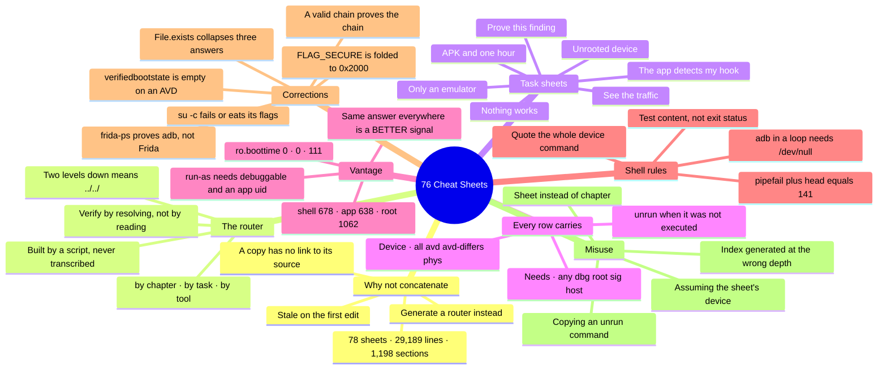

# 76 — Cheat Sheets

> The router over every chapter's cheat sheet, the sheets that cut across chapters and therefore
> belong to none of them, and the short list of commands where the obvious answer has been measured
> to be wrong.

**Prerequisites:** none — this chapter is a lookup artefact, usable from day one
**Applies to:** all chapters. Every command was run on Android 15 / API 35 unless a row says otherwise

---

## Table of Contents

1. [Introduction](#1-introduction)
2. [How to use this chapter](#2-how-to-use-this-chapter)
3. [The router — every chapter's sheet, indexed](#3-the-router--every-chapters-sheet-indexed)
4. [Task sheets — organised by what you are doing](#4-task-sheets--organised-by-what-you-are-doing)
5. [The repo-wide commands](#5-the-repo-wide-commands)
6. [The corrections sheet — where the obvious command lies](#6-the-corrections-sheet--where-the-obvious-command-lies)
7. [Confusions and misuse](#7-confusions-and-misuse)
8. [Summary](#8-summary)
9. [References](#9-references)

---

## 1. Introduction

Seventy-eight of the chapters in this repository ship a `cheatsheet.md`. Together they are 29,189
lines across 1,198 sections. That is not a cheat sheet; that is a second copy of the repository with
the explanations removed.

So the obvious thing to do here — concatenate them — is the one thing this chapter must not do. A
single 29,000-line file is unnavigable, and worse, it is **stale the moment any chapter is edited**,
because a copy has no relationship to its source. Every reader who finds a wrong command in it will
find the right one three directories away and have no way to know which is current.

> **Mental Model**
> A per-chapter cheat sheet answers *"I am working on WebViews, what do I need?"*. It cannot answer
> *"I have ninety minutes and an APK"*, because that question crosses eleven chapters and none of
> them owns it. **The gap between those two questions is the entire justification for this chapter.**

Three things belong here and nowhere else.

**A router, generated rather than transcribed.** Section 3 links every section of every sheet, and it
is built by a script that re-reads the sheets. It cannot drift, because there is nothing in it to
drift — it holds pointers, not content.

**Task sheets.** Section 4 is organised by what you are doing: an APK and one hour, an unrooted
device, only an emulator, an app that has noticed you, a finding you need to prove. This is what a
working cheat sheet actually is, and it is exactly the shape no chapter-shaped sheet can take.

**The corrections.** Section 6 is the list of commands where the standard answer is wrong. This is
the highest-value part of the chapter and the least obvious, so it is worth being blunt about why: a
cheat sheet is *copied without being read*. Prose gets skimmed and its hedges are at least visible;
a command in a fence gets pasted into a terminal. That makes a cheat sheet the single worst place in
a repository for a command that does not work — and the single best place for the sentence *"the
obvious command here lies, use this instead."*

> **Warning**
> This repository has measured its own violation of that rule. **376 command lines across 146
> markdown files** use `adb shell su -c '…'` <!-- lint:allow -->, a form that fails outright on every
> AOSP `userdebug` build and silently eats its own flags where it does not fail. See §6 and
> [`scripts/lint-commands.py`](scripts/lint-commands.py). Those repairs are owned by another worker
> and are not made here — but the detector is, because the repository did not have one.

### When to reach for this instead of the chapter

| You are… | Go to |
|---|---|
| Mid-task and need one command, and you know which chapter owns it | The chapter's own `cheatsheet.md`, via the router in §3 |
| Mid-task and do **not** know which chapter owns it | The router grouped [by task](references/cheatsheet-index-by-task.md) or [by tool](references/cheatsheet-index-by-tool.md) |
| Starting a piece of work and want the order of operations | §4, the task sheets |
| Typing a command you have typed a hundred times | §5, and check the vantage column |
| About to write a finding based on what a tool printed | §6, before you write it |
| Learning the concept for the first time | **Not here.** The chapter. A sheet is a reminder, not an explanation |

The last row is the important one. Everything in this chapter assumes you have already understood
the thing it condenses. A cheat sheet read by someone who has not is just a list of magic words.

---

## 2. How to use this chapter

### The three artefacts, and which one you want

| Artefact | What it is | Reach for it when |
|---|---|---|
| §3 + [`references/`](references/README.md) | **Generated router.** Pointers into all 78 sheets | You know roughly what you want and need the page number |
| §4 and [`cheatsheet.md`](cheatsheet.md) | **Task sheets.** Written here, cross-chapter | You know what you are *doing* but not what you need |
| §6 | **Corrections.** Measured contradictions of the standard answer | Before you trust a tool's output |

### The entry format

Every command row in §4 and §5 carries the two facts that a copied command silently assumes:

```
| command | Needs | Device | what it does |
```

**`Needs`** is the lowest privilege the command actually works from. It is the column people skip and
then lose an hour to.

| Tag | Meaning |
|---|---|
| `any` | Works from `adb shell` at uid 2000 with no special build |
| `dbg` | Needs the target app to be `android:debuggable` — this is what `run-as` requires |
| `root` | Needs root. The `su` invocation differs by device; see §5.1 |
| `sig` | Needs your test artefact signed with the **target's** key — the real gate on `am instrument` |
| `host` | Runs entirely on your machine; no device involved |

**`Device`** records where it was measured and where it behaves differently.

| Tag | Meaning |
|---|---|
| `all` | Measured, and no device-class difference is known |
| `avd` | Measured on the emulator only |
| `avd≠` | **Behaves differently on an emulator.** The row says how |
| `phys` | Needs a physical device — an AVD cannot answer this question at all |
| `unrun` | **Shipped without being executed in this session.** Correct as far as it is understood, and labelled so you do not mistake it for a measurement |

> **Pentester's Note**
> `unrun` is not an apology, it is the honest half of a promise. Every other row in this chapter was
> executed in the exact form it is printed, on the device recorded below. Where a row needs hardware
> that was not attached — a locked bootloader, a StrongBox element, a production `user` build — it
> says `unrun` rather than pretending. A sheet that does not distinguish the two is a sheet you
> cannot calibrate.

### What was attached while this chapter was written

Recorded because a version-gated claim measured on the wrong device is worse than no claim.

```bash
# host — the first thing to run in any session, before trusting anything below
adb devices -l
adb shell getprop ro.product.model
adb shell getprop ro.build.version.release
adb shell getprop ro.build.version.sdk
adb shell getprop ro.build.type
```

Output on 2026-08-16:

```
emulator-5554   device product:sdk_gphone16k_x86_64 model:sdk_gphone16k_x86_64 device:emu64xa16k
sdk_gphone16k_x86_64
15
35
userdebug
```

| Fact | Value | Consequence for this chapter |
|---|---|---|
| Device | AVD `sdk_gphone16k_x86_64` (`emu64xa16k`), `emulator-5554` | The two physical phones this repository has used were **not attached**. No row here claims a phone measurement it did not make |
| Android | 15 / API 35, `userdebug`, `ro.debuggable=1` | Refusals measured here are solid — a permissive build cannot manufacture a refusal. Successes that depend on permissiveness are labelled |
| Root | Magisk 30.7, binary at `/debug_ramdisk/magisk` | `su` takes **`su 0 <cmd>`**, not `su -c <cmd>` |
| SELinux | `Enforcing` | Every "permission denied" below is a real one |
| Page size | 16,384 bytes | Naively-linked native binaries exit 139. See §6 |
| `frida-server` | Present at `/data/local/tmp/frida-server`, **does not link** | See §6 — and note `frida-ps -U` works anyway, which is the trap |
| App vantage | `com.devuser.helloworld`, `DEBUGGABLE`, uid 10207 | Made the third column of the vantage table measurable |

### The cross-references

- A link like [`33-Storage`](../33-Storage/README.md) goes to the chapter that *explains* the row.
- A link like [`33-Storage/cheatsheet.md`](../33-Storage/cheatsheet.md) goes to the chapter's own
  condensed sheet.
- Anything in [`references/`](references/README.md) beginning `cheatsheet-index` is **generated**.
  Do not edit it; edit [`scripts/build-cheatsheet-index.py`](scripts/build-cheatsheet-index.py) and
  re-run.

### Rebuilding the generated parts

```bash
# host — from 76-CheatSheets/
python3 -B scripts/build-cheatsheet-index.py --by chapter
python3 -B scripts/build-cheatsheet-index.py --by task
python3 -B scripts/build-cheatsheet-index.py --by tool
python3 -B scripts/build-cheatsheet-index.py --verify-links     # must print 0 broken
python3 -B scripts/lint-commands.py --self-test                 # must print 0 failures
python3 -B scripts/check-anchors.py --self-test                 # must print 0 failures
python3 -B scripts/check-anchors.py --path ..                   # must print 0 BROKEN anchors
```

`--verify-links` is not optional politeness. A generator that emits links from a directory two levels
below the repository root, using a path correct for one level, produces hundreds of broken links that
no human will spot by eye. That has already happened once in this repository — see §7.

**And a link has two halves.** `--verify-links` originally split every target on `#` and resolved
only the path, so the `#fragment` — the half that decides *where on the page you land* — was never
checked at all. Measured on 2026-08-17 by [`scripts/check-anchors.py`](scripts/check-anchors.py):
**273 dead anchors across the repository, 230 of them emitted by this chapter's own generator**, from
one line that collapsed runs of whitespace to a single hyphen. GitHub does not collapse. It deletes
the em-dash in `A — B` and hyphenates each of the two spaces that remain, giving `a--b`. Both halves
are resolved now, and the anchor check runs repository-wide rather than only over what this script
writes.

---

## 3. The router — every chapter's sheet, indexed

Generated, three ways. Pick the one that matches how you are lost.

| Index | Grouped by | Use it when |
|---|---|---|
| [`cheatsheet-index.md`](references/cheatsheet-index.md) | Chapter, then section | You know the chapter |
| [`cheatsheet-index-by-task.md`](references/cheatsheet-index-by-task.md) | What you are doing | You know the goal, not the chapter |
| [`cheatsheet-index-by-tool.md`](references/cheatsheet-index-by-tool.md) | Tool name, by frequency | You know the tool |

Measured over this repository on 2026-08-16, with `--stats` and `--verify-links`:

> **Warning — this row is a snapshot, and it moved while this chapter was being written.**
> Another chapter landed mid-session and the sheet count went from 76 to 78, the line total from
> 28,594 to 29,189, and the emitted-link count from 1,595 to 1,628. Nothing was wrong with the first
> measurement; the repository changed underneath it.
>
> **Re-run rather than quoting.** That is not a caveat bolted on — it is the reason this chapter
> generates its index instead of transcribing one. A transcribed number goes quietly stale; a
> generated one is a command away from being right again.

| | |
|---|---:|
| Chapter directories with a README | 80 |
| Chapters carrying a `cheatsheet.md` | 78 |
| Total lines across all sheets | 29,189 |
| Total H2 sections across all sheets | 1,198 |
| Total fenced code blocks | 747 |
| Links emitted by the generator | 1,628 |
| Broken links after `--verify-links` | **0** |

The two chapters with a README and no sheet are [`79-Glossary`](../79-Glossary/README.md) and
[`80-Appendix`](../80-Appendix/README.md), which are reference chapters exempted by
[STYLE-GUIDE §4a](../STYLE-GUIDE.md) — a glossary *is* a cheat sheet, and shipping a second one that
condenses it is duplication. The generator knows about that exemption, so `--check` reports zero
problems rather than two false ones.

> **Under the Hood**
> The router is built by parsing each sheet's H2 headings, code fences and table rows. It records
> where things are; it copies nothing. That is a deliberate constraint, not a limitation: the moment
> an index contains content, it acquires a second, divergent copy of the truth. The one hand-written
> thing in the generator is the task taxonomy in §4, because "what am I doing" is a judgement no
> parser can make.

### Sheets by weight

The five largest and five smallest, from the generated index. Size is a rough proxy for how much of
a chapter is operational rather than conceptual — and the small ones are not thin, they are chapters
whose value is mostly in the explaining.

| Largest | Lines | | Smallest | Lines |
|---|---:|---|---|---:|
| [`10-APK-Internals`](../10-APK-Internals/cheatsheet.md) | 877 | | [`20-Security-Architecture`](../20-Security-Architecture/cheatsheet.md) | 155 |
| [`09-Android-App-Internals`](../09-Android-App-Internals/cheatsheet.md) | 856 | | [`24-IPC`](../24-IPC/cheatsheet.md) | 201 |
| [`01-Computer-Science-Basics`](../01-Computer-Science-Basics/cheatsheet.md) | 759 | | [`40-Obfuscation`](../40-Obfuscation/cheatsheet.md) | 216 |
| [`16-JNI`](../16-JNI/cheatsheet.md) | 673 | | [`30-Activities`](../30-Activities/cheatsheet.md) | 220 |
| [`19-Memory`](../19-Memory/cheatsheet.md) | 613 | | [`28-Services`](../28-Services/cheatsheet.md) | 249 |

---

## 4. Task sheets — organised by what you are doing

Seven sheets, none of which any single chapter can hold. Each is an **order of operations**, not a
menu: the steps are in the order that makes the next step cheaper. The dense, printable version of
all of them is [`cheatsheet.md`](cheatsheet.md).

### 4.1 I have an APK and one hour

The constraint is real and the failure mode is specific: an hour spent decompiling produces nothing
reportable, because the manifest and the traffic hold the findings that a rushed read of the code
does not.

| # | Do | Command | Needs | Device |
|---|---|---|---|---|
| 1 | Identity first — hash it, so every later claim names a build | `sha256sum app.apk` | `host` | `all` |
| 2 | The parsed manifest, not the decoded one | `aapt2 dump xmltree app.apk --file AndroidManifest.xml` | `host` | `all` |
| 3 | `targetSdk` — it decides most security defaults | `aapt2 dump badging app.apk \| grep -E 'targetSdkVersion\|sdkVersion'` | `host` | `all` |
| 4 | Exported surface | `aapt2 dump xmltree app.apk --file AndroidManifest.xml \| grep -B4 'exported'` | `host` | `all` |
| 5 | Network policy — the reason your proxy will fail silently | `unzip -p app.apk res/xml/network_security_config.xml` | `host` | `all` |
| 6 | Install, and get a real uid to test from | `adb install app.apk` | `any` | `avd≠` |
| 7 | What the platform actually parsed — the authority | `adb shell dumpsys package <pkg>` | `any` | `all` |
| 8 | Storage sweep after login | `adb shell "run-as <pkg> ls -laR ."` | `dbg` | `all` |
| 9 | Traffic, before code | proxy + [`35-SSL`](../35-SSL/cheatsheet.md) | `any` | `all` |
| 10 | Only now, the code | `jadx -d out app.apk` | `host` | `all` |

**Where the hour goes wrong.** Steps 2, 3 and 7 are ten minutes and produce most of the writeable
findings. Step 10 is where an hour disappears. If you are out of time, stop after 9 and say what you
did not do.

> **Warning — step 6 differs by device.** On the AVD, `adb install` works. On the Redmi this
> repository has used, it returns `INSTALL_FAILED_USER_RESTRICTED: Install canceled by user` when
> nobody cancelled anything — an OEM "Install via USB" policy. Root bypasses it:
> `adb push app.apk /data/local/tmp/ && adb shell "su 0 pm install -r /data/local/tmp/app.apk"`.
> Neither `settings put global verifier_verify_adb_installs 0` nor `pm install -i com.android.shell`
> helps. Recorded in [`30-Activities`](../30-Activities/README.md); `unrun` here, no phone attached.

Full detail: [`10-APK-Internals`](../10-APK-Internals/cheatsheet.md),
[`32-Manifest`](../32-Manifest/cheatsheet.md), [`52-StaticAnalysis`](../52-StaticAnalysis/cheatsheet.md),
[`44-NetworkSecurityConfig`](../44-NetworkSecurityConfig/cheatsheet.md).

### 4.2 I am on an unrooted device

Far more is reachable than people assume, and the things that are not are reachable a different way.

| Want | Without root | Needs | Device |
|---|---|---|---|
| App private data | `adb shell "run-as <pkg> tar czf - ."  > data.tgz` | `dbg` | `all` |
| A shell as the app | `adb shell run-as <pkg> sh` | `dbg` | `all` |
| Frida in the process | Repackage with the **Frida Gadget**, no server needed | `host` | `all` |
| Hooks without repackaging | `am instrument` with a test APK signed by the **target's** key | `sig` | `all` |
| Read another app's exported provider | `adb shell content query --uri content://<auth>/<path>` | `any` | `all` |
| Fire an exported component | `adb shell am start -S -n <pkg>/<cls>` | `any` | `all` |
| See TLS traffic | User CA + `network_security_config` that trusts it, or repackage | `host` | `all` |
| Device-side listener from the host | `adb reverse tcp:8080 tcp:8080` | `any` | `all` |
| Logs | `adb logcat -d` | `any` | `all` |

Two facts that decide most of this table:

- **`run-as` needs `FLAG_DEBUGGABLE` *and* an application uid.** It refuses in two distinct ways and
  the messages are not interchangeable: a debuggable **system** app gives
  `package not an application`, a non-debuggable app gives `package not debuggable`. Reading the
  first as the second loses a genuine finding.
- **`am instrument` is gated by the signing relationship, not by `debuggable`.** A non-debuggable
  release build was successfully instrumented; a debuggable target **refused** a differently-signed
  test APK. Measured in [`66-Instrumentation`](../66-Instrumentation/README.md) with APKs differing
  in one bit.

> **Pentester's Note**
> `adb shell` is **not** an app. `com.android.shell` requests 200 permissions, 183 granted at
> install and 16 runtime permissions pre-granted `SYSTEM_FIXED`. A finding reproduced only from
> `adb shell` is not yet a finding — reproduce it from an app uid. Section 5.2 is the tool for that.

### 4.3 I have only an emulator

An AVD is a fine Android and it is not a device. Three questions it answers *wrongly* rather than
not at all, which is the dangerous category.

| Question | On an AVD | What to do instead |
|---|---|---|
| Is the boot state trustworthy? | `ro.boot.verifiedbootstate` is the **empty string**, not `orange`. The widely-written `!"orange".equals(state)` therefore returns **`true`** — the check passes on the least trustworthy platform it can meet | Read the property *and* test for absent; better, use attestation |
| Is this key hardware-backed? | Every key is `SOFTWARE`, `hardwareEnforced` is empty — **and the attestation chain still verifies perfectly**. A valid chain proves the chain, not the hardware | Assert on the attestation *contents*, not on chain validity |
| Anything about fastboot | There is **no bootloader**. `adb reboot bootloader` returns 0, reboots, and comes back as `device` in ~40s. `fastboot devices` never sees it. No `misc`, `boot` or `recovery` partition exists | Use a physical device, or say the question is unanswerable |

And three where the emulator is *different*, which is safe once you know:

| | Measured on this AVD |
|---|---|
| `su` form | `su 0 <cmd>`. `su -c` returns `su: invalid uid/gid '-c'` |
| Page size | 16,384. A naively-linked `int main(void){return 42;}` exits **139**. Fix: `-Wl,-z,max-page-size=16384` |
| `frida-server` | Present, and **does not link**: `CANNOT LINK EXECUTABLE … empty/missing DT_HASH/DT_GNU_HASH` |

**The inverted emulator heuristics**, all re-measured here:

```bash
# host — the four most-copied emulator checks, on a stock current AVD
adb shell getprop ro.build.fingerprint      # google/sdk_gphone16k_x86_64/emu64xa16k:15/...
adb shell 'ls /dev/qemu_pipe'               # No such file or directory
adb shell 'ls /dev/goldfish_pipe_dprctd'    # present — the node MOVED
adb shell getprop ro.kernel.qemu            # 1
```

The fingerprint does **not** start with `generic`, so the most-copied `isEmulator()` on the internet
returns `false` here. `/dev/qemu_pipe` is gone. The one signal that still worked in this session is
`ro.kernel.qemu`, which read `1` from all three vantages — shell, root and app uid. Full treatment
in [`39-EmulatorDetection`](../39-EmulatorDetection/cheatsheet.md).

### 4.4 The app detects my hook

The reflex is to reach for a bypass. The correct first move is to find out **which check fired**,
because a bypass applied to the wrong seam is indistinguishable from a bypass that failed.

| # | Step | Command / method | Needs |
|---|---|---|---|
| 1 | Is it detecting anything, or is your tooling broken? | Attach to a *different* process and confirm hooks land | `any` |
| 2 | What did it see? Read the app's own log first | `adb logcat -d \| grep -i <pkg>` | `any` |
| 3 | Enumerate the checks statically before hooking | `jadx -d out app.apk` then search for the families in [`37-RootDetection`](../37-RootDetection/cheatsheet.md) | `host` |
| 4 | Confirm the seam — is it Java, JNI, or a syscall? | `frida-trace -U -i "open*" -f <pkg>` | `any` |
| 5 | Only now, hook | [`65-Hooking`](../65-Hooking/cheatsheet.md), [`67-BypassingProtections`](../67-BypassingProtections/cheatsheet.md) | `any` |

Four measured reasons a "working" bypass changes nothing:

| Symptom | Cause | Evidence |
|---|---|---|
| Hook installs, verifies, has no effect | The compiler **inlined** the target. Zero call sites remain | [`65-Hooking`](../65-Hooking/README.md): `lic_is_valid` still exported, body inlined into its caller |
| Patched function provably returns 1, check still fails | Same cause, at the binary level | [`18-ARM`](../18-ARM/README.md) §5.4 — a patch that works against a function that no longer matters |
| `objection android root disable` reports success, app still dies | It is **three hooks and thirteen hard-coded paths**. Measured coverage: 1 of 5 checks in a purpose-built app | [`54-Objection`](../54-Objection/README.md) |
| `android sslpinning disable` reports three successful hooks | It hooked **platform classes**, not the app. It reported the same three against an app with **no network code at all** | [`54-Objection`](../54-Objection/README.md) |

> **Mental Model**
> A "bypass succeeded" message means a hook installed. It does not mean the app was doing the thing
> you hooked. These are different claims and only the second one is a finding.

### 4.5 I need to see the traffic

Work down the layers and **stop at the first one that explains the silence.** Most lost hours are
spent bypassing a pinning implementation that was never reached.

| Layer | Check | Needs |
|---|---|---|
| 0 | Is there traffic at all? A void run and a clean negative look identical | `any` |
| 1 | Proxy reachable from the device? | `any` |
| 2 | Trust store — does the app trust your CA? | `any` |
| 3 | `network_security_config` — `cleartextTrafficPermitted`, `trust-anchors`, `<pin-set>` | `host` |
| 4 | Code-level `TrustManager` / `HostnameVerifier` overrides | `host` |
| 5 | Library pinning — OkHttp `CertificatePinner`, Conscrypt, **BoringSSL inside Flutter** | `host` |
| 6 | Not HTTP at all — raw sockets, gRPC, MQTT, WebSocket | `any` |

> **Warning — a trust-store trap this repository has already hit.** Before concluding "the app
> trusts user CAs", check what the device's store actually is:
> ```bash
> # host — on one device used by this repository, this returned an APatch tmpfs
> adb shell "mount | grep cacerts"
> ```
> A rooting stack that **promotes an interception CA into the SYSTEM store** makes every intercept
> succeed for a reason unrelated to the app. Chapter [`44`](../44-NetworkSecurityConfig/README.md)
> hit exactly this and wrote it up as a methodology trap rather than publishing the conclusion. Not
> reproduced here: `unrun`, no such device attached.

### 4.6 I need to prove this finding

The five questions between an observation and a finding. If any answer is "I do not know", you have
an observation.

| # | Question | Why it kills weak findings |
|---|---|---|
| 1 | Who is the attacker, concretely? | "An attacker with root on the victim's device" usually collapses the moment it is written down |
| 2 | What do they start with? | Physical access, an installed app, a hostile network — these are different reports |
| 3 | Does it reproduce **from an app uid**? | `adb shell` holds privileges an app does not. This is the single most common reason a finding evaporates |
| 4 | Does the server compensate? | If the server validates what the client checks, most client-side findings drop a tier |
| 5 | What is the business impact, in one sentence? | Device-owner-as-attacker findings are business risk, not user-data risk — and saying so is what gets them acted on |

```bash
# host — question 3, mechanically
bash scripts/vantage.sh --file /path/under/test --pkg <debuggable-package>
```

And the number that should make you slow down: adjudicating one real sweep's HIGH band by hand,
**15 of 17 leads were rejected** — doc links, `@Preview` fixtures, an XMP namespace, marketing URLs
— while the genuinely interesting finding sat at MEDIUM. A sweep produces leads; adjudication
produces findings. See [`52-StaticAnalysis`](../52-StaticAnalysis/README.md) and
[`72-RealWorldFindings`](../72-RealWorldFindings/cheatsheet.md).

### 4.7 Nothing works and I do not know why

Debug the tool before you debug the app. In order of how often each is the answer.

| # | Check | Command |
|---|---|---|
| 1 | Is a device attached, and **which one**? | `adb devices -l` |
| 2 | Is it the device you think? Frida can pick a different one | `frida-ls-devices` |
| 3 | Did your quoting survive? | `adb shell "sh -c 'echo A; echo B'"` — must print **both** |
| 4 | Is `su` the form this device takes? | `adb shell "su 0 id"` |
| 5 | Is the process alive when you attach? | `adb shell pidof -s <pkg>` |
| 6 | Is your probe racing the thing it measures? | Wait on an **exit** marker, never an entry one |
| 7 | Is the screen locked? | `adb shell "dumpsys trust" \| grep -o "deviceLocked=[01]"` |
| 8 | Is your pipeline lying about failure? | Drop `set -o pipefail`, or use `grep -c` |

> **Warning — number 6 is the one that produces a wrong report rather than no report.** A probe
> that waits for a flag raised at the *start* of the work reads the target's storage before the
> target has written anything, gets four `ENOENT`s, and **exits successfully**. The obvious reading
> is "this app persists nothing", which is a finding somebody would write down. Report the wait
> condition alongside every negative result. Measured in
> [`66-Instrumentation`](../66-Instrumentation/README.md).

---

## 5. The repo-wide commands

The commands that recur in a dozen chapters, deduplicated, with the vantage stated. **Every command
in this section was executed in the form printed**, on the AVD recorded in §2, except where a row
says `unrun`.

### 5.1 Posture — run these before anything else

```bash
# host — device identity
adb devices -l
adb shell getprop ro.product.model
adb shell getprop ro.build.version.release
adb shell getprop ro.build.version.sdk
adb shell getprop ro.build.type
adb shell getprop ro.build.fingerprint
adb shell getenforce
```

<!-- lint:allow -- both forms are shown on purpose; that IS the check -->
```bash
# host — which su form does this device take? Run BOTH; the wrong one reads as "not rooted"
adb shell "su 0 id"          # AOSP su: every userdebug build, every AVD
adb shell "su -c id"         # Magisk su on a phone
```

Measured on the AVD:

<!-- lint:allow -- transcript of the failing form, quoted on purpose -->
```
$ adb shell "su 0 id"
uid=0(root) gid=0(root) groups=0(root),1004(input),... context=u:r:su:s0

$ adb shell "su -c id"
su: invalid uid/gid '-c'
```

| Command | Needs | Device | Notes |
|---|---|---|---|
| `adb shell "su 0 id"` | `root` | `all` | The form that works on AOSP/AVD. Prefer it |
| `adb shell "su -c id"` | `root` | `phys` | Magisk `su` on a phone. **Fails on any AOSP `su`** <!-- lint:allow --> |
| `adb shell "su 0 /debug_ramdisk/magisk -v"` | `root` | `avd` | Prints `30.7:MAGISK:R`. **`magisk` is not on root's `PATH` here** — the bare name gives `failed to exec magisk` |
| `adb shell "grep -c magisk /proc/self/mountinfo"` | `any` | `all` | Returned **3** from shell, root **and** an app uid. The loudest root signal, needing no privilege |
| `adb shell "mount \| grep cacerts"` | `any` | `all` | Do this before any trust-store claim |

### 5.2 Vantage — the same probe from three heights

This repository's most-repeated finding, as a command. A detection probe verified from `adb shell`
has not been verified.

```bash
# host — from 76-CheatSheets/
bash scripts/vantage.sh --posture --pkg <debuggable-package>
bash scripts/vantage.sh --file /system/xbin/su --pkg <debuggable-package>
bash scripts/vantage.sh --cmd 'getprop | wc -l' --pkg <debuggable-package>
```

Measured output, 2026-08-16, with `com.devuser.helloworld` (uid 10207):

| Probe | `shell` (2000) | `root` | app uid |
|---|---|---|---|
| `ls -l /system/xbin/su` | `-rwsr-x--- root shell 51224` | same | **`Permission denied`** |
| `test -e /system/xbin/su` | `EXISTS` | `EXISTS` | **`NOT-VISIBLE`** |
| `getprop \| wc -l` | **678** | **1062** | **638** |
| `getprop \| grep -c ro.boottime` | **0** | **111** | **0** |
| `grep -c magisk /proc/self/mountinfo` | 3 | 3 | 3 |
| `getprop ro.kernel.qemu` | 1 | 1 | 1 |

Three things fall out of that table, and each of them has cost somebody an hour:

1. **`new File("/system/xbin/su").exists()` returns `false` on a genuinely rooted device**, because
   `/system/xbin` is `0750 root:shell` and `File.exists()` maps `EACCES` and `ENOENT` alike to
   `false`. The most-copied root check has zero discriminating power on the only kind of device where
   it could matter.
2. **The shell is a decent proxy for an app and a terrible proxy for root** — 678 vs 638 vs 1,062.
   The error to guard against is not "I tested from the shell", it is "I tested from root and called
   it shell." A published figure in this repository was wrong for exactly that reason and had to be
   corrected; these numbers reproduce the corrected ones independently.
3. **Three identical answers is a *better* signal, not a worse one.** `mountinfo` is readable from
   everywhere, which is precisely what makes it a usable root check.

### 5.3 Package and APK

| Command | Needs | Device | Does |
|---|---|---|---|
| `adb shell pm list packages -3` | `any` | `all` | Third-party packages only |
| `adb shell pm path <pkg>` | `any` | `all` | **Every** split. Returns multiple lines for split APKs — pull all of them |
| `adb shell dumpsys package <pkg>` | `any` | `all` | What `PackageManager` actually parsed. The authority when tools disagree |
| `adb pull <path-from-pm-path> base.apk` | `any` | `all` | Get the APK |
| `aapt2 dump xmltree app.apk --file AndroidManifest.xml` | `host` | `all` | The parsed manifest tree |
| `aapt2 dump badging app.apk` | `host` | `all` | Summary: package, sdk versions, permissions, launchable |
| `unzip -l app.apk` | `host` | `all` | Entry list — note which `classes*.dex` are STORED vs DEFLATED |

The `dumpsys package` flags line is the fastest read in the repository:

```
$ adb shell dumpsys package com.devuser.helloworld | grep -E 'flags=\[|targetSdk'
    versionCode=1 minSdk=24 targetSdk=35
    flags=[ DEBUGGABLE HAS_CODE ALLOW_CLEAR_USER_DATA TEST_ONLY ALLOW_BACKUP ]
```

`DEBUGGABLE` in production is a serious finding; `ALLOW_BACKUP` is `true` by default and worth a row
in the report; `TEST_ONLY` is defeated by one character (`adb install -t`).

### 5.4 Storage and data

| Command | Needs | Device | Does |
|---|---|---|---|
| `adb shell "run-as <pkg> ls -laR ."` | `dbg` | `all` | Full private-data tree as the app |
| `adb shell "run-as <pkg> tar czf - ." > data.tgz` | `dbg` | `all` | Pull it all, no root |
| `adb shell "su 0 ls -la /data/data/<pkg>"` | `root` | `all` | Same, for a non-debuggable app |
| `adb shell "su 0 ls -di /data/data /data/user/0"` | `root` | `all` | Prints the **same inode** — it is a bind mount, not a symlink |
| `adb shell "ls /data/user_de/0/<pkg>"` | `root` | `all` | Device-encrypted data — readable before first unlock |
| `sqlite3 db.sqlite '.tables'` | `host` | `all` | And **read the `-wal` file too**; deleted rows survive there |

> **Under the Hood**
> `readlink /data/user/0` returns nothing and exits 1, while `ls -di` gives `/data/data` and
> `/data/user/0` the **same inode** — measured as `344065` on this AVD. It is a bind mount. This
> matters to anyone reasoning about path canonicalisation or traversal, and a glossary entry in this
> repository was wrong about it until it was measured.

### 5.5 Process, logs and IPC

| Command | Needs | Device | Does |
|---|---|---|---|
| `adb shell pidof -s <pkg>` | `any` | `all` | PID, or nothing if the process is dead |
| `adb logcat -d -t 200` | `any` | `all` | Last 200 lines, then exit |
| `adb logcat -c` | `any` | `all` | Clear before a reproduction |
| `adb shell am start -S -n <pkg>/<cls>` | `any` | `all` | **`-S` is not optional** — see §6 |
| `adb shell content query --uri content://<auth>/<path>` | `any` | `all` | Query an exported provider |
| `adb shell service list` | `any` | `all` | Registered system Binder services |
| `adb shell dumpsys activity broadcasts` | `any` | `all` | Live broadcast registrations — most are invisible to APK analysis |

> **Warning**
> `dumpsys` records broadcast extras **in cleartext**. A test broadcast carrying a token is
> recoverable afterwards by anything that can read `dumpsys`. Do not send real credentials while
> testing.

### 5.6 The five shell rules that make the rest work

These are not style. Each one has a measured failure behind it, reproduced in this session.

<!-- lint:allow -- the first line of this block IS the counter-example -->
```bash
# 1. QUOTE the whole device-side command. Measured:
adb shell sh -c 'echo A; echo B'        # prints a blank line, then B  -- "echo A" is SWALLOWED
adb shell "sh -c 'echo A; echo B'"      # prints A, then B             -- correct
```

```bash
# 2. Redirect stdin on every adb call inside a loop. Measured:
printf 'a\nb\nc\n' | while read -r x; do echo "row=$x"; adb shell true; done
#   -> row=a          ONE of three rows, exit 0, no error
printf 'a\nb\nc\n' | while read -r x; do echo "row=$x"; adb shell true < /dev/null; done
#   -> row=a  row=b  row=c
```

<!-- lint:allow -- the failing pipelines are the point of this block -->
```bash
# 3. Do not combine `set -o pipefail` with an early-exit consumer. Measured:
bash -c 'set -o pipefail; yes | head -3 >/dev/null; echo $?'          # -> 141
bash -c 'set -o pipefail; seq 1 100000 | grep -q 5; echo $?'          # -> 141
bash -c 'set -o pipefail; seq 1 100000 | grep -c 5 >/dev/null; echo $?'  # -> 0   (grep -c reads all input)
```

```bash
# 4. Test CONTENT, not exit status, when adb or a device tool is involved.
adb devices | sed -n '2,$p' | grep -c 'device$'     # 0 means nothing attached
#   `adb devices` exits 0 with nothing attached, and `fastboot devices` prints
#   nothing and exits 0 too. Silence is success, not error.
```

```bash
# 5. On Git Bash / MSYS2, QUOTE every absolute DEVICE path. Measured, in this session:
adb shell ls -la /sdcard/          # ls: C:/Program: No such file or directory  <- MANGLED   # lint:allow
adb shell 'ls -la /sdcard/'        # correct
adb shell cat /proc/net/tcp        # works unquoted -- /proc is the one exception
```

Rule 3 is the subtle one, and it is intermittent, which is worse. With a small producer the writer
finishes before the consumer closes the pipe and the status is 0; with a large one it is 141. The
same script passes on Monday and fails on Tuesday, and the error always looks like a problem with
the *data*.

> **Under the Hood — rule 5, measured while writing this chapter.**
> MSYS2's path-conversion layer rewrites a Unix-looking argument into a Windows path *before* `adb`
> ever sees it, so `/sdcard/` arrives as `C:/Program Files/Git/sdcard/`. The error names a host
> directory and reads as an adb or device fault. Every Android top-level path tested was rewritten:
>
> | Rewritten | Passed through |
> |---|---|
> | `/system` `/data` `/dev` `/sdcard` `/apex` `/storage` `/vendor` `/product` `/odm` `/oem` `/mnt` `/cache` | `/proc` |
>
> `/proc` survives because MSYS treats it as a virtual mount with no Windows equivalent. That single
> exception is what makes the bug so confusing: half the commands on a sheet work unquoted and half
> do not, with no visible pattern. Quoting fixes it everywhere, and `MSYS_NO_PATHCONV=1` fixes it
> too. Harmless on Linux and macOS — **and this repository is written on Git Bash**, where the linter
> currently counts **121 unquoted device paths across 81 markdown files**.

---

## 6. The corrections sheet — where the obvious command lies

The most valuable page in any cheat sheet is the one that says *the obvious command here is wrong*.
Thirty-three of them, each measured. The **Re-measured here** column marks the ones executed again in
this session, on the AVD in §2, rather than carried across from the chapter that found them.

| # | The obvious move | What it actually does | Do this instead | Re-measured here |
|---|---|---|---|:---:|
| 1 | `adb shell su -c 'cmd'` | `su: invalid uid/gid '-c'` on every AOSP `su`. Reads as **not rooted** | `adb shell "su 0 cmd"` | Yes <!-- lint:allow --> |
| 2 | `adb shell "su -c 'magisk -v'"` | `-v` is consumed by **`su`**, so it prints *su's* version | `adb shell "su 0 /debug_ramdisk/magisk -v"` | Yes <!-- lint:allow --> |
| 3 | `adb shell "su 0 magisk -v"` | `failed to exec magisk` — `magisk` is not on root's `PATH` on the AVD | Use the absolute path | Yes |
| 4 | `adb shell sh -c 'a; b'` | Prints nothing for `a`, then `b`. Exit 0 | `adb shell "sh -c 'a; b'"` | Yes <!-- lint:allow --> |
| 5 | `set -o pipefail` with `\| head` or `\| grep -q` | Exit **141** on a *successful* match, via SIGPIPE | `grep -c`, or a `case` glob, or drop `pipefail` | Yes <!-- lint:allow --> |
| 6 | `adb shell` inside `while read` | Eats the loop's stdin; prints one row of N and exits 0 | Append `< /dev/null` | Yes <!-- lint:allow --> |
| 7 | `frida-ps -U` succeeds ⇒ Frida works | **It does not.** It enumerates over adb with **no `frida-server` running**. `frida -U -n zygote64` then fails: `unable to connect to remote frida-server: closed` | Prove instrumentation with an actual attach | Yes |
| 8 | `new File("/system/xbin/su").exists()` | **`false` from an app on a rooted device.** `/system/xbin` is `0750 root:shell`; `File.exists()` maps `EACCES` and `ENOENT` alike to `false` | Read `/proc/self/mountinfo`, which needs no privilege | Yes |
| 9 | `Build.FINGERPRINT.startsWith("generic")` | **`false`** on a stock current AVD: `google/sdk_gphone16k_x86_64/…` | Populations and structure, not values — see [`39`](../39-EmulatorDetection/README.md) | Yes |
| 10 | Check `/dev/qemu_pipe` for an emulator | `ENOENT`. The node is now `/dev/goldfish_pipe_dprctd` | Enumerate, do not assume a path | Yes |
| 11 | Test a detection probe from `adb shell` | shell sees **678** properties, an app **638**, root **1,062**. `ro.boottime.*`: 0 / 0 / **111** | Run it as the app — [`scripts/vantage.sh`](scripts/vantage.sh) | Yes |
| 12 | `!"orange".equals(verifiedbootstate)` | The property is the **empty string** on an AVD, so the check **passes** on the least trustworthy platform it can meet | Test for absent as well as bad | Yes |
| 13 | `readlink /data/user/0` to find the CE dir | Returns nothing. It is a **bind mount** — same inode as `/data/data` | `ls -di` both, compare inodes | Yes |
| 14 | `grep -rn FLAG_SECURE` in decompiled release code | Finds nothing. `FLAG_SECURE` is `public static final int = 8192`, so `javac` folds it and only the literal `0x2000` survives into DEX. Verified with `javap -constants` against `android-35` | Search the constant, or hook `Window.setFlags` at runtime | Yes |
| 15 | `grep -i xposed` over APKs | **1,141 hits, 1,141 explained by the word "exposed", 0 genuine.** Across 237 APKs | Never put a token under ~8 characters in a high-confidence tier | — |
| 16 | `UiAutomation.executeShellCommand("a \| b")` | **Not a shell.** Whitespace split then exec: `echo "one two"` returns the quotes, pipelines return nothing with no error. Also runs as **uid 2000** | `executeShellCommand("sh -c '…'")`, and never for a vantage-sensitive probe | — <!-- lint:allow --> |
| 17 | `am start -n <pkg>/<cls>` twice with different extras | `Intent.filterEquals()` **ignores extras**, so the second delivery goes to the running instance and prints a warning | Always `am start -S` | — |
| 18 | `getCallingUid()` in `onBind` | Returns the **service's own** UID. `onBind` is dispatched by the system | Check in the transaction, not the bind | — |
| 19 | "Only debuggable apps can be instrumented" | **False.** A non-debuggable release build was instrumented. The gate is the **signing relationship**, or root | Compare signing certs before blaming `debuggable` | — |
| 20 | `TracerPid` detects the debugger | **A JDWP debugger does not set it.** `jdb` attached, threads enumerated, `TracerPid: 0` throughout | It detects `ptrace`, which is a different question | — |
| 21 | `ls -l *.apk` shows whether shrinking worked | Three APKs were **byte-identical in size** (12,757 B) with DEX sizes 7,384 / 2,920 / 7,180. `apksigner` pads the signing block to 4 KiB | Compare the DEX, not the APK | — |
| 22 | jadx said `finished with errors, count: 61` | The output tree held **2,104 refused methods across 1,424 files** — under-reported 30× | Count the tree, not the console | — |
| 23 | Query the database to review stored data | A `logout` deleting 2 rows left **all four secrets readable in the 61,832-byte `-wal`** | Read the files, not the SQL | — |
| 24 | A valid attestation chain proves hardware backing | On an emulator every key is `SOFTWARE`, `hardwareEnforced` is empty, **and the chain verifies perfectly** | Assert on the attestation *contents* | — |
| 25 | `ro.boot.verifiedbootstate` reports device integrity | Read `green` while a **TEE-signed attestation** from the same device, seconds later, said `verifiedBootState=Unverified`, `deviceLocked=false` | The property is attacker-controlled; the hardware is not | — |
| 26 | `fastboot --disable-verity` is an option AVB honours | It flips **one byte inside the region AVB hashes**, invalidating the digest and the signature over it. Only an unlocked bootloader accepts the result | It is a deliberate corruption; describe it as one | — |
| 27 | `fastboot devices` printing nothing means a broken install | **Silence is success.** It exits 0 with nothing attached; `fastboot getvar` in the same state blocks on `< waiting for any device >` | Test content, not status | — |
| 28 | `adb reboot bootloader` gets you to fastboot | On an AVD it returns 0, reboots, and comes back **as Android** in ~40s. There is no bootloader, no `misc`, no `boot` partition | Nothing about fastboot is learnable on an emulator | — |
| 29 | `lpdump` describes the partition layout | Failed with `Failed to read metadata.` as root, while `dmctl table` produced a complete map | When a description and the running system disagree, believe the kernel | — |
| 30 | `objection android root disable` handles root detection | Three hooks, thirteen hard-coded paths. **1 of 5** checks in a purpose-built app | Find the check first, then hook that check | — |
| 31 | "`android sslpinning disable` succeeded" ⇒ the app pins | It reported three successful hooks against an app with **no network code at all** | A hook installing is not evidence the app pinned | — |
| 32 | A `classes.dex` CRC check detects repackaging | Re-signing changed the signature digest while `classes.dex` CRC stayed **identical** — nothing in the code changed | Check the signing certificate, and handle `signingCertificateHistory` | — |
| 33 | `adb shell ls /sdcard/` on Git Bash <!-- lint:allow --> | MSYS rewrites the path before adb sees it: `ls: C:/Program: No such file or directory`. Every Android top-level path tested was rewritten **except `/proc`** | Quote it: `adb shell 'ls /sdcard/'`, or `MSYS_NO_PATHCONV=1` | Yes |

Rows marked `—` are carried from the chapter that measured them, with the device and method recorded
there. They are cited, not re-derived; where the measurement needed a physical device, a locked
bootloader or a production build, this session could not repeat it and does not pretend to.

### The repository's own violation, quantified

The rule this section exists to enforce is one this repository breaks at scale. Measured by
[`scripts/lint-commands.py`](scripts/lint-commands.py) on 2026-08-16:

| Form | Occurrences |
|---|---:|
| `adb … shell "su -c …` | 283 |
| `adb … shell su -c …` | 79 |
| `adb … shell 'su -c …` | 13 |
| `adb … shell \"su -c …` | 1 |
| **Total** | **376** across **146** files |
| Unexplained | **0** |

The repository's first sweep for this defect put it at *"~105–118 broken command lines across ~37–50
markdown files"*, using a hand-written detector:

```
Select-String -Pattern "adb\s+(-[des]\s+\S+\s+)?shell\s+su\s+-c\s+'"
```

That pattern requires `su` to follow `shell` with nothing between, so it **cannot see the
double-quoted form** — which is 283 of the 376, about 75% of the defect. The true scale is roughly
three times that first estimate.

> **Mental Model**
> This is the same shape as the link-checker defect this repository records against itself, where a
> `forward` exemption that never re-checked its own precondition hid **1,512 broken links** behind a
> reported `broken=0`: a pattern that answers a *narrower* question than it appears to, while
> reporting a number that looks like an answer to the wider one. The general form is worth
> memorising, because it is how a check becomes worse than no check: **a detector's blind spot is
> invisible in its output.** The only defence is to close the arithmetic — explain every hit, and go
> looking for the hits you did not get.

The repairs are **not made here.** Another worker owns them, and a linter that rewrites prose someone
else is mid-way through editing is how two agents corrupt one file. This chapter contributes the
detector, the correct forms, and the number.

---

## 7. Confusions and misuse

The failure modes of *this* chapter specifically. Each of the first three has already happened in
this repository, to somebody competent, which is why they are here rather than in a list of good
intentions.

### 7.1 Treating a cheat sheet as a substitute for the chapter

The commonest and the most expensive. A sheet is a **reminder**, and a reminder is only useful to
someone who has something to be reminded of.

The tell is a report that quotes a tool's output as its finding. `objection` printed
`Job: … android sslpinning disable`, so the report says the app pins — but that message means a hook
installed against a *platform class*, and it appeared unchanged against an app with no network code.
The sheet row is correct; the reader's model of what it means was missing, and the sheet could not
supply it because a sheet has no room to.

**The rule:** if you cannot say *why* a command works, you cannot interpret its output, and you must
not put that output in a report. Follow the link.

### 7.2 Copying a command without running it

This is the specific way a *cheat-sheet* chapter fails, as opposed to any other kind.

Prose is skimmed and its hedges are at least on the page. A fenced command is pasted. So a wrong
command in a sheet propagates further and faster than a wrong sentence anywhere else — and the two
canonical instances in this repository are both in sheets:

- `adb shell su -c 'magisk -v'` <!-- lint:allow --> in a "Magisk version" row that prints
  *`su`'s* version, on the
  devices where it does not fail.
- `set -o pipefail` above a `| head` in a triage script, which printed **"not a JNI library"
  directly below a list of that library's JNI exports**.

Neither produces an error. Both produce a confident wrong answer.

**The rule this chapter follows:** every command here was executed in the exact form it is printed,
or it is labelled `unrun`. That is the only honest option, and the labelling matters as much as the
running — a sheet that hides which is which cannot be calibrated by its reader.

### 7.3 Generating an index at the wrong depth

Concrete, recent, and expensive. A sibling chapter generated its index into `references/` and emitted
links of the form `../NN-Chapter/README.md`. A file in `references/` is **two** levels below the
repository root, so the correct form is `../../NN-Chapter/README.md`.

That produced **1,495 broken links**, and they hid for months inside a link-checker category that
excused "forward references into unwritten chapters" and never re-checked whether the chapter was
still unwritten.

Two lessons, and only the first is about paths:

- **Fix it at the generator, not in the output.** Patching 1,495 links leaves the next run to
  recreate them.
- **Verify by resolving, not by reading.** `--verify-links` in
  [`scripts/build-cheatsheet-index.py`](scripts/build-cheatsheet-index.py) resolves every emitted
  link against the filesystem. On its first run it reported **58 broken of 1,595** — and 55 of those
  were a defect I had not anticipated: the generator *quotes each sheet's own subtitle*, and those
  subtitles contain links written relative to the **chapter** directory. Copying text across a depth
  boundary is a link operation, and eyeballing would never have caught it.

### 7.4 Reading the router as a summary

The generated index in [`references/`](references/README.md) contains headings and counts. It
deliberately contains **no commands**. If it did, it would be a second copy of 29,189 lines with its
own truth, diverging from the sheets the moment either changed.

A reader who scans the router and concludes "chapter 44 covers `trust-anchors`" has learned where to
look, and nothing else. That is the whole intended value.

### 7.5 Assuming the sheet's device

Every command has a vantage and a device class, and a sheet that omits them silently assumes one.
Three ways that goes wrong, all measured:

| The sheet says | The reader has | Result |
|---|---|---|
| `su -c` (a Magisk phone was assumed) | An AVD or any `userdebug` build | `su: invalid uid/gid '-c'` — reads as **not rooted** |
| A root check that reads a path | An app uid, not `adb shell` | `EACCES`, which `File.exists()` reports as `false` — reads as **not rooted**, on a rooted device |
| A `fastboot` procedure | An emulator | Command exits 0, device reboots into Android, `fastboot devices` never sees it |

All three failures **look like an answer**. None of them looks like a missing precondition. That is
why §5's tables carry `Needs` and `Device` columns and why the reader should not trust a row that
lacks them.

### 7.6 Terms this chapter's rows are read as meaning, and do not

| Row says | Reader hears | Actually |
|---|---|---|
| "bypass succeeded" | The protection is defeated | A **hook installed**. Whether the app used that path is a separate question |
| "not detected" | The app has no check | Possibly the check is in a seam you did not instrument, or was inlined and has no call site |
| `frida-ps -U` lists processes | Frida can instrument this device | It enumerated **over adb**. Attach is the test, and it failed here with `frida-server` present but unlinkable |
| `File.exists()` returned `false` | The file is absent | Absent, **forbidden**, or invisible — three findings collapsed into one boolean |
| A grep hit | A finding | A **lead**. Three independent sweeps in this repository ran 16,836 → 168 → 2, 7,346 → 9 → 2, and 132 → 0 |
| An attestation chain verified | The key is in hardware | The chain is valid. On an emulator every key is `SOFTWARE` and the chain still verifies |
| `exported="false"` | Unreachable | `shell` and some system components still reach it |

### 7.7 What a good sheet row looks like

Ship this shape, in this chapter or your own:

| Property | Bad row | Good row |
|---|---|---|
| Vantage | `adb shell cat /proc/modules` | `adb shell cat /proc/modules` — `shell` only; **`EACCES` from an app** |
| Device | `su -c 'id'` | `su 0 id` on AOSP/AVD; `su -c id` on a Magisk phone. Run both to find out which <!-- lint:allow --> |
| Provenance | "checks for root" | "reads `/proc/self/mountinfo`; returned 3 magisk lines from all three vantages on API 35" |
| Failure shape | *(absent)* | "prints nothing and exits 0 when it fails — test the content" |

Worked examples of both, side by side, are in
[`examples/01-anatomy-of-a-sheet-row.md`](examples/01-anatomy-of-a-sheet-row.md).

---

## 8. Summary

### Key points

- **Do not concatenate.** 78 sheets, 29,189 lines, 1,198 sections. A copy has no relationship to its
  source and goes stale on the first edit. Generate a router instead, and verify its links by
  resolving them.
- **The unit of a real cheat sheet is a task, not a chapter.** "I have an APK and one hour" crosses
  eleven chapters and belongs to none of them.
- **A cheat sheet is copied without being read**, which makes it the worst place for a wrong command
  and the best place for "the obvious command here lies."
- **Every command carries a vantage and a device class.** `shell` is not an app, an app is not root,
  and an AVD is not a phone. All three omissions produce answers rather than errors.
- **`su 0 <cmd>` on AOSP builds and every AVD; `su -c` only on a Magisk phone.** Run both once, at
  the start, and record which worked.
- **Quote the whole device-side command, redirect stdin on `adb` in loops, and keep `pipefail` away
  from `head` and `grep -q`.** Three measured, silent, intermittent failures.
- **Test content, not exit status**, whenever adb, fastboot or a device tool is involved. Several of
  them succeed loudly and fail quietly.
- **A tool reporting success is not a finding.** A hook installing, a chain verifying, a grep
  matching — each is a lead that needs adjudicating.
- The repository's own `su -c` defect is **376 lines across 146 files**, about three times the
  recorded estimate, because the published detector could not see the double-quoted form.

### Mind map



### Quick revision

- Why is concatenating 76 cheat sheets the wrong answer, in one sentence?
- What is the correct relative prefix from a file in `references/` to another chapter, and what
  happened in this repository when it was wrong?
- Which `su` form does an AVD take, and what does the other one print?
- Name the three vantages, and give the property counts measured for each.
- Why does `new File("/system/xbin/su").exists()` return `false` on a rooted device?
- What does a successful `frida-ps -U` actually prove?
- Which two pipeline constructs turn `set -o pipefail` into a source of false failures?
- Why does grepping decompiled release code for `FLAG_SECURE` find nothing?
- What is the one thing a valid key-attestation chain proves, and the one thing it does not?
- What must be true before a `shell`-only reproduction becomes a finding?

---

## 9. References

### Generated in this chapter

- [`references/cheatsheet-index.md`](references/cheatsheet-index.md) — every section of every sheet,
  by chapter
- [`references/cheatsheet-index-by-task.md`](references/cheatsheet-index-by-task.md) — the same,
  routed by what you are doing
- [`references/cheatsheet-index-by-tool.md`](references/cheatsheet-index-by-tool.md) — a mechanical
  tool census across all sheets
- [`references/lint-report.md`](references/lint-report.md) — dated snapshot of the command lint

### Scripts

- [`scripts/build-cheatsheet-index.py`](scripts/build-cheatsheet-index.py) — the router generator,
  with `--verify-links`
- [`scripts/check-anchors.py`](scripts/check-anchors.py) — resolves every `](…#fragment)` in the
  **whole repository** against the anchor GitHub really generates, with `--self-test`
- [`scripts/lint-commands.py`](scripts/lint-commands.py) — the command linter, with `--self-test`
- [`scripts/vantage.sh`](scripts/vantage.sh) — one probe, three vantages, on an attached device

### Standards and primary documentation

- OWASP MASVS — https://mas.owasp.org/MASVS/
- OWASP MASTG — https://mas.owasp.org/MASTG/
- Android behaviour changes, per release — https://developer.android.com/about/versions
- Android Debug Bridge — https://developer.android.com/tools/adb
- Frida documentation — https://frida.re/docs/android/
- Android Code Search — https://cs.android.com/

### Related chapters

| Chapter | Relationship |
|---|---|
| [`77-UsefulCommands`](../77-UsefulCommands/README.md) | The command surface in full. This chapter condenses and corrects; 77 enumerates |
| [`79-Glossary`](../79-Glossary/README.md) | The vocabulary every sheet row assumes |
| [`80-Appendix`](../80-Appendix/README.md) | Version matrix, severity rubric, report templates, engagement checklist |
| [`73-Labs`](../73-Labs/) | The complete lab index across the repository |
| [`78-Diagrams`](../78-Diagrams/README.md) | Every diagram in one place — the visual analogue of this chapter |
| [`75-InterviewQuestions`](../75-InterviewQuestions/README.md) | The same aggregation problem, solved the same way: generate the index, add the layer no chapter can hold |
| [`71-OWASP-Mobile`](../71-OWASP-Mobile/README.md) | MASVS/MASTG identifiers for the findings these sheets help produce |
| [`72-RealWorldFindings`](../72-RealWorldFindings/README.md) | What the §4.6 questions look like when answered properly |
| [`51-DynamicAnalysis`](../51-DynamicAnalysis/README.md) | Liveness checks, and why a void run and a clean negative look identical |
| [`60-ADB`](../60-ADB/README.md) | Why `adb shell` is not an app, with the permission census |
