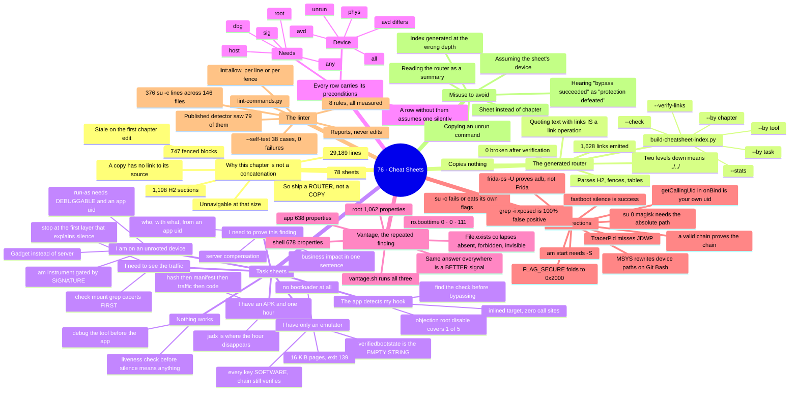
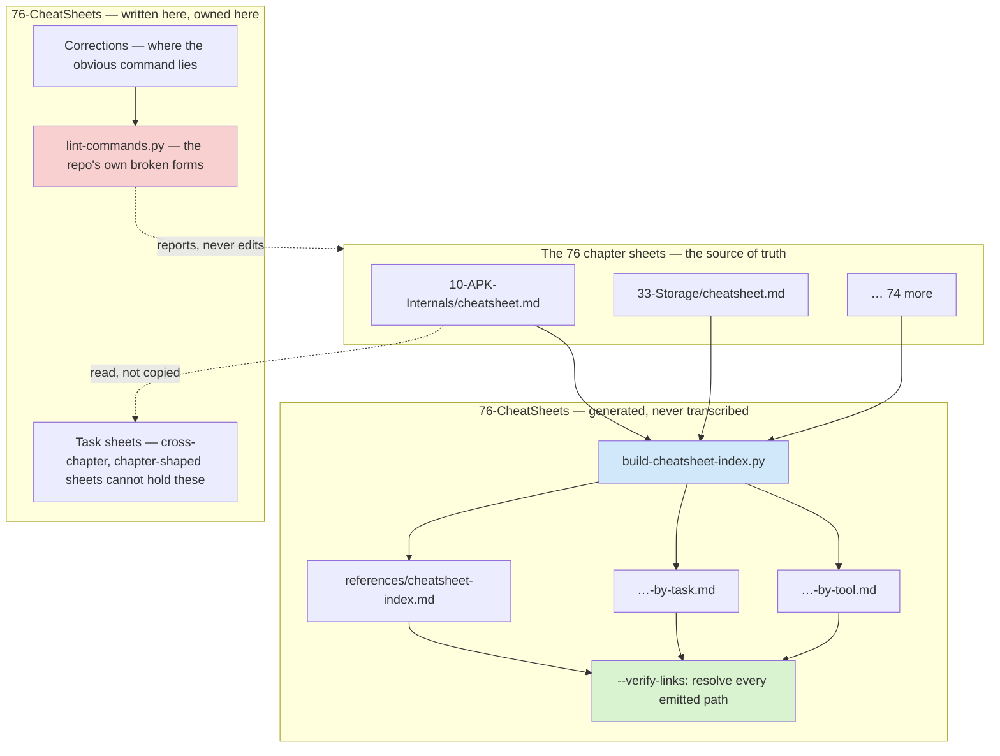
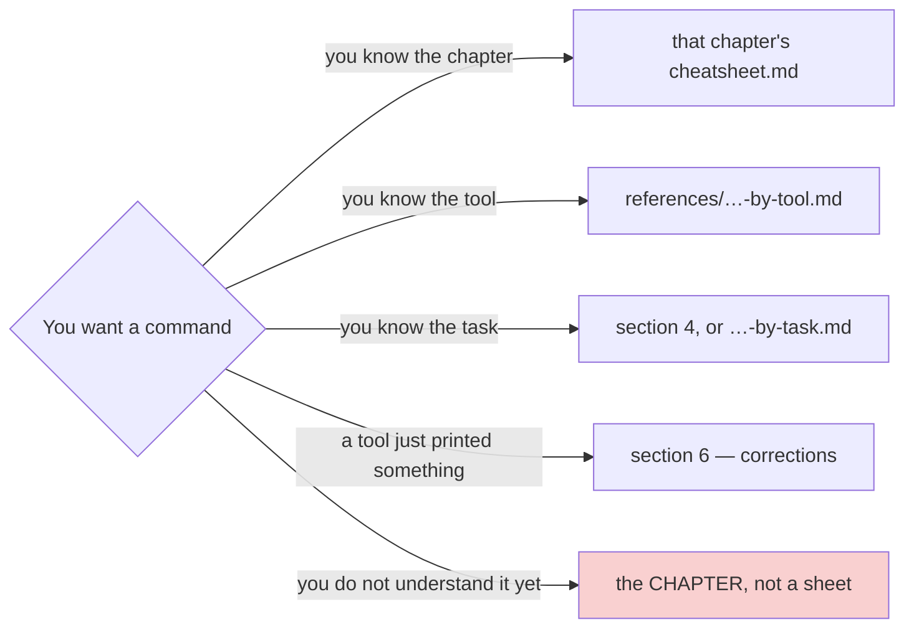

# 76 — Cheat Sheets · Mind map

One map of the whole chapter. The three branches on the left are what this chapter *contains*; the
three on the right are what it *guards against*.

## How the parts fit together

The arrow that matters is the dotted one from the sheets to the task sheets: **read, not copied.**
Everything generated flows one way, from the chapters into `references/`, and can be rebuilt from
nothing. Everything written here is content no chapter owns. Nothing in this chapter is a duplicate
of anything in a chapter, which is why nothing here can go stale independently of its source.

The red box is the linter. It points back at the sources because that is where the defects are — and
it points with a dotted arrow because it **reports and never edits**. Two agents writing to one file
is how a repository loses content.

## The decision the chapter is built on

The red terminal is the one people take by mistake. A cheat sheet read by someone who has not
understood the underlying mechanism is a list of magic words, and the output it produces cannot be
interpreted — which is how a `Job: … sslpinning disable` line ends up in a report as evidence that
an app pins.
