# 78 — Diagrams

> Find any diagram in this repository in seconds, read the notation without guessing, draw one that a
> security reader can trust — and know exactly how the ones you draw will mislead people.

**Prerequisites:** none — this chapter is a lookup artefact and a notation reference, usable from day one
**Applies to:** every chapter; the measurements were taken on Android 15 / API 35

---

## Table of Contents

1. [Introduction](#1-introduction)
2. [How to use this chapter](#2-how-to-use-this-chapter)
3. [The census — what the repository actually contains](#3-the-census--what-the-repository-actually-contains)
4. [Repository-level diagrams](#4-repository-level-diagrams)
5. [How to read the notation](#5-how-to-read-the-notation)
6. [How to draw diagrams for security work](#6-how-to-draw-diagrams-for-security-work)
7. [Confusions and misuse — how diagrams mislead](#7-confusions-and-misuse--how-diagrams-mislead)
8. [Summary](#8-summary)
9. [References](#9-references)

---

## 1. Introduction

This repository contains **775 Mermaid diagrams** outside this chapter. That number is measured, not
estimated — [`scripts/diagram-census.py`](scripts/diagram-census.py) counted them, and section 3
reports the full breakdown.

It was 771 when this chapter was started and 775 by the time it was finished, because
`76-CheatSheets` landed in between. Nothing was retyped to accommodate that; the script was re-run.
That is the entire argument for the design of this chapter, demonstrated on itself within a single
afternoon.

That creates two problems, and only one of them is "where is the diagram I remember seeing".

The first problem is navigation, and it is the easy one. A generated index solves it.

The second problem is that **a diagram is the most confidently wrong artefact in a security
document.** Prose hedges. A sentence can say "usually", "on most builds", "unless the OEM has changed
it". A box-and-arrow diagram cannot. Every arrow you draw makes an implicit claim that the arrows you
did not draw do not exist, and readers believe that claim without noticing they have been asked to.
This chapter's longest section, [section 7](#7-confusions-and-misuse--how-diagrams-mislead), is about
that failure, with cases this repository measured rather than imagined.

> **Mental Model**
> A diagram is a *filter* someone else chose, presented as if it were the *territory*. The value is
> entirely in the filtering — an unfiltered diagram of Android would be unreadable. The danger is
> entirely in forgetting that filtering happened.

### When you reach for this chapter instead of the chapter itself

| You want… | Go to |
|---|---|
| The diagram of Binder transactions you half-remember | The [index](references/diagram-index.md), then the chapter it points at |
| A worked example of a `stateDiagram-v2` to copy the shape of | The [by-type index](references/diagram-index-by-type.md) |
| To understand what `-->>` means, versus `->>` | [Section 5](#5-how-to-read-the-notation) |
| A picture spanning the whole platform, which no single chapter owns | [Section 4](#4-repository-level-diagrams) |
| To draw a trust boundary in your own report without getting it wrong | [Section 6](#6-how-to-draw-diagrams-for-security-work) |
| To know why the diagram you just drew will be believed too much | [Section 7](#7-confusions-and-misuse--how-diagrams-mislead) |
| To check a diagram actually renders before you ship it | [`scripts/validate-mermaid.mjs`](scripts/validate-mermaid.mjs) |

### What this chapter deliberately does not contain

**It does not reproduce the 775 diagrams.** That was the obvious design, and it is wrong for two
reasons that are worth stating plainly, because the same reasoning applies to any aggregation you are
tempted to build:

- **A copied diagram is stale on arrival.** The moment [25-Binder](../25-Binder/README.md) refines its
  transaction diagram, the copy here is a second, contradictory version of the same claim, and there
  is no signal telling a reader which one is current. An index cannot go stale in that way, because it
  is regenerated rather than transcribed.
- **A copied diagram loses its prose.** STYLE-GUIDE.md section 2 requires that "every diagram is
  followed by prose explaining what the reader is looking at — never leave a diagram to speak for
  itself." Copying the diagram and not the prose breaks that rule 775 times. Copying both would be
  copying the repository.

What is genuinely this chapter's own work is the census, the diagrams that belong at repository level
because no single chapter owns them, the notation reference, and section 7.

---

## 2. How to use this chapter

### Finding a diagram

Two generated artefacts, both rebuilt by one command:

```bash
# host, from 78-Diagrams/
python3 -B scripts/diagram-census.py
```

| Artefact | Sorted by | Use it when |
|---|---|---|
| [`references/diagram-index.md`](references/diagram-index.md) | Chapter, then order of appearance | You know roughly which chapter, and want to scan its pictures |
| [`references/diagram-index-by-type.md`](references/diagram-index-by-type.md) | Mermaid family, largest family first | You want an example of a diagram *shape*, regardless of subject |

Every row has the same fields:

| Column | Meaning |
|---|---|
| **Depicts** | The diagram's own `title` if it declares one, otherwise the heading it sits under. **Never invented by the script** — if a diagram sits under a vague heading, the row is vague, and that is a signal about the diagram |
| **Type** | The Mermaid family: flowchart, sequence, state, class, mindmap, block |
| **Nodes** | A crude count of distinct node, participant or class identifiers. A size signal, not an analysis: 4 means a sketch, 30 means a map |
| **Boundaries** | How many `subgraph` blocks it contains. This repository draws a trust boundary as a `subgraph`, so a `0` here means the diagram asserts no boundary |
| **Atk** | `yes` when the diagram colours something `#f9d0d0`, this repository's convention for attacker-controlled input |
| **Location** | A link straight to the file and the section anchor |

> **Pentester's Note**
> The **Boundaries** column is the one to sort by when you are looking for prior art for a report
> diagram. A diagram with two or more `subgraph` blocks has already done the hard part — deciding
> where the boundary goes — and that decision is the reusable part, not the boxes.

### Reading the index rows

A row reads `| 7 | Binder transaction path | sequence | 6 | 0 | yes | README.md:1402 |`. That is: the
seventh diagram in that chapter, a sequence diagram with six participants, asserting no trust
boundary, marking at least one attacker-controlled element, at line 1402 of that chapter's README.
The link resolves to the *section* the diagram lives in, not the raw line, because a line number in a
living document is the first thing to rot.

### Checking a diagram before you ship it

```bash
# host, once, OUT OF TREE so no node_modules lands in the repository
mkdir -p /tmp/mmv && cd /tmp/mmv && npm init -y && npm install mermaid@11 jsdom

# host, from 78-Diagrams/
node scripts/validate-mermaid.mjs --modules /tmp/mmv
node scripts/validate-mermaid.mjs --modules /tmp/mmv --root .   # this chapter only
```

The validator uses Mermaid's own parser, so a block that passes is a block GitHub will draw. It
reports the file, the line, and a **likely cause** drawn from the failure patterns actually observed
in this repository — see [section 3.3](#33-do-the-diagrams-parse).

### Verifying the links this chapter generates

```bash
# host, from 78-Diagrams/
python3 -B scripts/verify-index-links.py
```

This resolves every relative link on disk and checks that the heading anchor exists in the target.
It is not optional politeness. It exists because a sibling generator in this repository emitted
`../NN-Chapter/README.md` from a file inside `references/` — one `../` short, because
`references/` is two levels below the repository root — and produced **1,495 dead links** that
survived for months. Eyes cannot count `../`. Resolve them.

---

## 3. The census — what the repository actually contains

Everything in this section is a measurement taken on **2026-08-16** with CPython 3.13.3 and Node
v20.19.1 on Windows 11. Re-run the scripts before quoting any of it; every number here moves when a
chapter is edited.

### 3.1 Diagram count and mix

```bash
# host, from 78-Diagrams/
python3 -B scripts/diagram-census.py --stats
```

**775 Mermaid diagrams** across **172 markdown files**, in every chapter that has a README plus the
repository-root files. That is the count *excluding this chapter*; chapter 78 contributes 37 of its
own, which the script counts and reports separately, for a repository total of **812**.

| Family | Count | Share | What it is used for here |
|---|---:|---:|---|
| flowchart | 402 | 51.9% | Structure, layering, decision paths, "where does the data go" |
| mindmap | 159 | 20.5% | The per-chapter `mindmap.md` and the Summary block of each README |
| sequence | 144 | 18.6% | Anything with ordering: IPC, boot, handshakes, hook installation |
| state | 32 | 4.1% | Lifecycles — activity, process, key, token, session |
| block layout | 27 | 3.5% | Memory maps and file layouts, where a flowchart would lie about adjacency |
| class | 11 | 1.4% | Object models: `ArtMethod`, `Parcel`, provider hierarchies |

Two things in that table are worth stopping on.

**Half the repository is flowcharts.** That is not wrong in itself — flowchart is the general-purpose
family — but it is the family that most easily hides ordering. When you see a flowchart in a chapter
about a protocol, ask whether the author meant a sequence diagram and reached for the familiar tool.
[Section 6.3](#63-choosing-the-family) is about that choice.

**Sequence diagrams are only 18.6%, and they are where the parse failures cluster** (section 3.3).
The sequence grammar has more reserved words and stricter statement termination than flowchart, so it
punishes casual text. That is a fact about Mermaid, not about the authors.

Size distribution: the **median diagram has 7 nodes** and the largest has **46**. A 7-node diagram is
the right size for this material. Treat 30-plus as a smell — it is usually two diagrams that have not
been separated yet.

Convention adoption, which is the interesting part:

| Convention (STYLE-GUIDE.md section 6) | Diagrams using it | Share |
|---|---:|---:|
| Draws at least one `subgraph` (a named trust boundary) | 215 | 27.7% |
| Colours attacker-controlled input `#f9d0d0` | 300 | 38.7% |

> **Warning**
> Read those two numbers together and the finding is uncomfortable: **more diagrams mark
> attacker-controlled input than draw a boundary for it to cross.** 300 diagrams say "this is hostile"
> and only 215 say where hostile stops being able to reach. Marking the input without drawing the
> boundary is the more dangerous half done first — it tells the reader to worry without telling them
> where the worrying ends. [Section 6.1](#61-show-the-boundary-do-not-imply-it) is the fix.

### 3.2 Where the diagrams are, and where they are not

**663** diagrams sit in chapter `README.md` files. **112** sit elsewhere — in `mindmap.md`, in
`faq.md`, in individual lab files. Any aggregator that only walked READMEs would silently miss one
diagram in seven.

```bash
# host, from 78-Diagrams/
python3 -B scripts/diagram-census.py --poor
```

The least-illustrated chapter READMEs, and the honest reading of each:

| Chapter README | Diagrams | Is that a problem? |
|---|---:|---|
| [76-CheatSheets](../76-CheatSheets/README.md) | 1 | **No.** A reference chapter under STYLE-GUIDE.md section 4a |
| [79-Glossary](../79-Glossary/README.md) | 1 | **No.** A reference chapter under STYLE-GUIDE.md section 4a. Its one diagram is the Summary mind map, which is what the contract asks for |
| [80-Appendix](../80-Appendix/README.md) | 1 | **No.** Same contract |
| [77-UsefulCommands](../77-UsefulCommands/README.md) | 3 | **Defensible.** A command surface is a table, not a picture |
| [33-Storage](../33-Storage/README.md) | 4 | **Worth a look.** Storage is exactly the topic where a `block-beta` filesystem layout earns its place |
| [66-Instrumentation](../66-Instrumentation/README.md) | 4 | **Worth a look.** Its central result is about *vantage point*, which is a boundary question |
| [72-RealWorldFindings](../72-RealWorldFindings/README.md) | 4 | **Defensible.** Findings are narrative |
| [74-CaseStudies](../74-CaseStudies/README.md) | 4 | **Defensible.** Same |
| [75-InterviewQuestions](../75-InterviewQuestions/README.md) | 4 | **Defensible.** Question banks are lists |

Every non-reference chapter README clears the STYLE-GUIDE.md section 2 minimum of two diagrams:

```bash
# host, from 78-Diagrams/
python3 -B scripts/diagram-census.py --check
# checked 80 chapter READMEs; 0 problem(s)
```

> **Pentester's Note**
> "Diagram-poor" is not automatically a defect, and the table above deliberately says so for five of
> the eight rows. A chapter whose subject is genuinely a list should not be padded with pictures to
> satisfy a counter. The number is a prompt to *ask*, and the answer is allowed to be "no". Treat
> automated findings on your own repository exactly as you treat them on a client's.

### 3.3 Do the diagrams parse?

```bash
# host, from 78-Diagrams/
node scripts/validate-mermaid.mjs --modules /tmp/mmv
```

This is the measurement that matters most, because a diagram that does not parse renders on GitHub as
a red error box — a defect every reader sees and no author does, since editor previews vary and a
broken block often looks fine while you are writing it.

**753 of 812 blocks parse. 59 do not, across 44 files in 40 chapters — 7.3%.** None of the 59 is in
this chapter, and none is in `76-CheatSheets`; every one of the 37 diagrams authored here parses.

That is a real result and it is reported here rather than quietly fixed, because this chapter's job is
to measure the repository, and because fixing 40 other chapters is not this chapter's mandate. Every
failure has a file and a line in the validator's output.

The six causes, each confirmed by reducing it to a two-line diagram that fails and a one-character
edit that fixes it:

| Count | Cause | Why Mermaid rejects it | The fix |
|---:|---|---|---|
| 35 | A **semicolon** inside message or label text, e.g. `K-->>SH: SIGCHLD; wait4() returns status` | `;` is a statement separator. Everything after it is parsed as a new statement | Use a comma, or `<br/>` |
| 10 | **Unquoted parentheses or brackets in mindmap text**, e.g. `O(1) average O(n) worst` | In `mindmap`, `(`, `[` and `{` are the node *shape* delimiters | Quote it: `id["O(1) average"]` |
| 6 | A **backslash-escaped quote** inside a quoted label, e.g. `A["getDeclaredMethod(\"x\")"]` | Mermaid has no backslash escape inside `[" "]` | Use `#quot;` or drop the inner quotes |
| 6 | A **`style` line inside a `sequenceDiagram`** | The sequence grammar has no styling statement at all | Use a `rect rgb(...)` block, or say it in a `Note` |
| 1 | A **participant id colliding with a keyword** — `participant Opt as Optimiser` | Sequence keywords match case-insensitively, so `Opt` is lexed as the `opt` block keyword and the rest of the diagram collapses | Rename the id. The display name survives via `as` |
| 1 | Unquoted parentheses in flowchart node text | Same as the mindmap case | Quote the whole label |

> **Under the Hood**
> The keyword-collision case is the one that will bite you personally, because it looks like a working
> diagram until you add a second message. The reserved ids in a sequence diagram include `opt`, `alt`,
> `else`, `loop`, `par`, `and`, `rect`, `break`, `critical`, `note`, `end`, `activate`, `deactivate`,
> `box`, `over`, `link` and `title` — matched **without regard to case**. `participant Note as Notepad`
> is broken. `participant N as Notepad` is fine. Sequence diagrams are 18.6% of this repository and
> carry a disproportionate share of its parse failures for exactly this kind of reason.

A seventh cause was found by this chapter, in this chapter, and it is worth recording because it is
the same shape as the sixth. The Summary mind map in [section 8](#8-summary) originally contained the
leaf `mindmap the parts of a topic`. A mindmap leaf whose text **begins** with a diagram-type keyword
makes Mermaid re-detect the diagram type mid-body and abort. The map did not render, and it looked
completely fine in an editor. It was caught by running the validator on this chapter — which is the
only reason it is a footnote rather than a defect shipped in the chapter that tells everyone else to
check theirs.

> **Warning**
> Mermaid tells you **where** it stopped, never **why**. Its reported line number is the line where the
> parser gave up, which is frequently the line *after* the one that broke it: an unterminated message
> swallows the following line before failing. `validate-mermaid.mjs` prints the reported line, the
> source at that line, and a suggested cause — but the suggestion is a heuristic over six known
> patterns, not a second parser. Read the line above it too.

### 3.4 How the census is produced

Both scripts extract fenced blocks with the same state machine, and two details make it correct.
Both are worth copying, because both were bugs first.

**A fence is closed only by a run of at least as many backticks with no info string.** Without that
rule, a `mermaid` block shown as an *example* inside a wider four-backtick fence gets counted as a
real diagram. This chapter contains several such examples in
[section 6](#6-how-to-draw-diagrams-for-security-work); a naive `grep` for a mermaid fence counts
them and is wrong.

**A fence line must match the whole line.** A regex anchored only at the start treats an ordinary
paragraph that happens to *begin* with backticks as opening a fence, and everything after it — every
heading, every link — disappears from the parser's view. That defect produced twenty phantom
"no such anchor" reports in this chapter before it was found.

Neither script transcribes anything. The census reads the repository; the index is written from what
it read; nothing in `references/` is hand-edited. That is the whole design, and it is borrowed
directly from [75-InterviewQuestions](../75-InterviewQuestions/README.md), which solved the same
problem for question banks.

---

## 4. Repository-level diagrams

These are the diagrams no single chapter owns, because each spans the whole platform. They are
authored here, and they are the only diagrams in this chapter that are *content* rather than
*reference*.

All of them parse — verified with `validate-mermaid.mjs --root .`, not by eye.

### 4.1 The Android security stack, end to end

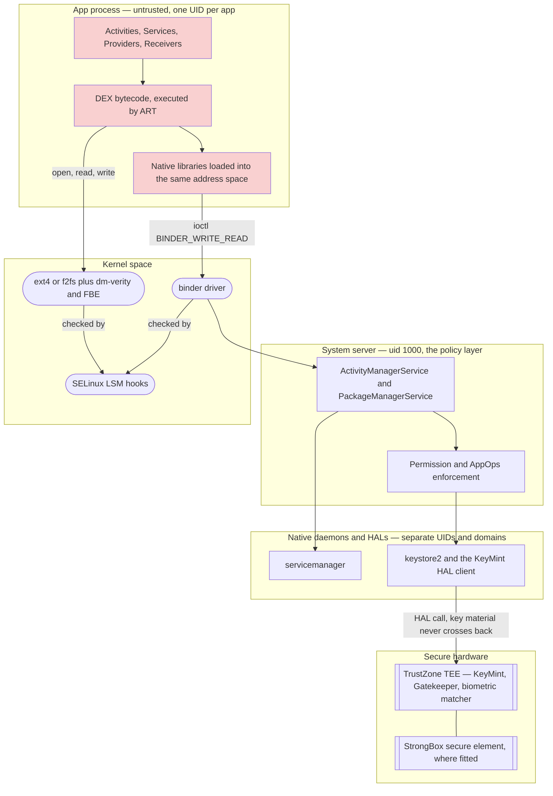

Read it from the top. Everything in the red boxes is code an attacker who controls the app — a
repackager, a malware author, or the device owner — can change at will. Everything below the first
boundary is code they cannot change without a separate privilege escalation.

The three arrows that leave the app process are the entire attack surface of the platform from an
app's position: **Binder** (which reaches `system_server` and every registered service), the
**filesystem**, and — not drawn, because it leaves the device — the **network**. Every finding in
chapters 24 through 30 is an argument about the first arrow. Every finding in chapter 33 is about the
second.

Note what the diagram asserts by omission, and check the assertion: there is no arrow from the app
process directly to the TEE. Key material genuinely never crosses back — but *use* of a key does, via
`keystore2`, and that is why [49-KeyStore](../49-KeyStore/README.md) insists that KeyStore prevents
extraction and not use. The diagram is correct and still invites the wrong conclusion, which is the
theme of section 7.

### 4.2 The boot chain, hardware root of trust to app code

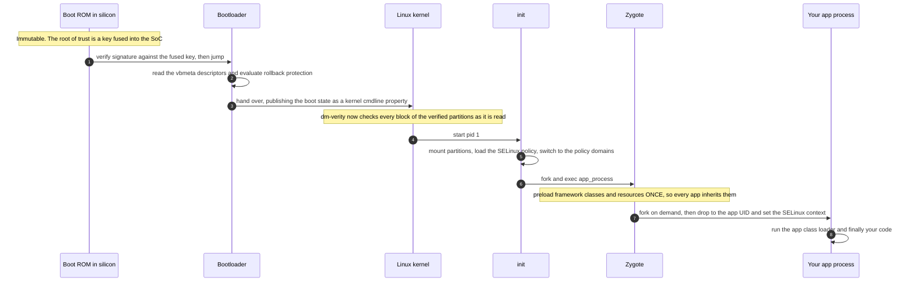

Each step verifies the next before transferring control, which is what "chain" means: break any link
and every link below it is unverified, which is precisely what unlocking a bootloader does.

Two consequences that this shape makes visible and that people miss.

**The boot state is a claim, not a check.** The bootloader *publishes* the verified boot state; it does
not enforce anything about it afterwards. Anything reading `ro.boot.verifiedbootstate` at runtime is
reading a property, and a property is only as trustworthy as the process that can write it. This is
why [20-Security-Architecture](../20-Security-Architecture/README.md) insists that only *server-side*
verification of a hardware-backed attestation has cryptographic weight.

**Zygote forks and does not exec**, which is step 9. Forking is why app startup is fast, and it is also
why every app on a device shares the same library layout until reboot — the ASLR weakness in
[19-Memory](../19-Memory/README.md).

> **Warning**
> On the emulator used for this chapter's measurements, `ro.boot.verifiedbootstate` is **empty**. The
> emulator does not run the first two steps of this diagram at all. A diagram of the boot chain can be
> *read* on an emulator and cannot be *verified* on one — which is a good example of a picture whose
> top half you must take on trust from the platform documentation rather than from your own device.

### 4.3 Where every chapter sits in the platform

```mermaid
flowchart LR
    subgraph Found["Foundations — 01 to 05"]
        F1["CS, Linux, programming, Java, Kotlin"]
    end
    subgraph Plat["Platform — 06 to 08"]
        P1["Architecture, AOSP, build system"]
    end
    subgraph Exec["Code and execution — 09 to 19"]
        E1["App internals, APK, DEX, ART, native, JNI, ARM, memory"]
    end
    subgraph Model["Security model — 20 to 25"]
        M1["Security architecture, sandbox, SELinux, permissions, IPC, Binder"]
    end
    subgraph Surface["App attack surface — 26 to 33"]
        S1["Intents, providers, services, receivers, activities, manifest, storage"]
    end
    subgraph Crypto["Crypto and transport — 34 to 36, 44"]
        C1["Cryptography, TLS, pinning, network security config"]
    end
    subgraph Prot["Client-side protections — 37 to 43"]
        R1["Root, tamper and emulator detection, obfuscation, R8, WebView"]
    end
    subgraph Ident["Identity — 45 to 50"]
        I1["OAuth, tokens, auth, biometrics, KeyStore, secure hardware"]
    end
    subgraph Tools["Tradecraft — 51 to 67"]
        T1["Dynamic and static analysis, Frida, JADX, Ghidra, ADB, Magisk, hooking"]
    end
    subgraph Applied["Applied — 68 to 75"]
        A1["Reverse engineering, malware, vuln research, OWASP, findings, labs, cases"]
    end
    subgraph Ref["Reference — 76 to 80"]
        X1["Cheatsheets, commands, diagrams, glossary, appendix"]
    end

    Found --> Plat --> Exec --> Model
    Model --> Surface
    Model --> Crypto
    Surface --> Prot
    Crypto --> Ident
    Prot --> Tools
    Ident --> Tools
    Tools --> Applied
    Applied --> Ref
```

This is a reading order, not an architecture. The arrows mean "this makes more sense after that", and
the only genuinely hard dependency is the leftmost chain: you cannot reason about the sandbox without
processes and UIDs, and you cannot reason about hooking without knowing what an `ArtMethod` is.

Notice that **Tradecraft has two inbound arrows and no outbound ones except to Applied**. That shape is
deliberate and it is the honest one: tools are downstream of understanding. A reader who starts at
Frida and works backwards will be able to run commands and unable to explain results, which is exactly
the mid-to-senior gap described in [80-Appendix](../80-Appendix/README.md) section 10.

### 4.4 The complete trust-boundary map

This is the diagram to have in your head during an engagement. Every finding you will write is a claim
that data or control crossed one of these lines in a direction it should not have.

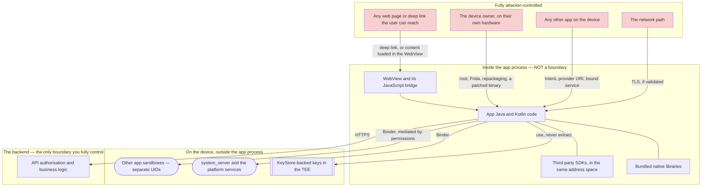

The box labelled **"Inside the app process — NOT a boundary"** is the point of the whole diagram, and
it is drawn as a box specifically so that you notice it is not one. Its four members are joined with
undirected `---` links rather than arrows, because there is no direction of trust between them: a
third-party analytics SDK can read your `SharedPreferences`, call your JNI functions, and see every
string you decrypt. Obfuscation, root detection and pinning all live inside this box. That is why
[80-Appendix](../80-Appendix/README.md) rates them as business risks rather than user-data risks.

The only line in the diagram with a genuinely enforced boundary on both sides is the one to the
backend. Everything a client checks, an owner can uncheck.

> **Mental Model**
> When you cannot decide a finding's severity, find the finding on this map. If the data crosses from
> `Hostile` into `AppProc` and stops, it is a client-side issue and the severity argument is about
> business risk. If it crosses into `Device` or `Server`, it is a data-and-authorisation issue and the
> argument is about users.

### 4.5 One Binder call, across every boundary

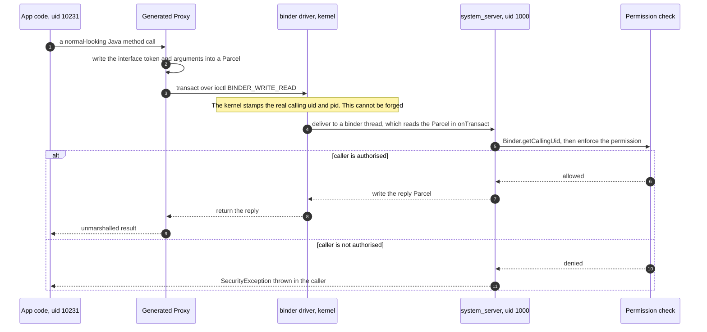

This one sequence is the shape of nearly every privileged operation on Android, and it is worth being
able to draw from memory. The load-bearing step is the `Note` at step 4: the caller's UID is applied
by the kernel, not supplied by the caller, which is what makes `Binder.getCallingUid()` a sound basis
for authorisation and `getCallingPid()` — recyclable, raceable — an unsound one.

Two things the diagram deliberately shows that a simpler version would flatten. The **Parcel** is drawn
as its own step rather than folded into the transport, because parcel read/write mismatches are their
own vulnerability class. And the **denial path is drawn**, because a diagram showing only the happy
path teaches a reader that the check exists without teaching them what happens when it fires — and
"what happens on failure" is where the bugs are.

### 4.6 The engagement, static through dynamic to reporting

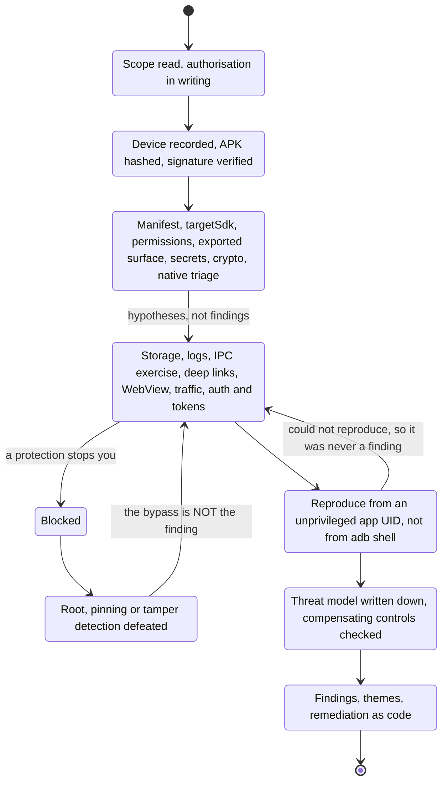

The three loops are the whole method, and every one of them is a place people leave early.

`Blocked → Bypass → Dynamic` exists to make the point structurally: the bypass returns you to where you
were, it does not advance you. A report whose highest-severity item is "root detection can be
bypassed" has mistaken a door for a room.

`Confirm → Dynamic` is the loop that removes findings. A behaviour observed only from `adb shell` was
observed at uid 2000 with developer privileges an app does not have. If it does not reproduce from an
app UID, it never existed, and the correct action is to delete it rather than soften its wording.

A state diagram is the right family here, and a flowchart would have been wrong: the same state is
entered repeatedly from different places, which flowchart arrows express badly and states express
naturally.

### 4.7 The device-state machine an engagement moves through

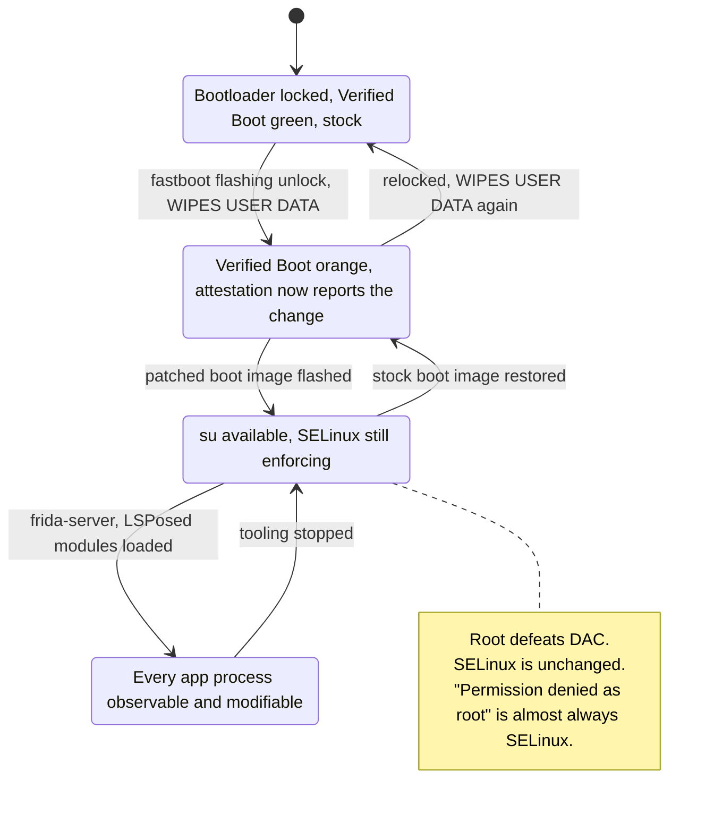

Each transition costs something, and knowing what it costs is what stops you from starting an
engagement on a device you cannot restore. The two `WIPES USER DATA` labels are on the diagram rather
than in a footnote because that is the fact people discover after the fact.

The note is on the diagram for the same reason: the single most common wasted hour in Android testing
is a root user hitting `Permission denied` and concluding the file does not exist. It is
[22-SELinux](../22-SELinux/README.md), and the diagram says so where you will be looking.

> **Pentester's Note**
> Measured on the emulator used for this chapter: `su 0 id` returns
> `uid=0(root) ... context=u:r:su:s0` while SELinux reports `Enforcing`. Both are true at once. Root
> and unconfined are different properties, and only one of them is on this diagram — which is
> precisely why the note is there.

---

## 5. How to read the notation

Nobody in this repository has written this down, and a reader who cannot tell `-->>` from `->>` is
losing information on every sequence diagram they read.

### 5.1 The five families this repository uses

| Family | Answers the question | Reach for it when |
|---|---|---|
| `flowchart` | *What connects to what?* | Structure, layering, containment, decision trees |
| `sequenceDiagram` | *In what order, between whom?* | Protocols, IPC, boot, hooking, anything where ordering is the point |
| `stateDiagram-v2` | *What state is it in, and what changes that?* | Lifecycles, sessions, keys, device state |
| `classDiagram` | *What is the shape of this data?* | Object models, structure layouts, inheritance |
| `mindmap` | *What are the parts of this topic?* | Summaries and revision. Never for mechanism |

`block-beta` is used for the 27 cases where relative position carries meaning — memory maps, file
layouts — because a flowchart would let the renderer move boxes and would therefore lie about
adjacency.

### 5.2 Flowchart arrows and node shapes

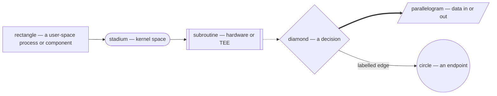

| Notation | Reads as |
|---|---|
| `-->` | A solid directed edge: control or data flows this way |
| `---` | An undirected link: an association with no direction of trust |
| `-.->` | A dotted edge: conditional, optional, or an indirect relationship |
| `==>` | A thick edge: the primary path, when several are drawn |
| `-- "text" -->` | A labelled edge. **In this repository the label names the transport**: `Binder`, `socket`, `syscall`, `HTTPS` |
| `A["text"]` | Rectangle — a user-space process or component |
| `A(["text"])` | Stadium — **kernel space** |
| `A[["text"]]` | Subroutine shape — **hardware, TEE or secure element** |
| `A{"text"}` | Diamond — a decision |
| `subgraph X["name"]` | **A trust boundary**, and the name says whose |

The shape conventions in the last three rows are this repository's, from STYLE-GUIDE.md section 6, not
Mermaid's. Mermaid attaches no meaning to shapes at all.

### 5.3 Sequence arrows — the four you must tell apart

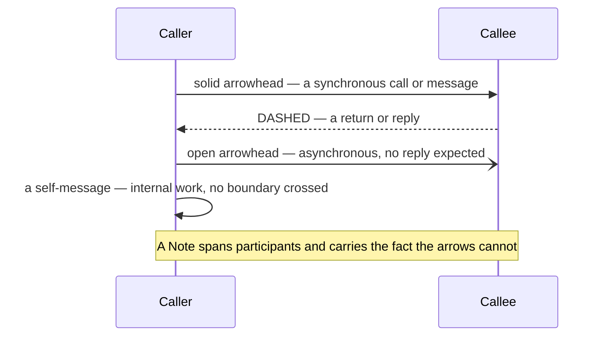

| Notation | Reads as | Getting this wrong costs you |
|---|---|---|
| `->>` | A call or message *out* | — |
| `-->>` | A **return**, reply or result coming *back* | Reading a reply as a second call invents an interaction that does not exist |
| `-)` | Asynchronous send, no reply expected | Assuming ordering that the system does not guarantee |
| `->>` with the same participant twice | Internal work — **no boundary is crossed** | Reading internal work as IPC invents an attack surface |
| `activate` / `deactivate`, or a `+`/`-` suffix | The participant is executing on the stack for that span | — |
| `alt` / `else` | Mutually exclusive paths | — |
| `opt` | A block that may not happen at all | — |
| `loop` | Repetition, with the condition in the label | — |
| `Note over A,B` | A statement the arrows cannot carry | The `Note` is usually the most important line in the diagram |

> **Warning**
> The dashes matter and they are easy to miss at a glance. `A->>B` followed by `B->>A` describes
> **two independent calls, in two directions**. `A->>B` followed by `B-->>A` describes **one call and
> its answer**. In a diagram of an authorisation flow, those are completely different systems, and the
> second one has a boundary the first does not.

### 5.4 State and class notation

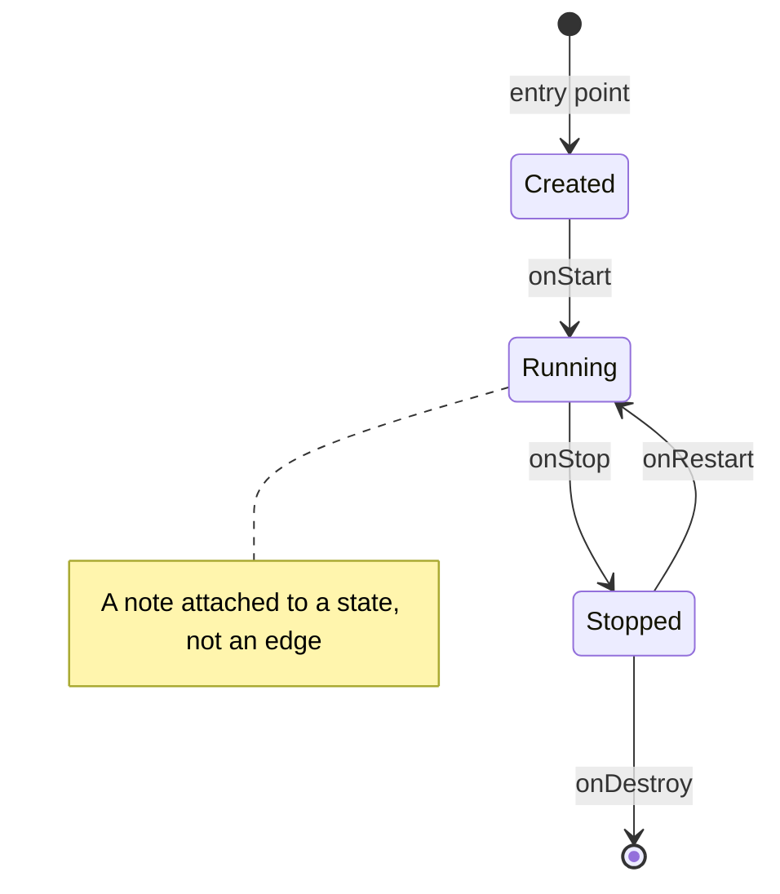

`[*]` is the start or end pseudo-state. The label after the colon on an edge is the **event that causes
the transition**, which is the part to read first: in security work the interesting question is almost
always "what can an attacker send that causes this transition", and the edge labels are the answer.

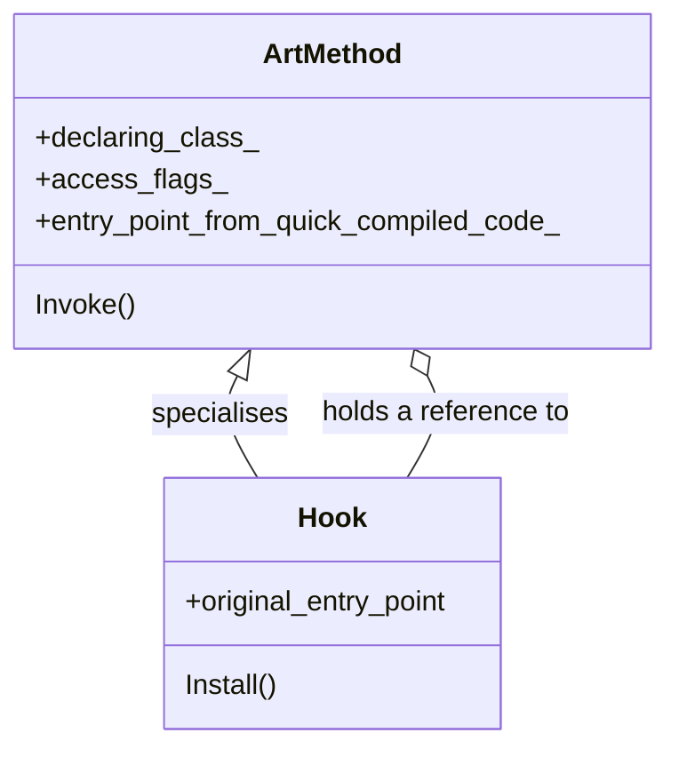

`+` is public and `-` is private. `<|--` is inheritance, `o--` is aggregation, `*--` is composition,
and `-->` is a plain association. For security reading, the relationship arrows matter far less than
the **field list**, because a field is a thing you can locate in memory and overwrite.

### 5.5 This repository's own conventions

| Convention | Written as | Meaning |
|---|---|---|
| Trust boundary | `subgraph Name["Whose boundary this is"]` | Crossing this line changes who is trusted |
| Attacker-controlled | `style X fill:#f9d0d0` | This node's content is chosen by someone hostile |
| Kernel space | `A(["name"])` | Runs in the kernel |
| Hardware or TEE | `A[["name"]]` | Outside the main OS entirely |
| Transport | The edge label | `Binder`, `socket`, `syscall`, `HTTPS`, `ioctl` |
| Not a boundary | A `subgraph` whose name says so, members joined with `---` | Deliberately drawn to be dismissed |

The last row is a convention this chapter introduces, in [section 4.4](#44-the-complete-trust-boundary-map),
and it is the one most worth adopting. Drawing a box that the caption then denies is the only reliable
way to stop a reader from assuming a boundary that is not there, because leaving the box out entirely
does not stop them — it just leaves them to invent their own.

> **Warning**
> `style` does not exist in `sequenceDiagram`. Six diagrams in this repository apply the
> `fill:#f9d0d0` convention to a sequence diagram and fail to parse as a result. To mark hostility in
> a sequence diagram, use a `rect rgb(249,208,208)` block around the messages, or state it in a
> `Note over`. The `Note` is usually clearer anyway.

---

## 6. How to draw diagrams for security work

### 6.1 Show the boundary, do not imply it

A diagram that lays out five components and connects them with arrows has said nothing about trust.
The reader supplies the boundaries from their own assumptions, and their assumptions are wrong in a
predictable direction: they assume more separation than exists.

Compare. First, the version people draw:

````markdown
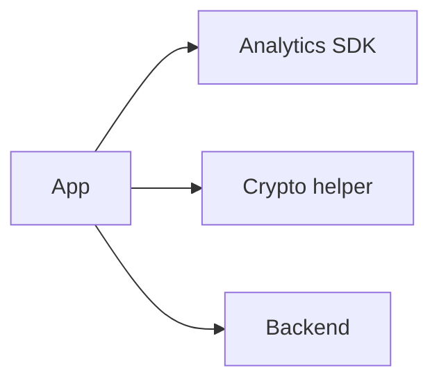
````

Four boxes, three arrows, and every claim it makes about security is false by omission. Now the same
system with the boundaries drawn:

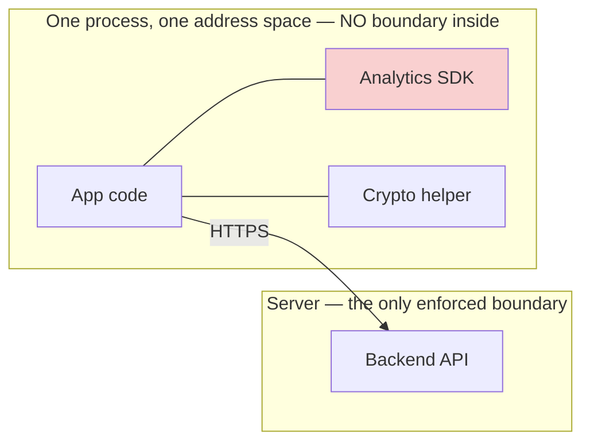

Same components. The second one says that the analytics SDK is inside the same address space as the
crypto helper, that it is drawn as untrusted, and that the only boundary in the system is the one to
the server. That is a diagram a reader can act on.

### 6.2 Mark what the attacker controls

Colour every node whose content an attacker chooses. Not the node where the *bug* is — the node where
the *input* is. Those are different, and the whole point of the exercise is to make the path between
them visible.

Three specific mistakes to avoid, all of them observed:

- **Marking the vulnerable component instead of the input.** The reader then cannot see how the
  attacker reaches it, which is the only part that determines exploitability.
- **Marking the attacker's *process*.** Every other app is attacker-controlled. Marking them all is
  the same as marking none. Mark the *data* — the extra in the Intent, the URI, the response body.
- **Marking the input and stopping.** As measured in [section 3.1](#31-diagram-count-and-mix), this
  repository has 300 diagrams that mark attacker input and only 215 that draw any boundary. Marking
  says "worry"; the boundary says "worry up to here". Only the pair is useful.

### 6.3 Choosing the family

| If the reader's question is… | Draw a | Do **not** draw a |
|---|---|---|
| "What can reach what?" | `flowchart` with `subgraph` boundaries | Sequence — it will imply an order that is not required |
| "Who talks to whom, in what order?" | `sequenceDiagram` | Flowchart — ordering will be invisible and readers will assume the wrong one |
| "What can this thing be, and what moves it?" | `stateDiagram-v2` | Flowchart — repeated entry into one state becomes spaghetti |
| "What is in this structure?" | `classDiagram`, or a table | Flowchart |
| "Where is this in memory or on disk?" | `block-beta` or a fenced ASCII layout | Flowchart — the renderer will move the boxes |
| "What are the parts of this subject?" | `mindmap` | Anything, if you are trying to show mechanism |

The commonest error is a flowchart standing in for a sequence diagram, because flowchart is the
familiar tool. The tell is arrows carrying verbs in the past tense — "sent the token", "returned the
key". Verbs on edges usually mean you meant to draw time.

### 6.4 Draw the actual flow, not the intended one

This is the one that separates a diagram worth putting in a report from one that just looks
professional.

An **intended flow** is what the design says happens. An **actual flow** is what the device does, and
you only know it after you have measured. Two versions of the same claim:

**Intended** — how a root check is described in a design document:

````markdown
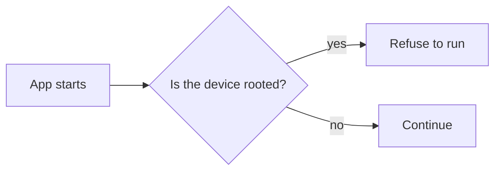
````

**Actual** — what a measured version looks like once you have run it:

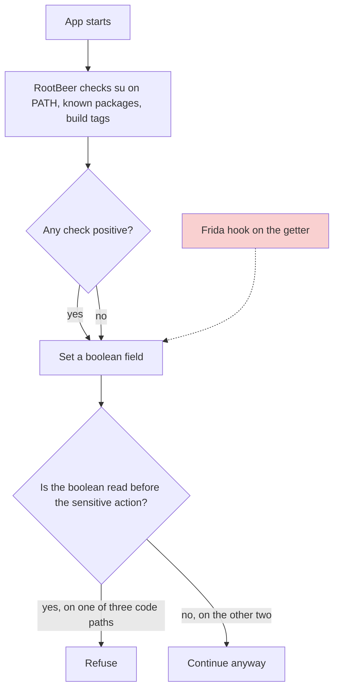

The second diagram is uglier and it is the one that is true. It shows that the check produces a
*value* rather than a *decision*, that the value is consulted inconsistently, and that a hook on one
getter is sufficient. None of that is visible in the first diagram, and all of it is what determines
whether there is a finding.

> **Pentester's Note**
> The practical rule: **do not draw a decision diamond you have not watched execute.** If you have not
> traced it, draw the boxes you observed and leave the connection unlabelled, or dotted. An honest gap
> in a diagram is information. A confident guess is a liability, and it is the thing a client will
> quote back at you.

### 6.5 Checklist before you ship a diagram

- [ ] Does every `subgraph` name say *whose* boundary it is, not just what is inside it?
- [ ] Is attacker-controlled **input** coloured, not just the vulnerable component?
- [ ] Does every edge in a sequence diagram name its transport?
- [ ] Are returns drawn `-->>` and calls drawn `->>`?
- [ ] Is there a failure or denial path, or only the happy one?
- [ ] Have you drawn any arrow you have not observed? Mark it dotted or remove it.
- [ ] Is there prose beside it saying what the reader is looking at?
- [ ] **Does it parse?** `node scripts/validate-mermaid.mjs --modules /tmp/mmv --root .`
- [ ] Would a reader who believes there are no other arrows be misled? If yes, say so in the prose.

---

## 7. Confusions and misuse — how diagrams mislead

This is the highest-value section in this chapter, and it is the reason the chapter is not just an
index.

### 7.1 The completeness illusion

A diagram makes exactly one claim that its author never intended: **that the arrows it draws are all
the arrows there are.**

Prose does not do this. Write "the app talks to `system_server` over Binder" and no reader concludes
that the app talks to nothing else. Draw one arrow from the app to `system_server` and many readers
conclude precisely that — not because they are careless, but because a diagram's whole function is to
be a complete picture of a chosen scope, and the scope is rarely stated.

The consequences are asymmetric and always in the same direction:

| The diagram omits | The reader concludes | The cost |
|---|---|---|
| A path that exists | It does not exist | A missed finding, or a control that was never tested |
| A boundary that exists | Everything inside is one trust domain | Over-stated severity |
| A boundary that does **not** exist | These components are separated | Under-stated severity — the expensive direction |
| A failure path | The check always fires | A bypass nobody looked for |

> **Mental Model**
> Read every security diagram twice. The first pass reads the arrows. The second pass asks: *what edge
> would have to exist for this diagram to be dangerously wrong, and has anyone checked?* The second
> pass is where findings come from.

### 7.2 Three measured cases where the obvious diagram omits the path

These are not hypotheticals. Each was measured, three of them elsewhere in this repository and one
here on the emulator described in [section 3](#3-the-census--what-the-repository-actually-contains).

#### Case 1 — the app process that runs commands as uid 2000

The sandbox diagram everyone draws puts app code inside a box labelled with the app's UID, and the box
is the boundary. From that picture, code running in an app process can do exactly what that UID can
do.

[66-Instrumentation](../66-Instrumentation/README.md) measured the edge that picture omits: under an
instrumentation harness, `UiAutomation.executeShellCommand` executes **as uid 2000** while the calling
code sits inside the app process. One process, two vantage points, and the diagram has one box.

The consequence is not abstract. A detection probe written inside an instrumented test, using
`executeShellCommand` because it is convenient, measures what the *shell* can see and reports it as
what the *app* can see. Everything downstream of that measurement is wrong, and the diagram is what
made it look sound.

#### Case 2 — the patch that changed nothing

The obvious diagram of a licence gate is a chain: check the licence, branch on the result, unlock or
refuse. Patch the branch and you win.

[74-CaseStudies](../74-CaseStudies/labs/lab-02-the-patch-that-changed-nothing.md) and
[59-radare2](../59-radare2/labs/lab-04-ctf-the-gate-that-was-not-there.md) measured the case where
patching the branch changes nothing, because an **upstream guard short-circuits before the licence
check is ever reached**. The licence comparison the reverse engineer spent two hours on is dead code
on the path that actually runs.

The diagram was not wrong about the licence check. It was wrong about being the whole path — it drew
the *named* mechanism, because the function was called something meaningful, and omitted the unnamed
one that actually decides. Naming is a filter, and diagrams inherit it.

#### Case 3 — the check whose answer is the same either way

Root and Xposed detection routines commonly test for paths such as `/data/adb/lspd`. The diagram is a
one-liner: path exists, therefore LSPosed, therefore rooted.

Measured on the emulator for this chapter, Android 15 / API 35, `userdebug`, SELinux `Enforcing`:

```console
# adb shell — as the shell user, uid 2000
$ ls -ld /data/adb/lspd
ls: /data/adb/lspd: Permission denied
$ ls -ld /data/adb/zzz_definitely_absent
ls: /data/adb/zzz_definitely_absent: Permission denied
```

Two paths, one of which was then **created as root** and one of which never existed. Asked again from
the unprivileged caller, after creation:

```console
# adb shell — the directory now exists, verified as root
$ ls -ld /data/adb/lspd
ls: /data/adb/lspd: Permission denied
```

`/data/adb` is mode `drwx------ root root`. An unprivileged caller cannot traverse it, so it gets
`EACCES` for every name underneath — present, absent, or invented. **The check's answer does not depend
on the thing it claims to check.** The arrow in the detection diagram, from "check path" to "rooted",
carries no information at all.

The diagram is not merely incomplete here. It is drawing a decision node that is not a decision.

#### Case 4 — the `su` that is not the `su` in the picture

The canonical Magisk diagram shows the app calling `su`, `su` talking to `magiskd`, and `magiskd`
granting or denying. It puts `su` at `/system/bin/su` inside a Magisk-managed mount namespace.

Measured on this emulator, where the Magisk app reports version **30.7** and `magiskd` is running:

| Question | Answer measured |
|---|---|
| Where is `su`? | `/system/xbin/su`, **not** `/system/bin/su` |
| What is it? | `-rwsr-x--- 1 root shell u:object_r:su_exec:s0 51224` — a setuid binary from the `userdebug` build |
| Does `/system/bin/su` exist? | No, for either an unprivileged or a root caller |
| Is `magiskd` running? | Yes, pid 377, executing `/debug_ramdisk/magisk` |
| What context does root land in? | `u:r:su:s0`, with SELinux still `Enforcing` |

So on this device the root you get comes from the **`userdebug` build's own `su`**, in the `su_exec`
domain, and never touches `magiskd` at all — even though Magisk is installed and its daemon is
running. A detection routine built from the canonical diagram looks for the wrong file, in the wrong
directory, and concludes the device is clean while an `su` two directories away hands out uid 0.

> **Pentester's Note**
> This is the general lesson, not a Magisk quirk. **A diagram of a rooting mechanism is a diagram of
> one deployment of it.** Before you rely on any path in such a picture, ask the device: `command -v
> su`, then `ls -lZ` the answer. Two commands, and they replace an assumption with a fact.

### 7.3 The boundary that is drawn but is not one

The mirror-image failure, and the one that inflates severities.

Three boxes that regularly appear as boundaries and are not:

- **The app process versus the SDKs inside it.** Drawn as separate boxes in almost every architecture
  diagram, because that is how the *code* is organised. There is no boundary. One address space, one
  UID, one set of permissions. [Section 4.4](#44-the-complete-trust-boundary-map) draws this
  explicitly as a non-boundary for exactly this reason.
- **`exported="false"` as an impermeable wall.** It controls reachability by *other apps*. It does not
  stop `shell`, it does not stop platform components with the right permission, and it does not stop
  the app's own other components. See the entry in [79-Glossary](../79-Glossary/README.md#5-terms-people-confuse).
- **The WebView as a separate context.** It is a component of the app process. Whether it is a boundary
  depends entirely on `addJavascriptInterface`, file access settings, and what URLs it will load —
  which is to say, on configuration a diagram usually does not show.

There is a fourth that is subtler: **root drawn as the top of the stack**. Root defeats DAC. SELinux
still applies. On the emulator measured here, root lands in `u:r:su:s0` with SELinux `Enforcing`, so
"I am root, therefore this box has no walls" is false in a way that costs hours. This is why
[section 4.7](#47-the-device-state-machine-an-engagement-moves-through) carries that fact as a note on
the diagram itself rather than in the prose beneath it.

### 7.4 Other ways this material gets misused

**The index treated as a substitute for the chapter.** Every row in
[`references/diagram-index.md`](references/diagram-index.md) is a pointer. It tells you a diagram
exists, what family it is, and how big. It does not tell you what it *means*, because the meaning is in
the prose beside it, in the chapter. Copying a diagram out of this repository and into a report
without its prose reproduces exactly the failure this chapter was designed to avoid.

**The node count read as a quality score.** It is a size signal produced by a crude identifier regex.
A 30-node diagram is not better than a 6-node one; it is more likely to be two diagrams.

**The `Atk` column read as "this diagram covers the attack".** It means the author used a colour. It
does not mean the threat model is complete, or right.

**The parse-failure count read as a quality judgement on those chapters.** Fifty-nine failures across
forty chapters is a *tooling* result: Mermaid's grammar rejects a semicolon in a message, and a
semicolon in a message is a reasonable thing to write. It says nothing about whether those diagrams
are *correct*. A diagram can parse perfectly and be completely wrong about the system, which is the
far more expensive defect and the one no script will ever catch.

**The repository-level diagrams in [section 4](#4-repository-level-diagrams) treated as authoritative
for a specific device.** They describe AOSP's shape. Case 4 above is a measured instance of that shape
being wrong on a real device sitting on the same desk. Verify on the target and cite the target.

**Regenerating the index and assuming the links are fine.** They were not, in the sibling chapter that
tried it, 1,495 times. Run
[`scripts/verify-index-links.py`](scripts/verify-index-links.py) after every regeneration. It takes
under a second and it resolves every link on disk instead of trusting the shape of the string.

> **Warning**
> The single most dangerous artefact you can produce on an engagement is a clean, well-laid-out
> architecture diagram of a system you have only read about. It will be believed more than your prose,
> circulated further than your report, and outlive both. Draw what you measured. Where you did not
> measure, say so on the diagram.

---

## 8. Summary

### Key points

- The repository contains **775 Mermaid diagrams** outside this chapter, in 172 files: 51.9%
  flowcharts, 20.5% mindmaps, 18.6% sequence, and the rest state, block and class. All numbers are
  generated, never transcribed.
- **753 of 812 parse**, counting this chapter's own 37, all of which do. The 59 failures cluster in six
  causes, of which a semicolon in message text is 35 on its own, and the most instructive is a
  participant id colliding with a sequence keyword.
- **300 diagrams mark attacker-controlled input; only 215 draw a boundary.** Marking hostility without
  drawing where it stops is the more dangerous half done first.
- This chapter indexes rather than copies. A copied diagram is stale immediately and separated from the
  prose the style guide requires beside it.
- In a sequence diagram, `-->>` is a **return** and `->>` is a **call**. Confusing them invents or
  erases an interaction.
- A `subgraph` is a trust boundary and its name must say *whose*. `#f9d0d0` marks attacker-controlled
  input. Kernel space is `([ ])` and hardware is `[[ ]]`.
- **Every arrow you draw asserts that the undrawn ones do not exist.** Four measured cases in this
  repository show a real system with a path the obvious diagram omits.
- Draw the actual flow, not the intended one. Do not draw a decision you have not watched execute.
- Diagrams inflate severity by showing boundaries that are not there — app versus SDK, `exported=false`
  as a wall, WebView as a context, root as the top of the stack.
- Generated links must be **resolved**, not read. Eyes cannot count `../`.

### Mind map

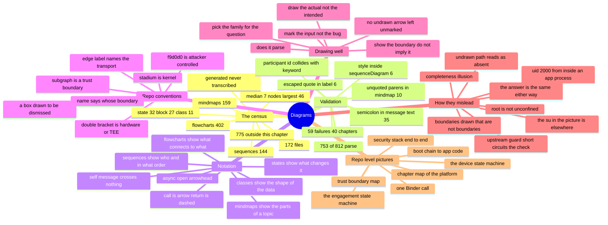

### Quick revision

- What does `-->>` mean in a sequence diagram, and how is it different from `->>`?
- Which Mermaid node shape means kernel space in this repository, and which means hardware?
- What does a `subgraph` assert, and what must its name contain?
- Which colour marks attacker-controlled input, and what is the commonest mistake when applying it?
- Why does `style X fill:#f9d0d0` fail inside a `sequenceDiagram`, and what do you use instead?
- Name the single most common cause of parse failure in this repository.
- Why would `participant Opt as Optimiser` break a diagram that has two messages in it?
- State the one claim every diagram makes that its author never intended.
- Give a measured example of a path an obvious diagram omits.
- Name three boxes that are commonly drawn as boundaries and are not.
- Why is copying a diagram out of its chapter worse than linking to it?
- What must you do to a generated relative link before you trust it?

---

## 9. References

### The tooling used here

- Mermaid — https://mermaid.js.org/
- Mermaid syntax reference, by diagram type — https://mermaid.js.org/intro/syntax-reference.html
- Mermaid live editor, useful for checking a block before committing it — https://mermaid.live/
- GitHub's announcement of native Mermaid rendering in Markdown — https://github.blog/2022-02-14-include-diagrams-markdown-files-mermaid/

### On diagramming systems and security

- C4 model for software architecture — https://c4model.com/ — the clearest public treatment of *levels of abstraction* in a diagram, which is the discipline this chapter's section 6.3 is about
- Microsoft Threat Modeling and the STRIDE method — https://learn.microsoft.com/en-us/security/engineering/threat-modeling-with-stride — data-flow diagrams where trust boundaries are the primary object
- OWASP Threat Modeling — https://owasp.org/www-community/Threat_Modeling
- CISA Secure by Design — https://www.cisa.gov/securebydesign

### Platform sources for the repository-level diagrams

- Android platform architecture — https://developer.android.com/guide/platform
- Android security overview — https://source.android.com/docs/security
- Verified Boot — https://source.android.com/docs/security/features/verifiedboot
- Application sandbox — https://source.android.com/docs/security/app-sandbox
- Binder and AIDL — https://developer.android.com/develop/background-work/services/aidl

### This chapter's own artefacts

- [`references/README.md`](references/README.md) — the annotated index of everything here
- [`references/diagram-index.md`](references/diagram-index.md) — every diagram, by chapter (generated)
- [`references/diagram-index-by-type.md`](references/diagram-index-by-type.md) — every diagram, by family (generated)
- [`cheatsheet.md`](cheatsheet.md) — the notation on one page
- [`mindmap.md`](mindmap.md) — the whole chapter as one map
- [`faq.md`](faq.md) — the questions people actually ask about diagrams
- [`labs/`](labs/) — four labs, ending in a CTF
- [`examples/`](examples/) — the same system drawn badly and drawn well
- [`scripts/`](scripts/) — the census, the validator, the link checker

### Related chapters

- [06-Android-Architecture](../06-Android-Architecture/README.md) — the platform layering that section 4.1 compresses
- [20-Security-Architecture](../20-Security-Architecture/README.md) — Verified Boot and the boot chain in full
- [21-App-Sandbox](../21-App-Sandbox/README.md) — the boundary that section 4.4 says is not where people draw it
- [25-Binder](../25-Binder/README.md) — the transaction that section 4.5 traces
- [66-Instrumentation](../66-Instrumentation/README.md) — the measured uid 2000 case in section 7.2
- [74-CaseStudies](../74-CaseStudies/README.md) — the patch that changed nothing
- [76-CheatSheets](../76-CheatSheets/README.md) — condensed operational references
- [77-UsefulCommands](../77-UsefulCommands/README.md) — the commands behind the measurements here
- [79-Glossary](../79-Glossary/README.md) — terminology, including the confusions section 7.3 depends on
- [80-Appendix](../80-Appendix/README.md) — severity, reporting, and the version matrix
