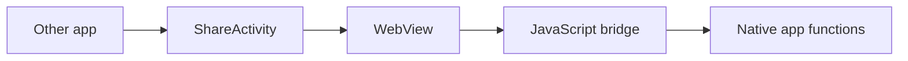
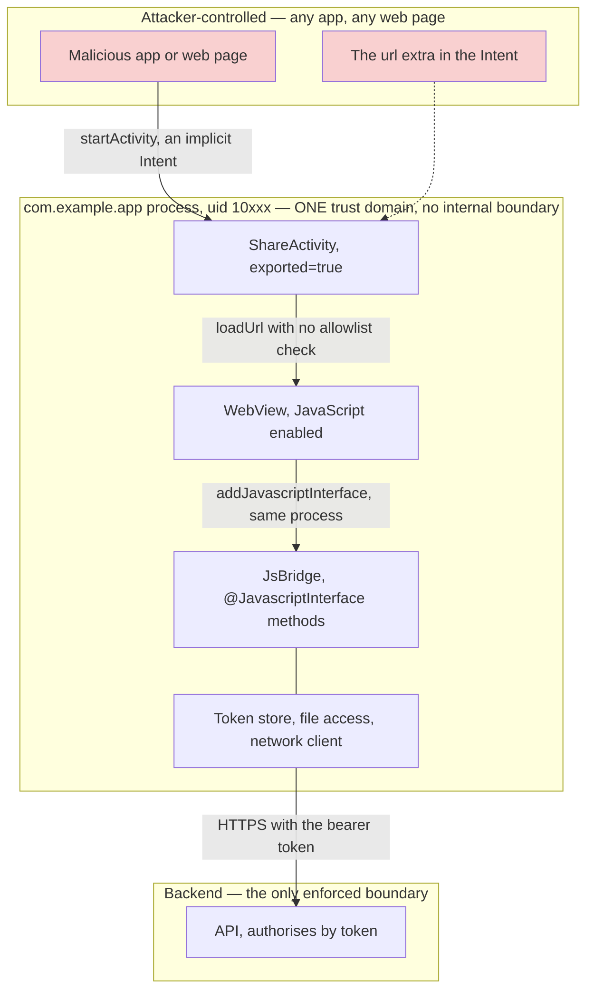
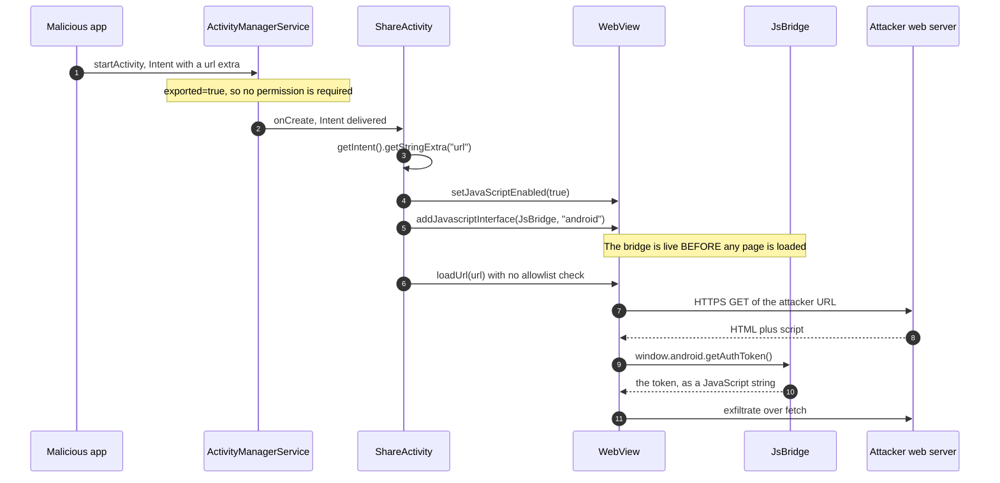

# Example 01 — one system, three diagrams

The same system, drawn three ways, with what each version reveals and what it hides.

The system: an app has an exported activity that accepts a URL in an Intent extra and loads it in a
`WebView` which has a JavaScript bridge registered. This is a composite of patterns covered in
[26-Intent](../../26-Intent/README.md), [30-Activities](../../30-Activities/README.md) and
[43-WebView](../../43-WebView/README.md). It is the shape of a very large number of real findings.

Chapter: [../README.md](../README.md).

---

## Version A — the diagram most people draw

Source, shown as text so you can compare it with the rendered version below:

````markdown

````

Rendered:


### What it gets right

The components are correct and the order of the chain is correct. Someone who has never seen the app
now knows there are five parts and roughly how they connect. That is not nothing.

### What it hides

Almost everything that determines whether there is a finding.

| Question a reader will have | Version A's answer |
|---|---|
| Which of these boxes is hostile? | Silence |
| Where is the trust boundary? | Silence — five boxes in a row implies five separations |
| What crosses the first arrow? | Silence — "Other app" is not the input, the *Intent extra* is |
| Does the app validate the URL? | Silence, which reads as "no such step exists" |
| Are the WebView and the bridge separate from the app? | It draws them as separate boxes. They are not |
| What does an attacker actually get? | Silence |

The last row of that table is the fatal one. **Five boxes in a row is the visual grammar of a
pipeline, and a pipeline implies stages that constrain each other.** A reader is being told, without a
word being written, that getting from "Other app" to "Native app functions" requires passing through
three intermediate things — when in fact all three live in one address space with one UID and
constrain nothing.

### The specific harm

Hand version A to a developer and ask where to add validation. They will point at the arrow between
`WebView` and `JavaScript bridge`, because that is where the diagram makes the boundary look like it
is. The correct answer is the arrow into `ShareActivity`, which the diagram draws as the least
interesting edge on the page.

---

## Version B — the same system with the boundaries drawn

````markdown

````

Rendered:


### What changed

Six things, and each is a decision you should be able to defend:

1. **Three `subgraph` blocks**, and each name says *whose* boundary it is. The middle one says
   explicitly that it is not a boundary at all, which is the single most important sentence on the
   page.
2. **The attacker-controlled *input* is coloured, not the attacker's process.** `URL` is the extra
   that travels; `EXT` is who sends it. Colouring only `EXT` would have said "another app is hostile",
   which every reader already knows and which names nothing you can validate.
3. **`BR --- FN` is undirected.** There is no direction of trust between the bridge and the functions
   it can reach; they are peers in one address space. An arrow would have implied a gate.
4. **Every edge names its transport**: `startActivity`, `loadUrl`, `addJavascriptInterface`, `HTTPS`.
   A reader can now grep the app for each one.
5. **`URL -.-> ACT` is dotted** because the extra is data carried by the Intent rather than an
   independent call. The dot says "this is a payload, not a separate interaction".
6. **The missing check is named on the edge**: `loadUrl with no allowlist check`. The absence is
   stated where the reader is looking, rather than left to be inferred from a box that is not there.

### What version B still does not show

Ordering. You cannot tell from it whether the bridge is registered before or after `loadUrl` is
called, and that matters: a bridge registered after navigation begins is reachable by a page that has
already loaded, and a bridge registered before is reachable from the first frame. For ordering, you
need version C.

---

## Version C — the same system as a sequence

````markdown

````

Rendered:


### What only version C shows

**Step 4 is a self-message.** `ACT->>ACT` crosses no boundary — it is the app reading its own Intent.
Drawing it as a message to another participant would have invented an interaction. Drawing it not at
all would have hidden where the untrusted value enters the app's own code, which is exactly the line a
reader needs to find in JADX.

**Steps 5 to 7 are ordered, and the order is the finding.** The `Note over WV,BR` states the
consequence: the bridge is registered before navigation, so it is reachable from the very first script
the attacker's page runs. Reverse steps 6 and 8 and the exploit has a race in it. Version B cannot
express that difference at all.

**Step 12 is drawn `-->>`, dashed.** It is the bridge *returning* a value, not calling out. If it were
drawn `->>` a reader would conclude the bridge initiates contact with the WebView, which would suggest
a completely different design — and a different set of things to test.

**`AMS` appears as a participant.** It is not part of the app, and putting it on the page makes it
visible that the delivery is mediated by the platform and that the platform decided not to require a
permission. Version B compressed that into an edge label.

---

## Which one do you ship?

| Audience | Version | Why |
|---|---|---|
| A developer being asked to fix it | **B** | The boundary is the fix. The answer is "validate at the edge into `ShareActivity`", and B is the only version where that edge is visually load-bearing |
| A security reviewer deciding severity | **B**, then **C** | B establishes that the app process is one trust domain, which is what makes the impact real. C establishes reachability |
| A reader learning the pattern | **C** | Ordering is the mechanism, and the mechanism is what generalises to the next app |
| An executive summary | **None of them.** A sentence | "Any installed app can make this app load an attacker-chosen web page, which can then read the user's session token." Diagrams below, if they want them |
| Nobody, ever | **A** | It is confidently wrong in the direction that under-states severity |

---

## The general rule this example demonstrates

**Draw the boundaries first, the ordering second, and the components last.**

Components are what you notice first and what matters least. Anyone can list five classes. The
question a diagram exists to answer is which of them constrain each other — and version A, which is
the version almost everybody draws by default, answers it wrongly by saying nothing.

> **Pentester's Note**
> When you inherit a diagram from a client's documentation, it is almost always a version A. Do not
> annotate it. Redraw it as a version B, and the act of deciding where the `subgraph` blocks go will
> generate your test plan for you: every boundary you draw is a claim you now have to verify, and
> every claim you cannot verify is a question for the developers.

---

## Verify these render

```bash
# host, from 78-Diagrams/
node scripts/validate-mermaid.mjs --modules /tmp/mmv examples/01-one-system-three-diagrams.md
```

The three fenced-in-fence listings above are *not* counted as diagrams by either script, because a
four-backtick fence is closed only by four backticks. That is the same rule that keeps the census
honest — see [section 3.4](../README.md#34-how-the-census-is-produced).
