# Example 02 — the seven ways a diagram in this repository fails to parse

Every failure pattern measured in this repository, as a minimal reproduction and its one-character
fix. Each broken case is shown as *text* — inside a wider fence, so it is never counted as a diagram
and never renders as a red box. Each fixed case is a real, rendering diagram.

Measured with Mermaid 11.16.1 under Node v20.19.1 on 2026-08-16: **753 of 812 blocks parse, 59 do
not**, across 44 files in 40 chapters.

Chapter: [../README.md](../README.md). Cheat sheet: [../cheatsheet.md](../cheatsheet.md).

---

## Why bother

A diagram that does not parse renders on GitHub as a red error box. It is the one defect in a
repository that **every reader sees and no author does**, because Markdown previewers vary, editors
disagree, and a broken block usually looks fine while you are typing it.

Nothing about the seven patterns below is exotic. Every one of them is a reasonable thing to want to
write. Mermaid's grammar simply says no.

---

## 1 — A semicolon in message or label text

**35 of 59 failures.** By a wide margin the commonest.

Broken:

````markdown
```mermaid
sequenceDiagram
    participant K as Kernel
    participant SH as Shell
    K-->>SH: SIGCHLD; wait4() returns status 0
```
````

Mermaid's error: `Parse error on line 4`, with the caret under the semicolon.

**Why.** `;` is a statement separator in Mermaid, exactly as it is in C. Everything after it is parsed
as a new statement, and `wait4() returns status 0` is not one.

Fixed — a comma:

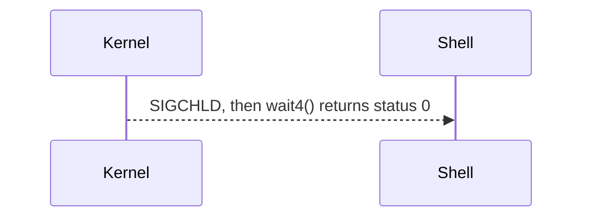

Fixed — a line break, when the two halves are genuinely two facts:

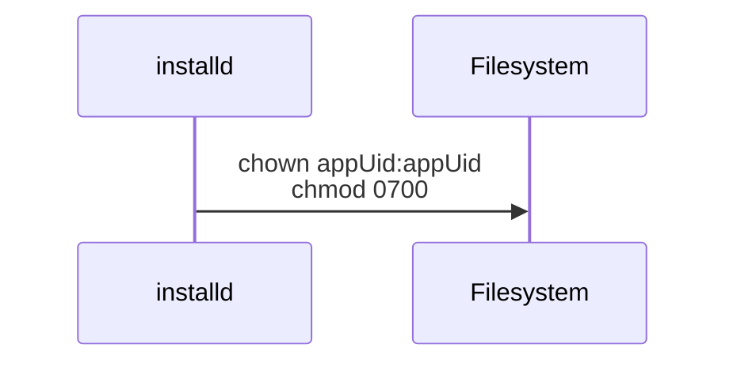

> **⚠️ Warning**
> This one bites hardest when you are transcribing shell commands or C into a message. `setgroups(3003,
> ...) ; setresgid ; setresuid(10231)` is a perfectly good description of what Zygote does and it is
> not a diagram. Put the command in a fenced code block beside the diagram, and put the *meaning* in
> the message.

---

## 2 — Unquoted parentheses or brackets in mindmap text

**10 of 59 failures.**

Broken:

````markdown
```mermaid
mindmap
  root((Hash table))
    Collision handling
      O(1) average O(n) worst
```
````

**Why.** In `mindmap`, `(`, `[`, `{` and `((` are the node **shape** delimiters — that is how
`root((Hash table))` gets its circle. A leaf whose text contains them is asking for a shape and
supplying nonsense inside it.

Fixed — quote the whole label, which also lets you pick the shape:

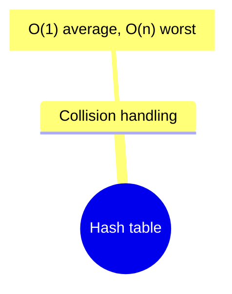

Fixed — or just avoid the characters, which is usually clearer in a mind map:

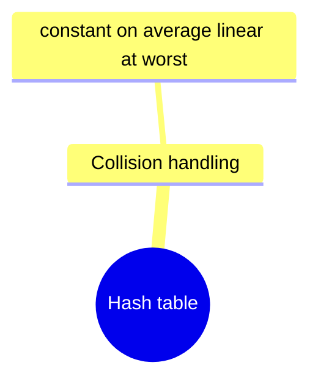

---

## 3 — A backslash-escaped quote inside a quoted label

**6 of 59 failures.**

Broken:

````markdown
```mermaid
flowchart LR
    A["ctx.getSharedPreferences(\"prefs\", MODE_PRIVATE)"] --> B["ContextImpl"]
```
````

**Why.** Mermaid has no backslash escape inside `[" "]`. The first `\"` ends the label, and the
remainder is parsed as diagram syntax.

Fixed — the HTML entity `#quot;`:

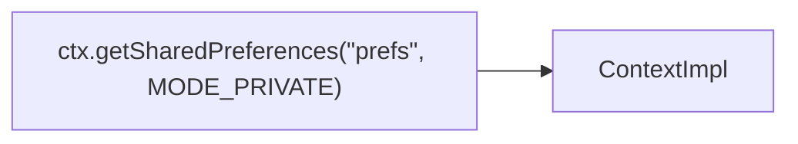

Fixed — or drop the inner quotes, which is usually more readable at diagram size:

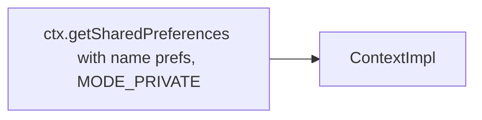

---

## 4 — `style` inside a `sequenceDiagram`

**6 of 59 failures**, and the most interesting one, because it is this repository's own convention
outrunning the tool.

Broken:

````markdown
```mermaid
sequenceDiagram
    participant M as Malware code
    participant S as String decryptor
    M->>S: decrypt(blob)
    style M fill:#f9d0d0
```
````

**Why.** The sequence grammar contains no `style` production at all. STYLE-GUIDE.md section 6 says to
colour attacker-controlled input `#f9d0d0`; that instruction is written for flowcharts and cannot be
followed literally here.

Fixed — a `rect` block, which is the sequence family's only region colouring:

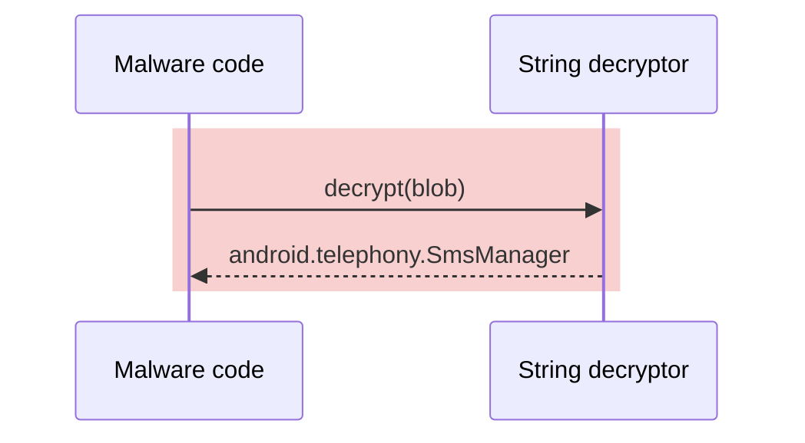

Fixed — or, usually better, a `Note`, because it can say *why*:

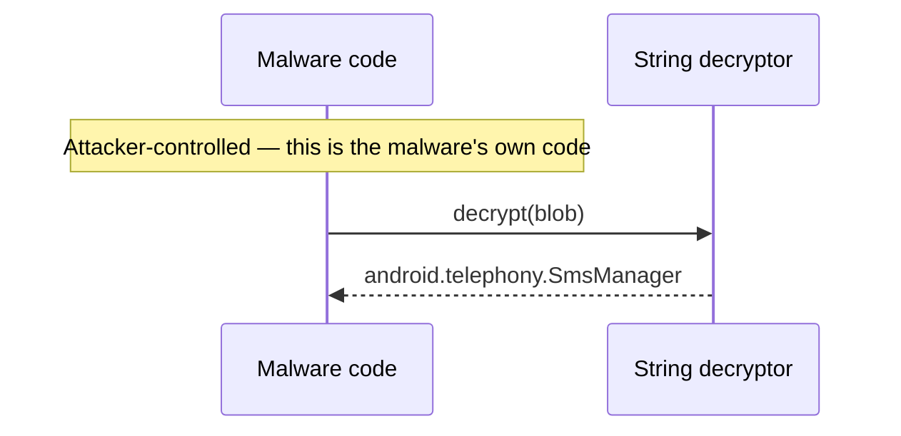

> **🧠 Mental Model**
> A convention that cannot be expressed in a family is a signal, not an obstacle. If you find yourself
> wanting to colour a participant in a sequence diagram, ask whether you actually wanted a flowchart —
> "who is hostile" is a structural question, and structure is what flowcharts are for.

---

## 5 — A participant id that collides with a keyword

**1 of 59 failures**, and the one most likely to waste your afternoon, because it looks like a working
diagram until you add a second message.

Broken:

````markdown
```mermaid
sequenceDiagram
    participant Enq as Enqueuer
    participant Opt as Optimiser
    Enq->>Enq: mark reachable types
    Enq->>Opt: the live program only
```
````

**Why.** Sequence keywords are matched **without regard to case**. `Opt` is lexed as the `opt`
(optional block) keyword, so the parser is waiting for a block body and gets a message instead. The
error points at the *second* message, not at the declaration, which is why this is hard to find.

The reserved ids: `opt`, `alt`, `else`, `loop`, `par`, `and`, `rect`, `break`, `critical`, `option`,
`note`, `end`, `activate`, `deactivate`, `autonumber`, `link`, `links`, `box`, `over`, `right`,
`left`, `of`, `title`.

Fixed — rename the **id**, keep the label:

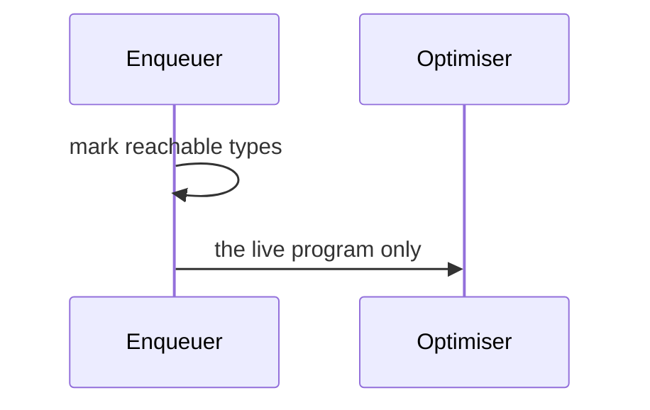

> **🔍 Pentester's Note**
> The general habit worth forming: **participant ids should be short and meaningless; participant
> labels should be long and meaningful.** `participant A as ActivityManagerService` never collides
> with anything. The moment you make the id readable you are competing with the grammar for the same
> words.

---

## 6 — Unquoted parentheses in flowchart node text

**1 of 59 failures.**

Broken:

````markdown
```mermaid
flowchart LR
    A[exit_group(0) syscall] --> B[process reaped]
```
````

**Why.** `(` opens a round-shaped node. `A[exit_group(` is a malformed shape declaration.

Fixed — quote the whole label. This is the habit to form for *every* label, not just the ones that
currently break:

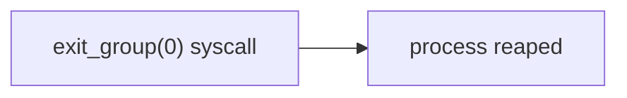

---

## 7 — A mindmap leaf whose text starts with a diagram-type keyword

**0 of the 59 in the repository, and 2 in this chapter while it was being written**, which is why it is
here.

Broken:

````markdown
```mermaid
mindmap
  root((Notation))
    Families
      mindmap the parts of a topic
      flowchart what connects to what
```
````

**Why.** Mermaid detects the diagram type from a keyword at the start of a line. A leaf beginning with
`mindmap` restarts type detection mid-body and the parse aborts.

Fixed — reword so the keyword is not the first word:

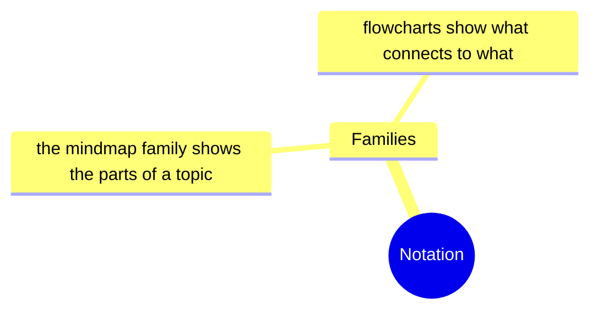

Fixed — or quote it, which keeps the wording exactly:

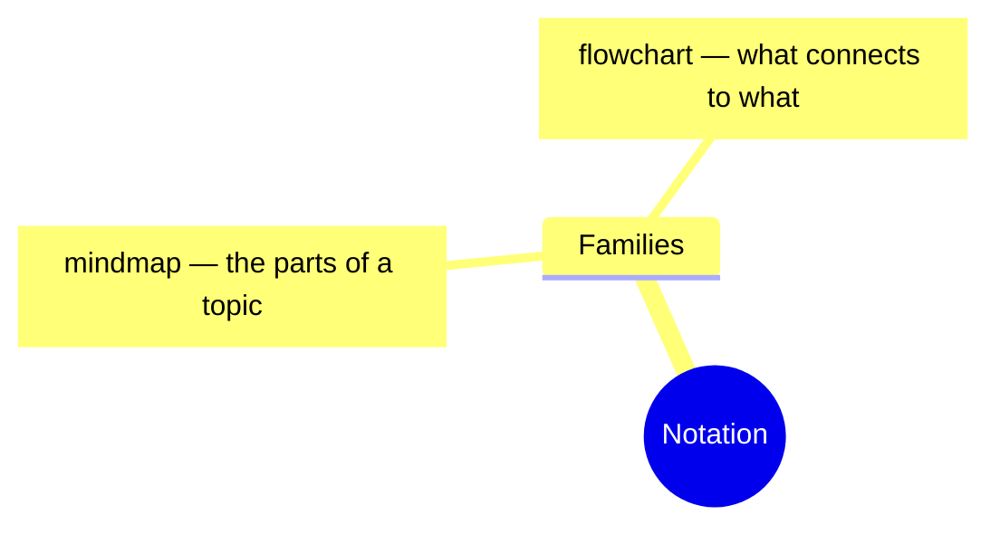

---

## Reproduce all of this

```bash
# host, one-time setup, OUT OF TREE so no node_modules lands in the repository
mkdir -p /tmp/mmv && cd /tmp/mmv && npm init -y && npm install mermaid@11 jsdom

# host, from 78-Diagrams/ — this file: every block above should parse
node scripts/validate-mermaid.mjs --modules /tmp/mmv examples/02-broken-diagrams-and-their-fixes.md

# host — the whole repository, with a likely cause per failure
node scripts/validate-mermaid.mjs --modules /tmp/mmv

# host — machine-readable, for grouping the failures yourself
node scripts/validate-mermaid.mjs --modules /tmp/mmv --json
```

Every **broken** listing above sits inside a four-backtick fence, so neither script counts it. Every
**fixed** listing is a real diagram and is parsed by the command above. That is deliberate: a file
about parse failures that itself contains parse failures would be an unusually stupid artefact to
ship.

---

## What none of this tells you

Whether the diagram is *correct*.

All seven patterns are grammar problems, and a validator finds grammar problems. A diagram can parse
perfectly, render beautifully, and describe a system that does not exist — which is the far more
expensive defect and the one no script will ever catch. That failure is
[section 7](../README.md#7-confusions-and-misuse--how-diagrams-mislead) of the chapter, and the labs.
