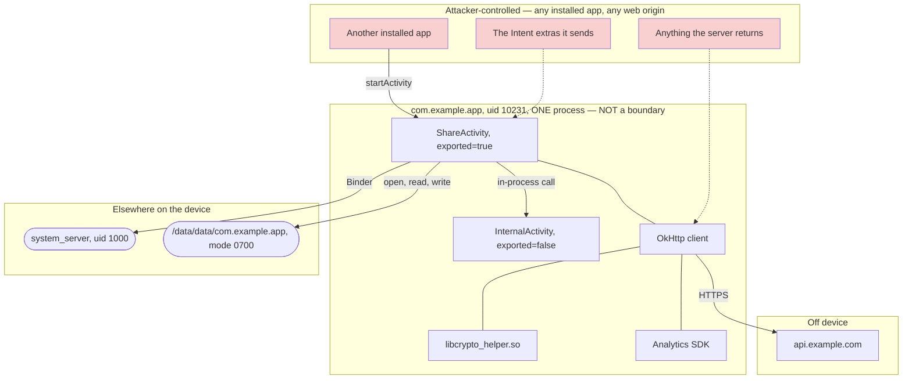

# Lab 01 — Draw the trust boundaries of a real app, from evidence only

> Produce a trust-boundary diagram of an app on your device in which **every box, every arrow and
> every boundary is backed by a command you ran** — and where the things you could not verify are
> visibly marked as unverified.

**Difficulty:** Beginner to Intermediate
**Time:** 90–150 minutes
**Prerequisites:** [60-ADB](../../60-ADB/README.md), [32-Manifest](../../32-Manifest/README.md),
[21-App-Sandbox](../../21-App-Sandbox/README.md), and
[section 6](../README.md#6-how-to-draw-diagrams-for-security-work) of this chapter
**You need:** any Android device or emulator with `adb`, and an app you are authorised to inspect

---

## Why this lab exists

Almost every architecture diagram you will ever be handed was drawn from a document. It shows the
system somebody intended to build. Your job on an engagement is to describe the system that exists,
and the fastest way to learn the difference is to try to draw one from nothing but measurements and
notice how often you reach for a fact you do not actually have.

The discipline this lab teaches is a single rule:

> **🧠 Mental Model**
> **One command per claim.** If a box, an arrow or a boundary in your diagram is not backed by
> something you ran and can paste, it does not go in solid. It goes in dotted, or it does not go in at
> all.

That rule is unreasonable, and that is the point. You will find that four or five things you "know"
about the app turn out to be assumptions, and every one of those is a place a real finding could hide.

---

## Ethics and scope

Use an app you are entitled to analyse: one you wrote, a purpose-built vulnerable app from
[80-Appendix](../../80-Appendix/README.md) section 3, or a system app on your own emulator. Do not use
this lab as an excuse to probe a third-party production app you have no authorisation for. Nothing in
this lab requires a specific target — the method is the deliverable.

---

## Setup

### Confirm your device

```bash
# host
adb devices -l
adb shell getprop ro.build.version.release
adb shell getprop ro.build.version.sdk
adb shell getprop ro.build.type
adb shell getenforce
adb shell id
```

Record what comes back. It goes at the top of your deliverable, because **a diagram without a device
is a diagram without a scope**. On the reference device used to write this lab:

```
sdk_gphone16k_x86_64, Android 15, API 35, userdebug
SELinux: Enforcing
adb shell id: uid=2000(shell) gid=2000(shell) ... context=u:r:shell:s0
```

That last line is the one people skip and the one that invalidates conclusions. **You are uid 2000.**
Every observation you make from `adb shell` is an observation from the shell's vantage, not the app's.
Write it down now, because you will need it in step 6.

### Choose a target and pin the version

```bash
# host — what is installed
adb shell pm list packages -3

# host — pin the exact version you are describing
adb shell dumpsys package <pkg> | grep -E "versionName|versionCode|targetSdk|minSdk"
adb shell pm path <pkg>
```

A diagram of "the app" is worthless six weeks later. A diagram of `com.example.app 4.2.1
(versionCode 4021), targetSdk 35` is evidence.

---

## Part 1 — Enumerate the components, and only the components

**Objective:** produce the list of boxes, with no arrows and no boundaries yet.

Resist drawing anything. The commonest way this exercise goes wrong is drawing the shape you expect
and then hunting for evidence to justify it.

```bash
# host — the manifest as the platform actually parsed it
adb shell dumpsys package <pkg> > pkg.txt

# host — the declared components
adb shell dumpsys package <pkg> | sed -n '/Activity Resolver Table/,/Service Resolver Table/p'
adb shell dumpsys package <pkg> | sed -n '/Service Resolver Table/,/Receiver Resolver Table/p'
adb shell dumpsys package <pkg> | sed -n '/Provider Resolver Table/,/^$/p'

# host — the UID the platform assigned
adb shell dumpsys package <pkg> | grep -E "userId=|pkgFlags"
```

If you have the APK, cross-check against the binary manifest rather than a decompiler's rendering:

```bash
# host
adb pull $(adb shell pm path <pkg> | head -1 | cut -d: -f2 | tr -d '\r') app.apk
aapt2 dump xmltree --file AndroidManifest.xml app.apk | head -80
```

> **⚠️ Warning**
> `dumpsys package` and `aapt2 dump xmltree` can disagree with what `jadx` shows you, and when they do,
> the platform is right. [10-APK-Internals](../../10-APK-Internals/README.md) covers crafted AXML that
> makes decompilers display one manifest while `PackageManager` parses another. If your diagram is
> going in a report, cite the platform's view.

### Deliverable 1

A plain list. No diagram yet.

```
Components observed, com.example.app 4.2.1, from dumpsys package on API 35:
  Activities  : MainActivity, ShareActivity, SettingsActivity
  Services    : SyncService
  Receivers   : BootReceiver
  Providers   : FileProvider (authority com.example.app.fileprovider)
  UID         : 10231
  Process     : com.example.app (single process — verified in Part 3)
```

Every line above must be traceable to a command. Note "verified in Part 3" — you have *not* verified
the process count yet, and saying so is part of the exercise.

---

## Part 2 — Establish which components are reachable, and by whom

**Objective:** decide, per component, whether an arrow from outside the app may be drawn.

`exported` is the first question and it is version-sensitive. From `targetSdk` 31 onwards a component
with an intent filter must declare `android:exported` explicitly; below that it defaults to `true`.
See the matrix in [80-Appendix](../../80-Appendix/README.md) section 2.

```bash
# host — exported flags as the platform sees them
adb shell dumpsys package <pkg> | grep -B2 -A6 "Activity Resolver Table" | head -40

# host — the definitive per-component check, from the binary manifest
aapt2 dump xmltree --file AndroidManifest.xml app.apk \
  | grep -A4 -E "E: (activity|service|receiver|provider)"
```

Then **test reachability rather than trusting the flag**:

```bash
# host — try to start a component from uid 2000
adb shell am start -n <pkg>/.ShareActivity

# host — try a component you believe is NOT exported
adb shell am start -n <pkg>/.InternalActivity
```

On the reference device, attempting a non-exported activity from the shell produced:

```
java.lang.SecurityException: Permission Denial: starting Intent { ... }
  from null (pid=29734, uid=2000) not exported from uid 1000
```

That is a useful result and it is worth reading carefully. It says **this build's shell does not hold
`START_ANY_ACTIVITY`.** A great deal of folklore assumes it does. Yours may differ; measure rather
than repeat.

> **🔍 Pentester's Note**
> `exported="false"` means "not reachable by other **apps**". It does not mean "not reachable". The
> app's own components reach it, and privileged components may. Your diagram must say which of those
> it means, and the only honest way to know is to try.

### Deliverable 2

An annotated reachability table. This is the raw material for your boundary.

| Component | `exported` | Tested from uid 2000 | Conclusion for the diagram |
|---|---|---|---|
| `ShareActivity` | `true` | started successfully | Solid arrow from outside |
| `InternalActivity` | `false` | `SecurityException` | No arrow from outside |
| `SyncService` | `false` | `Unable to start service` | No arrow from outside |
| `FileProvider` | `false`, with `grantUriPermissions` | see Part 4 | **Dotted** — reachable only with a grant |

---

## Part 3 — Establish what is inside one address space

**Objective:** decide where the "not a boundary" box goes, which is the single most important box in
the finished diagram.

Everything running in one process shares one address space, one UID, and one permission set. Third-
party SDKs, bundled native libraries and the WebView are all inside it. Architecture diagrams draw
them as separate boxes because that is how the *code* is organised, and readers then infer separation
that does not exist.

```bash
# host — how many processes does the app actually run?
adb shell "ps -A -o USER,PID,NAME | grep <pkg>"

# host — the loaded native libraries, with the app running
adb shell "cat /proc/$(adb shell pidof <pkg> | tr -d '\r')/maps" | grep -oE "/[^ ]+\.so" | sort -u

# host — the app's UID, from the process rather than the manifest
adb shell "cat /proc/$(adb shell pidof <pkg> | tr -d '\r')/status" | grep -E "^Uid|^Gid"
```

A multi-process app is worth noticing: `android:process=":remote"` creates a genuinely separate
process, still with the same UID. That is a *process* boundary and not a *trust* boundary, and your
diagram must not conflate them. Unless the component is `android:isolatedProcess="true"`, in which
case it genuinely is one — see [21-App-Sandbox](../../21-App-Sandbox/README.md).

If you can decompile, list the third-party packages, because each one is a box that belongs inside the
non-boundary:

```bash
# host
jadx -d out app.apk >/dev/null 2>&1
ls out/sources | head -30
```

### Deliverable 3

A single sentence you must be able to defend, plus its evidence:

> "All of `MainActivity`, `ShareActivity`, the OkHttp client, `libcrypto_helper.so` and the analytics
> SDK run in one process, uid 10231, verified by `ps -A` returning one row and by `/proc/<pid>/maps`
> listing `libcrypto_helper.so`. There is no boundary between them."

---

## Part 4 — Establish what leaves the device and what comes back

**Objective:** the arrows to and from outside the device.

```bash
# host — the network security configuration
aapt2 dump xmltree --file res/xml/network_security_config.xml app.apk

# host — cleartext policy and the config reference
aapt2 dump xmltree --file AndroidManifest.xml app.apk \
  | grep -E "usesCleartextTraffic|networkSecurityConfig"

# host — sockets the app holds open, while exercising it
adb shell "cat /proc/net/tcp /proc/net/tcp6" | head -20
```

Capture traffic properly if it is in scope — [35-SSL](../../35-SSL/README.md) — but for this lab you
only need to establish **that** an arrow exists and what transport it uses, not what flows along it.

### Deliverable 4

Arrows with transports named:

```
app process --HTTPS--> api.example.com   (evidence: proxy capture, request log line 44)
app process --HTTPS--> analytics vendor  (evidence: same capture, host differs)
```

---

## Part 5 — Draw it

Now, and only now, draw. Use the conventions in
[section 5.5](../README.md#55-this-repositorys-own-conventions).

Rules for this drawing:

1. Three or four `subgraph` blocks maximum. Each name says **whose** boundary it is.
2. One `subgraph` is named to say it is **not** a boundary. Its members are joined with `---`.
3. Attacker-controlled **input** is `style X fill:#f9d0d0` — the Intent extra, the URI, the response
   body. Not the attacker's process.
4. Every edge carries its transport as a label.
5. **Anything you did not verify is `-.->` and is called out in the caption.**

A worked skeleton, using the reference numbers above. Adapt it; do not copy the facts.



Then write the caption. The caption is not optional and it is where the honesty lives:

> The app runs as a single process, uid 10231, verified with `ps -A`. `ShareActivity` is exported and
> was started from uid 2000; `InternalActivity` was not reachable from uid 2000 and is drawn with no
> external arrow. The `AppProc` box is drawn to be dismissed: OkHttp, the analytics SDK and
> `libcrypto_helper.so` share one address space with the app's own code and constrain nothing.
> **Dotted edges are unverified:** the Intent extra path was inferred from decompiled source and not
> exercised, and the server response path was observed only for `api.example.com`.

### Deliverable 5

The diagram, the caption, and — separately — the list of commands you ran, in order. A reviewer must
be able to reproduce every claim.

---

## Part 6 — The vantage-point audit

**Objective:** find the claims you made from the wrong position.

Go back through your evidence and mark every observation that came from `adb shell`. Every one of them
was made at **uid 2000**, in SELinux domain `u:r:shell:s0`, with group memberships an app does not
have. Two failure modes follow:

- **A capability you observed that the app does not have.** You read a file the app cannot, or started
  a component the app cannot. Your diagram now has an arrow that does not exist for the app.
- **A restriction you observed that does not apply to the app.** You were denied something the app can
  do freely. Your diagram is missing an arrow.

Test the difference where you can:

```bash
# host — the shell's view
adb shell ls -la /data/data/<pkg>/

# host — the app's own view, ONLY if the app is debuggable
adb shell run-as <pkg> ls -la /data/data/<pkg>/
```

On the reference device, `run-as` refused for every non-debuggable package even on a `userdebug`
build:

```
run-as: package not debuggable: com.google.android.apps.nexuslauncher
```

That is the correct result and it is itself the lesson: **on a non-debuggable app you cannot easily
occupy the app's vantage point at all**, so every filesystem claim you make from `adb shell` is a
claim about the shell.

> **🔍 Pentester's Note**
> [66-Instrumentation](../../66-Instrumentation/README.md) measured the sharpest version of this:
> `UiAutomation.executeShellCommand` executes at **uid 2000 while running inside the app process**. One
> process, two vantage points, and the sandbox diagram everyone draws has one box. If your evidence
> came from an instrumented test using that API, you measured the shell and labelled it the app.

### Deliverable 6

An amendment list:

```
Vantage audit — com.example.app
  1. "/data/data/<pkg> is 0700"        observed as uid 2000 (denied). Consistent with the app owning
                                       it, but NOT direct evidence of the app's own access. Keep,
                                       cite as inference.
  2. "ShareActivity is startable"      observed as uid 2000. An app has the same ability here because
                                       the component is exported with no permission. Keep as solid.
  3. "FileProvider is unreachable"     observed as uid 2000 with no grant. An app WITH a grant reaches
                                       it. Redraw as dotted, labelled "with a URI grant".
```

Apply the amendments to the diagram. The amended diagram is the deliverable that would go in a report.

---

## Success criteria

- [ ] Every solid box and arrow in your final diagram maps to a command in your command log
- [ ] Exactly one `subgraph` is named to say it is *not* a boundary, and its members are joined `---`
- [ ] Attacker-controlled **input** is coloured, and the attacker's *process* is not the only thing
      coloured
- [ ] Every edge names a transport
- [ ] At least one edge is dotted, and the caption says why
- [ ] The caption names the app version, the device, and the API level
- [ ] The vantage audit found at least one claim you had to weaken
- [ ] `node scripts/validate-mermaid.mjs --modules /tmp/mmv <your file>` reports zero failures

---

## Hints

<details>
<summary>I cannot find any component that is not exported</summary>

Some small apps genuinely export everything they declare. That is itself the finding — write it as
one. If you want a richer target, the vulnerable apps in
[80-Appendix](../../80-Appendix/README.md) section 3 are built to have a varied surface: OVAA and
Injured Android in particular have deep-link and provider chains worth mapping.
</details>

<details>
<summary>My app runs in three processes. Do I need three subgraphs?</summary>

No. Draw one `subgraph` per **trust** domain, not per process. Multiple processes with the same UID
are one trust domain: they share a sandbox, a data directory and a permission set. Note the process
split in the caption, because it matters for crash isolation and for where you attach a debugger, and
draw one box.

The exception is `android:isolatedProcess="true"`, which really is a separate, far more restricted
domain with its own SELinux type. That earns its own `subgraph`.
</details>

<details>
<summary>How do I decide whether the network is inside or outside the boundary?</summary>

Ask what happens if it is hostile. If a hostile network can change what the app does, the network is
attacker-controlled input and belongs in the hostile box, with the arrow into the app coloured. TLS
with correct validation makes that arrow much narrower, but "narrower" is not "absent" — and whether
validation is correct is something you test, not something you assume from the presence of `https://`.
</details>

<details>
<summary>My diagram has grown to twenty-five boxes and is unreadable</summary>

You have drawn two diagrams. Split by question: one diagram answering "what can reach the app", one
answering "what does the app reach". The median diagram in this repository has **7 nodes**, and the
largest has 46 — measure your own with
`python3 -B scripts/diagram-census.py --format csv --out -` and see where yours sits.
</details>

<details>
<summary>Everything I want to write is an inference, not a measurement</summary>

Good — that is the lab working. Draw the inferences dotted and list them in the caption. Then pick the
two that would most change a severity rating and go and measure those. You do not have to measure
everything; you have to be honest about which is which.
</details>

---

## What to take away

The finished picture is the smaller half of the value. The larger half is the list of things you
believed and could not show, because that list is where the untested attack surface is.

An engagement that produces a diagram with three dotted edges and a caption explaining them is in
better shape than one that produces a confident diagram with none — because the second one has the
same three gaps and has hidden them.

---

## Next

- [Lab 02](lab-02-what-the-diagram-omits.md) — take an existing diagram and find its missing edges
- [Lab 03](lab-03-intended-versus-actual.md) — redraw an intended flow as the measured one
- [Lab 04](lab-04-ctf-the-cartographers-error.md) — the CTF
