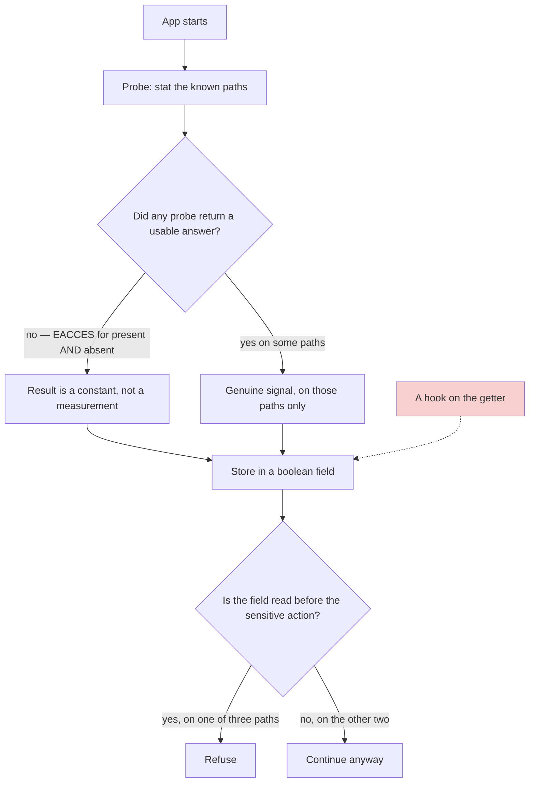

# Lab 02 — Take a diagram from this repository and find what it omits

> Pick a diagram somebody else drew, extract the claims it makes silently, and test each one on a real
> device until you find at least one edge the picture denies and the system has.

**Difficulty:** Intermediate
**Time:** 2–3 hours
**Prerequisites:** [Lab 01](lab-01-boundaries-from-evidence.md),
[section 7](../README.md#7-confusions-and-misuse--how-diagrams-mislead) of this chapter,
[22-SELinux](../../22-SELinux/README.md), [60-ADB](../../60-ADB/README.md)
**You need:** an Android device or emulator with `adb`, root optional but useful

---

## Why this lab exists

Lab 01 asked you to draw. This one asks you to read adversarially, which is the harder and more useful
skill, because on an engagement you are handed diagrams far more often than you make them.

The premise is [section 7.1](../README.md#71-the-completeness-illusion): **every arrow a diagram draws
asserts that the arrows it does not draw do not exist.** Nobody writes that assertion down and nearly
every reader accepts it. Your job here is to make the assertion explicit and then attack it.

> **Mental Model**
> Reading a diagram for correctness is not checking that the drawn arrows are right. It is asking:
> *what edge would have to exist for this picture to be dangerously wrong, and has anyone checked?*

---

## Part 1 — Choose a target diagram

Use the generated index rather than browsing. That is what it is for.

```bash
# host, from 78-Diagrams/
python3 -B scripts/diagram-census.py

# host — every diagram that claims at least one trust boundary
grep -E '^\| [0-9]+ \|' references/diagram-index.md | awk -F'|' '$6+0 > 0' | head -40
```

Good candidates share three properties, and the index columns let you screen for all three:

| Want | Index column | Why |
|---|---|---|
| It claims a boundary | **Boundaries** > 0 | A boundary is a falsifiable claim. "These things are related" is not |
| It is not enormous | **Nodes** between 6 and 15 | Under 6 and there is nothing to omit. Over 20 and you will not finish |
| It marks hostility | **Atk** = `yes` | The author was thinking about an attacker, so the omissions will be interesting rather than accidental |

Strong choices, all of which have measurable claims on a device you control:

- The app sandbox in [21-App-Sandbox](../../21-App-Sandbox/README.md)
- A root-detection decision flow in [37-RootDetection](../../37-RootDetection/README.md)
- The Binder call path in [25-Binder](../../25-Binder/README.md)
- The Magisk injection chain in [62-Magisk](../../62-Magisk/README.md)
- Storage layout in [33-Storage](../../33-Storage/README.md)

Record the exact diagram: file, line, and the section it sits in. You are going to argue with it and
you will need to cite it.

---

## Part 2 — Extract the silent claims

**Objective:** turn a picture into a numbered list of falsifiable statements.

For every element, write down what a reader is entitled to conclude. Use these four templates, and be
mechanical about it — the value comes from completeness, not from insight at this stage.

| Element | The claim to write down |
|---|---|
| An arrow `A --> B` | "Data or control can flow from A to B, by the labelled means" |
| **No arrow** between A and B | "There is no path from A to B" |
| A `subgraph` around A and B | "A and B are on the same side of a boundary, and crossing it changes who is trusted" |
| A decision `{"…"}` | "This branch is evaluated on the path that actually runs, and its result determines what follows" |

Work outward from the boxes to the empty space between them. **The claims that come from empty space
are the ones worth testing** — they are the ones no author ever consciously made.

### Worked example

Take the shape of a typical root-detection flow: `App starts` → `{Is the device rooted?}` → `Refuse` or
`Continue`.

Four boxes, three arrows, and this many silent claims:

```
C1  The check runs before anything sensitive happens.
C2  The check has exactly two outcomes.
C3  The outcome of the check determines what happens next.
C4  There is no path to "Continue" that skips the check.
C5  There is no path to the sensitive action that skips both.
C6  The check is a single evaluation, not a stored value read later.
C7  Nothing outside the app can influence the check's result.
C8  The check's inputs are observable to the app — that is, it CAN tell.
```

Eight claims from four boxes. Notice that C4 through C8 are all consequences of *empty space*, and
that C6 and C8 are the two most likely to be false.

### Deliverable 1

Your numbered claim list, with the diagram cited by file and line. Aim for at least eight claims. If
you have fewer than six, you are reading only the boxes.

---

## Part 3 — Rank the claims by what it would cost if they were false

**Objective:** decide what to test, because you cannot test everything.

Score each claim on two axes, one to five:

- **Falsifiability** — how cheaply can you test it on a device you have?
- **Consequence** — if it is false, how much does the security conclusion change?

Test high-consequence claims first, and among those, the cheapest.

```
Claim  Falsify  Consequence  Test
C6     4        5            Hook the getter, see whether the value is read repeatedly
C8     5        5            Run the check's underlying probe by hand as an unprivileged caller
C4     2        5            Requires full path coverage — expensive, do last
C2     5        1            Trivially true, skip
```

> **Pentester's Note**
> `Consequence` is not the same as severity. A claim can be low-consequence and still be worth ten
> minutes if it is free to test. What you are avoiding is the opposite: spending three hours on a
> high-consequence claim you have no cheap way to falsify, while an adjacent claim collapses in one
> command.

### Deliverable 2

The ranked table, and the two or three claims you are going to attack.

---

## Part 4 — Attack the claims on a device

**Objective:** at least one measured refutation.

Three families of test, with worked measurements from the reference device — Android 15, API 35,
`userdebug`, SELinux `Enforcing`.

### 4.1 Does the check's probe actually carry information?

This is claim **C8**, and it is the one people never think to test. A detection routine tests something.
Ask whether the answer it gets differs between the two worlds it is trying to distinguish.

Worked case, from [section 7.2](../README.md#72-three-measured-cases-where-the-obvious-diagram-omits-the-path)
of the chapter. Root and Xposed detectors commonly probe `/data/adb/lspd`:

```bash
# adb shell — as the shell user, uid 2000
ls -ld /data/adb/lspd
ls -ld /data/adb/zzz_definitely_absent
```

Measured, both:

```
ls: /data/adb/lspd: Permission denied
ls: /data/adb/zzz_definitely_absent: Permission denied
```

Then make the world different and ask again:

```bash
# adb shell — create the path the detector looks for. Note: su 0 <cmd>, not su -c
su 0 mkdir -p /data/adb/lspd
su 0 sh -c "test -e /data/adb/lspd && echo EXISTS || echo ABSENT"
ls -ld /data/adb/lspd
su 0 rmdir /data/adb/lspd
```

Measured:

```
EXISTS
ls: /data/adb/lspd: Permission denied
```

**The answer did not change.** `/data/adb` is mode `drwx------ root root`; an unprivileged caller
cannot traverse it and gets `EACCES` for every name underneath — present, absent or invented. The
decision node in the diagram is not a decision. It emits a constant.

Generalise this test to whatever your diagram's decision node probes:

```bash
# adb shell — the same shape, for any path-existence probe
for p in /sbin/su /system/xbin/su /system/app/Superuser.apk /data/adb/magisk; do
  printf "%-34s " "$p"; ls -ld "$p" 2>&1 | tail -c 60
done
```

Read the errors, not just the successes. `No such file or directory` and `Permission denied` are
different answers and only the first one is information.

### 4.2 Is there a second entrance?

Claim **C4** and **C5**. The diagram shows one way in. Enumerate all of them.

```bash
# host — every component the platform will route to
adb shell dumpsys package <pkg> | sed -n '/Activity Resolver Table/,/Permissions:/p'

# host — every intent filter, including the ones with no obvious UI
aapt2 dump xmltree --file AndroidManifest.xml app.apk | grep -B6 "E: intent-filter"

# host — deep link handlers
adb shell pm get-app-links <pkg>
```

The pattern you are hunting is a component that reaches the same functionality by a route the diagram
does not draw: a debug activity, a legacy scheme handler, a receiver that triggers a sync, a provider
`call()` method. [27-ContentProviders](../../27-ContentProviders/README.md) covers the last of those,
and it is a favourite because `call()` is invisible in a URI-shaped mental model.

### 4.3 Is the check a decision, or a stored value?

Claim **C6**, and this is where the "patch that changed nothing" pattern lives.

Static first:

```bash
# host — where is the result stored, and how many times is it read?
jadx -d out app.apk >/dev/null 2>&1
grep -rn "isRooted\|isDeviceRooted\|rootDetected" out/sources | head -20
```

Two reads in two places is a different system from one read at one call site: it means the *value* is
what matters, and one hook on the getter is sufficient, and a patch at the check site may be
irrelevant.

Then dynamically. A minimal Frida agent that answers "how often, and from where":

```javascript
// frida — save as trace-getter.js, run:
//   frida -U -f com.example.app -l trace-getter.js
// Replace the class and method with the ones you found statically.
Java.perform(function () {
    var C = Java.use("com.example.app.security.RootChecker");
    C.isDeviceRooted.implementation = function () {
        var real = this.isDeviceRooted();
        console.log("[+] isDeviceRooted() -> " + real);
        console.log(Java.use("android.util.Log")
            .getStackTraceString(Java.use("java.lang.Exception").$new()));
        return real;          // observe first. Do NOT change it yet.
    };
});
```

> **Warning**
> Observe before you modify. If you flip the return value immediately you learn only whether the app
> behaves differently — you do not learn *why*, and you cannot tell a check that was bypassed from a
> check that was never consulted. The stack trace is the whole point of the script above.

The refutation you are looking for looks like this: the getter is called once at startup, the value is
cached, and the sensitive action reads the cache — or worse, does not read it at all, because an
upstream guard already decided. That is exactly the case measured in
[74-CaseStudies lab 02](../../74-CaseStudies/labs/lab-02-the-patch-that-changed-nothing.md) and
[59-radare2 lab 04](../../59-radare2/labs/lab-04-ctf-the-gate-that-was-not-there.md).

### Deliverable 3

For each claim you attacked: the command or script, the raw output, and a one-line verdict — `HOLDS`,
`FALSE`, or `UNTESTED`. Paste the output. A verdict without its evidence is an opinion.

---

## Part 5 — Redraw the diagram with the omission in it

**Objective:** the corrected picture, and it should be uglier than the original.

Take the original and add what you found. Use `-.->` for anything you inferred but did not exercise,
and colour the attacker-controlled input.

The root-detection example, corrected after finding that the check emits a constant and that the value
is cached:



Then write the delta explicitly. This is the deliverable a client reads:

> **What the original diagram omitted.** Three things. First, the probe cannot distinguish the two
> worlds it claims to distinguish: `/data/adb/lspd` returns `EACCES` whether the path exists or not, so
> that branch of the check emits a constant. Second, the check produces a **stored value**, not a
> decision, and the value is read at three call sites of which two do not gate anything. Third, the
> diagram shows no path to the sensitive action that skips the check, and two exist.
>
> **What did not change.** The check does run before the sensitive action on the path the diagram
> draws. That part of the picture was correct.

That last paragraph matters. A refutation that does not say what survived reads as adversarial and
gets dismissed.

### Deliverable 4

The corrected diagram, the delta paragraph, and the evidence log.

---

## Part 6 — Generalise

**Objective:** one sentence you will carry to the next diagram.

Look at the omission you found and ask what *class* of omission it is. The chapter names four, and
almost everything falls into one of them:

| Class | Shape |
|---|---|
| **The undrawn path** | A second route to the same functionality, which the diagram's silence denies |
| **The named-mechanism trap** | The diagram drew the thing with a meaningful name and missed the unnamed thing that actually decides |
| **The informationless check** | A decision node whose probe returns the same answer in both worlds |
| **The false boundary** | A box drawn as separation where one address space, one UID, or one permission set actually exists |

Write your finding as one of these, and you will recognise it faster next time.

### Deliverable 5

One sentence. For example: *"This was a false boundary: the diagram drew the native library as a
separate box, and `/proc/<pid>/maps` shows it in the app's own address space, so anything the library
protects is protected only from a reader who trusts the diagram."*

---

## Success criteria

- [ ] At least eight silent claims extracted, of which at least three come from empty space
- [ ] Claims ranked by falsifiability and consequence, with the ranking written down before testing
- [ ] At least one claim refuted with pasted device output
- [ ] At least one claim confirmed, and said so
- [ ] Corrected diagram parses: `node scripts/validate-mermaid.mjs --modules /tmp/mmv <your file>`
- [ ] Corrected diagram uses `-.->` for at least one unverified edge
- [ ] The delta paragraph says what the original got *right* as well as wrong
- [ ] The omission is classified into one of the four classes

---

## Hints

<details>
<summary>Every claim I test turns out to be true</summary>

Two possibilities, and it is worth knowing which.

You may have picked a diagram that is genuinely accurate — some are, and confirming one is a real
result. But more often the claim list is too shallow. Re-read Part 2 and force yourself to write the
claims that come from **empty space**: "there is no path from X to Y". Those are the ones that fail.

Also check you are testing the claim rather than the mechanism. "The check runs" is easy to confirm.
"The check's result changes what happens" is the claim, and it is a different test.
</details>

<details>
<summary>I cannot get root, so I cannot create the file to test the probe</summary>

You do not need to. The test in Part 4.1 works in the other direction: show that the answer for a path
you *invented* — which certainly does not exist — is identical to the answer for the path the detector
looks for. Identical answers for a known-absent path and an unknown path already proves the probe
carries no information from that caller's position.
</details>

<details>
<summary>The app crashes as soon as Frida attaches</summary>

That is anti-instrumentation, and it is a finding in itself. Note it and use the static path for now —
[67-BypassingProtections](../../67-BypassingProtections/README.md) covers the mechanics.

For this lab, `jadx` plus careful reading of every call site of the stored value will get you the
answer to claim C6 without any runtime at all. Grep for the field name, not the method name.
</details>

<details>
<summary>How do I know when I have found "enough"?</summary>

One refuted high-consequence claim, with evidence, is enough. This lab is not a completeness exercise —
it is a habit-forming exercise. The habit is asking what the empty space asserts.
</details>

<details>
<summary>My corrected diagram is much uglier than the original</summary>

Correct. Reality has more edges than an architecture slide. If your corrected diagram is as clean as
the one you started with, you have probably reproduced the original's filtering rather than replacing
it.

If it is genuinely unreadable, split it: one diagram for the paths, one for the decision logic. Do not
smooth it back out.
</details>

---

## What to take away

You have now done, on a diagram in a repository, exactly what you will do to a client's architecture
documentation: convert a picture into falsifiable statements, rank them, and test the cheap ones with
the worst consequences.

The output that clients value is not the corrected diagram. It is the sentence "your documentation
asserts there is no path from A to B, and here is the path" — because that sentence tells them their
model is wrong, and a wrong model produces new bugs faster than you can find the old ones.

---

## Next

- [Lab 03](lab-03-intended-versus-actual.md) — redraw an intended flow as the measured one
- [Lab 04](lab-04-ctf-the-cartographers-error.md) — the CTF
