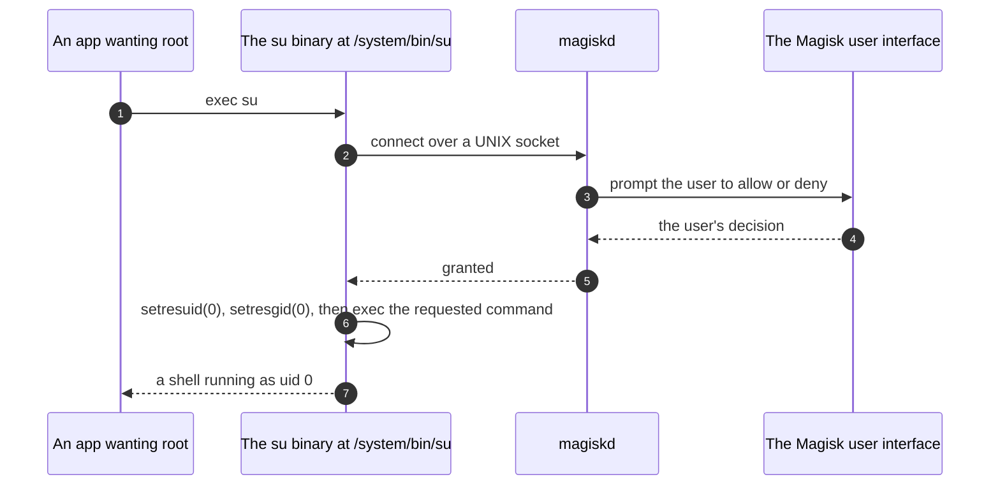
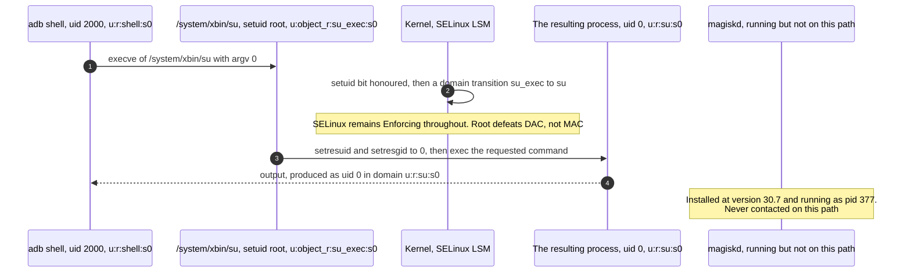
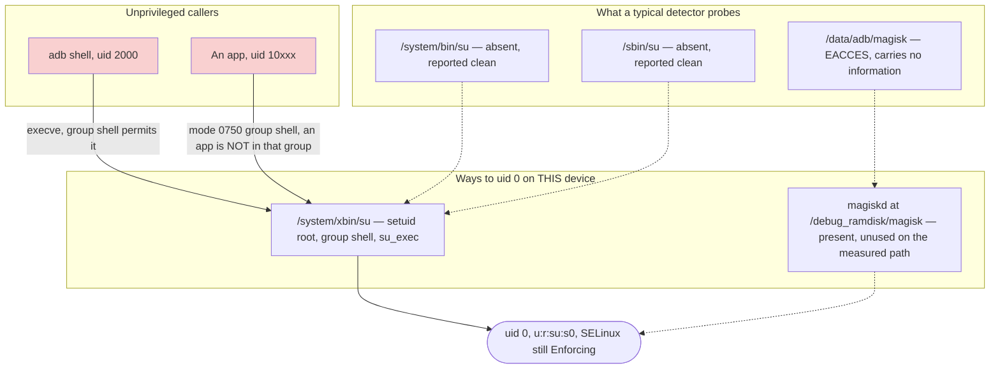

# Lab 03 — Redraw an intended flow as the actual one

> Take the canonical picture of how root works on Android, measure what your own device actually does,
> and produce the diagram that is true of *that device* — then write down every place the two differ.

**Difficulty:** Intermediate
**Time:** 2–3 hours
**Prerequisites:** [Lab 02](lab-02-what-the-diagram-omits.md),
[22-SELinux](../../22-SELinux/README.md), [62-Magisk](../../62-Magisk/README.md),
[02-Linux-Basics](../../02-Linux-Basics/README.md),
[section 6.4](../README.md#64-draw-the-actual-flow-not-the-intended-one)
**You need:** an Android device or emulator you have root on, and `adb`

---

## Why this lab exists

An **intended flow** is what a design says happens. An **actual flow** is what the machine in front of
you does. Every diagram you have ever seen of a rooting mechanism, a licence check, or an
authentication handshake is an intended flow, because intended flows are the only kind you can draw
without a device.

They are not useless — an intended flow is a hypothesis, and a good one. They become dangerous at the
moment somebody uses one to decide what to test, because the tests then inherit the diagram's
omissions.

This lab uses root as the subject because it is the case where the gap is widest, easiest to measure,
and most consequential: detection routines are written from the canonical diagram, and on a device
where the diagram is wrong they look in the wrong place and report "clean".

> **🧠 Mental Model**
> A diagram of a mechanism is a diagram of **one deployment** of that mechanism. "How Magisk works" is
> not a fact about your device. It is a fact about a device configured the way the author's was.

---

## Part 0 — Record the device

Everything below is device-specific. Without this block, none of it is evidence.

```bash
# host
adb devices -l
adb shell getprop ro.build.fingerprint
adb shell getprop ro.build.version.release
adb shell getprop ro.build.version.sdk
adb shell getprop ro.build.type
adb shell getprop ro.debuggable
adb shell getprop ro.secure
adb shell getprop ro.build.version.security_patch
adb shell getenforce
adb shell id
```

The reference device used to write this lab:

```
emulator-5554   product:sdk_gphone16k_x86_64   device:emu64xa16k
fingerprint : google/sdk_gphone16k_x86_64/emu64xa16k:15/AE3A.240806.043/12960925:userdebug/dev-keys
release     : 15          sdk: 35        type: userdebug
ro.debuggable: 1          ro.secure: 1   security_patch: 2024-09-05
getenforce  : Enforcing
id          : uid=2000(shell) ... context=u:r:shell:s0
```

> **⚠️ Warning**
> `su -c '…'` through `adb shell` is broken in a way that silently mangles quoting. Use
> `adb shell "su -c 'cmd'"`, or on this device's `su`, the form used throughout this lab:
> `adb shell su 0 <cmd>`. Getting this wrong produces empty output that looks like a negative result.

---

## Part 1 — Draw the intended flow, before measuring

**Objective:** commit to a hypothesis in writing, so you can be wrong in public.

This is the picture that appears in essentially every article about Magisk. Draw it — or your own
version of it — **before** you touch the device.



Now write the claims, exactly as in [Lab 02](lab-02-what-the-diagram-omits.md) Part 2:

```
I1  A binary named su exists at /system/bin/su.
I2  That binary is what runs when a caller types `su`.
I3  It talks to magiskd.
I4  magiskd is the thing that decides.
I5  The privilege obtained comes from Magisk.
I6  Magisk is the only source of root on this device.
I7  A detector that looks for /system/bin/su will find this.
```

Seven claims, all reasonable, and on the reference device **five of them are false**.

### Deliverable 1

Your intended diagram and your claim list, written down and timestamped before Part 2. The point is
not to be right. The point is to have committed.

---

## Part 2 — Measure

**Objective:** answer each claim with a command.

### 2.1 Where is `su`, really?

```bash
# adb shell
command -v su
ls -lZ "$(command -v su)"
```

Measured on the reference device:

```
/system/xbin/su
-rwsr-x--- 1 root shell u:object_r:su_exec:s0  51224 2025-01-23 23:03 /system/xbin/su
```

Three facts in one line, and every one of them contradicts the intended diagram.

- **`/system/xbin/su`, not `/system/bin/su`.** Claim I1 is false, and claim I7 with it.
- **`-rwsr-x---`** — the setuid bit is set, owner `root`, group `shell`. This is a classic setuid-root
  helper, not a client that asks a daemon for permission.
- **`u:object_r:su_exec:s0`** — the SELinux type `su_exec` is the AOSP `userdebug` type, defined in the
  platform policy. Magisk's own binary is not labelled this way.

Confirm the negative directly, because an absence is a claim too:

```bash
# adb shell
ls -d /system/bin/su
su 0 ls -d /system/bin/su
```

Measured, both:

```
ls: /system/bin/su: No such file or directory
```

Asked from two different privilege levels, so this is not a permissions artefact.

### 2.2 Is Magisk even involved?

```bash
# adb shell
dumpsys package com.topjohnwu.magisk | grep -m1 versionName
ps -A -o PID,NAME | grep -i magisk
su 0 readlink /proc/$(pidof magiskd)/exe
su 0 ls -1 /data/adb
```

Measured:

```
    versionName=30.7
  377 magiskd
/debug_ramdisk/magisk
magisk
magisk.db
modules
post-fs-data.d
service.d
```

So Magisk **is** installed, at version 30.7, and its daemon **is** running from `/debug_ramdisk/magisk`
with its usual data layout under `/data/adb`. Claim I3 and I4 are still live — the question is whether
the `su` you actually get goes through it.

### 2.3 What does the privilege you obtain actually look like?

```bash
# adb shell
su 0 id
su 0 id -Z
getenforce
```

Measured:

```
uid=0(root) gid=0(root) groups=0(root),1004(input),1007(log),1011(adb),... context=u:r:su:s0
u:r:su:s0
Enforcing
```

The domain is `u:r:su:s0`. That is the domain the AOSP `userdebug` policy transitions to from
`su_exec`. Combined with 2.1, the chain is:

```
shell (u:r:shell:s0)  --exec /system/xbin/su (u:object_r:su_exec:s0)-->  u:r:su:s0
```

There is no step in that chain where `magiskd` is consulted. **Claims I3, I4, I5 and I6 are false for
this path.** Magisk is running, and the root you got did not come from it.

And note the last line: **SELinux is still `Enforcing` while you are uid 0.** Root defeats DAC. It does
not exit MAC.

### 2.4 The consequence for a detector

```bash
# adb shell — a typical detector's path list, from an unprivileged caller
for p in /sbin/su /system/bin/su /system/xbin/su /su/bin/su \
         /data/local/tmp/su /data/adb/magisk /system/app/Superuser.apk; do
  printf "%-32s " "$p"
  ls -ld "$p" 2>&1 | tail -c 70
done
```

Measured, abbreviated:

```
/sbin/su                         No such file or directory
/system/bin/su                   No such file or directory
/system/xbin/su                  -rwsr-x--- 1 root shell 51224 /system/xbin/su
/su/bin/su                       No such file or directory
/data/local/tmp/su               No such file or directory
/data/adb/magisk                 Permission denied
/system/app/Superuser.apk        No such file or directory
```

Read that column carefully, because it contains three different kinds of answer and only two of them
are information:

| Answer | Means |
|---|---|
| A stat result | The path exists. **Information.** |
| `No such file or directory` | The path does not exist, and the caller could tell. **Information.** |
| `Permission denied` | The caller cannot tell. **Not information** — and this is what `/data/adb/*` returns for present *and* absent names alike |

A detector that only checks `/system/bin/su` and `/sbin/su` reports **clean** on a device where any
shell user can obtain uid 0 in one command.

### Deliverable 2

The command log with pasted output, and the claim list marked up:

```
I1  su at /system/bin/su ................ FALSE — it is /system/xbin/su
I2  that binary is what runs ............ FALSE — a different path runs
I3  it talks to magiskd ................. FALSE for this path
I4  magiskd decides ..................... FALSE for this path
I5  privilege comes from Magisk ......... FALSE — it comes from the userdebug policy
I6  Magisk is the only source of root ... FALSE — the build ships its own
I7  a detector finds /system/bin/su ..... FALSE — nothing is there
    magiskd is running ................. TRUE  — pid 377, from /debug_ramdisk/magisk
    Magisk is installed ................ TRUE  — app version 30.7
```

---

## Part 3 — Draw the actual flow

**Objective:** the diagram that is true of the device in front of you.



And the structural view, which is where you put the consequence for detection:



Read the second diagram's dotted edges: they are the *probes*, and none of them touches the path that
actually works. Read the edge from `APPU` too — `/system/xbin/su` is mode `0750` with group `shell`, so
an ordinary app UID is not in the group and cannot execute it. That is a real difference between the
shell's position and an app's, and it is the kind of nuance the intended diagram had no way to express.

### Deliverable 3

Both diagrams, each with a caption naming the device fingerprint, and both parsing:

```bash
# host, from 78-Diagrams/
node scripts/validate-mermaid.mjs --modules /tmp/mmv <your file>
```

---

## Part 4 — Write the delta

**Objective:** the paragraph that would go in a report.

Structure it in three parts: what was assumed, what was measured, what follows.

> **Assumed.** The device is rooted with Magisk 30.7, so root is obtained by executing `su` — expected
> at `/system/bin/su` — which consults `magiskd` for a grant decision.
>
> **Measured** on `google/sdk_gphone16k_x86_64/emu64xa16k:15/AE3A.240806.043/12960925:userdebug/dev-keys`,
> API 35, SELinux `Enforcing`. `command -v su` resolves to `/system/xbin/su`, mode `-rwsr-x---`, owner
> `root`, group `shell`, SELinux type `u:object_r:su_exec:s0` — the AOSP `userdebug` helper.
> `/system/bin/su` does not exist for either an unprivileged or a privileged caller. Executing it
> yields `uid=0(root)` in domain `u:r:su:s0`. `magiskd` is running as pid 377 from
> `/debug_ramdisk/magisk` and is not contacted on this path.
>
> **Follows.** Any control that reasons about root by looking for Magisk's artefacts is looking in the
> wrong place on this build. Detection lists that check `/system/bin/su` and `/sbin/su` return clean
> here. Separately, probes under `/data/adb` return `EACCES` to an unprivileged caller regardless of
> whether the target exists, so those probes carry no information at all — they are constants dressed
> as measurements.

Note what the delta does **not** say. It does not say the canonical Magisk diagram is wrong: on a
production device rooted only with Magisk, it is right. It says the diagram describes a deployment, and
this is a different one.

### Deliverable 4

The three-part delta, with the fingerprint in it.

---

## Part 5 — Do it again on something else

**Objective:** prove the method transfers.

One more subject, chosen from what you have available. Each has a well-known intended diagram and a
measurable actual one.

| Subject | Intended diagram everyone draws | What to measure |
|---|---|---|
| App data isolation | `/data/data/<pkg>` is private to the app | `ls -ldZ`, then `run-as`, then as root. Check whether `/data/data/<pkg>` and `/data/user/0/<pkg>` are a bind mount rather than a symlink |
| Zygote and app start | init → zygote → your app, one arrow each | `ps -A -o PID,NAME` — how many zygotes are there? On the reference device: `zygote64` and `webview_zygote`, and **no 32-bit zygote** on this x86_64 image |
| Binder service reachability | The app calls "the system" | `service list` — 298 registered services on the reference device. Which are reachable from an app UID, and which require a permission? |
| Verified Boot | ROM → bootloader → kernel → init | `getprop ro.boot.verifiedbootstate` — **empty** on the reference emulator, because the first two stages do not run at all |

The last row is the most instructive negative result in this lab. A diagram of the boot chain can be
*read* on an emulator and cannot be *verified* on one. Saying so is better work than drawing it
confidently.

```bash
# adb shell — the second subject, measured
ps -A -o PID,NAME | grep -i zygote
service list | wc -l
getprop ro.boot.verifiedbootstate
getprop ro.boot.veritymode
```

Reference measurements:

```
 1885 zygote64
 2255 webview_zygote
298
                       <- empty
enforcing
```

### Deliverable 5

A second intended/actual pair, with its own delta paragraph.

---

## Success criteria

- [ ] The intended diagram was drawn and its claims written down **before** measuring
- [ ] Every claim is marked TRUE, FALSE or UNTESTED with pasted evidence
- [ ] The actual diagram names the device fingerprint in its caption
- [ ] The actual diagram distinguishes information-carrying probes from `EACCES` constants
- [ ] The delta says what the intended diagram got right, not only what it got wrong
- [ ] A second subject was measured and produced its own pair
- [ ] All diagrams parse under `validate-mermaid.mjs`
- [ ] No `su -c '…'` appears anywhere in your command log

---

## Hints

<details>
<summary>My device has su at /system/bin/su and the intended diagram is basically right</summary>

Then you have confirmed a claim, which is a result. Say so, and move to a subject where the gap is
wider — the table in Part 5 has three more.

It is also worth checking *which* `su` you have. `ls -lZ` the path and read the SELinux type. Magisk's
binary and the AOSP `userdebug` helper live in different types, and the type is a harder fact than the
path.
</details>

<details>
<summary>command -v su returns nothing</summary>

`su` is not on your `PATH`, which on a production build is the expected result. Search directly:

```bash
# adb shell
for d in /sbin /system/bin /system/xbin /vendor/bin /debug_ramdisk /su/bin; do
  ls -ldZ "$d/su" 2>&1 | tail -c 70
done
```

If none of them exists, your device is not rooted, and the intended diagram simply does not apply. Use
Part 5's app-data-isolation subject instead — it needs no root at all.
</details>

<details>
<summary>readlink /proc/<pid>/exe says permission denied</summary>

You need root for that one, which is circular if you are trying to establish how you get root. Work
around it: `ps -A -o PID,NAME` establishes that the daemon is running, and that is all the claim needs.
Note the limitation in the deliverable rather than skipping the claim silently.
</details>

<details>
<summary>How is this different from Lab 02?</summary>

Lab 02 starts from somebody else's diagram and hunts for what it omits. Lab 03 starts from the
*canonical* diagram of a mechanism — the one in everybody's head, not in any particular file — and
replaces it with one that is true of a specific device.

The difference matters because the canonical diagram is the one that never gets reviewed. Nobody
checks the picture they already believe.
</details>

<details>
<summary>Is it fair to call the canonical Magisk diagram "wrong"?</summary>

No, and the lab is careful not to. It is right about the deployment it describes. The error is
generalisation: treating a diagram of one configuration as a fact about all devices.

That is the transferable lesson, and it applies to every architecture diagram you will be handed —
including the ones in this repository, which
[section 7.4](../README.md#74-other-ways-this-material-gets-misused) says the same thing about.
</details>

---

## What to take away

Two habits.

**Commit to the intended flow in writing before you measure.** It costs five minutes and it converts
vague expectations into a scoreboard. You cannot be usefully surprised by a device if you never said
what you expected.

**Read the errors, not only the successes.** `No such file or directory` and `Permission denied` are
different answers, and a whole class of client-side security control is built on failing to notice
that only the first one carries information.

---

## Next

- [Lab 04](lab-04-ctf-the-cartographers-error.md) — the CTF, in which the flag is reachable only along
  a path no diagram shows
