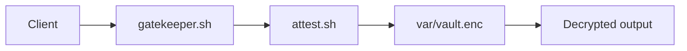
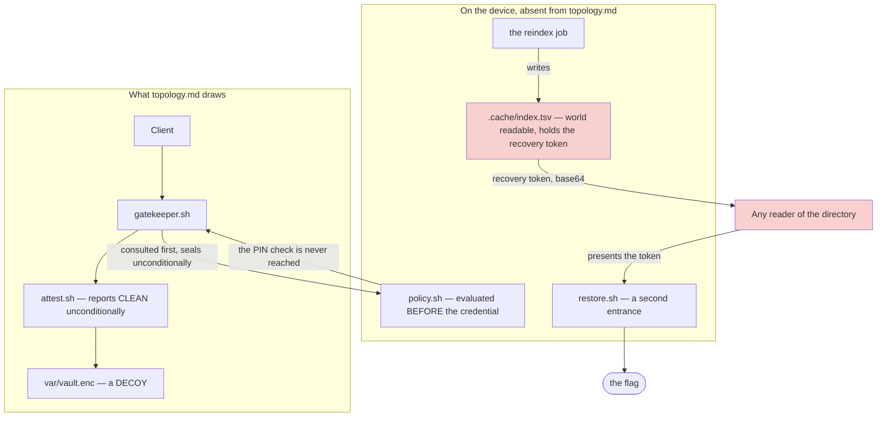

# Lab 04 — CTF: The Cartographer's Error

> A vault, a topology diagram maintained by the platform team, and a flag that is unreachable along
> every path the diagram draws.

**Difficulty:** Intermediate
**Time:** 60–120 minutes
**Format:** CTF. One flag, `MAPLAB{...}`. One decoy, deliberately placed where the diagram sends you
**Prerequisites:** [Lab 02](lab-02-what-the-diagram-omits.md),
[Lab 03](lab-03-intended-versus-actual.md), [02-Linux-Basics](../../02-Linux-Basics/README.md),
[60-ADB](../../60-ADB/README.md)
**You need:** an Android device or emulator with `adb`. Root is **not** required for the flag; one
optional side-quest uses it

---

## Briefing

You have been given read access to a small system called **Cartography Vault**, deployed under
`/data/local/tmp/cartography` on the device. The platform team maintains a topology document for it,
`topology.md`, which they consider authoritative and which ends with the sentence:

> There is no other way in.

Your objective is the flag. Everything you need is on the device.

> **Warning**
> This is a self-contained training target you build yourself on your own device. It is deliberately
> weak. Do not adapt any part of it into anything that guards something real.

---

## Setup

Save the following as `setup.sh` on your **host**, push it, and run it on the device. Do not read it
past the first few lines until you have finished — it is the answer key.

````bash
#!/system/bin/sh
# Lab 04 setup — builds the target under /data/local/tmp/cartography
set -e
ROOT=/data/local/tmp/cartography
rm -rf "$ROOT"
mkdir -p "$ROOT/bin" "$ROOT/var" "$ROOT/.cache"

cat > "$ROOT/topology.md" <<'EOF'
# Cartography Vault — system topology (v3, maintained by the platform team)



The client supplies a PIN to `gatekeeper.sh`. The gatekeeper validates it, then `attest.sh`
confirms the device has not been tampered with, and only then is `var/vault.enc` released.

There is no other way in.
EOF

cat > "$ROOT/bin/policy.sh" <<'EOF'
#!/system/bin/sh
# policy.sh — deployment policy evaluation. Consulted before anything else.
# Returns 0 for OPEN, 1 for SEALED.
STATE=SEALED
[ "$STATE" = OPEN ] && exit 0
exit 1
EOF

cat > "$ROOT/bin/attest.sh" <<'EOF'
#!/system/bin/sh
# attest.sh — device integrity probe.
# Reports TAMPERED if the tamper marker is present.
if ls -d /data/adb/cartography.lock >/dev/null 2>&1; then
  echo TAMPERED
  exit 1
fi
echo CLEAN
exit 0
EOF

cat > "$ROOT/bin/gatekeeper.sh" <<'EOF'
#!/system/bin/sh
# gatekeeper.sh — the front door.
HERE=$(dirname "$0")
PIN="$1"
[ -z "$PIN" ] && { echo "usage: gatekeeper.sh <pin>"; exit 2; }

# Deployment policy is evaluated before the credential.
if ! sh "$HERE/policy.sh"; then
  echo "vault sealed by policy — contact your administrator"
  exit 1
fi

EXPECT=919c68ff757c3fe518643fbe8424b381ba9e1aaf1eac547a2b7c759a4f687793
GOT=$(printf '%s' "$PIN" | sha256sum | cut -d' ' -f1)
if [ "$GOT" != "$EXPECT" ]; then
  echo "incorrect PIN"
  exit 1
fi

if [ "$(sh "$HERE/attest.sh")" != CLEAN ]; then
  echo "device integrity check failed"
  exit 1
fi

cat "$HERE/../var/vault.enc"
EOF

cat > "$ROOT/bin/restore.sh" <<'EOF'
#!/system/bin/sh
# restore.sh — maintenance recovery entry point.
# Takes the recovery token issued by the reindex job.
HERE=$(dirname "$0")
TOK="$1"
[ -z "$TOK" ] && { echo "usage: restore.sh <recovery-token>"; exit 2; }
EXPECT=1a66665a430bb7159d74b19b06de9afbed6e9221ac17d41277fdc9526d01b575
GOT=$(printf '%s' "$TOK" | sha256sum | cut -d' ' -f1)
if [ "$GOT" != "$EXPECT" ]; then
  echo "recovery token rejected"
  exit 1
fi
# The stored blob is only the first half. The second half is derived from the
# recovery token itself, so reading this script is not sufficient.
HEAD=$(printf '%s' 'TUFQTEFCe3RoZV91bmRyYXduX2VkZ2VfaXNfdGhlX29uZV90aGF0X3dvcmtzXw==' | base64 -d)
printf '%s%s}\n' "$HEAD" "$(printf '%s' "$TOK" | sha256sum | cut -c1-8)"
EOF

cat > "$ROOT/var/vault.enc" <<'EOF'
TUFQTEFCe3lvdV9yZWFkX3RoZV9kaWFncmFtX2FuZF9zdG9wcGVkfQ==
EOF

cat > "$ROOT/.cache/index.tsv" <<'EOF'
# written by the reindex job — do not edit
component	last_seen	notes
gatekeeper	2026-08-14T02:11:07Z	front door
policy	2026-08-14T02:11:07Z	evaluated first
attest	2026-08-14T02:11:07Z	probe target unreadable from this uid
vault	2026-08-14T02:11:08Z	keyid 7f3a9c2e
restore	2026-08-14T02:11:08Z	recovery=cm5kLXRva2VuLTdmM2E5YzJl
EOF

chmod 0755 "$ROOT/bin/"*.sh
chmod 0644 "$ROOT/var/vault.enc" "$ROOT/.cache/index.tsv" "$ROOT/topology.md"
echo "built $ROOT"
````

```bash
# host — push and build
adb push setup.sh /data/local/tmp/setup.sh
adb shell sh /data/local/tmp/setup.sh
# expected: built /data/local/tmp/cartography
```

> **Warning**
> On Git Bash / MSYS on Windows, `adb push setup.sh /data/local/tmp/setup.sh` fails with
> `remote secure_mkdirs() failed`, because MSYS rewrites the device path into a Windows path. Prefix
> the command with `MSYS_NO_PATHCONV=1`, or use PowerShell. The error message names a `C:\Program
> Files\Git\data\...` path, which is the tell.

Then get a shell in the target:

```bash
# host
adb shell
# adb shell
cd /data/local/tmp/cartography
```

---

## The topology you were given

This is what `topology.md` draws. It is reproduced here so you can look at it while you work.


Four boxes, three arrows, and one sentence of prose asserting completeness.

Before you touch anything: **write down the claims.** Use the templates from
[Lab 02](lab-02-what-the-diagram-omits.md) Part 2. You should get at least six, and at least two of
them should come from empty space rather than from a box.

---

## Stage 1 — The front door

**Objective:** get the vault to release its contents through the path the diagram draws.

```bash
# adb shell, in /data/local/tmp/cartography
sh bin/gatekeeper.sh 0000
```

You will get an answer. Try a few more PINs. The PIN is four digits and a brute force is four lines of
shell, so if you want to prove the credential is not the obstacle, prove it:

```bash
# adb shell — 10,000 candidates, a few seconds
i=0
while [ $i -lt 10000 ]; do
  printf -v p "%04d" $i 2>/dev/null || p=$(printf "%04d" $i)
  out=$(sh bin/gatekeeper.sh "$p")
  case "$out" in *incorrect*) ;; *) echo "$p -> $out"; esac
  i=$((i+1))
done
```

Record what happens. Then answer, in writing, the question this stage exists to make you ask:

> **Did the PIN ever matter?**

### Checkpoint 1

You should be able to state, with evidence, whether the credential check was ever reached.

---

## Stage 2 — The guard the diagram does not draw

**Objective:** find out what actually decided.

Read the front door. Everything here is shell script; there is no reverse engineering to do, which is
deliberate — the difficulty in this CTF is entirely in what you notice, not in what you decode.

```bash
# adb shell
cat bin/gatekeeper.sh
```

Find the component that runs **before** the credential check. Now compare that against the topology
diagram and notice that it is not on it.

```bash
# adb shell — the component the diagram omits
cat bin/policy.sh
```

You can flip it. Go ahead — it is your device:

```bash
# adb shell
cp bin/policy.sh bin/policy.sh.bak
sed -i 's/STATE=SEALED/STATE=OPEN/' bin/policy.sh
sh bin/gatekeeper.sh <your pin>
```

You will now get output. Decode it:

```bash
# adb shell
sh bin/gatekeeper.sh <your pin> | base64 -d; echo
```

**Read what it says before you submit it.** Then restore the file, because the rest of the lab assumes
the deployment is in its original state:

```bash
# adb shell
mv bin/policy.sh.bak bin/policy.sh
```

### Checkpoint 2

You have a string that looks like a flag. It is not the flag. What it says is the lesson of this stage,
and it is the same lesson as
[74-CaseStudies lab 02](../../74-CaseStudies/labs/lab-02-the-patch-that-changed-nothing.md): **the
named mechanism was not what decided.** The diagram drew the gatekeeper because "gatekeeper" is a
meaningful name. The thing that actually decided has no box.

Add `policy.sh` to your redrawn diagram before continuing.

---

## Stage 3 — The check that cannot fail

**Objective:** determine whether `attest.sh` measures anything.

```bash
# adb shell
cat bin/attest.sh
sh bin/attest.sh
```

It probes a path and reports `CLEAN` or `TAMPERED`. Test whether that probe can distinguish the two
worlds it claims to distinguish. First, from your position:

```bash
# adb shell
ls -d /data/adb/cartography.lock
ls -d /data/adb/a_name_i_just_invented
```

Compare the two error messages **exactly**. Then, if you have root, make the world different and ask
again. Note the form: `su 0 <cmd>`, not `su -c`:

```bash
# adb shell — optional side-quest, needs root
su 0 mkdir -p /data/adb/cartography.lock
su 0 sh -c "test -e /data/adb/cartography.lock && echo MARKER_EXISTS"
sh bin/attest.sh
su 0 rmdir /data/adb/cartography.lock
```

On the reference device — Android 15, API 35, `userdebug`, SELinux `Enforcing` — the marker was
created, root confirmed `MARKER_EXISTS`, and `attest.sh` still printed:

```
CLEAN
```

`/data/adb` is mode `drwx------ root root`. An unprivileged caller cannot traverse it and receives
`EACCES` for every name underneath — present, absent, or invented. `attest.sh` maps any failure to
"absent", so it reports `CLEAN` unconditionally.

### Checkpoint 3

`attest.sh` is a decision node in the diagram that emits a constant. Mark it on your redrawn diagram
as what it is. This is the same failure as
[section 7.2 case 3](../README.md#72-three-measured-cases-where-the-obvious-diagram-omits-the-path) of
the chapter.

Note also that even with the correct PIN and a `CLEAN` attestation, the drawn path leads to the decoy.
**Every box on the topology diagram has now been either bypassed or shown to be inert, and you still
do not have the flag.** That is the point at which you stop working the diagram and start working the
directory.

---

## Stage 4 — The component that is not on any diagram

**Objective:** the flag.

Stop reading the topology. Enumerate the deployment.

```bash
# adb shell — everything, including what a plain ls hides
ls -laR /data/local/tmp/cartography
```

Two things appear that the topology never mentions. One is a directory. One is an executable.

The directory holds an artefact left behind by a component the diagram does not draw at all — a
maintenance job. Read it, and read every column, including the last:

```bash
# adb shell
cat -A .cache/index.tsv 2>/dev/null || cat .cache/index.tsv
```

One row carries a value that is not a timestamp and not a note. It is encoded. Decode it:

```bash
# adb shell
printf '%s' '<the encoded value>' | base64 -d; echo
```

The executable is a second entrance, with its own credential, which is exactly the thing you just
decoded:

```bash
# adb shell
cat bin/restore.sh
sh bin/restore.sh '<the decoded value>'
```

### Checkpoint 4 — the flag

Format `MAPLAB{...}`. It has a hexadecimal suffix.

> **Pentester's Note**
> If you tried to shortcut this by base64-decoding the blob you can see inside `restore.sh`, you got
> the flag's first half and no suffix. That is deliberate: the second half is derived from the recovery
> token, so possession of the script is not possession of the flag. The shortcut still required you to
> find `restore.sh`, which was the point — but the suffix is the proof you walked the whole undrawn
> edge.

---

## Stage 5 — Redraw it

**Objective:** the diagram that is true, which is the actual deliverable of this lab.

Produce the version of `topology.md` that a competent reviewer would have written. It must contain:

- `policy.sh`, upstream of everything, with the edge that short-circuits
- `attest.sh` marked as emitting a constant rather than a measurement
- The decoy explicitly labelled, so nobody chases it twice
- The reindex job and its cache, which no earlier diagram contains
- `restore.sh` as a second entrance, with its own credential
- The recovery token as attacker-reachable input, coloured

One correct answer:



Then the delta paragraph, in the three-part form from
[Lab 03](lab-03-intended-versus-actual.md) Part 4: what the document asserted, what was measured, what
follows.

---

## Scoring

| Points | Achievement |
|---:|---|
| 10 | Wrote the claim list before touching anything |
| 10 | Demonstrated that the PIN never mattered, with evidence |
| 15 | Identified `policy.sh` as the actual decider |
| 10 | Recovered the decoy and recognised it as one **without submitting it** |
| 15 | Showed that `attest.sh` returns the same answer in both worlds |
| 10 | Found `.cache/` and the artefact of a component with no box |
| 20 | The flag, with its hexadecimal suffix |
| 10 | Redrawn diagram that parses and contains all six required elements |
| **−10** | Submitted the decoy as the flag |
| **−10** | Found the flag by reading `setup.sh` |

**100 is the ceiling.** Below 50, re-read
[section 7](../README.md#7-confusions-and-misuse--how-diagrams-mislead) and try again on a fresh build.

---

## Hints

<details>
<summary>Hint 1 — I brute-forced every PIN and the output never changed</summary>

That is the correct result, and it is the first finding rather than a dead end.

If the output is identical for all 10,000 candidates, the credential check is not being reached. Read
`gatekeeper.sh` from the top and find the first thing it does. Compare that against the four boxes on
the topology diagram.
</details>

<details>
<summary>Hint 2 — I patched the guard and got something that looks like a flag</summary>

Read it. It is a sentence, and the sentence is telling you what you just did.

Everything on the topology diagram is now either bypassed or shown to be inert, and you do not have the
flag. That is the signal to stop working the document and start working the directory.
</details>

<details>
<summary>Hint 3 — I have listed the directory and see nothing new</summary>

`ls` without `-a` hides names beginning with a dot, and directories that begin with a dot are exactly
where things get left behind. Use `ls -laR`.

Two things in the deployment are absent from `topology.md`. One is a directory. One is an executable in
`bin/`.
</details>

<details>
<summary>Hint 4 — I found the cache file but it looks like ordinary log noise</summary>

Read every column of every row, not just the first two. Five rows describe components you already know
about. One row carries a third field that is neither a timestamp nor prose.

It is base64. `printf '%s' '<value>' | base64 -d` — use `printf`, not `echo`, so no trailing newline is
folded into the decode.
</details>

<details>
<summary>Hint 5 — restore.sh rejects my token</summary>

Three usual causes.

You passed the **encoded** value rather than the decoded one. You included a trailing newline, which
happens if you used `echo` instead of `printf` — compare `printf '%s' x | sha256sum` with
`echo x | sha256sum` and you will see they differ. Or you copied the `recovery=` prefix along with the
value.
</details>

<details>
<summary>Hint 6 — my flag has no hexadecimal suffix</summary>

You decoded the blob out of `restore.sh` rather than running it with the token. The stored blob is only
the first half; the suffix is computed from the token at run time. Run the script.
</details>

---

## Solution

<details>
<summary>Full walkthrough — do not open until you have the flag or have given up</summary>

**Stage 1.** Every PIN returns `vault sealed by policy — contact your administrator`. The credential is
never evaluated, so brute force proves only that the check is unreachable.

**Stage 2.** `gatekeeper.sh` runs `policy.sh` before comparing the PIN, and `policy.sh` has
`STATE=SEALED` hard-coded, exiting 1 unconditionally. `policy.sh` appears nowhere on the topology
diagram. Flipping it to `OPEN` and supplying the correct PIN — **4729** — releases
`var/vault.enc`, which base64-decodes to:

```
MAPLAB{you_read_the_diagram_and_stopped}
```

That is the decoy, and it is placed exactly where the diagram sends you.

**Stage 3.** `attest.sh` probes `/data/adb/cartography.lock` with `ls -d … >/dev/null 2>&1` and treats
any non-zero exit as "absent". `/data/adb` is `drwx------ root root`, so an unprivileged caller gets
`EACCES` for every name underneath. Creating the marker as root does not change the answer: it still
prints `CLEAN`. The decision node emits a constant.

**Stage 4.** `ls -laR` reveals `.cache/` and `bin/restore.sh`, neither of which is on the diagram.
`.cache/index.tsv` is a leftover from a maintenance job — a component with no box at all — and its
final row reads:

```
restore	2026-08-14T02:11:08Z	recovery=cm5kLXRva2VuLTdmM2E5YzJl
```

`printf '%s' cm5kLXRva2VuLTdmM2E5YzJl | base64 -d` yields `rnd-token-7f3a9c2e`. Then:

```
$ sh bin/restore.sh rnd-token-7f3a9c2e
MAPLAB{the_undrawn_edge_is_the_one_that_works_1a66665a}
```

The suffix `1a66665a` is the first eight hex digits of `sha256("rnd-token-7f3a9c2e")`, computed at run
time from the token you supplied — which is why reading the script alone gives you the first half only.

**Why it works.** Three of the chapter's four measured failure patterns, in one target:

| Stage | Pattern | Chapter reference |
|---|---|---|
| 2 | The named-mechanism trap — an upstream guard with no box decides | [7.2 case 2](../README.md#72-three-measured-cases-where-the-obvious-diagram-omits-the-path) |
| 3 | The informationless check — the probe returns the same answer in both worlds | [7.2 case 3](../README.md#72-three-measured-cases-where-the-obvious-diagram-omits-the-path) |
| 4 | The undrawn path — a second entrance the diagram's silence denies | [7.1](../README.md#71-the-completeness-illusion) |

</details>

---

## Clean up

```bash
# host
adb shell rm -rf /data/local/tmp/cartography /data/local/tmp/setup.sh
```

If you ran the optional root side-quest, confirm the marker is gone:

```bash
# adb shell
su 0 sh -c "test -e /data/adb/cartography.lock && echo STILL_THERE || echo removed"
```

---

## What to take away

The flag was never behind a lock. It was behind a **sentence**: "There is no other way in."

That sentence is in every architecture document you will ever be handed, usually unwritten, and it is
the claim a diagram makes by existing. Nothing in this target was cryptographically hard, obfuscated,
or even mildly clever. Every step was blocked only by the reader's willingness to accept the map as
the territory.

> **Mental Model**
> When a diagram is complete and the path is still blocked, the diagram is wrong. That is not a
> setback in the investigation. That **is** the investigation.

---

## Next

- [../README.md section 7](../README.md#7-confusions-and-misuse--how-diagrams-mislead) — the failure
  patterns this CTF instantiates
- [../examples/01-one-system-three-diagrams.md](../examples/01-one-system-three-diagrams.md) — the same
  system drawn well and badly
- [74-CaseStudies](../../74-CaseStudies/README.md) — the same short-circuit, in a real binary
