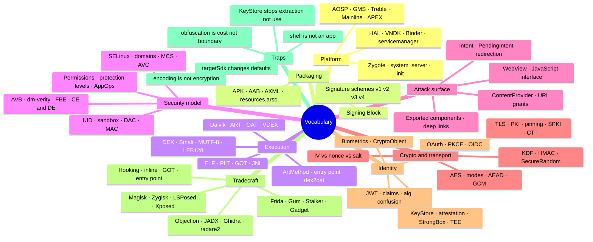

# 79 — Glossary

> The vocabulary this repository asks you to understand, defined precisely, with a pointer to the
> chapter that explains it properly. Coverage is checked mechanically, not promised:
> [`scripts/glossary-coverage.py`](scripts/glossary-coverage.py) asserts that every term on the
> watchlist in [`scripts/lexicon.txt`](scripts/lexicon.txt) has an entry here, and that every entry
> here is a word some chapter actually uses.

**Prerequisites:** none — this chapter is a lookup table, usable from day one
**Applies to:** all chapters

---

## Table of Contents

1. [Introduction](#1-introduction)
2. [How to use this glossary](#2-how-to-use-this-glossary)
3. [Terms A–Z](#3-terms-az)
4. [Acronym quick-reference](#4-acronym-quick-reference)
5. [Terms people confuse](#5-terms-people-confuse)
6. [File extensions and formats](#6-file-extensions-and-formats)
7. [Paths on an Android device](#7-paths-on-an-android-device)
8. [Summary](#8-summary)
9. [References](#9-references)

---

## 1. Introduction

Jargon is the tax you pay for precision. In Android security the tax is unusually high, because the
field sits at the intersection of four vocabularies that grew up separately: operating systems
(process, page table, syscall), Java (class loader, bytecode, reflection), cryptography (nonce, IV,
KDF), and offensive security (primitive, gadget, sink).

Worse, several words mean *different things* depending on which of those four rooms you are standing
in. "Key" means one thing to a cryptographer and another to a database engineer. "Reference" means one
thing in Java and another in JNI. "Signature" means a method's parameter list to a compiler and a
cryptographic authenticator to a package manager — and Android uses both senses, sometimes on the same
page of documentation.

> **Mental Model**
> A glossary is not a substitute for a chapter. A one-line definition tells you what a word *points
> at*; it does not give you the model that makes the word useful. Use this to unblock yourself
> mid-sentence, then read the linked chapter when the concept actually matters to what you are doing.

Every entry below gives the definition, and where relevant the thing people get wrong about it, and a
link to the chapter that teaches it properly.

---

## 2. How to use this glossary

Entries are alphabetical, ignoring case and leading symbols. Each has this shape:

> **Term** — the definition, in one or two plain sentences.
> *Chapter: `[NN](../NN-Name/README.md)`* · *Often confused with: X*

Where a term has a security consequence that a beginner would not guess, it is stated inline. Where a
term is commonly misused, the misuse is called out.

### If the word you need is not here

Say so, rather than working around it — a missing entry is a defect in this chapter, not in you. The
gap is also measurable:

```bash
# host — from the repository root
python3 -B 79-Glossary/scripts/glossary-coverage.py --term SELinux
python3 -B 79-Glossary/scripts/glossary-coverage.py            # both directions
python3 -B 79-Glossary/scripts/glossary-coverage.py --propose  # nominate gaps
```

This chapter used to claim it defined *every* term used anywhere in the repository. It did not: a
2026-08 audit found `Activity`, `SELinux`, `logcat`, `Gradle`, `bytecode`, `syscall`,
`BroadcastReceiver` and `daemon` all used across dozens of chapters with no entry — and `syscall`
appeared in this chapter's own introduction. Those are written now, and the claim above was narrowed
to one a script can check.

> **Mental Model**
> "Every term" is not an achievable target and never was. A corpus this size contains thousands of
> identifiers; a glossary that defined all of them would be a symbol index. What *is* achievable is a
> watchlist of the vocabulary the prose asks you to understand, checked in both directions — nothing
> on the list undefined, nothing defined that no chapter uses. The header of
> `glossary-coverage.py` records the extraction approaches that were measured and rejected before
> settling on that, so the next person does not repeat them.

---

## 3. Terms A–Z

### A

**AAB (Android App Bundle)** — Google Play's publishing format. It is *not* an installable package;
Play generates per-device APK sets from it. Practically, this means the APK on a device may not match
anything the developer built directly.
*Chapter: [10](../10-APK-Internals/README.md)*

**AAPT2 (Android Asset Packaging Tool 2)** — the tool that compiles and links resources into
`resources.arsc` and the binary manifest. `aapt2 dump xmltree` is the authoritative way to see what
the manifest actually says.
*Chapter: [08](../08-Build-System/README.md)*

**AAPCS64** — the ARM 64-bit procedure call standard: which registers carry arguments (X0–X7), where
return values go (X0), which registers a callee must preserve. Reading disassembly without knowing
this is guessing.
*Chapter: [18](../18-ARM/README.md)*

**ABI (Application Binary Interface)** — the contract between compiled code and its environment.
On Android it identifies the CPU/instruction-set variant: `arm64-v8a`, `armeabi-v7a`, `x86_64`, `x86`.
Determines which `lib/<abi>/` directory the device uses and which `frida-server` build you need.
*Chapter: [15](../15-Native-Code/README.md)*

**Activity** — the component representing one screen of an app. The system, not the app, decides when
it is created, paused and destroyed; an app that keeps state in an Activity and assumes it survives is
already wrong. For a tester it is the most commonly *exported* component, and an exported Activity is
a function any other app on the device can call with attacker-chosen arguments.
*Chapter: [30](../30-Activities/README.md)* · *See also: Exported component, launchMode, taskAffinity*

**adbd** — the ADB daemon on the device. Runs as the `shell` user (UID 2000) on production builds, not
as root.
*Chapter: [60](../60-ADB/README.md)*

**AEAD (Authenticated Encryption with Associated Data)** — encryption that also proves the ciphertext
was not modified, in one operation. AES-GCM and ChaCha20-Poly1305 are the ones you will meet. Using
plain CBC without a MAC is the failure this exists to prevent.
*Chapter: [34](../34-Cryptography/README.md)*

**AIDL (Android Interface Definition Language)** — a small language describing an IPC interface. The
build generates a `Stub` (server side) and `Proxy` (client side) that marshal calls over Binder. When
you decompile an app and see a class with an `onTransact` full of `case 1:`, `case 2:`, you are
looking at generated AIDL.
*Chapter: [25](../25-Binder/README.md)*

**AOSP (Android Open Source Project)** — the open-source Android platform. Does **not** include Google
Mobile Services, Play Services, or the Play Store; those are proprietary.
*Chapter: [07](../07-AOSP/README.md)*

**APEX** — a container format for updatable system modules, delivered independently of a full OS
update (Mainline). Conscrypt, the ART runtime, and the media components ship this way. Practical
consequence: the "system" is no longer a single frozen image, and the CA store moved, which is why
old system-certificate installation tricks break on newer Android.
*Chapter: [06](../06-Android-Architecture/README.md)*

**APK (Android Package)** — a ZIP archive containing an app's DEX, resources, manifest, native
libraries and signature. The unit Android installs.
*Chapter: [10](../10-APK-Internals/README.md)*

**APK Signing Block** — the region inserted between the ZIP entries and the central directory that
holds v2/v3/v3.1 signatures. It is a list of ID–value pairs, and third parties (including attackers)
can store arbitrary data there.
*Chapter: [10](../10-APK-Internals/README.md)*

**AppOps** — a permission-adjacent framework that tracks and can revoke fine-grained operations
independently of the permission system. `adb shell appops get <pkg>` is the way in.
*Chapter: [23](../23-Permissions/README.md)*

**ART (Android Runtime)** — the managed runtime that executes DEX bytecode. Replaced Dalvik as the
default in Android 5.0. Uses a hybrid of ahead-of-time compilation, just-in-time compilation, and
interpretation.
*Chapter: [13](../13-ART/README.md)*

**ArtMethod** — ART's internal C++ structure representing a method. Its
`entry_point_from_quick_compiled_code` field is the pointer that Frida, Xposed and LSPosed overwrite
to hook a Java method. If you understand this one structure, all Java hooking stops being magic.
*Chapter: [13](../13-ART/README.md)* · *See also: [65](../65-Hooking/README.md)*

**ASLR (Address Space Layout Randomisation)** — randomising where code and data land in memory so an
attacker cannot predict addresses. **Android's weakness:** because app processes are forked from
Zygote rather than exec'd, every app on a device shares the same library layout until reboot.
*Chapter: [19](../19-Memory/README.md)*

**Attestation (Key Attestation)** — a certificate chain, rooted in a Google hardware key, that proves
a given key was generated inside secure hardware and describes the device state at the time. The only
device-integrity claim with real cryptographic weight — and only if the *server* verifies it.
*Chapter: [49](../49-KeyStore/README.md)*

**AVB (Android Verified Boot)** — the mechanism that cryptographically verifies each stage of boot
against a hardware root of trust, with rollback protection. Produces the boot state
(green/yellow/orange/red).
*Chapter: [20](../20-Security-Architecture/README.md)*

**AVC denial** — an SELinux "access vector cache" log line recording a denied operation. Reading one
correctly tells you the source domain, the target type, the object class, and the exact permission
denied.
*Chapter: [22](../22-SELinux/README.md)*

**AVD (Android Virtual Device)** — an emulator configuration: system image, device profile, and
settings. The choice that matters is the image: a `google_apis` image allows `adb root`, a
`google_apis_playstore` image does not, and picking the wrong one is the single most common lab-setup
mistake. An AVD is the right place to learn and the wrong place to conclude — many apps behave
differently on one.
*Chapter: [39](../39-EmulatorDetection/README.md)*

**AXML (Android Binary XML)** — the compiled binary form of XML inside an APK. Because parsing it is
non-trivial, crafted files can make `apktool`/`jadx` display something different from what
`PackageManager` actually parses — a real evasion technique.
*Chapter: [10](../10-APK-Internals/README.md)*

### B

**Baksmali** — the disassembler that turns DEX bytecode into Smali text. `smali` is the assembler that
turns it back.
*Chapter: [14](../14-Dalvik/README.md)*

**Bearer token** — a credential where possession alone grants access; no proof of identity accompanies
it. This is why token *storage* is a first-class finding.
*Chapter: [46](../46-Tokens/README.md)*

**Binder** — Android's primary IPC mechanism: a kernel driver plus userspace libraries providing
reference-counted, capability-style object passing with a trustworthy caller identity.
*Chapter: [25](../25-Binder/README.md)*

**Binder.getCallingUid()** — returns the UID of the process that made the current Binder call. It
cannot be spoofed, which makes it the correct basis for authorization. `getCallingPid()` is racy — the
PID can be recycled — and must not be used for security decisions.
*Chapter: [25](../25-Binder/README.md)*

**Bionic** — Android's C library, replacing glibc. Smaller, BSD-licensed, and different enough that
glibc exploitation assumptions do not transfer.
*Chapter: [17](../17-Libraries/README.md)*

**Boot image (`boot.img`)** — the partition holding the Linux kernel and, on older layouts, the
ramdisk. It is what Magisk patches to obtain systemless root, and what `fastboot flash boot` writes.
Recent Pixels split the ramdisk into a separate `init_boot` partition, so patching the wrong one is a
common and confusing failure.
*Chapter: [61](../61-Fastboot/README.md)* · *See also: ramdisk, Magisk*

**Bootloader** — the firmware that runs before the kernel and decides what to boot. Unlocking it
disables Verified Boot enforcement and wipes user data.
*Chapter: [61](../61-Fastboot/README.md)*

**BoringSSL** — Google's fork of OpenSSL, used throughout Android. Flutter apps link it directly and
therefore ignore the Android system trust store — the reason Flutter pinning needs its own bypass.
*Chapter: [36](../36-CertificatePinning/README.md)*

**BroadcastReceiver** — the component that receives `Intent`s broadcast system-wide or by another app.
An exported receiver is an entry point reachable by any app, and its `onReceive` runs on the main
thread with the *host app's* permissions, which is what makes a receiver that acts on unvalidated
extras a privilege-escalation primitive rather than a bug. Since Android 13 a receiver registered at
runtime for a non-system broadcast must declare `RECEIVER_EXPORTED` or `RECEIVER_NOT_EXPORTED`.
*Chapter: [29](../29-BroadcastReceivers/README.md)* · *See also: Intent, Exported component*

**Bytecode** — instructions for a machine that does not exist in hardware. A real CPU decodes its
instruction set in silicon; a virtual machine's instruction set is decoded by software. DEX is
Android's bytecode format, and ART is what executes it — by interpreting it, or by compiling it to
real machine code. The practical point for a reverse engineer: bytecode retains far more structure
than compiled machine code, which is why an app's Java decompiles readably and its `.so` files do not.
*Chapter: [12](../12-DEX-Internals/README.md)* · *See also: DEX, Smali, dex2oat*

### C

**CA (Certificate Authority)** — an entity whose signature on a certificate causes clients to trust
it. Android has a *system* store and a *user* store; since Android 7.0 apps ignore the user store by
default.
*Chapter: [35](../35-SSL/README.md)*

**Canary (stack canary)** — a random value placed between local variables and the saved return
address; if a buffer overflow overwrites it, the mismatch is detected before returning.
*Chapter: [15](../15-Native-Code/README.md)*

**CE storage (Credential Encrypted)** — app storage under `/data/user/<n>/` that is only decryptable
after the user first unlocks the device. Contrast with DE storage.
*Chapter: [33](../33-Storage/README.md)*

**CFI (Control Flow Integrity)** — a mitigation restricting indirect calls/jumps to a valid set of
targets, making it harder to reuse code as an exploitation primitive.
*Chapter: [15](../15-Native-Code/README.md)*

**ClassLoader** — the object that finds and loads a class by name at runtime. Loaders form a
parent-first delegation chain, so which loader an app uses decides which version of a class wins —
the mechanism behind both legitimate dynamic feature loading and class-shadowing attacks. Every Frida
Java hook starts by finding the right loader, which is why `Java.enumerateClassLoaders` exists.
*Chapter: [11](../11-Android-Runtime/README.md)* · *See also: DexClassLoader*

**Confused deputy** — a privileged component tricked into misusing its authority on behalf of an
unprivileged caller. The abstract shape of intent redirection, permission re-delegation, and most
exported-component findings.
*Chapter: [24](../24-IPC/README.md)*

**Conscrypt** — Android's JCA/JSSE provider, backed by BoringSSL, delivered as a Mainline APEX module.
*Chapter: [17](../17-Libraries/README.md)*

**ContentProvider** — a component exposing structured data across the UID boundary via `content://`
URIs. A frequent source of SQL injection, path traversal, and data leakage.
*Chapter: [27](../27-ContentProviders/README.md)*

**Coroutine (Kotlin)** — a suspendable computation. The compiler rewrites suspend functions into a
state machine, which is why decompiled coroutine code shows an `invokeSuspend` method with a
`label` field and a large switch — one of the most confusing sights in JADX until you know why.
*Chapter: [05](../05-Kotlin/README.md)*

**CryptoObject** — the wrapper that binds a `Cipher`, `Signature` or `Mac` to a `BiometricPrompt`
authentication. **Its presence or absence is the single question that decides whether a biometric
implementation is real or decorative.**
*Chapter: [48](../48-Biometrics/README.md)*

### D

**DAC (Discretionary Access Control)** — classic UNIX ownership and permission bits. Root bypasses it
entirely, which is why Android also uses MAC (SELinux).
*Chapter: [22](../22-SELinux/README.md)*

**daemon** — a program that runs continuously in the background with no user interface, servicing
requests. The trailing `d` is the convention: `adbd`, `logd`, `installd`, `vold`, `frida-server`'s
process, Magisk's `magiskd`. On Android almost all of them are started by `init` from a `.rc` file,
and the UID and SELinux domain that `.rc` entry assigns is the whole of what a daemon can do — which
is why "it runs as a daemon" says nothing about its privilege until you look that up.
*Chapter: [02](../02-Linux-Basics/README.md)* · *See also: init*

**Dalvik** — the original Android VM, register-based, replaced by ART. Its bytecode format and Smali
syntax survive.
*Chapter: [14](../14-Dalvik/README.md)*

**DE storage (Device Encrypted)** — app storage under `/data/user_de/<n>/` readable after boot but
before the user unlocks. Enables Direct Boot. Anything sensitive placed here is available earlier than
the developer probably intended.
*Chapter: [33](../33-Storage/README.md)*

**Deep link** — a URI that opens a specific screen in an app. Attacker-supplied by definition, since
any app or web page can fire one.
*Chapter: [26](../26-Intent/README.md)*

**Deodex / ODEX** — historical optimised DEX artifacts produced ahead of time. Superseded by
OAT/VDEX.
*Chapter: [13](../13-ART/README.md)*

**DEX (Dalvik Executable)** — Android's bytecode container format. Register-based, with a shared
constant pool for strings, types, methods and fields.
*Chapter: [12](../12-DEX-Internals/README.md)*

**dex2oat** — the ahead-of-time compiler that turns DEX into OAT/VDEX at install or during background
optimisation.
*Chapter: [13](../13-ART/README.md)*

**DexClassLoader / InMemoryDexClassLoader** — class loaders that load DEX from an arbitrary file or
from a byte buffer. The mechanism behind packers, dynamic feature loading, and a great deal of
malware.
*Chapter: [11](../11-Android-Runtime/README.md)*

**dm-verity** — kernel device-mapper target verifying block integrity against a Merkle hash tree, so
the system partition cannot be silently modified. The reason Magisk is "systemless".
*Chapter: [20](../20-Security-Architecture/README.md)*

**DPoP (Demonstrating Proof of Possession)** — binds a token to a key the client holds, so a stolen
token alone is not enough.
*Chapter: [46](../46-Tokens/README.md)*

**Drozer** — a framework for probing an app's exported IPC surface from the position of a malicious
app.
*Chapter: [24](../24-IPC/README.md)*

### E

**ECB (Electronic Codebook)** — a block cipher mode that encrypts each block independently, so
identical plaintext blocks produce identical ciphertext. Leaks structure. Always a finding.
*Chapter: [34](../34-Cryptography/README.md)*

**ELF (Executable and Linkable Format)** — the binary format of Android native libraries (`.so`) and
executables.
*Chapter: [15](../15-Native-Code/README.md)*

**Entry point (ART)** — the function pointer in an `ArtMethod` that the runtime calls to execute the
method. Overwriting it is how Java hooking works.
*Chapter: [13](../13-ART/README.md)*

**Exported component** — an Activity, Service, Receiver or Provider reachable by other apps. Governed
by `android:exported`, whose *default* depends on `targetSdk` and on whether an intent filter is
present — a version-sensitive trap.
*Chapter: [32](../32-Manifest/README.md)*

### F

**Fastboot** — the bootloader-mode USB protocol used to flash partitions. Operates outside Android
entirely; destructive.
*Chapter: [61](../61-Fastboot/README.md)*

**FBE (File-Based Encryption)** — per-file encryption with different keys for CE and DE storage,
enabling Direct Boot.
*Chapter: [20](../20-Security-Architecture/README.md)*

**FileProvider** — a `ContentProvider` subclass for sharing files by URI grant instead of by file
permission. Misconfigured `<paths>` (especially `root-path` with `path="."`) exposes the filesystem.
*Chapter: [27](../27-ContentProviders/README.md)*

**FLAG_SECURE** — a window flag preventing screenshots and exclusion from screen capture and the
recents thumbnail.
*Chapter: [33](../33-Storage/README.md)*

**Frida** — a dynamic instrumentation toolkit. A server on the device injects an agent (with a
JavaScript runtime) into the target process via `ptrace`, and you script it from your host.
*Chapter: [53](../53-Frida/README.md)*

**Frida Gadget** — a shared library form of Frida you embed in a repackaged APK, for instrumenting
without root.
*Chapter: [53](../53-Frida/README.md)*

**fs-verity** — kernel-enforced read-only file integrity, used for APK verification (signing scheme
v4).
*Chapter: [10](../10-APK-Internals/README.md)*

### G

**Gatekeeper** — the TEE component that verifies the lockscreen credential and enforces throttling,
making PIN brute-forcing infeasible.
*Chapter: [50](../50-HardwareBackedSecurity/README.md)*

**GCM (Galois/Counter Mode)** — an AEAD mode. **Reusing an IV with the same key in GCM is
catastrophic** — it leaks the authentication key, not merely plaintext relationships.
*Chapter: [34](../34-Cryptography/README.md)*

**Ghidra** — the NSA's open-source reverse engineering suite, with a decompiler. The default free
choice for Android native RE.
*Chapter: [57](../57-Ghidra/README.md)*

**GMS (Google Mobile Services)** — the proprietary Google app and service layer that is *not* part of
AOSP.
*Chapter: [07](../07-AOSP/README.md)*

**GOT (Global Offset Table)** — the table holding resolved addresses of external symbols. Rewriting an
entry redirects all future cross-module calls — GOT hooking.
*Chapter: [15](../15-Native-Code/README.md)*

**Gradle** — the build system Android apps are built with; the platform itself uses Soong/Make
instead. Its build scripts are **programs**, not configuration, so `build.gradle` can generate code,
inject values into `BuildConfig`, and pull dependencies at build time. That makes it worth reading:
hardcoded secrets, debug flags left enabled for release, disabled minification, and the exact
dependency versions behind a vulnerable library all live there.
*Chapter: [08](../08-Build-System/README.md)* · *Often confused with: the Android Gradle Plugin, which
is the Android-specific layer on top of it*

### H

**HAL (Hardware Abstraction Layer)** — the interface between the framework and device-specific
hardware drivers.
*Chapter: [06](../06-Android-Architecture/README.md)*

**Hidden API** — framework APIs marked `@hide` and enforced at runtime by the blocklist/greylist
system. Bypassable for research.
*Chapter: [07](../07-AOSP/README.md)*

**HKDF / PBKDF2 / Argon2 / scrypt** — key derivation functions. PBKDF2 and Argon2 are for deriving keys
from *passwords* (deliberately slow); HKDF is for deriving keys from *existing key material* (fast).
Using the wrong one is a real finding.
*Chapter: [34](../34-Cryptography/README.md)*

### I

**IDOR / BOLA** — Insecure Direct Object Reference / Broken Object Level Authorization: the server
returns another user's object because it trusts a client-supplied identifier. The most common mobile
*backend* finding.
*Chapter: [47](../47-Authentication/README.md)*

**init** — the first user-space process the kernel starts, always PID 1, and the ancestor of every
other process on the device. It reads `.rc` scripts, mounts the partitions, sets the initial
properties, and starts the daemons and Zygote. Two consequences you will use: the `.rc` file for a
service is the authoritative statement of the UID, groups and SELinux domain it runs with, and
`init`'s property-set handling is a real attack surface because properties cross privilege boundaries.
*Chapter: [06](../06-Android-Architecture/README.md)* · *See also: daemon, Zygote*

**Intent** — a Parcelable message describing an operation to perform. Explicit (names a component) or
implicit (described by action/data/category).
*Chapter: [26](../26-Intent/README.md)*

**Intent redirection** — an exported component receives an `Intent` (often as an extra) from an
untrusted caller and passes it to `startActivity`/`sendBroadcast`/`bindService`, letting the attacker
reach non-exported components with the victim app's authority. **One of the highest-frequency
high-severity Android findings.**
*Chapter: [26](../26-Intent/README.md)*

**IV (Initialisation Vector)** — a per-message value making identical plaintexts encrypt differently.
Must be unpredictable for CBC and unique for GCM/CTR. It is **not** secret, and it is **not** a salt.
*Chapter: [34](../34-Cryptography/README.md)* · *Often confused with: nonce, salt*

**isolatedProcess** — a manifest attribute running a service in a heavily restricted process with no
permissions and its own SELinux domain. The strongest sandbox available to an app developer.
*Chapter: [21](../21-App-Sandbox/README.md)*

### J

**JADX** — a DEX-to-Java decompiler. Best-effort: it reconstructs plausible Java, not ground truth.
When it disagrees with the runtime, the runtime is right.
*Chapter: [56](../56-JADX/README.md)*

**JCA (Java Cryptography Architecture)** — the provider-based crypto API (`Cipher`, `MessageDigest`,
`Mac`, `KeyGenerator`, `KeyStore`). Hooking it wholesale is one of the highest-yield Frida techniques.
*Chapter: [34](../34-Cryptography/README.md)*

**JIT and AOT** — the two ways bytecode becomes machine code. **AOT** (ahead-of-time) compiles before
execution — on Android, `dex2oat` at install time or during idle maintenance. **JIT** (just-in-time)
compiles while the app runs, for the methods that turn out to be hot. Android uses both, guided by
profiles. Consequence for analysis: the same method in the same app may be interpreted, JIT-compiled
or AOT-compiled at different moments, and which it is changes what a hook or a memory dump sees.
*Chapter: [13](../13-ART/README.md)* · *See also: dex2oat, Bytecode*

**JNI (Java Native Interface)** — the bridge between managed code and native code. Registration is
either static (mangled `Java_com_example_Class_method` symbols) or dynamic (`RegisterNatives` inside
`JNI_OnLoad`) — the latter defeats naive symbol searching.
*Chapter: [16](../16-JNI/README.md)*

**JWT (JSON Web Token)** — a signed (JWS) or encrypted (JWE) token carrying claims. Base64url header,
payload and signature. The payload is **encoded, not encrypted** — a distinction developers get wrong
constantly.
*Chapter: [46](../46-Tokens/README.md)*

### K

**KeyMint / Keymaster** — the HAL through which Android asks secure hardware to generate and use keys.
KeyMint is the modern name.
*Chapter: [49](../49-KeyStore/README.md)*

**KeyStore (AndroidKeyStore)** — the system that generates and uses keys inside secure hardware so
the key material never enters the app's process. **It prevents key extraction; it does not prevent key
use by code running in the process.**
*Chapter: [49](../49-KeyStore/README.md)*

### L

**launchMode** — an activity attribute (`standard`, `singleTop`, `singleTask`, `singleInstance`,
`singleInstancePerTask`) controlling task and instance behaviour. Interacts with `taskAffinity` to
enable task hijacking.
*Chapter: [30](../30-Activities/README.md)*

**logcat** — the system-wide log, and the `adb logcat` command that reads it. Logs are held in a ring
buffer by the `logd` daemon and are **not** private to the app that wrote them, so anything an app
logs is a disclosure. Since Android 4.1 an ordinary app can only read its own entries, but `adb shell`
reads everything — which is why "I found the token in logcat" needs the `shell`-versus-app-UID check
before it becomes a finding. Filter with `adb logcat --pid=$(adb shell pidof -s <pkg>)`.
*Chapter: [51](../51-DynamicAnalysis/README.md)* · *See also: daemon, shell (UID 2000)*

**LSPlant** — an ART hook library: it replaces a method's quick entrypoint, keeps a backup method for
the original, and can deoptimize callers whose inlined copies bypass the hook. It is the engine
underneath Vector/LSPosed, not a module loader or a scope manager.
*Chapter: [81](../81-Android-Runtime-Internals/README.md)* · *See also: `ArtMethod`, Vector*

**LSPosed** — a modern Xposed-API implementation built on Zygisk, hooking Java methods by patching ART
entry points. In 2026 the lineage continues as **Vector**; the LSPosed architecture and the Vector
implementation are the same stack, but the native injection path and API version differ.
*Chapter: [63](../63-LSPosed/README.md)* · *See also: Vector, LSPlant, Zygisk*

### M

**MAC (Mandatory Access Control)** — access control enforced by system policy that even root cannot
override at will. On Android this is SELinux.
*Chapter: [22](../22-SELinux/README.md)* · *Often confused with: MAC (Message Authentication Code)*

**MAC (Message Authentication Code)** — a keyed value proving a message's integrity and authenticity.
HMAC is the common construction. Unrelated to Mandatory Access Control despite the acronym clash.
*Chapter: [34](../34-Cryptography/README.md)*

**Magisk** — a systemless root solution: it patches the boot image and uses mount namespaces to
present modifications without altering the verified partitions.
*Chapter: [62](../62-Magisk/README.md)*

**Mainline** — Google's programme for updating system components independently of full OS updates, via
APEX modules.
*Chapter: [06](../06-Android-Architecture/README.md)*

**MASVS / MASTG** — OWASP's Mobile Application Security Verification Standard (what to verify) and
Testing Guide (how to test it). The vocabulary clients expect in a report.
*Chapter: [71](../71-OWASP-Mobile/README.md)*

**MTE (Memory Tagging Extension)** — ARMv8.5 hardware feature tagging memory allocations to catch
use-after-free and buffer overflows.
*Chapter: [19](../19-Memory/README.md)*

**MUTF-8 (Modified UTF-8)** — the string encoding used inside DEX files. Differs from standard UTF-8
in how it encodes the null character and supplementary-plane characters.
*Chapter: [12](../12-DEX-Internals/README.md)*

### N

**Network Security Config** — an XML resource declaring trust anchors, pinning, and cleartext policy.
Frequently the reason your proxy silently fails.
*Chapter: [44](../44-NetworkSecurityConfig/README.md)*

**Nonce** — a number used once, for a given key. Overlaps with IV in practice; the distinguishing
requirement is *uniqueness*, whereas a CBC IV additionally requires *unpredictability*.
*Chapter: [34](../34-Cryptography/README.md)* · *Often confused with: IV, salt*

**nterp** — ART's native-stack interpreter. It is the preferred interpreter on many configurations,
but not a universal one: debuggable or interpret-only builds, incompatible instrumentation and some
exception/listener states can exclude it. Its entrypoint lives in `libart.so` and is one of the
possible values of a method's quick entrypoint.
*Chapter: [81](../81-Android-Runtime-Internals/README.md)* · *See also: ART, JIT, OAT*

### O

**OAT** — ART's compiled output file. Structurally an ELF with `oatdata`/`oatexec` symbols wrapping
the DEX and native code.
*Chapter: [13](../13-ART/README.md)*

**Objection** — a pre-built Frida agent with a REPL, automating common mobile testing tasks. Its
failures are opaque if you do not know what it is doing underneath.
*Chapter: [54](../54-Objection/README.md)*

**Obfuscation** — transformations that raise the cost of understanding code. Raises cost; does not
create a security boundary.
*Chapter: [40](../40-Obfuscation/README.md)*

**OTA / Verified Boot state** — see AVB. `ro.boot.verifiedbootstate` reports green (locked, OEM key),
yellow (locked, user key), orange (unlocked), red (verification failed).
*Chapter: [20](../20-Security-Architecture/README.md)*

**Overlay filesystem (`overlayfs`)** — a kernel filesystem that stacks a writable upper directory over
a read-only lower one and presents the merged result: an upper file hides the lower file of the same
name, and the lower layer is never written to. This is how Magisk makes modified files *appear* at
system paths while the real partition stays byte-for-byte intact and dm-verity stays satisfied. It is
also why a file you see at `/system/...` on a rooted device may not be the file that is really there.
*Chapter: [02](../02-Linux-Basics/README.md)* · *See also: Magisk, dm-verity*

### P

**Parcel** — Binder's serialisation container. Mismatches between what is written and what is read
(the "self-changing Bundle" class) have enabled privilege escalation.
*Chapter: [25](../25-Binder/README.md)*

**`PATH`** — an environment variable holding a list of directories the shell searches, in order, to
find the program you named. "Command not found" almost always means the program is installed but its
directory is not on `PATH`, not that it is missing. Two security consequences: a writable directory
early on `PATH` lets an attacker shadow a legitimate binary, and root detection routinely works by
looking for `su` on `PATH`.
*Chapter: [02](../02-Linux-Basics/README.md)* · *See also: `LD_PRELOAD`, RootBeer*

**PendingIntent** — a token letting another app perform an operation **with your app's identity**.
Must be created `FLAG_IMMUTABLE` unless mutability is genuinely required; a mutable one handed to an
attacker is a privilege escalation primitive.
*Chapter: [26](../26-Intent/README.md)*

**PIE (Position Independent Executable)** — a binary that can load at any base address, enabling ASLR.
Mandatory on Android since 5.0.
*Chapter: [15](../15-Native-Code/README.md)*

**Pinning (certificate pinning)** — constraining which certificate or public key a client will accept,
narrowing trust from "any trusted CA" to a specific set. Its absence is not automatically a
high-severity finding — context decides.
*Chapter: [36](../36-CertificatePinning/README.md)*

**PKCE (Proof Key for Code Exchange)** — an OAuth extension binding an authorization code to the
client that requested it, defeating code interception on mobile. The real test is whether the
**server enforces** it, not whether the client sends it.
*Chapter: [45](../45-OAuth/README.md)*

**Play Integrity API** — Google's device and app integrity attestation, successor to SafetyNet
Attestation. Verdicts must be verified **server-side**; a client-side check is meaningless.
*Chapter: [20](../20-Security-Architecture/README.md)*

**PLT (Procedure Linkage Table)** — the stub table used for lazily-resolved external calls, working
with the GOT.
*Chapter: [15](../15-Native-Code/README.md)*

**ProGuard** — the classic shrinker/obfuscator. Superseded by R8 as the Android default but its rules
language lives on.
*Chapter: [41](../41-ProGuard/README.md)*

**ptrace** — the syscall used to attach to and control another process. The foundation of debugging,
of Frida's injection, and — because a process can only be traced once — of the most common anti-debug
trick.
*Chapter: [02](../02-Linux-Basics/README.md)*

### R

**R8** — the current default shrinker, optimiser, desugarer and dexer, in one pass. Its optimisations
(inlining, class merging, enum unboxing, outlining) are why decompiled release code looks nothing like
the original source.
*Chapter: [42](../42-R8/README.md)*

**ramdisk** — a small filesystem carried inside the boot image and unpacked into RAM at boot, holding
just enough — `init`, its `.rc` files, the SELinux policy — to mount the real partitions. Because it
lives in RAM, changes to a *running* ramdisk vanish at power-off; because it ships inside the boot
image, changes to the *image* persist. That asymmetry is exactly what systemless root exploits.
*Chapter: [06](../06-Android-Architecture/README.md)* · *See also: Boot image, init, Magisk*

**RELRO (RELocation Read-Only)** — a hardening measure making relocation sections read-only after
linking. "Full RELRO" also resolves everything eagerly, protecting the GOT from being overwritten.
*Chapter: [15](../15-Native-Code/README.md)*

**Reflection** — inspecting and invoking classes, methods and fields by name at runtime. Defeats
static call-graph analysis, survives obfuscation only where keep rules preserve it, and is a favourite
of malware for hiding API calls.
*Chapter: [04](../04-Java/README.md)*

**resources.arsc** — the compiled resource table mapping resource IDs to values per configuration.
*Chapter: [10](../10-APK-Internals/README.md)*

**RootBeer** — a widely-used open-source root detection library. Extremely common in the wild, and
well-documented to bypass.
*Chapter: [37](../37-RootDetection/README.md)*

**run-as** — a setuid helper letting the `shell` user execute as an app's UID, but **only if the app
is `debuggable`**. The reason `android:debuggable="true"` in production is a serious finding.
*Chapter: [09](../09-Android-App-Internals/README.md)*

### S

**Salt** — a non-secret, unique value mixed into password hashing so identical passwords produce
different hashes. **Not** an IV and **not** a nonce.
*Chapter: [34](../34-Cryptography/README.md)* · *Often confused with: IV, nonce*

**Sandbox (app sandbox)** — the per-app isolation built from a unique UID (DAC), SELinux (MAC),
seccomp, and filesystem layout.
*Chapter: [21](../21-App-Sandbox/README.md)*

**Scoped storage** — the storage model, enforced from Android 11, restricting broad access to shared
external storage.
*Chapter: [33](../33-Storage/README.md)*

**Scudo** — Android's current hardened userspace memory allocator.
*Chapter: [19](../19-Memory/README.md)*

**seapp_contexts** — the AOSP file mapping apps to SELinux domains and assigning MCS categories, which
is what gives per-app isolation inside the shared `untrusted_app` domain.
*Chapter: [22](../22-SELinux/README.md)*

**seccomp-bpf** — a kernel facility filtering which syscalls a process may make. Zygote applies a
filter to app processes.
*Chapter: [21](../21-App-Sandbox/README.md)*

**SecureRandom vs Random** — `java.util.Random` is a predictable PRNG and must never generate keys,
tokens, IVs or session identifiers; `java.security.SecureRandom` is the CSPRNG. Using the former is a
real, findable vulnerability.
*Chapter: [34](../34-Cryptography/README.md)*

**SELinux (Security-Enhanced Linux)** — the mandatory access control system Android has enforced on
every process since Android 5.0. Every process runs in a **domain**, every file and socket carries a
**type**, and policy — compiled into the device, not editable at runtime — states which domain may
perform which operation on which type. Because it is *mandatory*, it applies to root as well:
**"I have root but still get permission denied" is almost always SELinux**, and the denial is in
`dmesg`/`logcat` as an AVC line. Apps share the `untrusted_app` domain and are separated inside it by
MCS categories.
*Chapter: [22](../22-SELinux/README.md)* · *See also: MAC, DAC, AVC denial, seapp_contexts*

**Service** — an app component with no user interface, for work that outlives a screen. Two kinds,
and the difference is the whole security story: a *started* service runs until told to stop, while a
*bound* service hands the caller a Binder interface and therefore an API. An exported bound service is
a set of methods any app can call inside the host app's UID, and `Binder.getCallingUid()` inside
`onTransact` is where the authorization decision belongs. Not to be confused with a system service
registered with `servicemanager`, nor with a UNIX daemon.
*Chapter: [28](../28-Services/README.md)* · *Often confused with: daemon, system service*

**servicemanager** — the registry where system Binder services publish themselves and clients look
them up. `adb shell service list` queries it.
*Chapter: [25](../25-Binder/README.md)*

**SharedPreferences** — the key-value store backed by an XML file in the app's private directory.
Nothing about it is encrypted: it is plaintext XML that root, a backup, or any path-traversal bug can
read. It is where tokens, session identifiers and "remember me" flags are found more often than
anywhere else, which makes `/data/data/<pkg>/shared_prefs/` the first directory to look in.
*Chapter: [33](../33-Storage/README.md)*

**sharedUserId** — a deprecated manifest attribute letting co-signed apps share one UID and therefore
one sandbox. Expands the blast radius of compromising any one of them.
*Chapter: [09](../09-Android-App-Internals/README.md)*

**shell (UID 2000)** — the identity `adb shell` runs as. It holds privileges a normal app does **not**,
which is why a finding reproduced only from `adb shell` is not yet a finding.
*Chapter: [77](../77-UsefulCommands/README.md)*

**Smali** — the human-readable assembly syntax for DEX bytecode. The reliable fallback when a
decompiler fails, and the medium for patching an app.
*Chapter: [14](../14-Dalvik/README.md)*

**SPKI pin** — a pin over the Subject Public Key Info hash rather than the whole certificate, so the
pin survives certificate renewal with the same key.
*Chapter: [36](../36-CertificatePinning/README.md)*

**Stalker** — Frida's instruction-level code tracing engine.
*Chapter: [53](../53-Frida/README.md)*

**StrandHogg** — the public name for a task-hijacking technique abusing `taskAffinity` and
`launchMode` so a malicious activity appears inside the victim app's task.
*Chapter: [30](../30-Activities/README.md)*

**StrongBox** — a discrete, tamper-resistant secure element (e.g. Titan M2) that can back KeyStore
keys, giving physical isolation beyond TrustZone.
*Chapter: [50](../50-HardwareBackedSecurity/README.md)*

**syscall (system call)** — the only way a program can ask the kernel to do anything outside its own
address space: open a file, allocate memory, send on a socket, make a Binder transaction. On AArch64
it is the `SVC #0` instruction, a deliberate hardware exception that switches from EL0 to EL1 and
enters the kernel at a fixed address. Two consequences the whole field rests on: **user-space code
physically cannot skip this step**, so it is where every check can be enforced; and because the
libc wrapper is only a convenience, malware and packers routinely issue raw syscalls to bypass hooks
placed on `libc`.
*Chapter: [01](../01-Computer-Science-Basics/README.md)* · *See also: seccomp-bpf, ptrace*

**system_server** — the process hosting most Android system services. Its crash causes a soft reboot.
*Chapter: [06](../06-Android-Architecture/README.md)*

### T

**Tapjacking** — tricking a user into interacting with a hidden or obscured UI by drawing an overlay
over the victim app.
*Chapter: [30](../30-Activities/README.md)*

**targetSdkVersion** — the API level an app declares it was built against. **Changes default security
behaviour**: exported defaults, runtime permissions, cleartext policy, PendingIntent mutability,
scoped storage, receiver export. Always the first thing to check in a manifest.
*Chapter: [32](../32-Manifest/README.md)*

**taskAffinity** — the task an activity prefers to belong to. Abusable for task hijacking.
*Chapter: [30](../30-Activities/README.md)*

**TEE (Trusted Execution Environment)** — an isolated execution environment (typically ARM TrustZone)
running a separate trusted OS, where key material and biometric templates live.
*Chapter: [50](../50-HardwareBackedSecurity/README.md)*

**TracerPid** — a field in `/proc/<pid>/status` that is non-zero when a process is being traced. The
simplest anti-debug check, and the first one to neutralise.
*Chapter: [38](../38-TamperDetection/README.md)*

**Treble** — the architectural split separating the vendor implementation from the Android framework,
enabling framework updates without vendor involvement.
*Chapter: [06](../06-Android-Architecture/README.md)*

**TrustManager** — the JSSE interface deciding whether to accept a server's certificate chain. A
`checkServerTrusted` with an empty body accepts everything — the classic TLS finding.
*Chapter: [35](../35-SSL/README.md)*

### U

**UID (User ID)** — the Linux user identity Android assigns per app (10000+), and the foundation of
the sandbox. Under multi-user, `UID = userId * 100000 + appId`.
*Chapter: [09](../09-Android-App-Internals/README.md)*

**URI permission grant** — a temporary, per-URI capability handed to another app via
`FLAG_GRANT_READ_URI_PERMISSION`, allowing access without a full permission. Stealable through intent
redirection.
*Chapter: [27](../27-ContentProviders/README.md)*

### V

**VDEX** — the ART artifact holding verified DEX plus verifier dependencies, alongside OAT.
*Chapter: [13](../13-ART/README.md)*

**Vector** — the 2026 continuation of LSPosed: a Zygisk-based Xposed/libxposed framework that loads
its framework DEX in memory, selects scope per app, and uses LSPlant for ART entrypoint hooks. Its
native injection path is a rewrite, not the old LSPosed binary.
*Chapter: [81](../81-Android-Runtime-Internals/README.md)* · *See also: LSPosed, LSPlant, Zygisk*

**VNDK (Vendor Native Development Kit)** — the stable set of native libraries vendor code may use,
part of Treble.
*Chapter: [06](../06-Android-Architecture/README.md)*

### W

**WebView** — the embeddable browser component. `addJavascriptInterface`,
`setAllowUniversalAccessFromFileURLs`, and unvalidated URL loading make it one of the richest client-
side attack surfaces.
*Chapter: [43](../43-WebView/README.md)*

**Weaver** — a secure-element-backed secret store used with Gatekeeper for lockscreen credential
verification on some devices.
*Chapter: [50](../50-HardwareBackedSecurity/README.md)*

### X–Z

**Xposed** — the original ART/Dalvik hooking framework, requiring `/system` modification. Its API
survives in LSPosed.
*Chapter: [64](../64-Xposed/README.md)*

**Zygisk** — Magisk's mechanism for injecting modules into Zygote so they run inside every app
process.
*Chapter: [62](../62-Magisk/README.md)* · *See also: ZygiskNext, Vector*

**ZygiskNext** — a standalone implementation of the Zygisk module ABI for KernelSU, Magisk and
APatch. It is not a different module API for authors. Closed-source since `v4-0.9.2`; the public
repository carries the README, `module.yaml`, the native extension header and documentation.
*Chapter: [81](../81-Android-Runtime-Internals/README.md)* · *See also: Zygisk, KernelSU, Magisk*

**Zygote** — the process that preloads framework classes and resources and forks every app process.
Forking (rather than exec'ing) is why app startup is fast — and why library addresses are identical
across apps until reboot.
*Chapter: [06](../06-Android-Architecture/README.md)*

---

## 4. Acronym quick-reference

| Acronym | Expansion | Chapter |
|---|---|---|
| AAB | Android App Bundle | [10](../10-APK-Internals/README.md) |
| ABI | Application Binary Interface | [15](../15-Native-Code/README.md) |
| AEAD | Authenticated Encryption with Associated Data | [34](../34-Cryptography/README.md) |
| AIDL | Android Interface Definition Language | [25](../25-Binder/README.md) |
| AOSP | Android Open Source Project | [07](../07-AOSP/README.md) |
| APK | Android Package | [10](../10-APK-Internals/README.md) |
| ART | Android Runtime | [13](../13-ART/README.md) |
| ASLR | Address Space Layout Randomisation | [19](../19-Memory/README.md) |
| AVB | Android Verified Boot | [20](../20-Security-Architecture/README.md) |
| AVC | Access Vector Cache (SELinux denial) | [22](../22-SELinux/README.md) |
| AXML | Android Binary XML | [10](../10-APK-Internals/README.md) |
| BOLA | Broken Object Level Authorization | [47](../47-Authentication/README.md) |
| CE | Credential Encrypted (storage) | [33](../33-Storage/README.md) |
| CFI | Control Flow Integrity | [15](../15-Native-Code/README.md) |
| CT | Certificate Transparency | [35](../35-SSL/README.md) |
| DAC | Discretionary Access Control | [22](../22-SELinux/README.md) |
| DE | Device Encrypted (storage) | [33](../33-Storage/README.md) |
| DEX | Dalvik Executable | [12](../12-DEX-Internals/README.md) |
| ELF | Executable and Linkable Format | [15](../15-Native-Code/README.md) |
| FBE | File-Based Encryption | [20](../20-Security-Architecture/README.md) |
| GMS | Google Mobile Services | [07](../07-AOSP/README.md) |
| GOT | Global Offset Table | [15](../15-Native-Code/README.md) |
| HAL | Hardware Abstraction Layer | [06](../06-Android-Architecture/README.md) |
| IDOR | Insecure Direct Object Reference | [47](../47-Authentication/README.md) |
| IPC | Inter-Process Communication | [24](../24-IPC/README.md) |
| IV | Initialisation Vector | [34](../34-Cryptography/README.md) |
| JCA | Java Cryptography Architecture | [34](../34-Cryptography/README.md) |
| JNI | Java Native Interface | [16](../16-JNI/README.md) |
| JWT | JSON Web Token | [46](../46-Tokens/README.md) |
| KDF | Key Derivation Function | [34](../34-Cryptography/README.md) |
| MAC | Mandatory Access Control **or** Message Authentication Code | [22](../22-SELinux/README.md) / [34](../34-Cryptography/README.md) |
| MASVS | Mobile App Security Verification Standard | [71](../71-OWASP-Mobile/README.md) |
| MASTG | Mobile App Security Testing Guide | [71](../71-OWASP-Mobile/README.md) |
| MCS | Multi-Category Security (SELinux) | [22](../22-SELinux/README.md) |
| MTE | Memory Tagging Extension | [19](../19-Memory/README.md) |
| MUTF-8 | Modified UTF-8 | [12](../12-DEX-Internals/README.md) |
| NDK | Native Development Kit | [15](../15-Native-Code/README.md) |
| OAT | Ahead-of-time compiled ART artifact | [13](../13-ART/README.md) |
| OIDC | OpenID Connect | [45](../45-OAuth/README.md) |
| PIE | Position Independent Executable | [15](../15-Native-Code/README.md) |
| PKCE | Proof Key for Code Exchange | [45](../45-OAuth/README.md) |
| PLT | Procedure Linkage Table | [15](../15-Native-Code/README.md) |
| RELRO | Relocation Read-Only | [15](../15-Native-Code/README.md) |
| SAF | Storage Access Framework | [33](../33-Storage/README.md) |
| SELinux | Security-Enhanced Linux | [22](../22-SELinux/README.md) |
| SPKI | Subject Public Key Info | [36](../36-CertificatePinning/README.md) |
| TEE | Trusted Execution Environment | [50](../50-HardwareBackedSecurity/README.md) |
| UID | User ID | [09](../09-Android-App-Internals/README.md) |
| VDEX | Verified DEX artifact | [13](../13-ART/README.md) |
| VNDK | Vendor Native Development Kit | [06](../06-Android-Architecture/README.md) |

---

## 5. Terms people confuse

These pairs cause more wasted hours than any others. Learn the distinction once.

| A | B | The distinction |
|---|---|---|
| **IV** | **Salt** | An IV makes *ciphertexts* differ; a salt makes *password hashes* differ. Neither is secret. They are not interchangeable. |
| **IV** | **Nonce** | Both are per-message values. A nonce must be *unique*; a CBC IV must additionally be *unpredictable*. GCM's is a nonce. |
| **Encoding** | **Encryption** | Base64 is encoding — reversible by anyone. Calling it encryption is a finding, not a defence. |
| **Hashing** | **Encryption** | Hashing is one-way and keyless. Encryption is reversible with a key. "We hash the password with AES" is a red flag. |
| **MAC** (access control) | **MAC** (message auth) | Same acronym, unrelated concepts. Context disambiguates: SELinux vs cryptography. |
| **Authentication** | **Authorization** | Who you are, versus what you may do. Most mobile backend findings are authorization failures on an authenticated session. |
| **Dalvik** | **ART** | Dalvik is the retired VM; ART is the current runtime. The *DEX format* and *Smali* are shared, which is why the names persist. |
| **Bytecode** | **Machine code** | Bytecode targets a VM that software implements; machine code targets the CPU directly. DEX is bytecode, an `.so` holds machine code. This is why one decompiles well and the other does not. |
| **package manager** (desktop) | **`pm`** (Android) | `apt`/`brew`/`winget` install software on *your computer*, with dependency resolution and repository signatures. Android's `pm` installs APKs on the *device*, with neither. Same words, unrelated tools. |
| **`daemon`** | **`service`** (Android) | A daemon is a background UNIX process started by `init`. An Android `Service` is an app component with no UI, running inside an app process. Only one of them is a Linux concept. |
| **DEX** | **ODEX / OAT / VDEX** | DEX is the portable bytecode container. ODEX/OAT/VDEX are device-specific compiled or verified artifacts derived from it. |
| **`shell` UID 2000** | **an app UID 10xxx** | `shell` has developer privileges an app does not. Reproduce every finding from a real app UID before reporting it. |
| **root** | **unrestricted** | Root defeats DAC. SELinux still applies. "I have root but permission denied" is normally SELinux. |
| **Signature** (method) | **Signature** (cryptographic) | A method signature is its parameter/return types. An APK signature authenticates the package. Android uses both words. |
| **Reference** (Java) | **Reference** (JNI) | A Java reference is a language-level pointer. A JNI local/global reference is an explicitly managed handle with its own lifetime rules and table limits. |
| **`exported="false"`** | **not reachable** | `shell` and some system components can still reach non-exported components. Export controls *app* reachability. |
| **Obfuscated** | **Secure** | Obfuscation raises cost. It never creates a trust boundary. |
| **Key in KeyStore** | **Key is safe** | KeyStore prevents *extraction*, not *use*. In-process code execution can still use the key. |
| **Pinning bypassed** | **Vulnerability found** | Bypassing pinning is a testing prerequisite, not a finding. What you observe afterwards is the finding. |
| **`targetSdk`** | **`compileSdk`** | `targetSdk` changes *runtime behaviour and defaults*. `compileSdk` only decides which APIs the compiler knows about. |
| **Emulator detection triggered** | **App is broken** | Many apps silently disable features rather than erroring. Absence of a behaviour on an emulator proves nothing. |

---

## 6. File extensions and formats

| Extension / name | What it is | Chapter |
|---|---|---|
| `.apk` | Android package (ZIP) | [10](../10-APK-Internals/README.md) |
| `.aab` | Android App Bundle (publishing format, not installable) | [10](../10-APK-Internals/README.md) |
| `.dex` | Dalvik Executable bytecode | [12](../12-DEX-Internals/README.md) |
| `.odex` / `.oat` / `.vdex` / `.art` | ART compiled and verified artifacts | [13](../13-ART/README.md) |
| `.so` | Shared object (native library, ELF) | [15](../15-Native-Code/README.md) |
| `.smali` | Disassembled DEX bytecode, human-readable | [14](../14-Dalvik/README.md) |
| `.arsc` | Compiled resource table (`resources.arsc`) | [10](../10-APK-Internals/README.md) |
| `AndroidManifest.xml` | The app's declaration — binary AXML inside an APK | [32](../32-Manifest/README.md) |
| `MANIFEST.MF` / `CERT.SF` / `CERT.RSA` | v1 (JAR) signature files under `META-INF/` | [10](../10-APK-Internals/README.md) |
| `.aidl` | Interface definition for Binder IPC | [25](../25-Binder/README.md) |
| `.bp` / `.mk` | Soong Blueprint / Make files (platform build) | [08](../08-Build-System/README.md) |
| `.pro` | ProGuard/R8 rules | [41](../41-ProGuard/README.md) |
| `mapping.txt` | R8/ProGuard obfuscation mapping | [41](../41-ProGuard/README.md) |
| `.te` / `.cil` | SELinux policy source | [22](../22-SELinux/README.md) |
| `.rc` | init configuration | [06](../06-Android-Architecture/README.md) |
| `libapp.so` | Flutter application code | [36](../36-CertificatePinning/README.md) |
| `index.android.bundle` | React Native JavaScript bundle | [52](../52-StaticAnalysis/README.md) |
| `global-metadata.dat` | Unity IL2CPP metadata | [52](../52-StaticAnalysis/README.md) |

---

## 7. Paths on an Android device

| Path | What lives there | Chapter |
|---|---|---|
| `/data/data/<pkg>/` | App private data. The same directory as `/data/user/0/<pkg>/` — a **bind mount**, not a symlink: `readlink` returns nothing and both paths share one inode | [33](../33-Storage/README.md) |
| `/data/user/<n>/<pkg>/` | Credential-encrypted app data for user *n* | [33](../33-Storage/README.md) |
| `/data/user_de/<n>/<pkg>/` | Device-encrypted app data (available before unlock) | [33](../33-Storage/README.md) |
| `/data/app/<pkg>-<rand>/` | Installed APK and extracted native libs | [09](../09-Android-App-Internals/README.md) |
| `/data/system/packages.xml`, `packages.list` | Package records and UID assignments | [09](../09-Android-App-Internals/README.md) |
| `/data/misc/keystore/` | KeyStore key blobs (useless off-device) | [49](../49-KeyStore/README.md) |
| `/data/misc/profiles/` | ART profiles for profile-guided compilation | [13](../13-ART/README.md) |
| `/data/misc/adb/adb_keys` | Authorised ADB host public keys | [60](../60-ADB/README.md) |
| `/data/local/tmp/` | Writable by `shell` — where `frida-server` usually lives | [53](../53-Frida/README.md) |
| `/sdcard/`, `/storage/emulated/<n>/` | Shared external storage | [33](../33-Storage/README.md) |
| `/sdcard/Android/data/<pkg>/` | App-specific external storage, weaker guarantees | [33](../33-Storage/README.md) |
| `/system/`, `/vendor/`, `/product/`, `/system_ext/` | Read-only platform partitions | [06](../06-Android-Architecture/README.md) |
| `/apex/` | Mainline APEX modules | [06](../06-Android-Architecture/README.md) |
| `/system/etc/security/cacerts/` | System CA trust store (moved on newer releases) | [35](../35-SSL/README.md) |
| `/proc/<pid>/maps` | Memory map — libraries, heaps, stacks | [19](../19-Memory/README.md) |
| `/proc/<pid>/status` | UID/GID, threads, and `TracerPid` | [38](../38-TamperDetection/README.md) |
| `/proc/net/unix` | UNIX sockets including the abstract namespace | [24](../24-IPC/README.md) |
| `/dev/binder`, `/dev/hwbinder`, `/dev/vndbinder` | Binder driver device nodes | [25](../25-Binder/README.md) |

---

## 8. Summary

### Key points

- Four vocabularies collide in this field — operating systems, Java, cryptography, offensive security
  — and several words carry different meanings in each.
- The definitions that matter most for avoiding wrong conclusions are: `shell` is not an app;
  KeyStore prevents extraction not use; obfuscation is cost not a boundary; and `targetSdk` silently
  changes security defaults.
- A glossary entry unblocks a sentence. The linked chapter builds the model.

### Mind map



### Quick revision

- What does `Binder.getCallingUid()` guarantee that `getCallingPid()` does not?
- What is the one field of `ArtMethod` that makes Java hooking possible?
- State the difference between an IV, a nonce, and a salt in one sentence each.
- Why is a finding reproduced only from `adb shell` not yet a finding?
- What does the Android KeyStore prevent, and what does it not prevent?
- Which manifest value silently changes the default for exported components, cleartext traffic, and
  PendingIntent mutability?
- Why does forking from Zygote weaken ASLR?
- What is the difference between authentication and authorization, and which produces more findings?

---

## 9. References

### Official documentation

- Android Developers glossary — https://developer.android.com/guide
- Android Open Source Project — https://source.android.com/
- Android Code Search — https://cs.android.com/
- Android security overview — https://source.android.com/docs/security

### Standards bodies

- OWASP MASVS — https://mas.owasp.org/MASVS/
- OWASP MASTG — https://mas.owasp.org/MASTG/
- NIST Glossary of Key Information Security Terms — https://csrc.nist.gov/glossary
- IETF RFC index — https://www.rfc-editor.org/

### Related chapters

- [76-CheatSheets](../76-CheatSheets/README.md) — condensed operational references
- [77-UsefulCommands](../77-UsefulCommands/README.md) — the command surface
- [78-Diagrams](../78-Diagrams/README.md) — every diagram in one place
- [80-Appendix](../80-Appendix/README.md) — supplementary tables and resources
