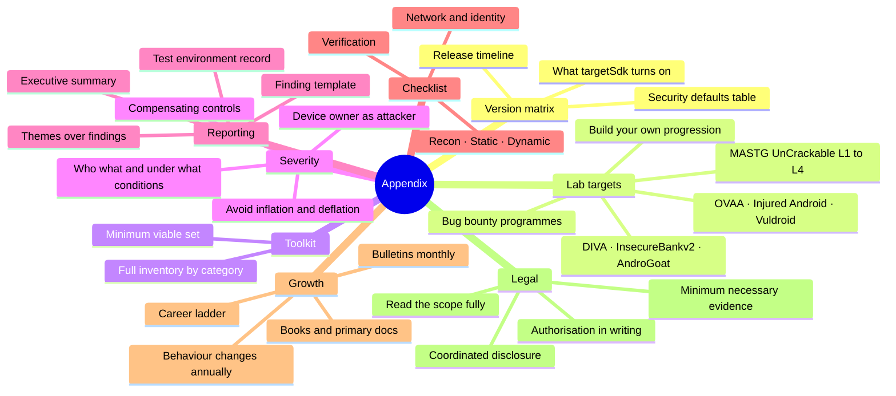

# 80 — Appendix

> Everything that belongs in the repository but not inside a single chapter: the lab catalogue, the
> reading list, the version matrix, severity guidance, report templates, and the reference tables you
> will come back to for years.

**Prerequisites:** none — usable as a reference from any point
**Applies to:** all chapters

---

## Table of Contents

1. [Introduction](#1-introduction)
2. [The Android version matrix](#2-the-android-version-matrix)
3. [Vulnerable apps and lab targets](#3-vulnerable-apps-and-lab-targets)
4. [Tool inventory](#4-tool-inventory)
5. [Severity, CVSS and business impact](#5-severity-cvss-and-business-impact)
6. [Report templates](#6-report-templates)
7. [The engagement checklist](#7-the-engagement-checklist)
8. [Reading list](#8-reading-list)
9. [Communities, conferences and staying current](#9-communities-conferences-and-staying-current)
10. [Career progression](#10-career-progression)
11. [Legal reference](#11-legal-reference)
12. [Summary](#12-summary)
13. [References](#13-references)

---

## 1. Introduction

A reference book needs a back matter section. This is it.

Nothing here teaches a new concept — every idea in this appendix is explained properly somewhere in
chapters 00–79. What lives here is the material you need *while working* rather than *while learning*:
the table you check before claiming a behaviour applies to a given Android version, the severity
rubric you use when a client disputes a rating, the template you fill in at 6pm on the last day of an
engagement.

> **Mental Model**
> Learning material is organised by concept. Working material is organised by *the moment you need
> it*. That is why this chapter looks nothing like the others.

### How to use this appendix

Do not read it end to end. Each section is entered from a different moment in an engagement:

| When you are… | Go to |
|---|---|
| About to claim "this is the default on Android 13" | §2 — the version matrix |
| Setting up a practice target | §3 — vulnerable apps and lab targets |
| Deciding what to install on a new machine | §4 — tool inventory |
| Arguing a severity with a client | §5 — severity, CVSS and business impact |
| Writing up at the end of an engagement | §6 — report templates |
| Wanting to be sure you missed nothing | §7 — the engagement checklist |
| Asked "how do I get better at this" | §8, §9, §10 — reading, communities, progression |
| Unsure whether you are authorised | §11 — legal reference. **Read this before, not after** |

### How this appendix gets misused

Reference material fails in a specific way: it gets applied without the judgement that produced it.
The three failures worth naming, because each one has produced real bad reports:

- **The version matrix treated as authoritative for a specific device.** It records what AOSP does at
  a given API level. An OEM build can and does differ, and Mainline modules update independently of
  the platform release. The matrix tells you what to *expect*, and therefore what to *verify* — it is
  never itself the evidence. Confirm on the target and cite that.
- **The report template filled in rather than thought through.** Every heading in §6 exists to force a
  question. "Threat model" is there so you state who the attacker is and what they already have; a
  finding whose threat model is "an attacker with root on the victim's device" usually collapses the
  moment you write that sentence down. If a section is hard to fill in honestly, that is the template
  working, not a formatting problem.
- **The severity rubric applied mechanically.** §5 opens by explaining why that fails. A rubric
  compresses judgement; it does not replace it. If the number it produces feels wrong, the rubric is
  probably missing context that you have and it does not — say so in the report and justify the
  deviation, rather than shipping a score you cannot defend.

---

## 2. The Android version matrix

The single most common source of wrong findings is asserting a behaviour that changed three releases
ago. Check here first.

### Release timeline

| Version | API | Codename | Released | Still relevant because |
|---|---|---|---|---|
| 4.4 | 19 | KitKat | 2013 | Last Dalvik release; still found in embedded/POS devices |
| 5.0–5.1 | 21–22 | Lollipop | 2014 | ART default; PIE mandatory; `WebView` became updatable |
| 6.0 | 23 | Marshmallow | 2015 | **Runtime permissions** — the largest single security change |
| 7.0–7.1 | 24–25 | Nougat | 2016 | **Apps stopped trusting user CAs by default** |
| 8.0–8.1 | 26–27 | Oreo | 2017 | Treble; background execution limits; implicit broadcast limits |
| 9 | 28 | Pie | 2018 | **Cleartext denied by default**; non-SDK interface restrictions |
| 10 | 29 | Q | 2019 | Scoped storage introduced (opt-out available) |
| 11 | 30 | R | 2020 | **Scoped storage enforced**; package visibility; one-time permissions |
| 12 | 31 | S | 2021 | **`exported` must be explicit**; **PendingIntent mutability must be explicit** |
| 13 | 33 | T | 2022 | Receiver export must be explicit; per-app language; photo picker |
| 14 | 34 | U | 2023 | Foreground service types mandatory; minimum installable targetSdk raised |
| 15 | 35 | V | 2024 | Continued tightening of background and storage access |
| 16 | 36 | — | 2025 | Ongoing platform hardening |

> **Warning**
> Dates and API numbers are stable, but per-release feature details evolve. Before writing a
> version-dependent claim into a report, verify against the official
> [behaviour changes](https://developer.android.com/about/versions) pages for the specific release.

### What `targetSdkVersion` turns on

This is the table to internalise. An app's `targetSdk` — not the device's OS version — decides most
security defaults.

| targetSdk | Behaviour it enables | Chapter |
|---|---|---|
| 17 | `ContentProvider` defaults to `exported="false"` | [27](../27-ContentProviders/README.md) |
| 23 | Runtime permission model applies | [23](../23-Permissions/README.md) |
| 24 | User-added CAs no longer trusted by default | [35](../35-SSL/README.md) |
| 26 | Background execution and implicit broadcast limits | [29](../29-BroadcastReceivers/README.md) |
| 28 | Cleartext HTTP denied by default | [44](../44-NetworkSecurityConfig/README.md) |
| 29 | Scoped storage (with `requestLegacyExternalStorage` escape hatch) | [33](../33-Storage/README.md) |
| 30 | Scoped storage enforced; `<queries>` package visibility | [33](../33-Storage/README.md) |
| 31 | `android:exported` must be declared explicitly on filtered components; `PendingIntent` mutability must be explicit | [32](../32-Manifest/README.md), [26](../26-Intent/README.md) |
| 33 | `RECEIVER_EXPORTED`/`RECEIVER_NOT_EXPORTED` required for runtime-registered receivers | [29](../29-BroadcastReceivers/README.md) |
| 34 | `foregroundServiceType` required | [28](../28-Services/README.md) |

> **Pentester's Note**
> When you find an app with a low `targetSdk`, you have found more than one issue. Low `targetSdk`
> re-enables a whole set of legacy behaviours: implicitly exported providers, trusted user CAs,
> permitted cleartext, legacy external storage, and implicitly mutable PendingIntents. Report the low
> `targetSdk` itself, and then test each legacy behaviour it re-enables.

### Security-relevant defaults, by declaration

| Setting | Default | Where declared | Risk when wrong |
|---|---|---|---|
| `android:debuggable` | `false` | manifest / build type | `run-as`, JDWP, full data access |
| `android:allowBackup` | `true` | manifest | `adb backup` / cloud exfiltration |
| `android:usesCleartextTraffic` | depends on targetSdk | manifest / NSC | Plaintext interception |
| `android:exported` | depends on targetSdk + filter | manifest | Unintended IPC surface |
| `setJavaScriptEnabled` | `false` | code | XSS becomes reachable |
| `setAllowFileAccess` | `false` from API 30 | code | Local file read from web content |
| `setAllowUniversalAccessFromFileURLs` | `false` | code | Full same-origin bypass |
| `setWebContentsDebuggingEnabled` | `false` | code | Remote WebView inspection |
| `PendingIntent` mutability | must be explicit from 31 | code | Privilege escalation |
| `SecureRandom` vs `Random` | n/a | code | Predictable keys and tokens |

---

## 3. Vulnerable apps and lab targets

Practise on these. All are deliberately vulnerable and legal to attack.

### Purpose-built training apps

| App | Focus | Difficulty | Notes |
|---|---|---|---|
| **OWASP MASTG test apps** (Android UnCrackable L1–L4, and the MASTG demos) | Root detection, tamper detection, obfuscation, native code | Beginner → Advanced | The canonical progression. UnCrackable L1 teaches root-detection bypass; L2 adds native code; L3 adds anti-Frida; L4 is heavily protected. Start here. |
| **DIVA (Damn Insecure and Vulnerable App)** | Storage, logging, input validation, hardcoding | Beginner | Short, focused challenges. Good first week. |
| **InsecureBankv2** | Auth, storage, IPC, backup, crypto | Beginner → Intermediate | Ships with a backend, so you can practise full-stack testing. |
| **OWASP GoatDroid** | Location privacy, session handling | Beginner | Older but the lessons still apply. |
| **Damn Vulnerable Bank** | Root detection, pinning, RASP-style protections | Intermediate | Closer to what a real banking app throws at you. |
| **AndroGoat** | Broad OWASP Mobile Top 10 coverage, written in Kotlin | Beginner → Intermediate | Kotlin source is useful for the [05-Kotlin](../05-Kotlin/README.md) decompilation work. |
| **Injured Android** | Deep links, Firebase, exported components, flags | Intermediate | Strong on IPC and deep-link chains. |
| **Oversecured Vulnerable Android App (OVAA)** | Modern, high-quality vulnerability set | Intermediate → Advanced | Excellent for intent redirection, provider abuse, and URI grant theft. |
| **Vuldroid** | Web-to-app attack chains | Intermediate | Good for WebView and deep-link work. |
| **Frida Labs / r2frida challenges** | Instrumentation practice | Intermediate | Tool-focused rather than app-focused. |

### Bug bounty and real targets

Only test where you have written authorisation.

| Source | What it gives you |
|---|---|
| **HackerOne / Bugcrowd / Intigriti mobile programmes** | Real apps, real scope documents, real payouts |
| **Google Play Security Reward Program** | Bounties for qualifying vulnerabilities in popular Play apps |
| **Android VRP (Vulnerability Rewards Program)** | Platform and AOSP vulnerabilities |
| **Samsung, Xiaomi, OPPO and other OEM programmes** | Device- and vendor-specific attack surface |

> **Warning**
> A programme's scope document *is* your authorisation, and it is narrow. "In scope: the Android app"
> does not authorise attacking the backend, other customers' accounts, or the app's third-party
> services. Read it fully; when in doubt, ask before you test.

### Building your own lab

The most valuable lab target is one you build yourself, because you control the vulnerability and can
verify your understanding is correct rather than merely plausible.

Suggested progression:
1. Write a "hello world" app, decompile it, and find your own code in JADX.
2. Add a hardcoded secret, and find it three ways: `strings`, JADX, and a Frida hook.
3. Add a `SharedPreferences` write, then locate the XML on disk.
4. Add an exported activity that takes a URL extra and loads it in a WebView — then exploit it.
5. Add a root check, then bypass your own check.
6. Add certificate pinning, then bypass your own pinning.
7. Move the secret into a native library, then extract it anyway.

By step 7 you understand both sides of every control in chapters 36–43.

---

## 4. Tool inventory

| Category | Tool | Purpose | Chapter |
|---|---|---|---|
| Platform | `adb` | Device control | [60](../60-ADB/README.md) |
| Platform | `fastboot` | Bootloader operations | [61](../61-Fastboot/README.md) |
| Platform | Android Studio + AVD | Development, emulator, debugger, profiler | [51](../51-DynamicAnalysis/README.md) |
| Root | Magisk | Systemless root | [62](../62-Magisk/README.md) |
| Root | LSPosed | Persistent Java hooking | [63](../63-LSPosed/README.md) |
| Static | `jadx` / `jadx-gui` | DEX → Java | [56](../56-JADX/README.md) |
| Static | `apktool` | Decode/rebuild resources and Smali | [10](../10-APK-Internals/README.md) |
| Static | `aapt2` | Manifest and resource inspection | [08](../08-Build-System/README.md) |
| Static | `apksigner` | Signature verification | [10](../10-APK-Internals/README.md) |
| Static | `baksmali` / `smali` | DEX ↔ Smali | [14](../14-Dalvik/README.md) |
| Static | MobSF | Automated triage | [55](../55-MobSF/README.md) |
| Static | `semgrep`, `apkid`, `apkleaks` | Rule-based scanning, packer ID, secret sweep | [52](../52-StaticAnalysis/README.md) |
| Native RE | Ghidra | Free decompiler | [57](../57-Ghidra/README.md) |
| Native RE | IDA Pro | Commercial decompiler and on-device debugger | [58](../58-IDA/README.md) |
| Native RE | radare2 / rizin / Cutter | Scriptable RE | [59](../59-radare2/README.md) |
| Native RE | `readelf`, `objdump`, `nm`, `strings` | Binary inspection | [15](../15-Native-Code/README.md) |
| Dynamic | Frida | Instrumentation | [53](../53-Frida/README.md) |
| Dynamic | Objection | Pre-built Frida agent | [54](../54-Objection/README.md) |
| Dynamic | Drozer | IPC surface probing | [24](../24-IPC/README.md) |
| Dynamic | `strace` / `ltrace` | Syscall and library call tracing | [51](../51-DynamicAnalysis/README.md) |
| Network | Burp Suite | HTTP interception | [35](../35-SSL/README.md) |
| Network | mitmproxy | Scriptable interception | [35](../35-SSL/README.md) |
| Network | Wireshark + `tcpdump` / PCAPdroid | Packet-level capture | [35](../35-SSL/README.md) |
| Data | `sqlite3` / DB Browser for SQLite | Database inspection | [33](../33-Storage/README.md) |
| Tokens | `jwt_tool`, `hashcat` | JWT analysis and secret cracking | [46](../46-Tokens/README.md) |

### Minimum viable toolkit

If you are starting today and want the shortest path to being useful:

```
adb + fastboot          → platform-tools
jadx-gui                → read the code
apktool + apksigner     → modify and rebuild
Burp Suite Community    → see the traffic
Frida + Objection       → change behaviour at runtime
Magisk on a test device → make all of the above possible
Ghidra                  → when you hit native code
```

Everything else is an optimisation.

---

## 5. Severity, CVSS and business impact

### The problem with mechanical scoring

CVSS was designed for platform and product vulnerabilities with a clear attacker and a clear victim.
Mobile app findings frequently do not fit: the "attacker" is often the device owner, and the impact
falls on the vendor rather than the user.

This causes two failure modes, and you must avoid both.

**Inflation.** Rating "no certificate pinning" as High because a scanner said so. Pinning absence
matters when the threat model includes a hostile network *and* the data is sensitive *and* there is no
compensating control. On an app that transmits only public content over correctly-validated TLS, it is
Informational.

**Deflation.** Dismissing "root detection bypassed" as not-a-finding and stopping there. The bypass is
not the finding — but everything you found *after* the bypass is.

> **Pentester's Note**
> Before assigning any severity, answer three questions in writing: **Who** is the attacker in this
> scenario? **What** do they get? **What** must be true for it to work? If you cannot answer all
> three concretely, you do not yet have a finding — you have an observation.

### A practical rubric

| Severity | Criteria | Example |
|---|---|---|
| **Critical** | Remote or trivially local compromise of other users' data or accounts, with no meaningful prerequisites | IDOR returning any user's records; authentication bypass on the API |
| **High** | Significant data exposure or privilege escalation, realistic prerequisites | Intent redirection stealing content-URI grants; hardcoded backend credential with real privilege; exported component performing a sensitive action |
| **Medium** | Meaningful weakness requiring notable prerequisites or yielding limited data | Sensitive data in an unencrypted database on a rooted-or-lost device; missing pinning where the data is sensitive; session not invalidated server-side on logout |
| **Low** | Weakness with limited realistic impact or strong prerequisites | Verbose logging of non-sensitive data; missing `FLAG_SECURE` on a low-value screen; debug artefacts with no exposed function |
| **Informational** | Hardening opportunity, no demonstrated impact | No obfuscation; no root detection; outdated but unexploited dependency |

### Device-owner-as-attacker findings

A whole category of mobile findings has the *user* as the adversary: root detection, pinning,
obfuscation, tamper detection, biometric gates, and client-side licensing.

Rate these against the **business** risk, not the user's data risk, and say so explicitly in the
report. "An attacker with physical access to their own device can extract the API key" is not a user
data breach — it is a business risk about API abuse, fraud, or licence circumvention. Writing it that
way is the difference between a report a client acts on and one they dismiss.

### Compensating controls

Always check before finalising a rating:

- Does the server validate what the client checks? (If yes, most client-side findings drop.)
- Is the exposed data actually sensitive, or is it public content?
- Is there rate limiting, anomaly detection, or a short token lifetime?
- Does the finding require an attack that the platform already prevents on supported versions?

---

## 6. Report templates

### Finding template

```markdown
## [ID] Title — a specific claim, not a category

**Severity:** High
**CVSS v3.1:** 7.4 (AV:N/AC:L/PR:N/UI:R/S:U/C:H/I:N/A:N)
**MASVS:** MASVS-STORAGE-1
**MASTG:** MASTG-TEST-xxxx
**Affected:** com.example.app v4.2.1 (versionCode 4021), tested on Pixel 6 / Android 14
  (build fingerprint: google/oriole/oriole:14/…), security patch 2026-06-05
**Status:** Confirmed / Exploited

### Summary
One paragraph a non-technical stakeholder can act on. What is wrong, who can exploit it, and what
they get.

### Threat model
Who is the attacker, what access do they start with, and what must be true for this to work.

### Technical detail
What the code does and why it is wrong. Include the relevant decompiled source or Smali with the
file path and class name.

### Steps to reproduce
Numbered, exact, copy-pasteable. Include the device state and any prerequisites.

1. …
2. …

### Evidence
Screenshots, request/response pairs, log excerpts, or script output. Redact real user data.

### Impact
What an attacker actually achieves, in business terms.

### Remediation
The specific fix, as code where possible. Reference the relevant Android documentation.

### References
- OWASP MASTG …
- Android documentation …
```

### Executive summary skeleton

```markdown
# Android Application Security Assessment — <App> v<Version>

## Scope and dates
What was tested, on which platform versions, over what period, and what was explicitly out of scope.

## Approach
Static analysis, dynamic analysis, network analysis, and the extent of source access.

## Summary of findings
| Severity | Count |
|---|---|
| Critical | 0 |
| High | 2 |
| Medium | 5 |
| Low | 4 |
| Informational | 7 |

## Key themes
Two or three paragraphs on the *patterns*, not the individual bugs. "Authorization is enforced in the
UI rather than the API" is worth more to a client than ten individual IDOR findings.

## What is working well
Genuinely. A report with no positives reads as adversarial and gets dismissed.

## Prioritised recommendations
1. …
```

> **Mental Model**
> A finding list is a deliverable. A *theme* is a service. Clients can fix ten bugs; only themes stop
> the eleventh from being written next sprint.

### Test environment record

Capture this at the start of every engagement and paste it into the report:

```
App              : com.example.app
Version          : 4.2.1 (versionCode 4021)
APK SHA-256      : <hash>
Signing cert     : SHA-256 <digest>
minSdk / targetSdk: 24 / 33
Device           : Pixel 6 (oriole)
Build fingerprint: google/oriole/oriole:14/…
Security patch   : 2026-06-05
Root             : Magisk <version>
SELinux          : Enforcing
Tooling          : frida <ver>, jadx <ver>, apktool <ver>, Burp <ver>
```

---

## 7. The engagement checklist

A condensed operational checklist. Each item links to the chapter that explains how.

### Recon and setup
- [ ] Record the full test environment (above)
- [ ] Obtain the APK and verify its hash and signature — [10](../10-APK-Internals/README.md)
- [ ] Confirm scope and authorisation in writing
- [ ] Establish a restorable device baseline — [51](../51-DynamicAnalysis/README.md)

### Static
- [ ] Full manifest audit — [32](../32-Manifest/README.md)
- [ ] `targetSdk` and the legacy behaviours it enables — [section 2](#2-the-android-version-matrix)
- [ ] Permission review and justification — [23](../23-Permissions/README.md)
- [ ] Exported component inventory — [32](../32-Manifest/README.md)
- [ ] Network security config — [44](../44-NetworkSecurityConfig/README.md)
- [ ] Secret and endpoint sweep, each hit validated — [52](../52-StaticAnalysis/README.md)
- [ ] Crypto API usage review — [34](../34-Cryptography/README.md)
- [ ] Third-party SDK inventory — [17](../17-Libraries/README.md)
- [ ] Native library triage — [15](../15-Native-Code/README.md)
- [ ] Obfuscation and protection assessment — [40](../40-Obfuscation/README.md)

### Dynamic — platform
- [ ] Storage sweep before and after login — [33](../33-Storage/README.md)
- [ ] Log review during full feature exercise — [33](../33-Storage/README.md)
- [ ] Exercise every exported activity, service, receiver, provider — [27](../27-ContentProviders/README.md)–[30](../30-Activities/README.md)
- [ ] Deep link and App Link testing — [26](../26-Intent/README.md)
- [ ] Intent redirection testing — [26](../26-Intent/README.md)
- [ ] PendingIntent mutability — [26](../26-Intent/README.md)
- [ ] WebView enumeration and configuration audit — [43](../43-WebView/README.md)
- [ ] Clipboard, screenshots, recents, backup — [33](../33-Storage/README.md)
- [ ] Localhost listeners and abstract sockets — [24](../24-IPC/README.md)

### Dynamic — network and identity
- [ ] Full traffic capture with interception established — [35](../35-SSL/README.md)
- [ ] TLS validation testing — [35](../35-SSL/README.md)
- [ ] Pinning assessment and, if in scope, bypass — [36](../36-CertificatePinning/README.md)
- [ ] Non-HTTP traffic capture — [35](../35-SSL/README.md)
- [ ] Authentication flow review — [47](../47-Authentication/README.md)
- [ ] OAuth/OIDC flow and PKCE *enforcement* — [45](../45-OAuth/README.md)
- [ ] Token storage, claims, expiry, revocation, logout — [46](../46-Tokens/README.md)
- [ ] Authorization testing: every endpoint, low-privileged and unauthenticated — [47](../47-Authentication/README.md)
- [ ] Biometric implementation: is a CryptoObject used? — [48](../48-Biometrics/README.md)
- [ ] KeyStore usage and key properties — [49](../49-KeyStore/README.md)

### Verification and reporting
- [ ] Every finding reproduced from an unprivileged app UID, not just `adb shell`
- [ ] Every automated finding manually validated
- [ ] Every finding has a concrete threat model and reproducible steps
- [ ] Severities sanity-checked against compensating controls
- [ ] Themes identified, not just individual bugs
- [ ] Evidence redacted of real user data

---

## 8. Reading list

### Books

| Book | Why |
|---|---|
| *Android Security Internals* — Nikolay Elenkov | The best single book on how Android's security model actually works internally. Dated in specifics, excellent in structure. |
| *The Android Hacker's Handbook* — Drake et al. | Older, but the platform-level exploitation chapters remain instructive. |
| *Android Internals: A Confectioner's Cookbook* — Jonathan Levin | Deep, occasionally idiosyncratic, unmatched on the low-level detail. |
| *The Mobile Application Hacker's Handbook* — Chell et al. | Broad practical coverage across platforms. |
| *Practical Binary Analysis* — Dennis Andriesse | The best on-ramp to the ELF and instrumentation material in chapters 15–19. |
| *The Art of Software Security Assessment* — Dowd, McDonald, Schuh | Not Android-specific, and still the best book on finding bugs in code. |
| *Serious Cryptography* — Jean-Philippe Aumasson | The right level for chapter 34: rigorous, readable, practitioner-focused. |
| *Operating Systems: Three Easy Pieces* — Arpaci-Dusseau | Free online, and the clearest treatment of the chapter 01 material. |

### Primary documentation

Read these directly rather than through blog summaries.

- Android Open Source Project security documentation — https://source.android.com/docs/security
- Android Developers security best practices — https://developer.android.com/privacy-and-security
- Android behaviour changes, per release — https://developer.android.com/about/versions
- Android Security Bulletins — https://source.android.com/docs/security/bulletin
- OWASP MASVS — https://mas.owasp.org/MASVS/
- OWASP MASTG — https://mas.owasp.org/MASTG/
- Frida documentation — https://frida.re/docs/android/
- Android Code Search — https://cs.android.com/

### Papers and technical writing

- Google Project Zero blog — the highest-quality public vulnerability research
- Android Security Bulletins — read them monthly; they are a map of the current attack surface
- Guardsquare, Oversecured, and NowSecure research blogs — app-layer findings with real detail
- USENIX Security, IEEE S&P, ACM CCS, NDSS proceedings — search for Android; most are freely available

---

## 9. Communities, conferences and staying current

### Conferences worth following

Talks are usually published free afterwards. Watching the last three years of Android talks from any
of these is a serious education.

| Conference | Emphasis |
|---|---|
| Black Hat / DEF CON | Broad; strong mobile and platform tracks |
| OffensiveCon | Deep exploitation and vulnerability research |
| Recon | Reverse engineering |
| Hardwear.io | Hardware, TEE, secure elements |
| Ekoparty, HITB, Nullcon, POC | Strong regional research communities |
| Android Security Symposium | Academic and platform-focused |

### Staying current

Android changes annually and the details in chapters 20–50 shift with it. A sustainable routine:

- **Monthly:** read the Android Security Bulletin. You do not need to understand every entry — you
  need to notice which subsystems keep appearing.
- **Annually:** read the behaviour changes page for the new API level, and update your mental version
  matrix.
- **Continuously:** when a tool breaks, find out *why* rather than downgrading. The reason is usually
  a platform change worth knowing.

> **Mental Model**
> The fundamentals in chapters 01–19 have a half-life measured in decades. The specifics in chapters
> 37–50 have a half-life measured in months. Invest your study time accordingly — and be suspicious
> of any resource that is all specifics.

---

## 10. Career progression

What each level is actually expected to do. Useful for self-assessment and for interview preparation
(see [75-InterviewQuestions](../75-InterviewQuestions/README.md)).

| Level | Typical experience | Expected to |
|---|---|---|
| **Junior** | 0–2 years | Run the standard toolchain competently. Follow a methodology. Produce findings that are correct, if sometimes over- or under-rated. Ask for help before going down a rabbit hole. |
| **Mid** | 2–4 years | Work independently through a full engagement. Bypass standard protections. Read Smali and basic native code. Write findings that need little editing. Recognise and dismiss false positives. |
| **Senior** | 4–8 years | Handle hardened targets with layered protections. Reverse native code confidently. Write custom tooling for a specific target. Identify themes, not just bugs. Defend severity ratings under pushback. Mentor. Scope engagements. |
| **Staff** | 8+ years | Design methodology and tooling used by a team. Handle the targets nobody else can. Do original research. Influence how clients build, not just what they fix. Translate technical risk into business decisions. |
| **Principal** | 10+ years | Set technical direction across an organisation. Publish research that changes practice. Trusted to make judgement calls where the standards are silent or wrong. |

The transition that matters most is **mid to senior**, and it is not about learning more tools. It is
about no longer needing them: being able to reason about an unfamiliar target from first principles,
decide what to test and why, and be right about the risk.

---

## 11. Legal reference

> **Warning**
> This section is orientation, not legal advice. Laws differ by jurisdiction and change. When in
> doubt, get written authorisation and, for anything ambiguous, talk to a lawyer.

### The core principle

Testing a system you do not own requires **authorisation from someone entitled to give it**. Not
implied consent. Not "it was publicly available." Not "I was only looking." Written authorisation, with
a defined scope.

### Key legislation

| Jurisdiction | Law | Substance |
|---|---|---|
| United States | Computer Fraud and Abuse Act (CFAA) | Criminalises access "without authorisation" or exceeding authorised access |
| United States | DMCA §1201 | Circumventing technical protection measures; a security research exemption exists but is narrow and conditional |
| United Kingdom | Computer Misuse Act 1990 | Unauthorised access, unauthorised access with intent, and unauthorised modification |
| European Union | Directive 2013/40/EU | Attacks against information systems; implemented in member state law |
| India | Information Technology Act 2000, §43 and §66 | Unauthorised access, damage, and related offences |
| Australia | Criminal Code Act 1995, Part 10.7 | Computer offences |
| Singapore | Computer Misuse Act | Unauthorised access and modification |

### What authorisation looks like

Valid:
- A signed statement of work or engagement letter naming the systems in scope
- A bug bounty programme's published scope, adhered to strictly
- Your own device running your own application
- A deliberately vulnerable training app, licensed for that purpose

Not valid:
- "The app is on the Play Store so anyone can analyse it" — reverse engineering may be restricted by
  the app's terms and by local law, and testing the *backend* is a separate matter entirely
- Verbal permission from someone without authority to grant it
- A scope document you have not actually read
- "I found it by accident" after you kept going

### Practical guidance

- **Read the scope document fully, before touching anything.** Note explicitly excluded assets,
  prohibited techniques (usually DoS, social engineering, physical), and testing windows.
- **Stay inside it.** Discovering an adjacent system is not authorisation to test it — it is something
  to report.
- **Do not exfiltrate real user data.** Prove access with the minimum necessary evidence, and redact.
- **Do not pivot to production data** to "demonstrate impact" unless explicitly authorised.
- **Document as you go.** Contemporaneous notes protect you.
- **If you find something outside scope,** stop, document what you already saw, and report it through
  the proper channel.
- **Coordinated disclosure:** report privately, give a reasonable remediation window, and agree
  publication terms in advance.

> **Pentester's Note**
> The techniques in chapters 36–43 defeat controls that exist to stop attackers. Your legal
> distinction from an attacker is *authorisation*, and nothing else — not intent, not skill, not
> employment. Treat the scope document as the most important artefact of the engagement, because
> legally it is.

---

## 12. Summary

### Key points

- `targetSdk`, not the device OS version, decides most of an app's security defaults. Check the
  version matrix before asserting any version-dependent behaviour.
- Practise on purpose-built vulnerable apps; the OWASP MASTG UnCrackable series is the canonical
  progression.
- Severity requires a threat model, not a scanner. Answer who, what, and under what conditions —
  in writing — before rating anything.
- Findings that treat the device owner as the attacker are business risks; say so explicitly.
- Themes are worth more to a client than individual findings.
- Reproduce every finding from an unprivileged app UID before reporting it.
- Fundamentals have a half-life of decades; platform specifics have a half-life of months.
- Authorisation is the only thing separating your work from a crime. Get it in writing, read it, and
  stay inside it.

### Mind map



### Quick revision

- Which declaration decides whether an app trusts user-added CAs?
- At which `targetSdk` does `android:exported` become mandatory on filtered components?
- Name the three questions you must answer before assigning a severity.
- Why is "root detection bypassed" not itself a finding?
- What must you do before reporting a finding you demonstrated from `adb shell`?
- What is the only thing that legally distinguishes your testing from an attack?

---

## 13. References

- Android behaviour changes — https://developer.android.com/about/versions
- Android Security Bulletins — https://source.android.com/docs/security/bulletin
- OWASP MASVS — https://mas.owasp.org/MASVS/
- OWASP MASTG and test apps — https://mas.owasp.org/MASTG/
- FIRST CVSS v3.1 specification — https://www.first.org/cvss/v3-1/specification-document
- FIRST CVSS calculator — https://www.first.org/cvss/calculator/3.1
- Google Play Security Reward Program — https://bughunters.google.com/
- Android Vulnerability Rewards Program — https://bughunters.google.com/about/rules/android-friends

### Related chapters

- [71-OWASP-Mobile](../71-OWASP-Mobile/README.md) — MASVS/MASTG in depth
- [72-RealWorldFindings](../72-RealWorldFindings/README.md) — worked findings with full write-ups
- [73-Labs](../73-Labs/README.md) — the complete lab index
- [75-InterviewQuestions](../75-InterviewQuestions/README.md) — aggregated by level
- [79-Glossary](../79-Glossary/README.md) — terminology
