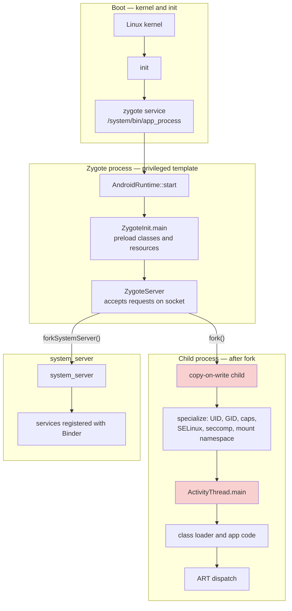
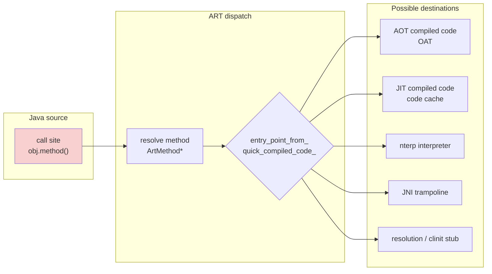
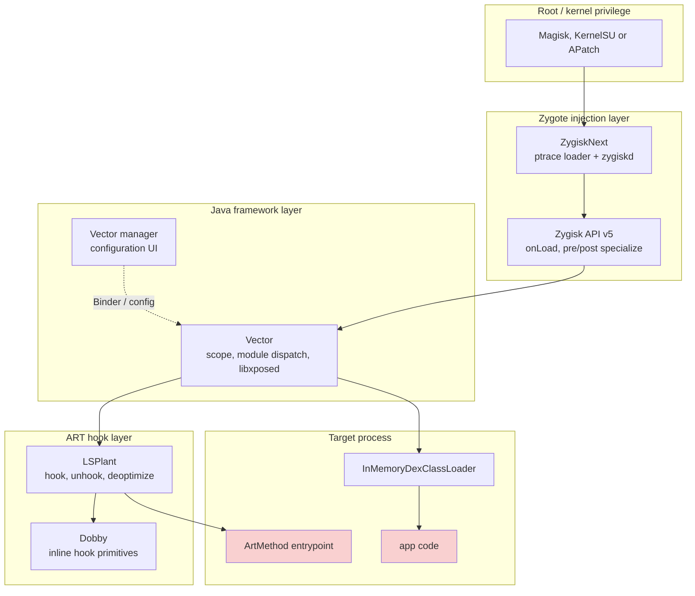
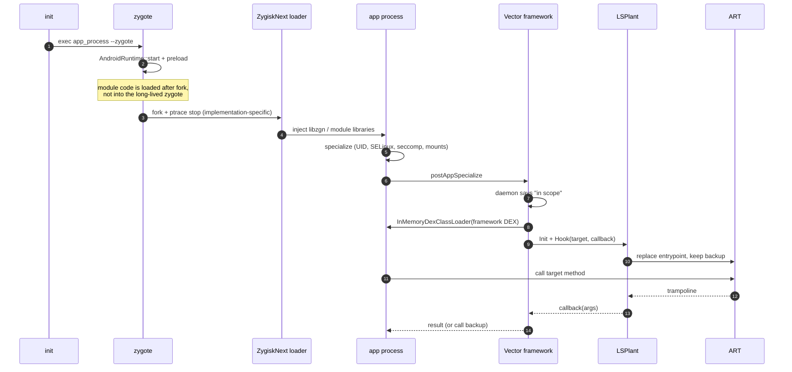
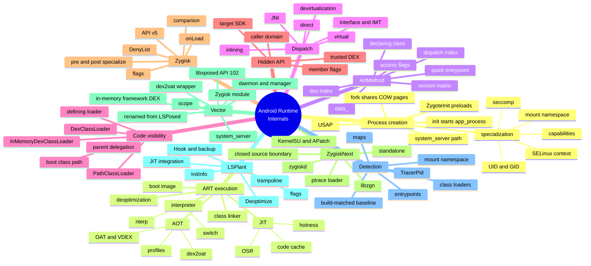

# 81 — Android Runtime Internals

> After this chapter you will be able to trace one Java call from a zygote fork to the machine code
> that executes it, explain where Zygisk, ZygiskNext, Vector and LSPlant each sit on that path, and
> decide from evidence — not from a module's name — which layer a hook, a detection or a failure
> actually lives in.

**Prerequisites:** [11-Android-Runtime](../11-Android-Runtime/README.md) ·
[13-ART](../13-ART/README.md) · [16-JNI](../16-JNI/README.md) · [25-Binder](../25-Binder/README.md) ·
[62-Magisk](../62-Magisk/README.md) · [63-LSPosed](../63-LSPosed/README.md) ·
[65-Hooking](../65-Hooking/README.md)

**Applies to:** Android 8.1 (API 27) through Android 16 (API 36), with module-specific notes for
Android 17 / API 37. The AOSP paths are from `main` as read on 2026-11-20; the module paths are from
the public snapshots named in each section. ART is a Mainline module, so two devices reporting the
same Android release can run different ART builds. Check the build, not the marketing version.

---

## Table of Contents

- [1. Introduction](#1-introduction)
  - [1.1 A running app is not a file](#11-a-running-app-is-not-a-file)
  - [1.2 Why this chapter exists beside chapters 11 and 13](#12-why-this-chapter-exists-beside-chapters-11-and-13)
  - [1.3 The three seams every runtime tool crosses](#13-the-three-seams-every-runtime-tool-crosses)
  - [1.4 What breaks without this knowledge](#14-what-breaks-without-this-knowledge)
  - [1.5 The cast, disentangled](#15-the-cast-disentangled)
- [2. High-Level Architecture](#2-high-level-architecture)
  - [2.1 From boot to an app process](#21-from-boot-to-an-app-process)
  - [2.2 From a Java call to machine code](#22-from-a-java-call-to-machine-code)
  - [2.3 The injection stack, layer by layer](#23-the-injection-stack-layer-by-layer)
  - [2.4 One hooked call, as a sequence](#24-one-hooked-call-as-a-sequence)
- [3. Deep Internal Working](#3-deep-internal-working)
  - [3.1 Zygote is a process template](#31-zygote-is-a-process-template)
  - [3.2 Specialization: the window where identity changes](#32-specialization-the-window-where-identity-changes)
  - [3.3 ART startup: from `app_process` to a live runtime](#33-art-startup-from-app_process-to-a-live-runtime)
  - [3.4 The execution pipeline: interpreter, JIT, AOT](#34-the-execution-pipeline-interpreter-jit-aot)
  - [3.5 `ArtMethod`: the structure every Java hook edits](#35-artmethod-the-structure-every-java-hook-edits)
  - [3.6 Entrypoints: what "quick" actually means](#36-entrypoints-what-quick-actually-means)
  - [3.7 Dispatch: why patching one method is not enough](#37-dispatch-why-patching-one-method-is-not-enough)
  - [3.8 Class loaders and in-memory DEX](#38-class-loaders-and-in-memory-dex)
  - [3.9 Hidden API enforcement and trusted DEX](#39-hidden-api-enforcement-and-trusted-dex)
  - [3.10 Zygisk: the module ABI](#310-zygisk-the-module-abi)
  - [3.11 ZygiskNext: a standalone Zygisk](#311-zygisknext-a-standalone-zygisk)
  - [3.12 Vector: the framework above the hook](#312-vector-the-framework-above-the-hook)
  - [3.13 LSPlant: the ART hook engine](#313-lsplant-the-art-hook-engine)
  - [3.14 The hook lifecycle, end to end](#314-the-hook-lifecycle-end-to-end)
  - [3.15 What the kernel and the linker see](#315-what-the-kernel-and-the-linker-see)
  - [3.16 Version matrix](#316-version-matrix)
- [4. Source Code Walkthrough (AOSP)](#4-source-code-walkthrough-aosp)
  - [4.1 `init.zygote64.rc` to `ZygoteInit`](#41-initzygote64rc-to-zygoteinit)
  - [4.2 `forkAndSpecialize`: the native path](#42-forkandspecialize-the-native-path)
  - [4.3 ART startup and the first entrypoint](#43-art-startup-and-the-first-entrypoint)
  - [4.4 The dispatch path](#44-the-dispatch-path)
  - [4.5 Deoptimization and instrumentation](#45-deoptimization-and-instrumentation)
  - [4.6 Beyond AOSP: reading the module sources](#46-beyond-aosp-reading-the-module-sources)
- [5. Security Perspective](#5-security-perspective)
  - [5.1 What each layer can and cannot do](#51-what-each-layer-can-and-cannot-do)
  - [5.2 How attackers abuse runtime internals](#52-how-attackers-abuse-runtime-internals)
  - [5.3 How developers misuse them](#53-how-developers-misuse-them)
  - [5.4 Vulnerability classes](#54-vulnerability-classes)
  - [5.5 Bug bounty patterns](#55-bug-bounty-patterns)
  - [5.6 OWASP MASVS/MASTG mapping](#56-owasp-masvsmastg-mapping)
  - [5.7 How pentesters test](#57-how-pentesters-test)
  - [5.8 How malware abuses it](#58-how-malware-abuses-it)
  - [5.9 How forensic analysts investigate it](#59-how-forensic-analysts-investigate-it)
- [6. Reverse Engineering Perspective](#6-reverse-engineering-perspective)
  - [6.1 A module APK on disk](#61-a-module-apk-on-disk)
  - [6.2 JADX patterns](#62-jadx-patterns)
  - [6.3 Smali: installing a hook](#63-smali-installing-a-hook)
  - [6.4 Native library patterns](#64-native-library-patterns)
  - [6.5 What obfuscation does](#65-what-obfuscation-does)
  - [6.6 Recognising the frameworks](#66-recognising-the-frameworks)
- [7. Dynamic Analysis](#7-dynamic-analysis)
  - [7.1 Map the process tree and namespaces](#71-map-the-process-tree-and-namespaces)
  - [7.2 Find the injected libraries](#72-find-the-injected-libraries)
  - [7.3 Enumerate class loaders](#73-enumerate-class-loaders)
  - [7.4 Inspect `ArtMethod` entrypoints](#74-inspect-artmethod-entrypoints)
  - [7.5 Trace a hook installation](#75-trace-a-hook-installation)
  - [7.6 Test inlining and deoptimization](#76-test-inlining-and-deoptimization)
  - [7.7 Safety rules](#77-safety-rules)
- [8. Static Analysis](#8-static-analysis)
  - [8.1 Module metadata](#81-module-metadata)
  - [8.2 DEX strings and class names](#82-dex-strings-and-class-names)
  - [8.3 Native exports](#83-native-exports)
  - [8.4 Build files and dependency pins](#84-build-files-and-dependency-pins)
  - [8.5 AOSP source greps](#85-aosp-source-greps)
- [9. Examples](#9-examples)
  - [9.1 Simple — a minimal Zygisk module](#91-simple--a-minimal-zygisk-module)
  - [9.2 Intermediate — classify entrypoints from Frida](#92-intermediate--classify-entrypoints-from-frida)
  - [9.3 Advanced — an LSPlant-style hook with a backup](#93-advanced--an-lsplant-style-hook-with-a-backup)
  - [9.4 Real application — deciding Vector's scope](#94-real-application--deciding-vectors-scope)
  - [9.5 Enterprise — a build-matched runtime baseline](#95-enterprise--a-build-matched-runtime-baseline)
- [10. Common Interview Questions](#10-common-interview-questions)
- [11. Common Mistakes](#11-common-mistakes)
  - [11.1 Developer mistakes](#111-developer-mistakes)
  - [11.2 Pentester mistakes](#112-pentester-mistakes)
  - [11.3 Reverse engineer mistakes](#113-reverse-engineer-mistakes)
- [12. Hands-on Labs](#12-hands-on-labs)
- [13. Summary](#13-summary)
- [14. References](#14-references)

---

## 1. Introduction

### 1.1 A running app is not a file

An APK on disk is a ZIP full of instructions that have never run. The moment you launch it, Android
does six things that no static analysis can show you: it creates a process by copying an existing
one, gives that copy a new identity, loads a managed runtime into it, resolves the app's classes,
chooses an execution mode for each method, and then keeps changing those choices while the app runs.
Every interesting security decision — "is this user an admin?", "is the signature valid?", "is the
device rooted?" — is made inside that living process, after all of it.

That is why runtime knowledge is not optional for Android security. A signature check that is
correct in Smali can be defeated by changing the value its method returns in memory. A root check
that reads `/system/bin/su` can be defeated by hiding a mount. A certificate pinner that is
implemented perfectly can be bypassed by replacing the method's entrypoint. None of those attacks
touch the APK. All of them depend on understanding the runtime that executes it.

### 1.2 Why this chapter exists beside chapters 11 and 13

[11-Android-Runtime](../11-Android-Runtime/README.md) explains what a managed runtime is and why
Android chose one. [13-ART](../13-ART/README.md) explains ART itself in depth: OAT, VDEX, the
compiler filters, the interpreter, the JIT, garbage collection and `ArtMethod`. This chapter does not
repeat those foundations. It extends them along the axis that neither chapter owns: **the runtime as
a target**.

That means three questions, in order:

1. How does a process become an app process, and where in that transition can foreign code enter?
2. How does ART decide what code to run for a method, and how can that decision be changed after the
   process is already running?
3. How do the real tools — Zygisk, ZygiskNext, Vector, LSPlant — stack on top of those two answers,
   and which layer is responsible when one of them fails?

The distinction matters because the tools are constantly confused with one another. Zygisk is not a
hook engine. ZygiskNext is not a hook engine either; it is a different way to provide Zygisk.
Vector is a hook framework, but it does not implement ART hooking itself — LSPlant does. A detection
that looks for "Zygisk" may be looking at a mount, a socket, a memory mapping or a process name, and
those are four different claims.

> **Mental Model**
> Think of the runtime as a building with three doors. The first door is the process boundary:
> zygote forks, and a child becomes an app. The second is the class-loader boundary: code from
> outside the app is made visible to it. The third is the dispatch boundary: a method call is
> redirected to different code. Zygisk opens the first door. Vector opens the second. LSPlant opens
> the third. A tool that claims to do "runtime hooking" is usually opening one door and borrowing the
> other two.

### 1.3 The three seams every runtime tool crosses

| Seam | What changes there | Who normally controls it | What a tool must supply |
|---|---|---|---|
| **Process creation** | A zygote child is specialized into an app or `system_server` | `init`, `zygote`, `ZygoteInit`, native specialization | Code that runs in the child before or after the UID/SELinux transition |
| **Code visibility** | A `ClassLoader` makes DEX visible to the app | `ClassLinker`, `DexPathList`, parent delegation | A loader, a DEX buffer, and a parent that can resolve framework classes |
| **Method dispatch** | A call reaches compiled code, the interpreter, or a JNI stub | `ArtMethod::entry_point_from_quick_compiled_code_` and the dispatch tables | A replacement entrypoint, a backup route to the original, and a way to handle inlined callers |

The three seams are independent. You can inject code into a process without hooking anything
(ZygiskNext's module loader does). You can load a DEX without redirecting a method (a plugin
framework does). You can redirect a method without loading a DEX (a native agent with JNI does). Most
real frameworks combine all three, and most failed analyses blame the wrong one.

### 1.4 What breaks without this knowledge

Three failure modes recur in practice, and each has a different cause:

- **The hook installs but never fires.** The method was inlined into its caller, or the caller
  already held a direct pointer to the compiled code. The entrypoint changed; the call did not go
  through it. This is a dispatch-seam failure, and [13-ART §3.17](../13-ART/README.md#317-method-entrypoint-patching-the-mechanism-behind-all-java-hooking)
  explains the mechanism this chapter extends.
- **The module loads but nothing happens.** The module was loaded into the wrong process, after the
  app had already resolved the class, or with a class loader that cannot see the target's classes.
  This is a visibility-seam failure.
- **The detection fires on a clean device.** The detector looked for a filename, a mapping or a
  property that a legitimate feature also produces. This is an evidence failure: the observation was
  real, the attribution was not.

> **Warning — "it works on my device" is not a runtime fact**
> ART ships as a Mainline module. The same Android release can carry different ART builds, different
> `ArtMethod` layouts and different compiler defaults. A hard-coded offset or a hard-coded class name
> is a claim about one build. Record the fingerprint, the SDK, the ABI and the ART module version
> before you generalise.

### 1.5 The cast, disentangled

| Name | What it is | What it is not | Where it runs |
|---|---|---|---|
| **ART** | Android's managed runtime: loader, verifier, interpreter, JIT, AOT compiler, GC | Not a hook framework | In every app process and `system_server` |
| **Zygote** | The preinitialised process template that `fork()`s app processes | Not a daemon that stays in the app | `zygote`, `zygote64`, secondary ABIs |
| **Zygisk** | Magisk's native module ABI around zygote specialization | Not an ART hook engine | Magisk's injected code in zygote children |
| **ZygiskNext** | A standalone implementation of Zygisk for KernelSU, Magisk and APatch | Not a different module API for authors | Loader/daemon plus the standard Zygisk callbacks |
| **Vector** | A Zygisk-based Xposed/libxposed framework, formerly LSPosed | Not the ART hook primitive itself | Zygisk module, daemon, manager, `system_server` |
| **LSPlant** | An ART hook library: hook, unhook, deoptimize | Not a module loader or a scope manager | Native library inside the target process |
| **LSPosed** | The project that became Vector in 2026 | Not a separate runtime | Historical name; see [63-LSPosed](../63-LSPosed/README.md) |
| **Xposed** | The original global hook framework | Not scoped per app | Historical; see [64-Xposed](../64-Xposed/README.md) |

The table is deliberately blunt. The most common interview mistake is to answer "Zygisk hooks
methods" or "Vector is a root tool". Zygisk provides a lifecycle; Vector provides a framework;
LSPlant provides the method-level primitive; root provides the privilege that makes any of them
possible.

---

## 2. High-Level Architecture

### 2.1 From boot to an app process



Read the diagram from the top. `init` starts `app_process` with `--zygote`; that process becomes the
zygote. It initialises ART, preloads the framework classes and resources the platform expects every
app to have, and then waits on a socket. An app launch does not start a new VM. It sends a request to
that socket; zygote `fork()`s, and the child inherits the entire preloaded address space
copy-on-write. The child is then *specialized*: its UID, GID, supplementary groups, capabilities,
SELinux context, seccomp filter and mount namespace are changed to the target app's identity. Only
after that does `ActivityThread.main` run the app's code.

The red nodes are the attacker-relevant ones: the child before specialization is still privileged,
and the app process after specialization is where every client-side security decision is made.

> **Under the Hood**
> `fork()` does not copy the heap eagerly. It copies page tables and marks pages copy-on-write. The
> preloaded classes, the boot image and the JIT code cache are shared until either process writes to
> them. This is why zygote preloading is a memory optimization, and why a hook installed in zygote
> before the fork is visible in every child without re-injecting it.

### 2.2 From a Java call to machine code



This is the diagram to keep in mind when a hook "does not work". The call site does not necessarily
look up a name at run time. After resolution, a compiled caller may hold a direct pointer to the
callee's compiled code, or may have inlined the callee's body entirely. The `ArtMethod` entrypoint is
the route for calls that go through the method, not for every call that was compiled from it. That
gap is the subject of [§3.7](#37-dispatch-why-patching-one-method-is-not-enough).

The five destinations are all normal. An interpreted method, a JIT-compiled method, an AOT-compiled
method, a JNI method and a method whose class has not been initialised can coexist in one process at
the same moment. "Compiled" is a per-method state, not a property of the app.

### 2.3 The injection stack, layer by layer



Each box is a different trust boundary. Root decides whether the loader can run at all. The loader
decides whether module code reaches the child. The framework decides which modules are in scope for
which app. LSPlant decides whether a method's entrypoint changes. Dobby supplies the architecture-
specific inline hook that LSPlant uses to reach ART's internal functions.

A failure at any layer looks similar from the app's perspective — "the hook is not there" — but the
evidence is different. Check the layers in order: is the device rooted and the loader active? Did
the module load into this process? Did the framework select this app? Did LSPlant initialise? Did the
target method resolve? Was the caller inlined?

### 2.4 One hooked call, as a sequence



The sequence shows why "inject at boot" is the wrong mental model for Zygisk modules. The module
library is loaded into the *child* after the fork, because the child is the process that will become
the app. The long-lived zygote is a template, not the place where per-app module code executes. The
Zygisk API documentation is explicit about this distinction, and it is the first thing to check when
a module behaves as if it were global.

---

## 3. Deep Internal Working

### 3.1 Zygote is a process template

Zygote exists because starting a managed runtime is expensive. A cold ART startup must map the boot
image, initialise the heap and the thread list, load the boot class path, verify classes and
establish the JIT. Doing that for every app launch would cost seconds and hundreds of megabytes.
Zygote does it once, then `fork()`s.

The init script is small and worth reading in full. On a 64-bit device,
`system/core/rootdir/init.zygote64.rc` starts:

```text
service zygote /system/bin/app_process64 -Xzygote /system/bin --zygote --start-system-server
    class main
    socket zygote stream 660 root system
    onrestart write /sys/android_power/request_state wake
```

`app_process64` is a tiny native executable. It parses the `-Xzygote` arguments, creates an
`AndroidRuntime`, calls `start()`, and hands control to `com.android.internal.os.ZygoteInit`. From
that point the process is a managed program whose job is to preload and then wait.

`ZygoteInit.main` does four things in order:

1. Creates the zygote server socket.
2. Preloads classes and resources (`preloadClasses`, `preloadResources`, `preloadSharedLibraries`).
3. Starts `system_server` if `--start-system-server` was passed.
4. Runs the accept loop, handling fork requests.

The preload list is not arbitrary. It is the set of framework classes that every app is expected to
use, and preloading them into the shared parent means every child maps the same physical pages. The
boot image (`boot.art`) does the same for selected objects and compiled code. The result is that an
app process starts with a large, read-mostly framework already resident.

> **Definition — USAP**
> An **Unspecialized App Process** is a zygote child that has been forked but not yet specialized.
> It waits for a request and then specializes into the app that needs it. USAP reduces launch
> latency because the fork has already happened; specialization still performs the identity change.
> It does not mean the app skips the security transition.

Zygote also has child zygotes. `ChildZygoteInit` starts a zygote-like process for a restricted
purpose, with `no_new_privs` and a seccomp filter that limits the UID/GID transitions it can perform.
A child zygote is not a second root factory. It is a constrained copy of the same idea.

### 3.2 Specialization: the window where identity changes

The fork is only half of process creation. The child is still running as root, in zygote's SELinux
domain, with zygote's capabilities and mount namespace. Specialization turns it into an app. The
request that triggers it carries the target's:

- UID and GID, plus supplementary groups;
- SELinux `seinfo` and the target's process name;
- runtime flags (debuggable, profileable, hidden-API policy);
- mount namespace and storage configuration;
- nice name, app data directory, and the arguments for `ActivityThread`.

The native implementation is `com_android_internal_os_Zygote.cpp`. In broad strokes it:

1. Sets the child's credentials (`setresuid`, `setresgid`, `setgroups`).
2. Applies capability and securebits changes.
3. Sets the process name and `no_new_privs` where required.
4. Applies the seccomp filter.
5. Calls `selinux_android_setcontext(uid, is_system_server, seinfo, name)` to enter the target
   domain.
6. Configures the mount namespace and storage views.
7. Returns to managed code, which calls `ActivityThread.main`.

The order is security-critical. A step that runs after the UID drop cannot regain root. A step that
runs before it can. That is why Zygisk's `preAppSpecialize` callback is unusually valuable: it runs
in the child, after the fork, but before the UID drop. Code there can still perform privileged setup,
open files, or prepare state that will be needed after the transition. `postAppSpecialize` runs with
the app's credentials and is the correct place for anything that must see the app's SELinux domain.

> **Warning — UIDs are not user namespaces**
> Android isolates apps with Linux UIDs and GIDs. Multi-user Android identifiers are not evidence
> that each app receives a Linux user namespace. SELinux performs a domain transition; it does not
> create an "SELinux namespace". Storage isolation uses mount namespaces and bind mounts; the native
> linker uses linker namespaces for library visibility. These are four different mechanisms, and
> conflating them produces wrong answers about what a process can see.

The mount namespace deserves its own sentence because so much root-hiding depends on it. A mount
namespace changes the filesystem view of a process, not its UID or its SELinux permissions. A
process can be in a private mount namespace and still be blocked by SELinux from reading a file that
is visible in that namespace. Conversely, hiding a path from `mountinfo` does not remove the
underlying file from the kernel; it changes what this namespace resolves.

### 3.3 ART startup: from `app_process` to a live runtime

When `AndroidRuntime::start` runs, ART is initialised before any Java code executes. The important
pieces are:

- **`Runtime::Init`** creates the runtime singleton, the heap, the thread list, the class linker, the
  JIT and the instrumentation subsystem.
- **The boot image** is mapped. It contains preinitialised objects and, depending on the build,
  compiled code for boot-classpath methods.
- **The boot class path** is constructed from the runtime's configuration and the image. It defines
  the classes that are always visible, independent of the app's own loader.
- **`ClassLinker`** is ready to resolve, verify and link classes on demand.

The boot image is not the kernel `boot.img`. It is an ART artifact (`boot.art`, often alongside
`boot.oat` and `boot.vdex`) that snapshots selected objects and classes. Boot-image profiles, added
in Android 11, decide which methods and classes are included. Since Android 12 the boot-image
compiler filter is `speed-profile`, which compiles the methods the profile says are hot rather than
everything.

ART is a Mainline module. The runtime, the compiler and the profile machinery can be updated
independently of the framework. That is good for security patches and bad for any tool that assumes
a fixed `ArtMethod` layout. The layout is internal, not a public ABI, and it has changed repeatedly.

### 3.4 The execution pipeline: interpreter, JIT, AOT

ART executes a method in one of several modes, and the mode can change while the process runs:

| Mode | What runs | When it is chosen | What it costs |
|---|---|---|---|
| **Interpreter** | The switch interpreter or `nterp` | First execution, debuggable apps, methods the compiler skipped | Slow per instruction, no compile cost |
| **JIT** | Code in the JIT code cache | Method becomes hot at run time | Compile cost during execution, memory for code |
| **AOT** | Code in the OAT file | `dex2oat` ran at install, boot or background dexopt | Install/storage cost, code may never run |
| **JNI** | A native function | Method is `native` | Bridge cost per call |

The interpreter is not one thing. ART has a switch interpreter and `nterp`, a native-stack
interpreter with a quick frame and an `ArtMethod`-callable entrypoint. `nterp` is fast, but it is not
universally eligible: Java-debuggable or interpret-only configurations, incompatible
instrumentation, and certain exception or listener states can exclude it. "Android always
interprets through `nterp`" is false. The safe statement is that `nterp` is the preferred interpreter
on supported configurations, and the runtime can fall back.

The JIT is profile-driven. Each method has a hotness counter; when it crosses a threshold, the
method is queued for compilation. The JIT can use runtime type information that AOT does not have,
and it can perform on-stack replacement (OSR): a long-running interpreted loop can enter compiled
code without returning to the caller. OSR is an optimization, not a deoptimization. Confusing the two
produces wrong explanations of why a hook in a loop behaves differently from a hook in a short
method.

Profiles connect the two. A profile records which classes and methods were hot, plus type
information. `dex2oat` consumes it with the `speed-profile` filter, compiling the hot subset instead
of everything. Install-time external profiles and local runtime profiles are different inputs.
Android 14 changed the ownership of app dexopt: Android 13 and earlier use the Package Manager path;
Android 14 and later use **ART Service** in the ART module. The documented default filter for apps
changed from `speed` on Android 13 and below to `speed-profile` on Android 14 and later, falling back
to `speed` when no profile exists. Do not apply app-filter assumptions to the boot image or
`system_server`.

> **Mental Model**
> Interpretation, JIT and AOT are not three eras. They are three states of the same method. A method
> can be interpreted at launch, JIT-compiled after a hundred calls, and later replaced by AOT code
> after a background dexopt. Any tool that reasons about "the" code for a method must say which
> state it means.

### 3.5 `ArtMethod`: the structure every Java hook edits

`ArtMethod` is ART's internal C++ representation of a Java method. It is not `java.lang.reflect.Method`.
It is not a managed object. It is not on the Java heap, so the garbage collector does not move it.
That stability is exactly what makes it patchable.

The Android 16 layout, from `art/runtime/art_method.h`, is approximately:

```cpp
class ArtMethod {
  GcRoot<mirror::Class> declaring_class_;      // class that declares the method
  std::atomic<std::uint32_t> access_flags_;    // Java flags + ART-internal bits
  uint32_t dex_method_index_;                  // index into the DEX method_ids table
  uint16_t method_index_;                      // vtable / direct-method / IMT index
  union {
    uint16_t hotness_count_;                   // non-abstract methods
    uint16_t imt_index_;                       // abstract interface methods
  };
  struct PtrSizedFields {
    void* data_;                               // JNI function, code item, or resolver data
    void* entry_point_from_quick_compiled_code_;
  } ptr_sized_fields_;
};
```

The exact field order and presence vary by Android release and pointer width. The two fields that
matter most for hooking are:

- **`data_`** — overloaded by method kind. For a JNI method it can hold the native function or a
  resolver; for a proxy or conflict method it holds other information; for a DEX method it can point
  at the code item.
- **`entry_point_from_quick_compiled_code_`** — the pointer the runtime calls for a quick invocation.
  It can point at AOT code, JIT code, `nterp`, a resolution stub, a class-initialization stub, a JNI
  trampoline, or a quick-to-interpreter bridge.

The entrypoint is the single most important field in Android Java hooking. Every framework that
hooks Java methods — Xposed, LSPosed, Vector, LSPlant, Frida's Java bridge — eventually writes it.
The differences are in how they find it, how they keep a backup, how they handle inlined callers, and
how they survive the next JIT compilation.

> **Warning — do not hard-code the offset**
> Public Frida scripts that hard-code an `ArtMethod` offset are the largest source of "works on my
> phone" breakage. Derive the offset from the runtime, or pin the exact build. The field is internal
> and changes without notice. [13-ART §3.15](../13-ART/README.md#315-artmethod--the-most-important-structure-in-android-security)
> derives the layout in more detail; this chapter uses the same structure but focuses on what
> changes it at run time.

### 3.6 Entrypoints: what "quick" actually means

ART's calling convention has a name that misleads people: the **quick** entrypoint. "Quick" does not
mean "compiled Java code". It names the calling convention and the path, not the destination. The
quick entrypoint is the pointer ART calls when it invokes a method with the quick frame layout. What
it points at depends on the method's state:

| Destination | Typical situation | How to recognise it |
|---|---|---|
| AOT compiled code | Method was compiled by `dex2oat` | Address lies in an `oatdata`/`oatexec` mapping, often `base.odex` |
| JIT compiled code | Method became hot in this process | Address lies in the JIT code cache mapping, often `[anon:jit-code]` |
| `nterp` entry | Method is interpreted with `nterp` | Address lies in `libart.so` or its read-only mapping |
| Resolution stub | Method's class or reference not resolved yet | Address in `libart.so`; resolves on first call |
| Class-initialization stub | Class not initialised | Address in `libart.so`; runs `<clinit>` then re-dispatches |
| JNI trampoline | Method is `native` | Address in `libart.so`; calls the native function in `data_` |
| Quick-to-interpreter bridge | Method must run in the interpreter | Address in `libart.so`; used by instrumentation/deopt |

Older ART layouts had a separate `entry_point_from_interpreter_` field. Android 16 does not. A script
that assumes the old field exists will read the wrong word and produce a confident, wrong answer.
This is a concrete example of why the version matrix in [§3.16](#316-version-matrix) is not
decoration.

The entrypoint is also not the only route to a method. A direct call can be compiled to a direct
branch to the callee's code. A virtual call can go through a vtable slot that was filled with the
callee's entrypoint at link time. An interface call can go through an IMT. A compiled caller can
inline the callee and never call anything. Patching `ArtMethod` changes the method; it does not
rewrite every call site that was compiled from it.

### 3.7 Dispatch: why patching one method is not enough

ART has four dispatch shapes, and each interacts differently with a hook:

| Dispatch | How the target is found | What a hook must consider |
|---|---|---|
| **Direct** | The call site names the method; static, private or constructor | The caller may have a direct pointer or an inlined copy |
| **Virtual** | The receiver's class vtable slot | The slot may have been filled before the hook; subclasses have their own slots |
| **Interface** | The receiver's IMT or interface method table | The implementation may be shared through an IMT; default methods complicate it |
| **JNI** | The native function in `ArtMethod::data_` or a resolver | Replacing the entrypoint is not the same as replacing `RegisterNatives` |

Two optimizations make this harder:

- **Inlining.** The compiler copies the callee's body into the caller. After that, the callee's
  entrypoint is irrelevant to that call site. LSPlant documents `Deoptimize(caller)` for this reason;
  deoptimizing only the target does not remove copies already embedded in callers. Finding the
  caller set is a separate problem, and a complete answer usually requires profiling or
  instrumentation rather than a static guess.
- **Devirtualization.** The compiler can prove that a virtual call has one receiver type and replace
  it with a direct call. The vtable slot is no longer consulted. A hook that only edits the vtable
  will miss it.

OSR adds a third wrinkle. A long-running interpreted loop can enter compiled code while it is still
running. If the hook is installed after that transition, the loop may already be executing compiled
code that does not consult the entrypoint. Testing a hook only on a short method, or only on a fresh
process, can miss this entirely.

> **Pentester's Note**
> When a Java hook "does not fire", do not reinstall it harder. First answer three questions: is the
> target method the one actually called, is the caller inlined, and is the process executing
> interpreted or compiled code at the call site? A hook that works in a debuggable build and fails in
> a release build is usually an inlining or optimization difference, not a permissions difference.

### 3.8 Class loaders and in-memory DEX

A class loader is a namespace plus a search strategy. Android's boot class path is loaded by the
boot class loader and is always visible. An app's own classes are loaded by a `PathClassLoader` whose
parent is the boot loader. Dynamically loaded code uses `DexClassLoader` or
`InMemoryDexClassLoader`, both of which take a parent loader.

Parent delegation is the rule: a loader asks its parent first, then searches its own DEX. The
consequence is that two classes with the same name but different defining loaders are different
classes. `ClassLoader#loadClass` returning a class does not prove that the class came from the APK
you expected; it may have come from the parent.

`InMemoryDexClassLoader` is the packer's and the hook framework's favourite constructor because it
accepts a `ByteBuffer` instead of a file path. Vector uses it to load its framework DEX into the
target process without writing the DEX to the app's data directory. The constructor is:

```java
// Java-level shape, simplified.
new InMemoryDexClassLoader(ByteBuffer dexBuffer, ClassLoader parent)
```

Vector's native code creates a direct `ByteBuffer` over the DEX bytes, gets the system class loader
as the parent, constructs the loader, and keeps a global reference to it. The DEX bytes arrive over
an IPC channel from the daemon, not from a file in the target's storage. That is a real reduction in
on-disk artifacts, but it is not invisibility: the DEX still exists in memory, the loader still
exists in the process, and the classes it defines are still visible to anything that enumerates
loaders.

> **Definition — defining loader**
> The **defining loader** of a class is the loader that called `defineClass` and produced the
> `Class` object. Two classes with the same binary name are identical only if their defining loaders
> are the same. This is why a hook framework that loads its own copy of a class can fail to match the
> app's copy, and why "the class is loaded" is not a sufficient check.

### 3.9 Hidden API enforcement and trusted DEX

Android restricts access to non-SDK framework members. The enforcement lives in ART
(`art/runtime/hidden_api.cc`), not in SELinux and not in the package manager. The decision uses:

- the member's hidden-API flags (whitelist, greylist, blacklist, or the newer allow/deny sets);
- the caller's domain (platform, system, application);
- the target SDK and the enforcement policy;
- exemptions, including trusted DEX.

The practical consequence for a hook framework is that its own code may need to call framework
internals that an ordinary app cannot. LSPlant exposes `MakeDexFileTrusted(env, cookie)` so a DEX can
be marked trusted for hidden-API access. Vector uses the mechanism when it needs to touch
system-server internals. This is separate from entrypoint patching: trusting a DEX changes an access
check, not a method's code.

Hidden-API enforcement is also not a sandbox. It does not grant UID or SELinux privileges, and it
does not stop native code that already has a pointer. It raises the cost of reflection and JNI
lookups from managed code. A framework that runs in `system_server` has a different domain and a
different set of exemptions from an app, which is why "the same hook works in an app but not in
`system_server`" is often a hidden-API question rather than a hooking question.

### 3.10 Zygisk: the module ABI

Zygisk is Magisk's native module interface. It is not an ART hook engine, and it does not provide a
Java API. It provides a lifecycle: your shared library is loaded into a zygote child, and you receive
callbacks at defined points in specialization. The current Magisk header defines
`ZYGISK_API_VERSION 5`.

The essential callbacks, from `native/src/core/zygisk/api.hpp`:

```cpp
struct ModuleBase {
    virtual void onLoad(Api *api, JNIEnv *env) {}
    virtual void preAppSpecialize(AppSpecializeArgs *args) {}
    virtual void postAppSpecialize(const AppSpecializeArgs *args) {}
    virtual void preServerSpecialize(ServerSpecializeArgs *args) {}
    virtual void postServerSpecialize(const ServerSpecializeArgs *args) {}
};
```

| Callback | Runs | Process identity | What it is for |
|---|---|---|---|
| `onLoad` | When the module is loaded into the child | Before specialization | Capturing the `Api*`, `JNIEnv*`, module directory |
| `preAppSpecialize` | After `fork()`, before UID drop | Root / zygote domain | Privileged setup, opening files, preparing state |
| `postAppSpecialize` | After UID drop, SELinux transition and seccomp | App UID and domain | Per-app work that needs the app's identity |
| `preServerSpecialize` | Same, for `system_server` | Root / zygote domain | System-server setup before transition |
| `postServerSpecialize` | After transition | `system` UID 1000 | Framework injection into `system_server` |

The API also provides:

- `connectCompanion()` — a socket to a privileged companion process, for work that must run outside
  the app's sandbox;
- `setOption()` — process flags such as `FORCE_DENYLIST_UNMOUNT` and `DLCLOSE_MODULE_LIBRARY`;
- `exemptFd()` — exempt a file descriptor from the module-unload close;
- the module directory FD, so the module can read its own files without guessing paths.

Two details are easy to get wrong. First, module code is loaded into the child after the fork, not
executed as ordinary callbacks inside the long-lived zygote. Second, the **DenyList** is not a
universal invisibility switch. It changes mount and injection behaviour for the selected processes,
and its meaning depends on the root implementation and the loader's mode. ZygiskNext's 1.3.0 release
introduced an unmount-only mode that restores mounts while still allowing module injection, which is
a direct counter-example to "denylisted means no modules".

> **Under the Hood**
> A Zygisk module is an ELF shared object with a module entry point. Magisk's loader maps it, resolves
> the entry, and calls it with an API table. The module's `onLoad` receives a `JNIEnv*` that is valid
> in the child. The table is versioned; a module compiled against an older table may still load, but
> the available methods depend on the loader's API version. Check the version before assuming a
> symbol exists.

### 3.11 ZygiskNext: a standalone Zygisk

ZygiskNext exists because Zygisk was originally a Magisk feature. KernelSU and APatch needed the same
module ABI without Magisk's built-in implementation. ZygiskNext provides it as a standalone package:
KernelSU (minimum build 10940), Magisk (minimum 26402, with built-in Zygisk disabled), and APatch.
It is not a second module API for authors; a normal Zygisk module still implements the Magisk
callbacks.

Its public README describes two layers that are often conflated:

1. **The Zygisk-compatible layer** — the standard `onLoad`/`preAppSpecialize`/`postAppSpecialize`
   lifecycle for app processes.
2. **The ZygiskNext API** — a native-only extension for init-oriented processes and HyperOS runtime
   callbacks, defined in `zygisk_next_api.h` (`ZYGISK_NEXT_API_VERSION 4`). It offers PLT hooks,
   inline hooks, a symbol resolver, and companion IPC. The README is explicit that this API does
   **not** provide ART or JNI compatibility to regular Zygisk modules.

The injection mechanism is the part that cannot be fully audited today. ZygiskNext became
closed-source at version `v4-0.9.2`; the public repository now contains the README, `module.yaml`,
the API header and documentation, not the loader implementation. The last public implementation
(before the licence change) used a ptrace-based chain, and that snapshot is still useful for
understanding the design:

- a monitor process watches for `app_process32`/`app_process64` executions;
- it stops the target, selects an ABI-matched `zygiskd`, and hands the stopped process to a tracer;
- the tracer loads the ABI-matched `libzgn.so` and calls its exported entry;
- injection is synchronised after the linker has initialised, using the ELF entrypoint and auxv;
- the target's registers and execution state are restored afterwards;
- a daemon (`zygiskd`) provides companion sockets and module delivery; module libraries can be
  delivered by file descriptor and loaded from `/proc/self/fd/<fd>`.

That is a design description of a historical public snapshot, not a claim about every 2026 binary.
The current release notes claim Android 16 QPR2 support, and the FAQ lists arm64-v8a, x86_64 and
armeabi-v7a (not 32-bit x86). Treat those as the project's compatibility claims, not as an
independent certification of every vendor ROM.

> **Warning — the closed-source boundary is part of the threat model**
> A root-level loader that is closed-source can change its injection mechanism, its hiding behaviour
> and its detection surface between releases. If your analysis depends on "ZygiskNext does X", pin
> the version, record the hash, and state which claim came from the public API, which from the
> project's documentation, and which from a historical source snapshot. Do not present the last
> public code as the current implementation.

### 3.12 Vector: the framework above the hook

Vector is the 2026 continuation of LSPosed. The v2.0 release renamed the project and described a
"completely rewritten, modern Zygisk architecture"; v2.2 added libxposed API 102, including hot
reload of a module's code inside a running process. It supports Android 8.1 through Android 17 Beta
according to its README.

Vector is a stack, not a single library:

| Component | Role | Where it runs |
|---|---|---|
| **Zygisk module** | Receives specialization callbacks; decides whether to inject | Zygote child |
| **Daemon** | Module database, configuration cache, scope decisions, IPC | Privileged daemon process |
| **Manager** | UI for enabling modules and selecting scope | Normal app (or parasitic mode) |
| **Framework DEX** | Xposed/libxposed implementation loaded into the target | Target process |
| **LSPlant** | ART hook primitive | Target process |
| **Dobby / LSPlt** | Native inline/PLT hook primitives beneath LSPlant | Target process |
| **dex2oat wrapper** | Forces non-inlined compilation and sanitises OAT metadata | Compilation time |

The per-app path is the one to memorise. In `postAppSpecialize`, Vector asks the daemon for a Binder
for the process's nice name. If the daemon has no binder, the app is not in scope and the module
allows itself to be unloaded. If it is in scope, Vector fetches the framework DEX and an obfuscation
map over IPC, wraps the DEX in a direct `ByteBuffer`, constructs an `InMemoryDexClassLoader` with the
system class loader as parent, closes the file descriptor, initialises the ART and JNI hookers,
resolves the framework entry class, and calls `forkCommon`. The hooks are installed before the Java
entry runs, and the module is not allowed to unload afterwards because the trampolines point into
its library.

The `system_server` path is similar but has extra steps: it obtains a system-server Binder
rendezvous, may use a late-injection service name when the server is already running, fetches the
framework DEX through the manager or system binder, installs the IPC bridge, and calls `forkCommon`
with the system-server flag. A failure leaves `system_server` running without Xposed rather than
crashing it, which is the correct failure mode for a boot-critical process.

Scope is the feature that distinguishes Vector from classic Xposed. The daemon's `ModuleDatabase`
and `ConfigCache` persist which modules are enabled and which apps they target. `system_server` is
shown as a scope entry but stored under the key `system` and expanded to the `system_server`
process/UID 1000. A scope change normally takes effect on the next target start; changing
`system_server` scope requires a restart to replace the already-loaded module set.

Vector also ships a `dex2oat` wrapper. Its README describes the problem precisely: modern ART
inlines methods, which makes specific call sites impossible to hook because the callee no longer
exists as a call. The wrapper appends `--inline-max-code-units=0` to the compiler arguments, and a
`liboat_hook.so` injected via `LD_PRELOAD` sanitises the OAT header's command-line metadata so the
result does not advertise the modification. This is a compilation-time intervention, not a runtime
hook, and it is a good example of why "hook reliability" is often a compiler-flag problem.

> **Pentester's Note**
> Vector's in-memory framework DEX reduces on-disk artifacts, but it does not make the process
> invisible. The loader, the classes, the native libraries and the hook trampolines are all still
> observable. When you assess detectability, enumerate each of those separately instead of treating
> "in memory" as a synonym for "undetectable".

### 3.13 LSPlant: the ART hook engine

LSPlant is the library that actually changes the method. Its public contract is small:

```cpp
bool Init(JNIEnv *env, const InitInfo &info);
jobject Hook(JNIEnv *env, jobject target_method,
             jobject hooker_object, jobject callback_method);
bool Unhook(JNIEnv *env, jobject target_method);
bool Deoptimize(JNIEnv *env, jobject method);
bool MakeDexFileTrusted(JNIEnv *env, jobject cookie);
```

`InitInfo` supplies an inline hooker, an unhooker, and a symbol resolver for `libart.so`. LSPlant is
not tied to Zygisk, Vector or Dobby; those are integration choices. It supports Android 5.0–17
(API 21–37) and armeabi-v7a, arm64-v8a, x86, x86-64 and riscv64 according to its README.

The hook implementation, as described in the public source, does roughly this:

1. Generates an architecture-specific executable trampoline.
2. Copies the target `ArtMethod` into a backup method.
3. Removes intrinsic treatment from the target and marks it non-compilable
   (`kAccCompileDontBother`), while clearing `kAccPreCompiled`.
4. Replaces the target's quick entrypoint with the trampoline.
5. Dispatches through the generated hook method, which invokes the module's callback.
6. Keeps the backup as the route to the original method.

The work is performed with ART suspension and GC-critical coordination, because writing an
`ArtMethod` while another thread is executing it is a data race with consequences. The backup is not
a copy of the compiled code; it is a method structure that preserves the original entrypoint and
metadata so the callback can call the original. Calling a backup after `Unhook` is documented as
undefined, which is a useful reminder that the lifetime of the backup is tied to the hook.

LSPlant also integrates with the JIT. Its JIT adapter hooks optimized compilation scheduling and
tracks target/backup movement in the JIT code cache. "LSPlant disables the JIT" is therefore wrong.
What it does is more specific: it prevents the target from being recompiled in a way that would
bypass the hook, and it preserves the cache ownership of the methods it moves. OSR is a separate
matter; the public evidence does not establish a dedicated OSR-redirection algorithm.

Deoptimization is the answer to inlining, but it is not a universal reset. `Deoptimize(caller)`
redirects a non-native method to the interpreter bridge and arranges for stack deoptimization checks.
Existing frames, inlined copies, class-initialization state and saved entrypoints all complicate
restoration. A hook that installs successfully and still does not fire on a hot caller is a
deoptimization problem, not an entrypoint problem.

### 3.14 The hook lifecycle, end to end

| Stage | What happens | Layer | Evidence if it fails |
|---|---|---|---|
| 1. Boot | `init` starts `app_process --zygote` | init / zygote | No zygote process; boot loop |
| 2. Runtime init | ART maps the boot image, creates the heap and class linker | ART | `libart.so` missing from maps; runtime abort |
| 3. Fork | Zygote accepts a request and forks | zygote | No child; socket error |
| 4. Pre-specialize | Module callback runs as root in the child | Zygisk / loader | Module log absent; wrong UID at callback |
| 5. Specialize | UID, SELinux, seccomp, mounts change | native zygote | App crashes; `avc:` denial |
| 6. Post-specialize | Module callback runs as the app | Zygisk / Vector | Daemon has no binder; scope mismatch |
| 7. DEX load | Framework classes become visible | Vector / class loader | `ClassNotFoundException`; wrong loader |
| 8. Hook init | LSPlant resolves ART symbols and installs | LSPlant / Dobby | `Init` false; missing symbol |
| 9. Hook install | Target entrypoint replaced, backup kept | LSPlant | Hook returns but callback never runs |
| 10. Call | App invokes the method | ART dispatch | Inlined caller; OSR; wrong overload |
| 11. Callback | Module decides, calls backup or returns | Vector / module | Exception; signature mismatch |
| 12. Unhook | Entrypoint restored, backup invalidated | LSPlant | Crash in a thread still executing the trampoline |

The table is the debugging order. Most "hook failed" reports start at stage 9 and never check stages
4–7. The evidence at each stage is different, and the layer that owns the failure is different.

### 3.15 What the kernel and the linker see

A runtime hook is visible to the kernel even when it is invisible to the app's Java code. The
observable surface includes:

- **`/proc/<pid>/maps`** — the injected library, the JIT code cache, the boot image, anonymous
  executable mappings, and `memfd:` names.
- **`/proc/<pid>/status`** — `TracerPid` while a ptrace loader is attached; UID/GID after
  specialization.
- **`/proc/<pid>/attr/current`** — the SELinux context, which changes at specialization.
- **`/proc/<pid>/ns/mnt` and `mountinfo`** — the mount namespace and the mounts visible in it.
- **`/proc/<pid>/fd`** — module directories, companion sockets, and memfd file descriptors.
- **`/proc/<pid>/task`** — threads created by the loader, the daemon client, or the hook engine.

The linker adds another layer. Android uses linker namespaces to constrain which libraries a process
can load and which symbols it can resolve. A library that is mapped into the process is not
automatically resolvable by every other library. `dlopen` can fail for a library that is visible in
`maps` because the caller's namespace does not permit it. This is why "the .so is there" and "the
code can call it" are separate claims.

W^X and CFI matter too. A hook trampoline needs executable memory. On a device with strict W^X, the
engine must use a mapping that is executable but not writable, or transition it briefly. On arm64,
BTI and PAC can make a naive trampoline fault. LSPlant and Dobby handle these architecture details;
a hand-written hook that ignores them will work on one device and crash on the next.

### 3.16 Version matrix

| Android | API | Runtime change that affects this chapter | Module note |
|---|---|---|---|
| 8.1 | 27 | Zygisk-era baseline for modern modules | Vector's stated floor |
| 9 | 28 | Hidden-API enforcement tightened | Trusted-DEX paths matter |
| 10 | 29 | Scoped storage; mount-namespace changes | Storage hiding is not UID hiding |
| 11 | 30 | Boot-image profiles | Boot image is profile-selected |
| 12 | 31 | Boot-image filter becomes `speed-profile` | Compilation assumptions change |
| 13 | 33 | Package Manager dexopt path | Baseline for many chapters |
| 14 | 34 | ART Service owns app dexopt | Default app filter becomes `speed-profile` |
| 15 | 35 | Further ART Mainline updates | Pin the ART module version |
| 16 | 36 | `ArtMethod` layout used in this chapter | ZygiskNext claims QPR2 support |
| 16 QPR2 | 36.1 | Minor API level | Do not collapse into "36" |
| 17 | 37 | Newer ART and module builds | Vector claims Beta support; verify |

The table is a map of *why* a claim might not transfer, not a guarantee that every row changes every
behaviour. The safe procedure is always the same: record the build fingerprint, the SDK, the ABI, the
ART module version and the loader version; then test the specific behaviour.

---

## 4. Source Code Walkthrough (AOSP)

### 4.1 `init.zygote64.rc` to `ZygoteInit`

The boot path is short enough to follow end to end. `init` reads the zygote service definition and
execs `app_process64` with `--zygote`. `app_process` is in `frameworks/base/cmds/app_process`. Its
`main` creates an `AppRuntime` (a subclass of `AndroidRuntime`), parses the arguments, and calls
`start`. `AndroidRuntime::start` initialises the VM, registers JNI natives, and calls
`ZygoteInit.main` through JNI.

The managed side is `frameworks/base/core/java/com/android/internal/os/ZygoteInit.java`. The shape is:

```java
// Abridged: the order is the point, not the exact lines.
public static void main(String[] argv) {
    ZygoteServer zygoteServer = new ZygoteServer();
    zygoteServer.createZygoteSocket(socketName);
    preloadClasses();
    preloadResources();
    preloadSharedLibraries();
    if (startSystemServer) {
        forkSystemServer(...);
    }
    zygoteServer.runSelectLoop(...);
}
```

`preloadClasses` reads `/system/etc/preloaded-classes` (or the build's equivalent) and loads each
class. `preloadResources` does the same for resources. By the time the accept loop starts, the
process has a large, shared, read-mostly framework image. The loop's job is to parse a request, fork,
and let the child specialize.

### 4.2 `forkAndSpecialize`: the native path

The request is serialized by `android.os.ZygoteProcess` and read by `ZygoteServer`. The managed
`Zygote.forkAndSpecialize` calls the native method implemented in
`frameworks/base/core/jni/com_android_internal_os_Zygote.cpp`. The native function is large, but its
responsibilities are ordered and auditable:

```cpp
// Abridged: the security-relevant order.
static jint ForkAndSpecialize(...) {
    pid_t pid = fork();
    if (pid == 0) {
        // child
        SetGids(...);
        SetRLimits(...);
        SetCapabilities(...);
        SetProcessName(...);
        SetSelinuxContext(...);   // selinux_android_setcontext
        SetSeccompFilter(...);
        ConfigureMountNamespace(...);
        return 0;
    }
    return pid;
}
```

The real function handles errors at every step, because a failure after `fork` but before
specialization must not leave a privileged child running app code. The child returns to managed code
only after the identity transition is complete. `ActivityThread.main` then runs with the app's UID,
SELinux domain, seccomp filter and mount view.

`system_server` uses a different path (`forkSystemServer`), but the same principle: the child is
specialized before it runs system services. The `system` UID and domain are not the app's, and the
services it registers are reachable through Binder from every app that has permission.

### 4.3 ART startup and the first entrypoint

ART's entry is `art/runtime/runtime.cc`. `Runtime::Init` creates the runtime and its subsystems;
`Runtime::Start` starts the threads and makes the runtime usable. The class linker is in
`art/runtime/class_linker.cc`. When a class is loaded, the linker:

1. Finds or defines the `mirror::Class`.
2. Resolves superclasses and interfaces.
3. Verifies the DEX (unless verification is disabled).
4. Links fields and methods, allocating `ArtMethod` structures.
5. Sets the initial entrypoints.

The initial entrypoint for a method is not its final compiled code. It may be a resolution stub, an
interpreter entry, or a JNI trampoline. The first call can trigger resolution and class
initialization, after which the entrypoint is updated. This is why "read the entrypoint at process
start" and "read it after the method has run" can produce different answers, and why a hook installed
too early can be overwritten by the runtime's own linking.

### 4.4 The dispatch path

The quick entrypoint is read in the runtime's invocation helpers and in generated code. The exact
function names vary by release, but the shape is stable:

```cpp
// Conceptual: the runtime reads the method's quick entrypoint and calls it.
using QuickInvoke = void (*)(ArtMethod*, Thread*, ...);
auto* entry = method->GetEntryPointFromQuickCompiledCode();
reinterpret_cast<QuickInvoke>(entry)(method, thread, ...);
```

For a compiled caller, the compiler may emit a direct call to the callee's entrypoint or inline the
callee. For a virtual call, it loads the vtable slot. For an interface call, it uses the IMT. The
entrypoint is therefore one of several routes, not the only one. A hook engine that changes it must
also handle the routes that bypass it, which is what deoptimization and JIT integration are for.

### 4.5 Deoptimization and instrumentation

`art/runtime/instrumentation.cc` owns method-entry/exit events and deoptimization. When a method is
deoptimized, ART redirects it to the interpreter bridge and arranges for stack deoptimization checks.
Leaving optimized code requires reconstructing the interpreter state for every live frame, which is
why deoptimization is expensive and why it is not a universal "undo".

Instrumentation changes execution mode. A debuggable app, a profiler, or a method tracer can disable
`nterp` or force interpretation. That means measurements taken under instrumentation are not neutral:
the act of observing can change which code runs. When you compare a hooked and an unhooked run, make
sure both runs use the same instrumentation state.

### 4.6 Beyond AOSP: reading the module sources

The AOSP walkthrough explains the runtime. The module sources explain the tools. Read them in this
order:

1. **Magisk's `native/src/core/zygisk/api.hpp`** — the module ABI, callbacks and options.
2. **ZygiskNext's `zygisk_next_api.h` and README** — the standalone implementation's public surface
   and its licence boundary.
3. **Vector's `zygisk/src/main/cpp/module.cpp`** — the per-app and `system_server` injection paths.
4. **Vector's `daemon/` configuration classes** — scope and module selection.
5. **LSPlant's `lsplant/src/main/jni/lsplant.cc`** — the trampoline and `ArtMethod` surgery.
6. **Vector's `dex2oat/README.md`** — the compilation-time inlining workaround.

The order is deliberate: each layer assumes the one above it. Reading LSPlant first explains the
hook but not how the library got into the process. Reading Vector first explains the process but not
what the hook physically changes. Read all three, and keep the layer boundaries explicit.

---

## 5. Security Perspective

### 5.1 What each layer can and cannot do

| Layer | Can | Cannot |
|---|---|---|
| Root | Change mounts, load kernel modules, run a privileged daemon | Bypass SELinux without a policy change; make a hook invisible by itself |
| Zygisk / ZygiskNext | Run native code in a zygote child; provide companion IPC | Hook a Java method without an ART hook engine |
| Vector | Load a framework DEX, select scope, dispatch module callbacks | Change an `ArtMethod` without LSPlant/Dobby |
| LSPlant | Replace an entrypoint, keep a backup, deoptimize | Load itself into a process; manage scope |
| A module | Decide what to do in a callback | Gain privileges the process does not have |

The table is the answer to "who can do X?". A module running in an app process has the app's UID and
SELinux domain, even though it was injected by a root loader. The loader's root privileges are not
inherited by the app process after specialization. That is the entire point of specialization, and
it is why a module that needs root work uses `connectCompanion()` rather than trying to act as root
inside the app.

### 5.2 How attackers abuse runtime internals

Runtime hooking is dual-use. The same primitives support:

- **Fraud and malware** — disabling certificate pinning, hiding root, bypassing license checks, or
  stealing credentials by hooking authentication methods.
- **Banking trojans** — overlaying a login screen and hooking the result to capture credentials.
- **Ad fraud** — hooking ad SDK methods to report views that never happened.
- **Ransomware** — hooking file APIs or permission checks to widen access.

The defensive lesson is not "detect Zygisk". It is "do not put a security decision on the client
side of a boundary the client controls". A signature check that runs in the app can be hooked. A
server-side check cannot. Play Integrity can raise the cost, but it is evidence, not a guarantee:
Google's documentation says an empty device verdict can reflect API hooking, rooting or an emulator,
without identifying which.

### 5.3 How developers misuse them

- **Trusting `PackageManager` signatures as an authentication factor.** The signature is a local
  check; a hooked method can return the expected value.
- **Checking root by filename only.** A mount namespace or a renamed binary defeats it, and the
  check produces false positives on legitimate devices.
- **Using hidden APIs without a version guard.** The API can disappear or change enforcement between
  ART updates.
- **Assuming `InMemoryDexClassLoader` is invisible.** The loader and its classes are enumerable.
- **Putting a security check in a method that is easy to inline.** The check may disappear into its
  caller, and the hook that was supposed to test it never sees it.

### 5.4 Vulnerability classes

The runtime itself is a high-value target, but the vulnerabilities that matter in this chapter are
usually architectural:

| Class | What it looks like | Why it matters |
|---|---|---|
| **Client-side trust** | A license, root or integrity decision made in app code | The client controls the code and the runtime |
| **Confused deputy** | A privileged service performs an action on behalf of an unprivileged caller without checking | Runtime injection can make the caller look legitimate |
| **Injection surface** | A loader accepts a library, DEX or config from a path another app can write | Code execution in a privileged process |
| **Integrity check placement** | The check runs before the code it protects, or in the same process | The check can be skipped or hooked |
| **Hidden-API bypass** | A framework uses restricted internals without a policy | Fragile across ART updates; can crash `system_server` |
| **Boot-loop risk** | A module fails in `system_server` and takes the boot with it | Availability is a security property |

No CVE is uniquely "the Zygisk vulnerability". The honest statement is that the class of runtime
injection has produced many issues across many components, and the specific CVE depends on the
component and the year. Do not invent an identifier to make an answer sound precise.

### 5.5 Bug bounty patterns

Programs that accept Android client findings usually care about:

- a privileged process loading code from an attacker-writable path;
- a `system_server` injection that a lower-privileged app can trigger;
- a signature or permission check that can be bypassed without root;
- a PendingIntent or Binder call that lets an app act as another;
- an exported component that reaches a runtime loader with attacker-controlled input.

"We hooked our own app with root" is not a vulnerability in the app; it is the threat model. The
finding is the missing server-side check or the privilege boundary that the hook crossed.

### 5.6 OWASP MASVS/MASTG mapping

| MASVS control | Relevance |
|---|---|
| **MASVS-RESILIENCE-1** | The app detects a rooted or hooked environment; the detection must be evidence-based |
| **MASVS-RESILIENCE-2** | The app detects tampering; runtime hooking is one tampering route |
| **MASVS-CODE-4** | The app validates untrusted input before using it in a loader or interpreter |
| **MASVS-PLATFORM-1** | The app does not expose privileged functionality to other apps |
| **MASVS-AUTH-1** | Authentication decisions are not made solely on the client |

The mapping is about the app's posture, not about the tool. A root detection control that fails on a
clean device is a resilience defect even if no attacker is present.

### 5.7 How pentesters test

1. Establish the baseline: the app's behaviour on a clean, non-rooted device.
2. Add one variable at a time: root, then the loader, then the framework, then the module.
3. At each step, record what the app can observe: `maps`, `TracerPid`, class loaders, entrypoints,
   properties, mount info.
4. Distinguish "the app crashed" from "the check returned the wrong answer" from "the check was
   never reached".
5. Remove the variable and confirm the observation disappears. If it does not, the observation was
   not caused by the variable.

### 5.8 How malware abuses it

Malware families use runtime hooking to:

- hide their package from the launcher and from `PackageManager` queries;
- intercept SMS or notification content;
- bypass certificate pinning to reach command-and-control;
- hook banking apps' login flows;
- disable security SDKs by replacing their detection methods.

The forensic response is to compare the process's runtime state with a build-matched baseline, not to
search for a single library name. A hooked method can leave no file on disk.

### 5.9 How forensic analysts investigate it

- Capture `/proc/<pid>/maps` and compare the executable mappings with the app's expected libraries.
- Check `TracerPid` and the parent process chain.
- Enumerate class loaders and look for loaders whose DEX is not in the APK.
- Dump `ArtMethod` entrypoints for security-relevant methods and compare them with a clean run.
- Check mount namespaces and `mountinfo` for hiding.
- Preserve the device image before rebooting; a reboot destroys the in-memory state.

The analysis must state its vantage: app, shell, root, or offline image. A finding from `adb shell`
may be invisible to the app, and vice versa.

---

## 6. Reverse Engineering Perspective

### 6.1 A module APK on disk

A Zygisk module is a normal APK with a native library and metadata. The exact layout depends on the
loader, but the recognisable pieces are:

```text
module.apk
├── AndroidManifest.xml
├── classes.dex                  # optional; the manager/UI
├── lib/arm64-v8a/libexample.so  # the Zygisk module
├── assets/
│   ├── xposed_init              # classic Xposed entry class list
│   └── ...
└── META-INF/
    └── xposed/                  # modern libxposed metadata (scope, entry points)
```

Vector modules use the libxposed metadata format; classic Xposed modules use `assets/xposed_init`.
A module can be both. The presence of `xposed_init` tells you the module expects an Xposed-compatible
loader; it does not tell you which loader is installed.

### 6.2 JADX patterns

In JADX, look for:

- `de.robv.android.xposed.XposedHelpers.findAndHookMethod` and `XC_MethodHook` subclasses;
- `io.github.libxposed.api.XposedModule` implementations and `@XposedPlugin`-style annotations;
- `DexClassLoader` or `InMemoryDexClassLoader` constructed with a `ByteBuffer`;
- `ClassLoader.getSystemClassLoader()` used as a parent for a foreign DEX;
- `System.loadLibrary` of a library that is not in the APK's `lib/` directory;
- reflection on `android.os.Process`, `ActivityThread`, or `system_server` internals.

Obfuscation renames the module's own classes but rarely renames the framework API it calls. The
string `findAndHookMethod`, the `XC_MethodHook` superclass, and the `libxposed` package names are
high-value anchors.

### 6.3 Smali: installing a hook

The following is an abridged, realistic shape. It is illustrative, not a byte-for-byte decompilation
of a specific module:

```smali
.method public static install()V
    .registers 4

    const-class v0, Lcom/example/target/Auth;

    const-string v1, "isValid"

    new-instance v2, Lcom/example/hook/AuthHook;

    invoke-direct {v2}, Lcom/example/hook/AuthHook;-><init>()V

    const/4 v3, 0x1

    new-array v3, v3, [Ljava/lang/Object;

    const/4 v0, 0x0

    aput-object v2, v3, v0

    invoke-static {v0, v1, v3}, Lde/robv/android/xposed/XposedHelpers;->findAndHookMethod(Ljava/lang/Class;Ljava/lang/String;[Ljava/lang/Object;)Lde/robv/android/xposed/XC_MethodHook$Unhook;

    return-void
.end method
```

The listing is deliberately simple: a class literal, a method name, a callback object, and a varargs
array. In a real module, the class literal is often obtained by name to survive obfuscation, and the
callback's `beforeHookedMethod`/`afterHookedMethod` methods contain the logic. The important
observation is that the hook is installed from managed code. The framework has already loaded the
module's DEX and resolved `XposedHelpers` before this method runs.

### 6.4 Native library patterns

In a native library, look for:

- an exported `zygisk_module_entry` (Zygisk module ABI);
- `JNI_OnLoad` and `RegisterNatives` (standard JNI, also used by hook frameworks);
- `LSPlant` symbols or the `lsplant::` namespace in a debug build;
- `Dobby` symbols (`DobbyHook`, `DobbyInstrument`) in a debug build;
- `libzgn.so` or `zygiskd` strings in a ZygiskNext installation;
- `MakeDexFileTrusted`, `InMemoryDexClassLoader`, and `openDexFile` strings.

Release builds often strip symbols. The strings and the imported library names remain more reliable
than the symbol table. A stripped library that imports `dlopen`, `dlsym`, `mprotect` and
`__android_log_print` and contains the string `libart.so` is a plausible ART tool; that is a lead,
not a conclusion.

### 6.5 What obfuscation does

Obfuscation changes names, not mechanisms. It can rename the module's classes and encrypt its
strings, but it cannot rename `ArtMethod`, `libart.so`, or the `InMemoryDexClassLoader` constructor
without breaking the platform call. The durable signatures are:

- the framework API names the module must call;
- the ELF structure and imported symbols;
- the runtime artifacts the hook creates (trampolines, code cache entries, loaders);
- the IPC endpoints and file descriptors.

A module that obfuscates all of those has essentially written its own runtime, which is a much
larger and more fragile project than renaming a few classes.

### 6.6 Recognising the frameworks

| Artifact | Suggests | Confidence |
|---|---|---|
| `assets/xposed_init` | Classic Xposed-compatible module | High |
| `META-INF/xposed/` metadata | libxposed/Vector-era module | High |
| `zygisk_module_entry` export | Zygisk module | High |
| `libzgn.so` or `zygiskd` | ZygiskNext installation | Medium (name can be copied) |
| `liblsplant.so` or `lsplant::` | LSPlant-based hook engine | Medium (debug builds) |
| `InMemoryDexClassLoader` + system parent | Framework DEX injection | Medium (packers do it too) |
| `--inline-max-code-units=0` in an OAT header | Vector's dex2oat wrapper | High if present |
| A trampoline in an executable anonymous mapping | Inline/entrypoint hook | Medium (JIT also does this) |

The confidence column is the point. A filename is evidence; it is not attribution. The strongest
claims combine an artifact with a behaviour observed in the same process.

---

## 7. Dynamic Analysis

### 7.1 Map the process tree and namespaces

```bash
# host — list the zygote and app processes
adb shell "ps -A -o PID,PPID,USER,NAME" | grep -E "zygote|system_server|com.example"

# host — the app's UID, SELinux context and mount namespace
adb shell "su 0 cat /proc/<pid>/status" | grep -E "Uid|Gid|TracerPid"
adb shell "su 0 cat /proc/<pid>/attr/current"
adb shell "su 0 readlink /proc/<pid>/ns/mnt"

# host — compare the app's mount view with init's
adb shell "su 0 cat /proc/<pid>/mountinfo" | head -40
```

Run the same commands for zygote and for the app, and compare. The UID should differ; the SELinux
context should differ; the mount namespace may differ. `TracerPid` is non-zero only while a tracer is
attached, so a loader that detaches after injection will not show it later.

### 7.2 Find the injected libraries

```bash
# host — executable mappings that are not the app's own libraries
adb shell "su 0 cat /proc/<pid>/maps" | grep -E "rwxp|r-xp" | grep -vE "/(system|apex|data/app)/"

# host — look for memfd-backed mappings and deleted files
adb shell "su 0 cat /proc/<pid>/maps" | grep -E "memfd|deleted"

# host — list open file descriptors
adb shell "su 0 ls -l /proc/<pid>/fd" | head -40
```

A JIT code cache is a legitimate executable mapping. So is a WebView JIT mapping. The finding is not
"there is executable memory"; it is "there is executable memory that does not belong to the app's
declared code and is not explained by the runtime". Compare with a clean run of the same app on the
same build.

### 7.3 Enumerate class loaders

```javascript
// Frida REPL — requires frida-server on the device
// Enumerate loaders and the DEX paths they expose.
Java.perform(function () {
    Java.enumerateClassLoaders({
        onMatch: function (loader) {
            console.log(loader.toString());
            try {
                var path = loader.path;
                if (path) console.log("  path: " + path);
            } catch (e) {}
        },
        onComplete: function () {}
    });
});
```

A loader whose `path` is null and whose parent is the system loader is a candidate for an in-memory
DEX. That is a lead, not proof: `InMemoryDexClassLoader` is also used by legitimate packers and
plugin systems.

### 7.4 Inspect `ArtMethod` entrypoints

The companion script [`scripts/art-entrypoints.js`](scripts/art-entrypoints.js) derives the
entrypoint offset at run time and classifies the target. The core idea:

```javascript
// Frida REPL — abridged; see scripts/art-entrypoints.js for the full script.
var ArtMethod = Java.use("java.lang.reflect.Method");
var method = ArtMethod.getDeclaredMethod("getDeclaringClass");
// The script resolves the ArtMethod pointer from the Method object,
// reads the entrypoint field, and maps the address to a module.
```

The script prints the module that owns the entrypoint address (`libart.so`, `base.odex`, the JIT
cache, an injected library) and warns when the address is not in a known mapping. It does not assume
a fixed offset; it derives it from the runtime's own structures.

### 7.5 Trace a hook installation

```bash
# host — watch the runtime and the loader while launching the target
adb logcat -c
adb shell "am force-stop com.example.target"
adb logcat -v threadtime | grep -Ei "zygisk|lsplant|vector|lsposed|art|dex2oat"
```

On a userdebug build, `atrace` and Perfetto can show the fork, the specialization and the first
compiled frames. Correlate the timestamps with the loader's log lines. A hook that installs before
the app's `Application.onCreate` and a hook that installs after it are different experiments.

### 7.6 Test inlining and deoptimization

```bash
# host — force a verify-only compile to reduce inlining, then compare
adb shell "cmd package compile -m verify -f com.example.target"

# host — force a speed compile and compare again
adb shell "cmd package compile -m speed -f com.example.target"

# host — clear local profiles (Android 14+)
adb shell "pm art clear-app-profiles com.example.target"
```

If the hook works with `verify` and fails with `speed`, the difference is compilation, not
permissions. If it works on a cold start and fails after the method is hot, the difference may be
JIT/OSR. Change one variable at a time, and record the compiler filter in the result.

### 7.7 Safety rules

- Use a disposable emulator or a lab device you own.
- Keep SELinux enforcing; do not disable it to make a hook work.
- Do not inject into `system_server` on a daily driver.
- Take a snapshot before changing the loader or the framework.
- Record the build fingerprint, SDK, ABI, ART module version and loader version for every run.

---

## 8. Static Analysis

### 8.1 Module metadata

```bash
# host — list the files that identify a module without executing it
unzip -l module.apk | grep -E "xposed_init|META-INF/xposed|lib/.*/lib.*\.so|classes.*\.dex"

# host — read the classic entry list
unzip -p module.apk assets/xposed_init

# host — list the modern metadata
unzip -l module.apk | grep "META-INF/xposed"
```

### 8.2 DEX strings and class names

```bash
# host — strings that survive obfuscation because the framework requires them
strings classes.dex | grep -E "findAndHookMethod|XC_MethodHook|libxposed|InMemoryDexClassLoader|MakeDexFileTrusted"

# host — JADX the module and search for hook APIs
jadx -d out module.apk
grep -rn "findAndHookMethod\|XC_MethodHook\|XposedModule" out/sources | head
```

### 8.3 Native exports

```bash
# host — exported symbols in the Zygisk module
readelf -Ws lib/arm64-v8a/libexample.so | grep -E "zygisk_module_entry|JNI_OnLoad|Dobby|lsplant"

# host — imported libraries and strings
readelf -d lib/arm64-v8a/libexample.so | grep NEEDED
strings lib/arm64-v8a/libexample.so | grep -E "libart|libzgn|LSPlant|Dobby"
```

### 8.4 Build files and dependency pins

```bash
# host — from a module source tree
grep -rn "lsplant\|dobby\|libxposed\|zygisk" build.gradle* CMakeLists.txt .gitmodules 2>/dev/null

# host — the exact submodule commits are part of the build identity
git submodule status
```

A module that pins an old LSPlant commit inherits that commit's ART compatibility. A module that
tracks `master` is a moving target. Record both.

### 8.5 AOSP source greps

```bash
# host — from an AOSP checkout
grep -rn "entry_point_from_quick_compiled_code_" art/runtime/art_method.h
grep -rn "selinux_android_setcontext" frameworks/base/core/jni/com_android_internal_os_Zygote.cpp
grep -rn "MakeDexFileTrusted" art/runtime/native/dalvik_system_DexFile.cc
grep -rn "speed-profile" art/compiler/CompilerOptions.cc frameworks/base/services/core/java/com/android/server/pm/dex/
```

The last grep is a reminder that compiler filters are configured in more than one place. The
documented default and the code path that applies it are not always in the same file.

---

## 9. Examples

### 9.1 Simple — a minimal Zygisk module

The smallest useful Zygisk module does nothing except prove that it reached the right process. The
complete source is [`examples/01-minimal-zygisk-module.cpp`](examples/01-minimal-zygisk-module.cpp).

```cpp
// device — compiled into libexample.so and packaged as a Zygisk module
#include <jni.h>
#include <android/log.h>
#include "zygisk.hpp"

class ExampleModule : public zygisk::ModuleBase {
public:
    void onLoad(zygisk::Api *api, JNIEnv *env) override {
        api_ = api;
        env_ = env;
    }

    void preAppSpecialize(zygisk::AppSpecializeArgs *args) override {
        // Still root, still zygote's SELinux domain.
        __android_log_print(ANDROID_LOG_INFO, "ExampleModule", "pre-specialize");
    }

    void postAppSpecialize(const zygisk::AppSpecializeArgs *args) override {
        // Now the app's UID and SELinux domain.
        __android_log_print(ANDROID_LOG_INFO, "ExampleModule", "post-specialize");
    }

private:
    zygisk::Api *api_ = nullptr;
    JNIEnv *env_ = nullptr;
};

REGISTER_ZYGISK_MODULE(ExampleModule)
```

Three things to notice. The callbacks are ordered by privilege, not by time alone: `pre` is
privileged, `post` is not. The `JNIEnv*` is valid in the child. And the module is not a hook; it is a
lifecycle participant. A module that only logs is still useful because it proves the loader reached
the process before you add the hook.

### 9.2 Intermediate — classify entrypoints from Frida

[`scripts/art-entrypoints.js`](scripts/art-entrypoints.js) resolves a Java method, finds its
`ArtMethod`, reads the quick entrypoint, and classifies the address by the mapping that owns it. The
important output is not "hooked" or "not hooked"; it is the destination:

```text
com.example.target.Auth.isValid
  ArtMethod: 0x7b42d1c800
  entry:     0x7b8f2a41c0
  mapping:   /system/framework/arm64/boot.art (oatexec)
  state:     AOT compiled
```

A second run after the method is hot might show `[anon:jit-code]`. A run with a hook installed might
show an anonymous executable mapping owned by the hook library. The script is a measurement tool, not
a detector.

### 9.3 Advanced — an LSPlant-style hook with a backup

The following sketch shows the shape of an LSPlant integration. It is not a complete build; the
headers and the `InitInfo` wiring are the parts that change between versions.

```cpp
// device — native code inside the target process
#include <lsplant.hpp>

static lsplant::InitInfo init_info{
    .inline_hooker = [](auto target, auto hooker, auto *backup) {
        return DobbyHook(target, hooker, backup) == RS_SUCCESS;
    },
    .inline_unhooker = [](auto target) {
        return DobbyDestroy(target) == RT_SUCCESS;
    },
    .art_symbol_resolver = [](auto symbol) {
        return dlsym(RTLD_DEFAULT, symbol);
    },
    .art_symbol_prefix_resolver = [](auto prefix) {
        return dlsym(RTLD_DEFAULT, prefix);
    },
};

bool install(JNIEnv *env, jobject target, jobject hooker, jobject callback) {
    if (!lsplant::Init(env, init_info)) return false;
    jobject backup = lsplant::Hook(env, target, hooker, callback);
    return backup != nullptr;
}
```

The backup is the original route. The callback can invoke it, inspect the arguments, or return a
value without calling it. If the caller was inlined, the hook may still not fire; that is what
`Deoptimize` is for. The sketch deliberately keeps the three concerns separate: init, hook, deopt.

### 9.4 Real application — deciding Vector's scope

A scope decision is a security decision. The following table is the reasoning a tester should write
down before enabling a module:

| Question | If yes | If no |
|---|---|---|
| Does the module need to see this app's classes? | Add the app to scope | Leave it out |
| Does the module need `system_server` internals? | Add `system`, accept boot-loop risk | Do not add it |
| Is the app a banking or payment app? | Expect detection and integrity checks | Still test, but expect fewer |
| Is the app debuggable? | Hooks are easier; behaviour may differ from release | Test the release build too |
| Is the module's DEX loaded in memory? | Fewer on-disk artifacts | Check the module's files |
| Does the module hook a method that is inlined? | Expect the dex2oat wrapper or deopt | Verify with a hot caller |

The scope is stored by the daemon and applied on the next target start. Changing `system_server`
scope requires a restart, because the already-loaded module set cannot be swapped safely. That is not
a limitation to work around; it is the correct behaviour for a boot-critical process.

### 9.5 Enterprise — a build-matched runtime baseline

An enterprise detection harness should compare an app's runtime state with a baseline captured from
the same build. The harness in [`examples/05-runtime-baseline.sh`](examples/05-runtime-baseline.sh)
collects:

- the build fingerprint, SDK, ABI and ART module version;
- the process's UID, SELinux context and mount namespace;
- executable mappings that are not in the app's declared library set;
- class loaders and their DEX paths;
- entrypoints for a short list of security-relevant methods.

The output is a diff, not a verdict. A difference is a question: "what is this mapping, and why is it
here?" A missing difference is not proof of cleanliness, because a hook can hide from any one
observation. The harness is useful because it makes the observations reproducible, not because it
solves the attribution problem.

---

## 10. Common Interview Questions

### Beginner

**Q: What is the difference between Zygisk and LSPlant?**
Zygisk is a lifecycle for loading native module code into a zygote child and giving it callbacks
around specialization. LSPlant is an ART hook library that changes a Java method's entrypoint. Zygisk
does not hook Java methods; LSPlant does not load modules. A framework such as Vector uses Zygisk to
get into the process and LSPlant to install the hook.

**Q: Why does Android use zygote instead of starting a new runtime for every app?**
Starting ART is expensive: mapping the boot image, creating the heap, loading the boot class path and
initialising the JIT. Zygote does that once and `fork()`s. The child inherits the preloaded address
space copy-on-write, so app startup is much cheaper. The child is then specialized into the app's
UID, SELinux domain, seccomp filter and mount namespace.

**Q: What is `ArtMethod`?**
It is ART's internal C++ structure for a Java method. It holds the declaring class, access flags, DEX
index, dispatch index, and the quick entrypoint. It is not `java.lang.reflect.Method` and it is not on
the Java heap, which is why it can be patched without the GC moving it.

**Q: What does "the hook installed but never fired" mean?**
It usually means the call did not go through the method's entrypoint. The caller may have inlined the
method, or may hold a direct pointer to the compiled code. It can also mean the hook was installed in
the wrong process, or the class was loaded by a different loader than the one the hook targeted.

### Intermediate

**Q: Why is patching one `ArtMethod` entrypoint not enough to intercept every call?**
Because compiled callers can inline the callee or devirtualize a call and branch directly to the
compiled code. The entrypoint is consulted for calls that go through the method, not for every call
compiled from it. A complete hook must also deoptimize affected callers or prevent the target from
being recompiled in a way that bypasses the hook.

**Q: What is the difference between `preAppSpecialize` and `postAppSpecialize`?**
`preAppSpecialize` runs in the child after `fork()` but before the UID drop, while the process is
still privileged. `postAppSpecialize` runs after the UID, SELinux, seccomp and mount changes, with
the app's identity. Privileged setup belongs in `pre`; anything that needs the app's domain belongs
in `post`.

**Q: How does `InMemoryDexClassLoader` change the artifact story?**
It lets a framework load DEX from a `ByteBuffer` instead of a file path. Vector uses it to load its
framework DEX into the target without writing the DEX to the app's data directory. The DEX still
exists in memory, the loader is still enumerable, and the classes are still visible. "In memory" is
not "invisible".

**Q: What is hidden-API enforcement, and why does a hook framework care?**
ART restricts access to non-SDK framework members based on the member's flags, the caller's domain,
the target SDK and exemptions. A hook framework often needs internals that an ordinary app cannot
touch, so it may mark its DEX as trusted (`MakeDexFileTrusted`). That changes an access check; it
does not grant UID or SELinux privileges.

**Q: Why does a hook work with `verify` but fail with `speed`?**
Because `speed` compiles and inlines more aggressively. The callee may be inlined into its caller, so
the call no longer goes through the callee's entrypoint. The fix is not "hook harder"; it is to
deoptimize the caller, prevent inlining, or choose a compilation mode that preserves the call.

### Senior

**Q: Walk me through what happens between `fork()` and the first line of app code.**
The child is specialized: UID/GID and supplementary groups, capabilities, process name,
`no_new_privs` where required, seccomp, SELinux context via `selinux_android_setcontext`, and the
mount namespace/storage view. Then managed code runs `ActivityThread.main`, which creates the app's
class loader, loads the APK, and calls `Application.onCreate`. A module's `pre` callback runs before
the identity change; `post` runs after it.

**Q: How would you prove that a suspicious executable mapping is a hook and not the JIT?**
Compare the same app on the same build with and without the suspected loader, and inspect the mapping
type, the owning module, the thread that created it, and the entrypoints of the methods the app
executes. The JIT code cache has a recognisable mapping and is created by ART; a hook trampoline is
usually in an anonymous mapping owned by an injected library. The proof is the combination, not a
single string.

**Q: What does LSPlant's `Deoptimize` actually do, and when does it not help?**
It redirects a non-native method to the interpreter bridge and arranges stack deoptimization checks,
so execution leaves optimized code and can be re-entered through the hook. It does not automatically
remove inlined copies in every caller, and it does not fix a hook installed in the wrong process. The
caller set usually has to be identified separately.

**Q: How does ZygiskNext differ from Magisk's built-in Zygisk?**
It implements the same module ABI as a standalone package for KernelSU, Magisk and APatch. On Magisk
it requires the built-in Zygisk to be disabled. Its loader is a different implementation, and since
`v4-0.9.2` it is closed-source, so its internals cannot be audited from the public repository. The
module-facing API is still the Zygisk API.

**Q: Why does Vector ship a `dex2oat` wrapper?**
Because modern ART inlines methods, and an inlined callee no longer exists as a call that can be
hooked. The wrapper forces `--inline-max-code-units=0` so methods remain discrete, and it sanitises
the OAT header's command-line metadata so the modification is not advertised. It is a
compilation-time fix for a dispatch-time problem.

### Staff Engineer

**Q: Design a detection for runtime hooking that does not rely on a filename.**
Capture a build-matched baseline of the app's executable mappings, class loaders and the entrypoints
of a small set of security-relevant methods. On each run, compare the observations and treat
differences as questions, not verdicts. Combine with server-side integrity evidence and with
behavioural checks that do not depend on the client's runtime. State the false-positive modes: JIT,
instrumentation, packers, plugin systems and legitimate accessibility tools all produce similar
observations.

**Q: How would you make a Java security check resistant to entrypoint patching?**
Move the decision to a boundary the client does not control: the server. If it must be local, make
the check depend on data the client cannot fabricate (hardware-backed keys, attestation), verify it
in more than one place, and avoid a single method that can be inlined or replaced. There is no
client-side check that is immune to a process the attacker controls; the goal is to raise cost and
preserve evidence, not to achieve impossibility.

**Q: A module works on Android 15 but crashes `system_server` on Android 16. How do you debug it?**
Start with the layer boundaries: does the module load, does Vector select `system_server`, does
LSPlant initialise, does the target method resolve, and does the callback run? Capture the boot log
and the tombstone, compare the `ArtMethod` layout and the ART module version, and test the same
module in an app process first. Do not change SELinux to make it work; that hides the real failure.

**Q: How do you evaluate a closed-source root loader?**
Treat it as a supply-chain dependency: pin the version and hash, review the public API and release
notes, test it in a disposable image, and observe its runtime artifacts (`maps`, `fd`, sockets,
properties, mount changes). Do not claim its internals from an old public snapshot. State clearly
which claims are documented, which are observed, and which are inferred.

### Principal Engineer

**Q: What is the right architectural response to the fact that any client-side runtime can be hooked?**
Assume the client is untrusted for security decisions. Put authorization, entitlement and integrity
decisions on the server, use hardware-backed attestation where it changes the risk, and design the
client to detect and report rather than to enforce. Treat detection as a signal with false positives
and false negatives, and make the system safe when the signal is wrong.

**Q: How would you standardise runtime compatibility across a fleet of Android devices?**
Pin the ART module and loader versions you support, publish a compatibility matrix, and test against
builds rather than marketing versions. Derive `ArtMethod` offsets at run time, avoid hard-coded
symbols, and keep a build-matched baseline for detection. Make the failure mode explicit: a module
that cannot initialise should disable itself, not crash the process.

**Q: What would you change about Android's runtime to make hooking harder without breaking
debugging and accessibility?**
There is no free lunch: debugging, profiling, accessibility and instrumentation all need to observe
or modify execution. The realistic improvements are stronger attestation of the runtime state,
better separation between debuggable and production builds, and APIs that let apps verify integrity
without relying on a single in-process check. Any design that simply forbids observation breaks
legitimate tooling.

**Q: How do you reason about a vulnerability that only appears when a method is JIT-compiled?**
Separate the states: interpreted, JIT-compiled, AOT-compiled and deoptimized. Reproduce the issue in
each state, record the compiler filter and the hotness, and check whether the bug is in the generated
code, the runtime's transition, or the app's assumption about when the code runs. The fix must be
validated in the state that actually ships, not only in the interpreter.

---

## 11. Common Mistakes

### 11.1 Developer mistakes

- **Putting a security decision in a single hookable method.** The method can be inlined, replaced or
  skipped. Put the decision on the server or behind hardware-backed evidence.
- **Checking root by filename.** A mount namespace, a renamed binary or a hidden path defeats it, and
  legitimate devices produce false positives.
- **Using hidden APIs without a version guard.** ART updates change enforcement and layouts.
- **Assuming a debuggable build represents production.** Instrumentation changes interpreter
  eligibility, compilation and timing.
- **Treating `InMemoryDexClassLoader` as invisible.** The loader and its classes are enumerable.

### 11.2 Pentester mistakes

- **Blaming the hook when the module never loaded.** Check the loader, the scope and the process
  before touching the hook.
- **Reinstalling a hook that did not fire.** Diagnose inlining, OSR and the caller first.
- **Testing only a cold start.** A hook that works before the method is hot may fail after JIT.
- **Disabling SELinux to make a hook work.** That changes the experiment and hides the real failure.
- **Injecting into `system_server` on a daily driver.** Use a disposable image and keep a recovery
  path.
- **Quoting a library name as attribution.** A filename is evidence, not proof.

### 11.3 Reverse engineer mistakes

- **Hard-coding an `ArtMethod` offset.** The layout is internal and changes across ART builds.
- **Assuming the first entrypoint is the final one.** Resolution and class initialization can replace
  it.
- **Ignoring the defining class loader.** Same name, different loader, different class.
- **Treating a stripped library as unanalysable.** Strings, imports, ELF structure and runtime
  behaviour remain.
- **Confusing OSR with deoptimization.** They are different transitions with different effects on a
  hook.
- **Claiming a closed-source loader's internals from an old snapshot.** Pin the version and separate
  documented, observed and inferred claims.

---

## 12. Hands-on Labs

Full lab material lives in [`labs/`](labs/).

| Lab | Objective | Difficulty |
|---|---|---|
| [Lab 01 — Runtime anatomy of an app](labs/lab-01-runtime-anatomy.md) | Map zygote, `system_server` and an app process; compare UID, SELinux context, mount namespace and executable mappings | Beginner |
| [Lab 02 — `ArtMethod` entrypoints](labs/lab-02-artmethod-entrypoints.md) | Derive the entrypoint offset at run time, classify AOT/JIT/interpreter states, and prove that a hot method changes state | Intermediate |
| [Lab 03 — Zygisk module anatomy](labs/lab-03-zygisk-module-anatomy.md) | Build a minimal Zygisk module, inspect its exports, and verify the callback order on a rooted lab device | Advanced |
| [Lab 04 — CTF: the invisible hook](labs/lab-04-ctf-the-invisible-hook.md) | A target app whose check is hooked; find the hook, identify the layer, and recover the flag without disabling SELinux | Advanced |

The labs assume a disposable rooted device or emulator. Lab 02 needs `frida-server` on the device;
Lab 03 needs the NDK and a Zygisk-compatible loader. If a prerequisite is missing, the lab says so
and offers a static fallback rather than pretending the step succeeded.

---

## 13. Summary

### 13.1 Key points

- **A running app is a specialized zygote child.** `fork()` shares the preloaded runtime; the
  specialization changes UID, SELinux, seccomp and mounts before app code runs.
- **ART chooses a destination per method, at run time.** Interpretation, JIT, AOT and JNI coexist;
  the quick entrypoint names a calling convention, not "compiled code".
- **`ArtMethod` is the patch point.** Its quick entrypoint can point at AOT code, JIT code, `nterp`,
  a resolution stub, a JNI trampoline or a deopt bridge. The layout is internal and versioned.
- **Patching one entrypoint is not intercepting every call.** Inlining, devirtualization, vtables,
  IMTs and OSR can bypass it. Deoptimization and JIT integration are part of the hook.
- **Class loaders define identity.** The same class name from a different loader is a different
  class. `InMemoryDexClassLoader` reduces on-disk artifacts, not observability.
- **Hidden-API enforcement is an ART access check.** Trusted DEX changes access, not privilege.
- **Zygisk is a lifecycle, not a hook engine.** ZygiskNext implements the same ABI standalone;
  Vector is the framework; LSPlant is the ART primitive; Dobby supplies inline hooks.
- **Every layer has a different failure signature.** Debug in order: root, loader, scope, DEX,
  LSPlant init, entrypoint, call site.
- **Detection is evidence, not attribution.** Compare a build-matched baseline, state the vantage,
  and treat differences as questions.

### 13.2 Mind map



### 13.3 Cheat sheet

| Question | Short answer |
|---|---|
| Where does an app process come from? | A zygote child, specialized after `fork()` |
| What changes at specialization? | UID/GID, caps, SELinux, seccomp, mounts, name |
| What is the quick entrypoint? | The pointer ART calls for a quick invocation |
| Does it always point at compiled code? | No: JIT, AOT, `nterp`, stubs, JNI, deopt bridge |
| Why does a hook not fire? | Inlined caller, wrong process, wrong loader, OSR |
| What fixes inlining? | Deoptimize the caller, or prevent inlining |
| What loads a foreign DEX? | A class loader with a suitable parent |
| Is in-memory DEX invisible? | No; the loader and classes are enumerable |
| What is hidden-API enforcement? | An ART access check on non-SDK members |
| What is Zygisk? | A native module lifecycle around specialization |
| What is ZygiskNext? | A standalone Zygisk for KernelSU/Magisk/APatch |
| What is Vector? | A Zygisk-based Xposed/libxposed framework |
| What is LSPlant? | The ART hook library Vector uses |
| What does Dobby do? | Inline hooks beneath LSPlant |
| What is the safest detection? | A build-matched baseline plus server-side evidence |

### 13.4 Quick revision

- A zygote child is privileged until specialization; `pre` is root, `post` is the app.
- `fork()` is copy-on-write; preloaded classes and the boot image are shared.
- `ArtMethod` is native, stable and patchable; its offset is not an ABI.
- The entrypoint is a route, not a guarantee; inlining creates a bypass.
- The JIT can enter compiled code mid-loop through OSR.
- Deoptimization is how optimized frames return to the interpreter.
- A class is defined by its loader, not only by its name.
- Hidden-API enforcement is not SELinux and not a sandbox.
- Zygisk is a lifecycle; ZygiskNext is an implementation; Vector is a framework; LSPlant is the hook.
- ZygiskNext is closed-source since `v4-0.9.2`; pin the version before making claims.
- Vector's dex2oat wrapper exists because inlining breaks hooks.
- Detection without a baseline is a guess; attribution without evidence is a story.

---

## 14. References

### Android runtime and DEX

- [Android runtime and Dalvik](https://source.android.com/docs/core/runtime) — the platform overview
  of ART, dexopt and the runtime's place in the system.
- [DEX format](https://source.android.com/docs/core/runtime/dex-format) — the byte-level DEX
  specification that ART loads, verifies and compiles.
- [ART Service](https://source.android.com/docs/core/runtime/configure/art-service) — Android 14+
  dexopt ownership and compiler-filter behaviour.
- [JIT compiler](https://source.android.com/docs/core/runtime/jit-compiler) — profiles, hotness and
  the JIT code cache.
- [Boot image profiles](https://source.android.com/docs/core/runtime/boot-image-profiles) — how the
  boot image selects classes and methods.
- [Configure ART](https://source.android.com/docs/core/runtime/configure) — compiler filters,
  `dalvik.vm.*` properties and dexopt configuration.

### AOSP source

- [`art/runtime/art_method.h`](https://android.googlesource.com/platform/art/+/refs/heads/main/runtime/art_method.h)
  — the `ArtMethod` layout and accessors.
- [`art/runtime/class_linker.cc`](https://android.googlesource.com/platform/art/+/refs/heads/main/runtime/class_linker.cc)
  — loading, linking and initialization.
- [`art/runtime/instrumentation.cc`](https://android.googlesource.com/platform/art/+/refs/heads/main/runtime/instrumentation.cc)
  — method events and deoptimization.
- [`art/runtime/hidden_api.cc`](https://android.googlesource.com/platform/art/+/refs/heads/main/runtime/hidden_api.cc)
  — non-SDK access enforcement.
- [`art/runtime/interpreter/mterp/nterp.cc`](https://android.googlesource.com/platform/art/+/refs/heads/main/runtime/interpreter/mterp/nterp.cc)
  — the `nterp` interpreter.
- [`frameworks/base/core/java/com/android/internal/os/ZygoteInit.java`](https://android.googlesource.com/platform/frameworks/base/+/refs/heads/main/core/java/com/android/internal/os/ZygoteInit.java)
  — preload and the zygote accept loop.
- [`frameworks/base/core/java/android/os/ZygoteProcess.java`](https://android.googlesource.com/platform/frameworks/base/+/refs/heads/main/core/java/android/os/ZygoteProcess.java)
  — the request side of specialization.
- [`frameworks/base/core/jni/com_android_internal_os_Zygote.cpp`](https://android.googlesource.com/platform/frameworks/base/+/refs/heads/main/core/jni/com_android_internal_os_Zygote.cpp)
  — the native identity transition.
- [`system/core/rootdir/init.zygote64.rc`](https://android.googlesource.com/platform/system/core/+/refs/heads/main/rootdir/init.zygote64.rc)
  — the zygote service definition.

### Zygisk, ZygiskNext and Vector

- [Magisk Zygisk API](https://github.com/topjohnwu/Magisk/blob/master/native/src/core/zygisk/api.hpp)
  — the module ABI, callbacks, options and companion API (API version 5 at the time of writing).
- [ZygiskNext](https://github.com/Dr-TSNG/ZygiskNext) — the standalone implementation, its
  requirements and its licence boundary.
- [ZygiskNext API header](https://github.com/Dr-TSNG/ZygiskNext/blob/main/zygisk_next_api.h) — the
  native extension API for init-oriented processes (`ZYGISK_NEXT_API_VERSION 4`).
- [ZygiskNext basics and FAQ](https://github.com/Dr-TSNG/ZygiskNext/wiki/Basics-&-FAQ) — root
  implementations, DenyList semantics and ABI support.
- [Vector](https://github.com/JingMatrix/Vector) — the Zygisk-based Xposed/libxposed framework and
  its module layout.
- [Vector `.gitmodules`](https://github.com/JingMatrix/Vector/blob/master/.gitmodules) — the pinned
  LSPlant, Dobby, LSPlt and libxposed dependencies.
- [Vector `module.cpp`](https://github.com/JingMatrix/Vector/blob/master/zygisk/src/main/cpp/module.cpp)
  — the per-app and `system_server` injection paths.
- [Vector dex2oat wrapper](https://github.com/JingMatrix/Vector/blob/master/dex2oat/README.md) — the
  inlining workaround and OAT metadata sanitisation.
- [Vector changelog](https://github.com/JingMatrix/Vector/blob/master/zygisk/changelog.md) — the
  rename, libxposed API 102 and hot reload.

### LSPlant and hooking

- [LSPlant](https://github.com/LSPosed/LSPlant) — the ART hook library, its API and supported
  versions.
- [LSPlant `lsplant.cc`](https://github.com/LSPosed/LSPlant/blob/master/lsplant/src/main/jni/lsplant.cc)
  — the trampoline and `ArtMethod` surgery.
- [LSPlant `art_method.cxx`](https://github.com/LSPosed/LSPlant/blob/master/lsplant/src/main/jni/art/runtime/art_method.cxx)
  — flags, entrypoints and version-specific helpers.
- [LSPlant API documentation](https://lsposed.org/LSPlant/namespacelsplant.html) — the public
  contract for `Init`, `Hook`, `Unhook`, `Deoptimize` and `MakeDexFileTrusted`.

### Security and standards

- [OWASP MASVS](https://mas.owasp.org/MASVS/) — the mobile application security verification
  standard, including the resilience controls.
- [OWASP MASTG](https://mas.owasp.org/MASTG/) — the testing guide, including Android runtime and
  tampering techniques.
- [Play Integrity verdicts](https://developer.android.com/google/play/integrity/verdicts) — what
  device integrity evidence does and does not prove.
- [Android version codes](https://developer.android.com/reference/android/os/Build.VERSION_CODES) —
  the API-level reference used in the version matrix.

### Related chapters

| Chapter | Why it is relevant |
|---|---|
| [11-Android-Runtime](../11-Android-Runtime/README.md) | The concept-level runtime, zygote and class loading |
| [13-ART](../13-ART/README.md) | The deep ART implementation this chapter extends |
| [16-JNI](../16-JNI/README.md) | The native bridge used by every module |
| [25-Binder](../25-Binder/README.md) | The IPC used by Vector's daemon and companions |
| [62-Magisk](../62-Magisk/README.md) | Root, Zygisk and the module lifecycle |
| [63-LSPosed](../63-LSPosed/README.md) | The framework that became Vector |
| [64-Xposed](../64-Xposed/README.md) | The original global hook framework |
| [65-Hooking](../65-Hooking/README.md) | The hook taxonomy this chapter applies to ART |


