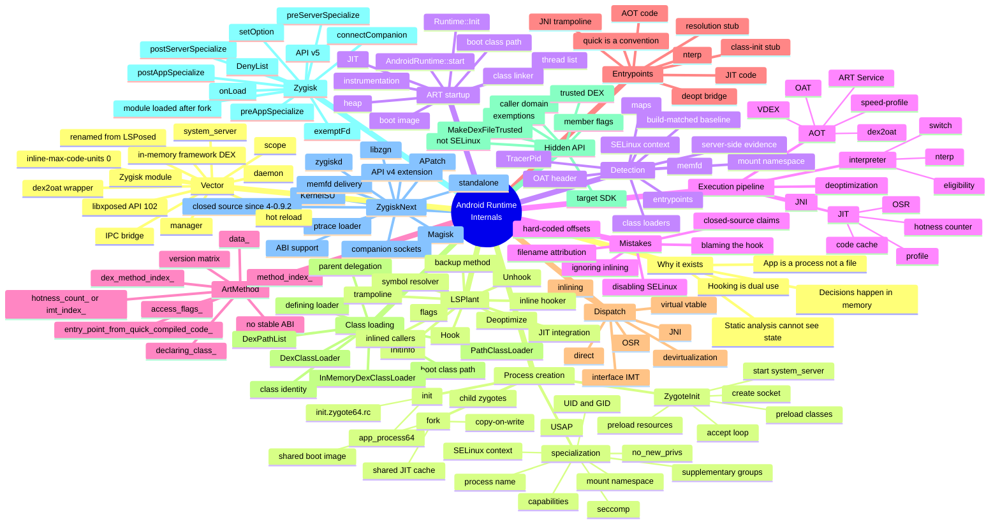

# 81 — Android Runtime Internals · Mind Map

One picture of the whole chapter. Read it outward from the centre: an app is a specialized zygote
child; ART decides per method how to execute it; `ArtMethod` is where that decision is stored; and
every runtime tool in this chapter — Zygisk, ZygiskNext, Vector, LSPlant — occupies a different layer
of the path from the fork to the hooked call. Every branch corresponds to a section of
[the chapter README](README.md); use it as a revision map before an engagement or an interview.

