# 81 — Android Runtime Internals · Mind Map

One picture of the whole chapter. Read it outward from the centre: an app is a specialized zygote
child; ART decides per method how to execute it; `ArtMethod` is where that decision is stored; and
every runtime tool in this chapter — Zygisk, ZygiskNext, Vector, LSPlant — occupies a different layer
of the path from the fork to the hooked call. Every branch corresponds to a section of
[the chapter README](README.md); use it as a revision map before an engagement or an interview.

  

*Chapter 81 mind map — the whole chapter on one page. [Open the full-size SVG](images/06-standalone-mindmap.svg) · [Mermaid source](diagrams/06-standalone-mindmap.mmd).* The inline copy is scaled to the page; open the SVG for the full-size map.
