```mermaid
flowchart TD
    A["Stage 0<br/>00 Introduction"] --> B["Stage 1 — Foundations<br/>01 CS Basics · 02 Linux · 03 Programming<br/>04 Java · 05 Kotlin"]
    B --> C["Stage 2 — The Platform<br/>06 Architecture · 07 AOSP · 08 Build System<br/>09 App Internals · 10 APK Internals"]
    C --> D["Stage 3 — Execution<br/>11 Runtime · 12 DEX · 13 ART · 14 Dalvik<br/>15 Native · 16 JNI · 17 Libraries · 18 ARM · 19 Memory"]
    D --> E["Stage 4 — The Security Model<br/>20 Security Architecture · 21 Sandbox<br/>22 SELinux · 23 Permissions"]
    E --> F["Stage 5 — The Attack Surface<br/>24 IPC · 25 Binder · 26 Intent · 27 Providers<br/>28 Services · 29 Receivers · 30 Activities<br/>31 Fragments · 32 Manifest · 33 Storage"]
    F --> G["Stage 6 — Crypto & Transport<br/>34 Cryptography · 35 SSL · 36 Pinning<br/>44 Network Security Config"]
    G --> H["Stage 7 — Client Hardening<br/>37 Root Det. · 38 Tamper Det. · 39 Emulator Det.<br/>40 Obfuscation · 41 ProGuard · 42 R8 · 43 WebView"]
    H --> I["Stage 8 — Identity<br/>45 OAuth · 46 Tokens · 47 Auth · 48 Biometrics<br/>49 KeyStore · 50 Hardware-Backed Security"]
    I --> J["Stage 9 — The Toolchain<br/>51 Dynamic · 52 Static · 53 Frida · 54 Objection<br/>55 MobSF · 56 JADX · 57 Ghidra · 58 IDA · 59 radare2<br/>60 ADB · 61 Fastboot · 62 Magisk · 63 LSPosed · 64 Xposed"]
    J --> K["Stage 10 — Applied Craft<br/>65 Hooking · 66 Instrumentation · 67 Bypassing<br/>68 Reverse Engineering · 69 Malware · 70 VR"]
    K --> L["Stage 11 — Professional Practice<br/>71 OWASP MASVS/MASTG · 72 Real Findings<br/>73 Labs · 74 Case Studies · 75 Interviews"]
    L --> M["Reference<br/>76 Cheat Sheets · 77 Commands<br/>78 Diagrams · 79 Glossary · 80 Appendix"]
```

# Android Pentesting Notes

> **From "I have never written a line of code" to Senior Android Penetration Tester.**
>
> A complete, first-principles reference for Android internals, reverse engineering, and mobile
> application security. Every chapter explains **why** something exists before it explains **how**
> to attack or defend it.

---

> ## ⚠️ Authorised testing only
>
> This repository contains **deliberately vulnerable applications, working exploit code, and root
> and hooking tooling**. Everything here is written for devices you own, applications you wrote,
> targets you have **written** permission to test, CTFs, and coordinated disclosure.
>
> Testing an application you do not own and are not authorised to test is a crime in most
> jurisdictions — including the UK Computer Misuse Act, the US CFAA, and India's IT Act §43/§66.
>
> **Read [SECURITY.md](SECURITY.md) before running anything.** It covers the safe handling of the
> vulnerable apps, why the measured corpus is anonymised, and how to report a problem in this
> material.

---

## What this is

An attempt at the book that did not exist: one continuous path from *"what is a process?"* to
reading a Binder transaction out of kernel memory, with nothing skipped in between and nothing
asserted that was not measured.

| | Measured |
|---|---:|
| Chapters | **81** |
| Files | **~1,650** |
| Lines | **~822,000** |
| Hands-on labs | **327** |
| Mermaid diagrams | **~833** |

Those numbers are counts, not achievements — a large repository of wrong things would be worse than
a small one. They are here because "comprehensive" is a claim, and this repository's standard is
that a claim carries the command that produced it. **Measured 2026-08-17; re-run rather than quote,
because the counts move whenever a chapter is edited:**

````bash
# host — the four counts above, reproduced
ls -d [0-9][0-9]-* | wc -l                                    # chapters
find . -type f -not -name '.gitkeep' | wc -l                  # files
find . -type f -not -name '.gitkeep' -exec cat {} + | wc -l   # lines
grep -ro '```mermaid' --include='*.md' . | wc -l              # diagrams
````

The lab count comes from [73-Labs](73-Labs/README.md), which generates it rather than asserting it.

**What "measured" means here.** Claims in this repository are checked against a real device before
they are written, and roughly thirty recorded findings contradict what the field repeats to itself:
the most-copied `isEmulator()` on the internet returns `false` on a current AVD; Scudo keeps no
quarantine on Android; `explicit_bzero` is missing from the NDK sysroot entirely. Where a
measurement disagreed with the textbook, the measurement won and the disagreement was written down.

---

## Who this is for

| Reader | What you will get |
|---|---|
| Absolute beginner, non-technical | A real path into the field. Chapters 01–05 assume you have never opened a terminal. |
| Developer moving into security | Skip to 06. The Android internals chapters are written for people who can code but have never read AOSP. |
| Working pentester | Chapters 20–72 are the depth you need to stop relying on automated tools. |
| Interview candidate | Every chapter ends with Beginner → Principal Engineer level questions. [Chapter 75](75-InterviewQuestions/README.md) indexes all of them by role and by round — mechanically, from a script, so the index cannot go stale — and adds what no single chapter can: how each interview stage is really graded, what escalates between tiers, and the cross-cutting questions that belong to no one chapter. |

---

## The core belief behind these notes

Most mobile security material teaches you **commands**. You learn `frida -U -f com.target -l bypass.js`
and it works, until the day it doesn't — and then you are stuck, because you never learned what a
process is, what `ptrace` does, why Frida needs it, or what the app did to stop you.

These notes teach the **machine underneath the command**. The tool chapters (53–66) come *late* on
purpose. By the time you reach Frida, you will already understand processes, memory, the ART runtime,
JNI, and ELF — so Frida becomes obvious rather than magic.

**Rule of the repository:** if a chapter tells you to run something, it must first have told you what
that thing touches inside the operating system.

---

## Learning path

The chapters are numbered in dependency order. Read them in order the first time. After that, use
them as a reference.



### Suggested pace

| Stage | Chapters | Realistic time (part-time) | You can now… |
|---|---|---|---|
| 0–1 | 00–05 | 8–12 weeks | Use Linux, read and write Java/Kotlin, understand what a program *is* |
| 2 | 06–10 | 4 weeks | Explain Android's stack and take an APK apart |
| 3 | 11–19 | 6–8 weeks | Read DEX, Smali, ELF and ARM64; explain how code actually runs |
| 4–5 | 20–33 | 6 weeks | Map an app's full attack surface without any tool |
| 6–8 | 34–50 | 8 weeks | Audit crypto, TLS, auth, and hardware-backed key storage |
| 9–10 | 51–70 | 8 weeks | Instrument, hook, bypass, and reverse anything you are given |
| 11 | 71–80 | ongoing | Deliver professional engagements and reports |

Total: roughly **12–18 months** part-time to reach solid senior capability. Anyone selling you
"Android pentesting in 30 days" is selling you a tool tutorial.

### Reading paths, if chapter order is not what you need

327 labs in reading order is a corpus, not a curriculum.
[`73-Labs/references/learning-paths.md`](73-Labs/references/learning-paths.md) gives five ordered
routes — two weeks with no Android background, interview-ready, emulator-only, the native/RE track,
and a no-device-at-all track for a laptop on a train. The chapter sequence in each is curated; the
lab list under it is **generated**, so a path can never point at a lab that has been renamed.

Each path states a **rule** as well as a sequence, and the rule is usually the more valuable half.

---

## Prerequisites and setup

**To read this repository you need nothing but a browser.** Every chapter is markdown, every diagram
renders inline, and the prose carries the measurements. A large fraction of the value is available
with no tooling at all.

To *run* things, the honest picture is below.

### What you actually need

| | What | Why |
|---|---|---|
| **Required** | A computer, and a POSIX shell (Linux, macOS, or Git Bash / WSL on Windows) | Every script here is `sh`, Python or JavaScript |
| **Required** | **Python 3** | The repository's own tooling. Always run it as `python3 -B` so no `__pycache__` is created |
| **Strongly recommended** | An **Android emulator** (Android Studio's AVD manager) | Rooted by default on a userdebug image, disposable, and safe to install deliberately vulnerable apps on |
| **Recommended** | **JDK** + Android SDK **build-tools** | 107 labs build a target from source. No Gradle and no network needed — the build scripts use `aapt2`, `d8`, `zipalign` and `apksigner` directly |
| **Optional** | A **physical device**, ideally rooted | Only 8 labs are `physical`-tagged and genuinely unanswerable on an emulator. Most root work is fine on an AVD |
| **Optional** | **Frida**, **apktool**, **JADX**, **Burp Suite**, **Ghidra** | Per-tool, per-chapter. Install them when the chapter needs them, not before |

> **⚠️ Never install the deliberately vulnerable apps on a device with a real account signed in, or
> on one carrying client data.** Prefer a disposable emulator, and uninstall when you are finished —
> every lab ends with a cleanup section naming the package. [SECURITY.md §2](SECURITY.md) explains
> why this repository ships **sources and build scripts, never APKs**.

### Be honest about the environment: most labs are blocked on a fresh machine

[73-Labs](73-Labs/README.md) surveyed this rather than assuming it, and the result is worth knowing
before you are forty minutes into a lab:

| On a typical setup | Labs |
|---|---:|
| Runnable | **140** of 327 |
| Blocked | **187** of 327 |
| …blocked by **Frida alone** | **128** |

**Frida is the single highest-value thing to install.** It is required at *both* ends — the host
tool and a matching server binary on the device — which is why it blocks so much and why it is the
most common place to get stuck. Installing it takes the runnable count from **140 to 210** in one
step.

Do not take those numbers on faith about *your* machine. Probe it:

```bash
# host — from 73-Labs: what can this machine run right now?
python3 -B 73-Labs/scripts/lab-env-probe.py --match
```

Nothing is inferred from a directory existing or an environment variable being set; a tool counts as
present when it **executes**. [73-Labs §3.6 and §3.8](73-Labs/README.md#36-the-environment-what-actually-works-here)
carry the full capability survey, the three install refusals that look identical but have unrelated
causes, and the `su` calling-convention difference that reads as "not rooted" when it is nothing of
the kind.

**Start here for setup:** [00-Introduction lab 01 — build your lab](00-Introduction/labs/lab-01-build-your-lab.md).

---

## Chapter index

### Stage 0 — Orientation
| # | Chapter | What it covers |
|---|---|---|
| 00 | [Introduction](00-Introduction/) | What Android security research actually is, the mindset, how to use this repo, lab setup |

### Stage 1 — Foundations (no prior knowledge assumed)
| # | Chapter | What it covers |
|---|---|---|
| 01 | [Computer Science Basics](01-Computer-Science-Basics/) | CPU, memory, processes, threads, stack, heap, registers, paging, virtual memory, kernel, syscalls |
| 02 | [Linux Basics](02-Linux-Basics/) | Filesystem, permissions, users, processes, signals, sockets, IPC, `/proc`, shells |
| 03 | [Programming Fundamentals](03-Programming-Fundamentals/) | Variables, control flow, functions, data structures, compilation vs interpretation |
| 04 | [Java](04-Java/) | Java from zero: OOP, inheritance, interfaces, collections, generics, reflection, annotations, exceptions |
| 05 | [Kotlin](05-Kotlin/) | Kotlin from zero: null safety, lambdas, coroutines, and how it compiles to the same bytecode |

### Stage 2 — The Platform
| # | Chapter | What it covers |
|---|---|---|
| 06 | [Android Architecture](06-Android-Architecture/) | Kernel → HAL → native libs → ART → framework → apps; boot process, init, Zygote, system_server |
| 07 | [AOSP](07-AOSP/) | The source tree, how to navigate it, how to read it, how to build it |
| 08 | [Build System](08-Build-System/) | Soong, Make, Bazel, Gradle; how an app and a platform image are produced |
| 09 | [Android App Internals](09-Android-App-Internals/) | UID/PID, package manager, install flow, app lifecycle, process model |
| 10 | [APK Internals](10-APK-Internals/) | ZIP structure, manifest, resources, assets, signing schemes v1–v4, split APKs, App Bundles |

### Stage 3 — Execution
| # | Chapter | What it covers |
|---|---|---|
| 11 | [Android Runtime](11-Android-Runtime/) | How managed code executes, JIT/AOT, the runtime's role in security |
| 12 | [DEX Internals](12-DEX-Internals/) | Byte-level DEX format, headers, maps, string/type/method ids, bytecode |
| 13 | [ART](13-ART/) | OAT/VDEX/ODEX, compilation modes, GC, the interpreter, method invocation |
| 14 | [Dalvik](14-Dalvik/) | The historical VM, register-based bytecode, why it mattered and what it left behind |
| 15 | [Native Code](15-Native-Code/) | ELF, sections, PLT/GOT, RELRO, NX, ASLR, PIE, stack canaries |
| 16 | [JNI](16-JNI/) | The Java↔native bridge, registration, references, and where it breaks security |
| 17 | [Libraries](17-Libraries/) | Bionic, libc, OkHttp, Conscrypt, BoringSSL, and third-party SDK risk |
| 18 | [ARM](18-ARM/) | AArch64 assembly, registers, calling conventions, reading disassembly |
| 19 | [Memory](19-Memory/) | Address space layout, mappings, allocators, and memory corruption primitives |

### Stage 4 — The Security Model
| # | Chapter | What it covers |
|---|---|---|
| 20 | [Security Architecture](20-Security-Architecture/) | The complete model: Verified Boot, dm-verity, sandbox, SELinux, Play Integrity |
| 21 | [App Sandbox](21-App-Sandbox/) | UID isolation, filesystem isolation, seccomp, and how sandboxes get escaped |
| 22 | [SELinux](22-SELinux/) | MAC vs DAC, policy, contexts, domains, denials, and reading `avc:` logs |
| 23 | [Permissions](23-Permissions/) | Install-time, runtime, signature, custom permissions, and permission bypasses |

### Stage 5 — The Attack Surface
| # | Chapter | What it covers |
|---|---|---|
| 24 | [IPC](24-IPC/) | Every IPC mechanism Android exposes and its threat model |
| 25 | [Binder](25-Binder/) | The kernel driver, parcels, transactions, AIDL, and Binder-level attacks |
| 26 | [Intent](26-Intent/) | Explicit/implicit intents, resolution, PendingIntent, intent redirection |
| 27 | [Content Providers](27-ContentProviders/) | URIs, permissions, `grantUriPermissions`, SQL injection, path traversal |
| 28 | [Services](28-Services/) | Started/bound/foreground services and exposed service abuse |
| 29 | [Broadcast Receivers](29-BroadcastReceivers/) | Ordered/sticky broadcasts, registration, and broadcast injection |
| 30 | [Activities](30-Activities/) | Lifecycle, task/back stack, task hijacking, tapjacking, deep links |
| 31 | [Fragments](31-Fragments/) | Lifecycle, fragment injection, and dynamic UI attack surface |
| 32 | [Manifest](32-Manifest/) | Every security-relevant attribute, line by line |
| 33 | [Storage](33-Storage/) | Internal, external, scoped storage, SharedPreferences, SQLite, Room, backups |

### Stage 6 — Cryptography & Transport
| # | Chapter | What it covers |
|---|---|---|
| 34 | [Cryptography](34-Cryptography/) | AES, RSA, ECC, DH/ECDH, ECDSA, SHA, HMAC, KDFs, IV/nonce/salt, entropy |
| 35 | [SSL/TLS](35-SSL/) | The handshake, PKI, certificate chains, CT, OCSP, CRL, mTLS |
| 36 | [Certificate Pinning](36-CertificatePinning/) | Every pinning implementation and how each is defeated |
| 44 | [Network Security Config](44-NetworkSecurityConfig/) | The XML that decides whether your proxy works |

### Stage 7 — Client-Side Hardening
| # | Chapter | What it covers |
|---|---|---|
| 37 | [Root Detection](37-RootDetection/) | Every technique, from `su` lookups to kernel-level checks |
| 38 | [Tamper Detection](38-TamperDetection/) | Signature checks, integrity checks, and where they are anchored |
| 39 | [Emulator Detection](39-EmulatorDetection/) | Hardware, sensor, and timing-based detection |
| 40 | [Obfuscation](40-Obfuscation/) | Name mangling, string encryption, control-flow flattening, packers |
| 41 | [ProGuard](41-ProGuard/) | Rules, mapping files, and what survives shrinking |
| 42 | [R8](42-R8/) | Modern shrinking/optimization and its RE implications |
| 43 | [WebView](43-WebView/) | `addJavascriptInterface`, file access, XSS→RCE chains |

### Stage 8 — Identity & Key Material
| # | Chapter | What it covers |
|---|---|---|
| 45 | [OAuth](45-OAuth/) | Flows, PKCE, redirect URI attacks on mobile |
| 46 | [Tokens](46-Tokens/) | JWT internals, refresh tokens, storage, and revocation |
| 47 | [Authentication](47-Authentication/) | Session management, MFA, device binding |
| 48 | [Biometrics](48-Biometrics/) | BiometricPrompt, CryptoObject, and why most implementations are bypassable |
| 49 | [KeyStore](49-KeyStore/) | Keymaster/KeyMint, key attestation, `setUserAuthenticationRequired` |
| 50 | [Hardware-Backed Security](50-HardwareBackedSecurity/) | TEE, TrustZone, StrongBox, secure element |

### Stage 9 — The Toolchain
| # | Chapter | What it covers |
|---|---|---|
| 51 | [Dynamic Analysis](51-DynamicAnalysis/) | Methodology before tools |
| 52 | [Static Analysis](52-StaticAnalysis/) | Methodology before tools |
| 53 | [Frida](53-Frida/) | Gum, Stalker, the agent model, Java and native hooking |
| 54 | [Objection](54-Objection/) | What it automates and what it hides from you |
| 55 | [MobSF](55-MobSF/) | Using it correctly, and its false positives |
| 56 | [JADX](56-JADX/) | Decompiler internals and failure modes |
| 57 | [Ghidra](57-Ghidra/) | Native RE workflow for Android `.so` files |
| 58 | [IDA](58-IDA/) | Pro workflow, Hex-Rays, debugging on-device |
| 59 | [radare2](59-radare2/) | Scriptable RE and rizin/cutter |
| 60 | [ADB](60-ADB/) | The protocol, not just the commands |
| 61 | [Fastboot](61-Fastboot/) | Bootloader, partitions, unlocking |
| 62 | [Magisk](62-Magisk/) | Systemless root, `zygisk`, DenyList, modules |
| 63 | [LSPosed](63-LSPosed/) | Modern Xposed on ART |
| 64 | [Xposed](64-Xposed/) | The original hooking framework and its concepts |

### Stage 10 — Applied Craft
| # | Chapter | What it covers |
|---|---|---|
| 65 | [Hooking](65-Hooking/) | Java, native, JNI, libc, SSL, and crypto hooking from first principles |
| 66 | [Instrumentation](66-Instrumentation/) | Building your own tooling |
| 67 | [Bypassing Protections](67-BypassingProtections/) | A systematic methodology, not a script collection |
| 68 | [Reverse Engineering](68-ReverseEngineering/) | End-to-end RE of managed and native code |
| 69 | [Malware Analysis](69-MalwareAnalysis/) | Android malware families, triage, and behavioural analysis |
| 70 | [Vulnerability Research](70-VulnerabilityResearch/) | Fuzzing, attack surface enumeration, exploit development |

### Stage 11 — Professional Practice
| # | Chapter | What it covers |
|---|---|---|
| 71 | [OWASP Mobile](71-OWASP-Mobile/) | MASVS, MASTG, MASWE, and mapping findings to standards |
| 72 | [Real World Findings](72-RealWorldFindings/) | Anonymised findings with full write-ups and CVSS |
| 73 | [Labs](73-Labs/) | The complete lab index and vulnerable-app catalogue |
| 74 | [Case Studies](74-CaseStudies/) | Public CVEs and bug bounty reports, dissected |
| 75 | [Interview Questions](75-InterviewQuestions/) | Beginner → Principal, with model answers |

### Reference
| # | Chapter |
|---|---|
| 76 | [Cheat Sheets](76-CheatSheets/) |
| 77 | [Useful Commands](77-UsefulCommands/) |
| 78 | [Diagrams](78-Diagrams/) |
| 79 | [Glossary](79-Glossary/) |
| 80 | [Appendix](80-Appendix/) |

---

## Every chapter has the same shape

```
NN-Chapter-Name/
├── README.md        ← the chapter itself (the main content)
├── cheatsheet.md    ← condensed, printable reference
├── mindmap.md       ← Mermaid mind map of the chapter
├── faq.md           ← questions learners actually ask
├── images/          ← diagrams and screenshots
├── labs/            ← hands-on exercises with solutions
├── examples/        ← runnable code (Java, Kotlin, C++, Smali, JS)
├── scripts/         ← Frida scripts, shell helpers, automation
└── references/      ← AOSP links, RFCs, papers, CVEs
```

And each `README.md` follows this fixed structure:

1. **Introduction** — plain English, analogies, *why this exists*
2. **High-Level Architecture** — Mermaid diagrams
3. **Deep Internal Working** — what / why / when / where / how
4. **Source Code Walkthrough** — real AOSP paths and classes
5. **Security Perspective** — attacker, developer, pentester, malware, forensics
6. **Reverse Engineering Perspective** — JADX, Smali, native, patterns
7. **Dynamic Analysis** — Frida, Objection, ADB, Burp, MobSF, Drozer, strace, LLDB
8. **Static Analysis** — source, manifest, resources, DEX, native, Gradle
9. **Examples** — simple → intermediate → advanced → real-world → enterprise
10. **Interview Questions** — beginner → principal
11. **Common Mistakes** — developer, pentester, reverse engineer
12. **Hands-on Labs** — exercises, assignments, CTF challenges
13. **Summary** — key points, mind map, cheat sheet, quick revision
14. **References** — AOSP, OWASP, Android docs, RFCs, papers

---

## Legal and ethical scope

Everything here is written for **authorised** work: your own devices and apps, apps you have written
permission to test, deliberately vulnerable training apps, CTFs, and coordinated vulnerability
disclosure.

Testing an application you do not own or have written authorisation to test is a crime in most
jurisdictions — including the UK Computer Misuse Act, the US CFAA, and India's IT Act §43/§66. A
bug bounty program's scope document *is* your authorisation; read it before you touch anything, and
stay inside it.

The techniques for defeating root detection, pinning, and integrity checks are documented here
because **you cannot assess an app you cannot observe**, and because developers need to understand
why their controls fail. They are not documented so that you can pirate software or commit fraud.

---

## Conventions used throughout

> **📖 Definition** — a term is being introduced for the first time.

> **⚠️ Warning** — something that will break your device, your test, or your legal standing.

> **🔍 Pentester's Note** — how this specifically matters during an engagement.

> **🧠 Mental Model** — the analogy to hold on to when the details fade.

> **🔬 Under the Hood** — optional depth; skip on first read, return on second.

Code blocks are labelled with the environment they run in:

```bash
# runs on your host machine
```

```bash
# adb shell — runs on the device
```

---

## Versioning and maintenance

Android changes every year. Where a chapter is version-sensitive it states the API levels it applies
to. Where behaviour changed (scoped storage in 10/11, package visibility in 11, foreground service
types in 14, `PendingIntent` mutability in 12) the chapter has a **Version Matrix** table.

Chapters are written against **Android 13–16 (API 33–36)** as the baseline, with historical
behaviour noted where it still matters for real-world targets. Measurements state the device and API
level they were taken on, because a measurement without its environment is an anecdote.

**Where measurement contradicted the textbook, the chapter keeps both** — the received wisdom, the
measurement that refuted it, and the device it was taken on. The largest collections are
[`39-EmulatorDetection`](39-EmulatorDetection/README.md), where nine well-known emulator checks are
dead and four are inverted, and [`76-CheatSheets`](76-CheatSheets/README.md) §6, which tabulates 33
commands that do not do what they are widely believed to do. The traps this repository fell into
itself are recorded the same way, and are now checked for automatically — see
[`76-CheatSheets/scripts/`](76-CheatSheets/scripts/).

---

## Contributing

Corrections are welcome, especially measured ones. **[CONTRIBUTING.md](CONTRIBUTING.md)** covers the
conventions and the checks a change has to pass. The short version:

- **Measure, do not recite.** A claim carries the command that produced it.
- **Never name a real vendor or app as vulnerable.** Describe the class, quantify the population,
  anonymise the instance.
- **Never fabricate** a CVE ID, a bug bounty URL, or an AOSP line number.
- **Sources, never binaries.** Build out of tree; no APKs, no keystores, no `__pycache__`.
- **A path in a code fence is a promise** — the file must exist.
- **BOM-less UTF-8, no raw control bytes**, and the lint gate stays at `ERROR 0`.

### Repository documents

| Document | What it is for |
|---|---|
| [SECURITY.md](SECURITY.md) | Authorised testing, safe handling of the vulnerable apps, the anonymisation policy, and how to report a problem in this material |
| [CONTRIBUTING.md](CONTRIBUTING.md) | The conventions, and the exact verification commands |
| [STYLE-GUIDE.md](STYLE-GUIDE.md) | How every chapter is written — the 14-section template and the reference-chapter alternative |
| [LICENSE](LICENSE) | CC BY 4.0 for the content, MIT for the code, and the third-party material covered by neither |

---

## Licence

**Content** (prose, chapters, diagrams) under **CC BY 4.0**. **Code** (scripts, examples) under
**MIT**. A small, named set of device-captured configuration files belongs to its original authors
and is listed in [LICENSE](LICENSE) §3. Use it, teach from it, build on it — keep the attribution.

---

## Start here

→ **[00-Introduction](00-Introduction/)** — or, if you want to know what your machine can actually
run first, → **[73-Labs](73-Labs/README.md)**.
