# Android Security Handbook

These notes teach Android security from first principles, for two readers at once: the beginner
who has never opened a terminal, and the working pentester who wants the machine underneath the
tools. They run from "what is a process" to reading a Binder transaction out of kernel memory.
Claims are checked against a real device before they are written down; where a measurement
disagreed with the textbook, the chapter keeps both sides, with the device and API level it came
from. The baseline is Android 13 to 16 (API 33 to 36). Everything here is written for devices and
apps you own or have written permission to test; read [SECURITY.md](SECURITY.md) before you run
anything.

## What's inside

81 chapters, about 1,680 files, about 879,000 lines, 327 hands-on labs, and about 834 Mermaid
diagrams, counted on 2026-11-16. Re-run rather than quote: the counts move whenever a chapter is
edited. The lab count is generated by [73-Labs](73-Labs/README.md); the rest come from the commands
in [76-CheatSheets/scripts](76-CheatSheets/scripts/).

## How to use it

If you have never written code, start at chapter 00 and read in order; chapters 01–05 assume no
prior knowledge at all.

If you are a developer moving into security, skip to chapter 06; the internals chapters assume you
can code but have never read AOSP.

If you pentest for a living, chapters 20–72 are the depth you are after. The tool chapters (53–66)
come late on purpose: by the time you reach Frida you will already know processes, memory, ART and
ELF.

If you are preparing for interviews, every chapter ends with graded questions, indexed by role and
round in [75-InterviewQuestions](75-InterviewQuestions/README.md).

## Start here

- [00-Introduction](00-Introduction/) — what this work is, and how to set up a lab.
- [73-Labs](73-Labs/README.md) — the lab index, and what your machine can run right now.
- [Learning paths](73-Labs/references/learning-paths.md) — ordered routes for stated goals.

## Learning path

The chapters are numbered in dependency order. Read them in order the first time; use them as a
reference afterwards.

```mermaid
flowchart TD
    A["Stage 0<br/>00 Introduction"] --> B["Stage 1 — Foundations<br/>01 CS Basics · 02 Linux · 03 Programming<br/>04 Java · 05 Kotlin"]
    B --> C["Stage 2 — The Platform<br/>06 Architecture · 07 AOSP · 08 Build System<br/>09 App Internals · 10 APK Internals"]
    C --> D["Stage 3 — Execution<br/>11 Runtime · 12 DEX · 13 ART · 14 Dalvik<br/>15 Native · 16 JNI · 17 Libraries · 18 ARM · 19 Memory"]
    D --> E["Stage 4 — The Security Model<br/>20 Security Architecture · 21 Sandbox<br/>22 SELinux · 23 Permissions"]
    E --> F["Stage 5 — The Attack Surface<br/>24 IPC · 25 Binder · 26 Intent · 27 Providers<br/>28 Services · 29 Receivers · 30 Activities<br/>31 Fragments · 32 Manifest · 33 Storage"]
    F --> G["Stage 6 — Crypto & Transport<br/>34 Cryptography · 35 SSL · 36 Pinning<br/>44 Network Security Config"]
    G --> H["Stage 7 — Client Hardening<br/>37 Root Det. · 38 Tamper Det. · 39 Emulator Det.<br/>40 Obfuscation · 41 ProGuard · 42 R8 · 43 WebView"]
    H --> I["Stage 8 — Identity<br/>45 OAuth · 46 Tokens · 47 Auth · 48 Biometrics<br/>49 KeyStore · 50 Hardware-Backed Security"]
    I --> J["Stage 9 — The Toolchain<br/>51 Dynamic · 52 Static · 53 Frida · 54 Objection<br/>55 MobSF · 56 JADX · 57 Ghidra · 58 IDA · 59 radare2<br/>60 ADB · 61 Fastboot · 62 Magisk · 63 LSPosed · 64 Xposed"]
    J --> K["Stage 10 — Applied Craft<br/>65 Hooking · 66 Instrumentation · 67 Bypassing<br/>68 Reverse Engineering · 69 Malware · 70 VR"]
    K --> L["Stage 11 — Professional Practice<br/>71 OWASP MASVS/MASTG · 72 Real Findings<br/>73 Labs · 74 Case Studies · 75 Interviews"]
    L --> M["Reference<br/>76 Cheat Sheets · 77 Commands<br/>78 Diagrams · 79 Glossary · 80 Appendix"]
```

If chapter order is not what you need, [learning-paths.md](73-Labs/references/learning-paths.md)
has five other routes, from two weeks with no Android background to one that needs no device. Each
states a rule as well as a sequence, and the rule is usually the more valuable half.

## Prerequisites

Reading needs nothing but a browser. To run things, you need Python 3 and a POSIX shell; the rest
depends on how far you go.

| What | Why |
|---|---|
| Python 3 and a POSIX shell (Linux, macOS, WSL) | Required. Every script here is `sh`, Python or JavaScript |
| Android Studio's emulator | Strongly recommended. An AVD is rooted by default, disposable, and safe for the vulnerable apps |
| JDK and Android SDK build-tools | Recommended. 107 labs build a target from source, with no Gradle and no network |
| A rooted physical device | Optional. Only 8 labs need one; most root work works on an AVD |
| Frida, apktool, JADX, Burp, Ghidra | Optional. Install each when a chapter needs it, not before |

On a fresh machine most labs are blocked, and that is measured rather than guessed: 140 of the 327
labs run as-is, 187 are blocked, and Frida alone accounts for 128 of those, because it is needed at
both ends — the host tool and a matching server on the device. Installing Frida takes the runnable
count from 140 to 210. Probe your own machine with
`python3 -B 73-Labs/scripts/lab-env-probe.py --match`, and start setup with
[00-Introduction lab 01](00-Introduction/labs/lab-01-build-your-lab.md).

## Chapter index

Every chapter follows the same 14-section structure; [STYLE-GUIDE.md](STYLE-GUIDE.md) is the contract.

| # | Chapter | Covers |
|---|---|---|
| **Stage 0 — Orientation** | | |
| 00 | [Introduction](00-Introduction/) | Mindset, repo use, lab setup |
| **Stage 1 — Foundations** | | |
| 01 | [Computer Science Basics](01-Computer-Science-Basics/) | CPU, memory, processes, virtual memory |
| 02 | [Linux Basics](02-Linux-Basics/) | Filesystem, permissions, processes, IPC |
| 03 | [Programming Fundamentals](03-Programming-Fundamentals/) | Variables, control flow, data structures |
| 04 | [Java](04-Java/) | OOP, collections, generics, reflection |
| 05 | [Kotlin](05-Kotlin/) | Null safety, coroutines, bytecode |
| **Stage 2 — The Platform** | | |
| 06 | [Android Architecture](06-Android-Architecture/) | Kernel to apps, Zygote, boot |
| 07 | [AOSP](07-AOSP/) | Reading and building the source tree |
| 08 | [Build System](08-Build-System/) | Soong, Make, Gradle |
| 09 | [Android App Internals](09-Android-App-Internals/) | UIDs, install flow, lifecycle |
| 10 | [APK Internals](10-APK-Internals/) | ZIP, manifest, signing, split APKs |
| **Stage 3 — Execution** | | |
| 11 | [Android Runtime](11-Android-Runtime/) | Managed execution, JIT, AOT |
| 12 | [DEX Internals](12-DEX-Internals/) | The DEX format, byte by byte |
| 13 | [ART](13-ART/) | OAT, VDEX, GC, compilation modes |
| 14 | [Dalvik](14-Dalvik/) | The historical VM |
| 15 | [Native Code](15-Native-Code/) | ELF, ASLR, RELRO, stack canaries |
| 16 | [JNI](16-JNI/) | The Java–native bridge, and where it breaks |
| 17 | [Libraries](17-Libraries/) | Bionic, OkHttp, third-party SDK risk |
| 18 | [ARM](18-ARM/) | AArch64 assembly, reading disassembly |
| 19 | [Memory](19-Memory/) | Address space, allocators, corruption |
| **Stage 4 — The Security Model** | | |
| 20 | [Security Architecture](20-Security-Architecture/) | Verified Boot, sandbox, Play Integrity |
| 21 | [App Sandbox](21-App-Sandbox/) | UID isolation, seccomp, escapes |
| 22 | [SELinux](22-SELinux/) | Policy, domains, reading `avc:` logs |
| 23 | [Permissions](23-Permissions/) | Install-time, runtime, signature, bypasses |
| **Stage 5 — The Attack Surface** | | |
| 24 | [IPC](24-IPC/) | Every mechanism and its threat model |
| 25 | [Binder](25-Binder/) | Driver, parcels, AIDL, Binder attacks |
| 26 | [Intent](26-Intent/) | Resolution, PendingIntent, redirection |
| 27 | [Content Providers](27-ContentProviders/) | URI grants, SQL injection, path traversal |
| 28 | [Services](28-Services/) | Started, bound, exposed-service abuse |
| 29 | [Broadcast Receivers](29-BroadcastReceivers/) | Ordered, sticky, broadcast injection |
| 30 | [Activities](30-Activities/) | Tasks, hijacking, tapjacking, deep links |
| 31 | [Fragments](31-Fragments/) | Lifecycle, fragment injection |
| 32 | [Manifest](32-Manifest/) | Security attributes, line by line |
| 33 | [Storage](33-Storage/) | Scoped storage, SQLite, backups |
| **Stage 6 — Cryptography & Transport** | | |
| 34 | [Cryptography](34-Cryptography/) | AES, RSA, ECC, KDFs, entropy |
| 35 | [SSL/TLS](35-SSL/) | Handshake, PKI, certificate chains |
| 36 | [Certificate Pinning](36-CertificatePinning/) | Every implementation, and its defeat |
| 44 | [Network Security Config](44-NetworkSecurityConfig/) | The XML that decides proxying |
| **Stage 7 — Client-Side Hardening** | | |
| 37 | [Root Detection](37-RootDetection/) | su lookups to kernel checks |
| 38 | [Tamper Detection](38-TamperDetection/) | Signature and integrity checks |
| 39 | [Emulator Detection](39-EmulatorDetection/) | Hardware, sensor, timing checks |
| 40 | [Obfuscation](40-Obfuscation/) | Mangling, string encryption, packers |
| 41 | [ProGuard](41-ProGuard/) | Rules, mapping files |
| 42 | [R8](42-R8/) | Modern shrinking, RE implications |
| 43 | [WebView](43-WebView/) | Javascript bridges, XSS to RCE |
| **Stage 8 — Identity & Key Material** | | |
| 45 | [OAuth](45-OAuth/) | Flows, PKCE, redirect attacks |
| 46 | [Tokens](46-Tokens/) | JWT internals, storage, revocation |
| 47 | [Authentication](47-Authentication/) | Sessions, MFA, device binding |
| 48 | [Biometrics](48-Biometrics/) | BiometricPrompt, CryptoObject, bypasses |
| 49 | [KeyStore](49-KeyStore/) | KeyMint, attestation, auth-bound keys |
| 50 | [Hardware-Backed Security](50-HardwareBackedSecurity/) | TEE, TrustZone, StrongBox |
| **Stage 9 — The Toolchain** | | |
| 51 | [Dynamic Analysis](51-DynamicAnalysis/) | Methodology before tools |
| 52 | [Static Analysis](52-StaticAnalysis/) | Methodology before tools |
| 53 | [Frida](53-Frida/) | Gum, Stalker, the agent model |
| 54 | [Objection](54-Objection/) | What it automates and hides |
| 55 | [MobSF](55-MobSF/) | Correct use, false positives |
| 56 | [JADX](56-JADX/) | Decompiler internals, failure modes |
| 57 | [Ghidra](57-Ghidra/) | Native RE workflow |
| 58 | [IDA](58-IDA/) | Pro workflow, Hex-Rays, on-device debugging |
| 59 | [radare2](59-radare2/) | Scriptable RE, rizin, Cutter |
| 60 | [ADB](60-ADB/) | The protocol, not only the commands |
| 61 | [Fastboot](61-Fastboot/) | Bootloader, partitions, unlocking |
| 62 | [Magisk](62-Magisk/) | Systemless root, DenyList, modules |
| 63 | [LSPosed](63-LSPosed/) | Modern Xposed on ART |
| 64 | [Xposed](64-Xposed/) | The original hooking framework |
| **Stage 10 — Applied Craft** | | |
| 65 | [Hooking](65-Hooking/) | Java, native, crypto hooks |
| 66 | [Instrumentation](66-Instrumentation/) | Building your own tooling |
| 67 | [Bypassing Protections](67-BypassingProtections/) | A systematic methodology |
| 68 | [Reverse Engineering](68-ReverseEngineering/) | Managed and native RE |
| 69 | [Malware Analysis](69-MalwareAnalysis/) | Families, triage, behaviour |
| 70 | [Vulnerability Research](70-VulnerabilityResearch/) | Fuzzing, exploit development |
| **Stage 11 — Professional Practice** | | |
| 71 | [OWASP Mobile](71-OWASP-Mobile/) | MASVS, MASTG, mapping findings |
| 72 | [Real World Findings](72-RealWorldFindings/) | Anonymised write-ups, CVSS |
| 73 | [Labs](73-Labs/) | Lab index, app catalogue |
| 74 | [Case Studies](74-CaseStudies/) | CVEs and bounty reports, dissected |
| 75 | [Interview Questions](75-InterviewQuestions/) | Graded questions, model answers |
| **Reference** | | |
| 76 | [Cheat Sheets](76-CheatSheets/) | |
| 77 | [Useful Commands](77-UsefulCommands/) | |
| 78 | [Diagrams](78-Diagrams/) | |
| 79 | [Glossary](79-Glossary/) | |
| 80 | [Appendix](80-Appendix/) | |

## Contributing and licence

Corrections are welcome, especially measured ones. [CONTRIBUTING.md](CONTRIBUTING.md) has the
conventions and the checks a change must pass; the lint gate must stay at `ERROR 0`. Content is
CC BY 4.0, code is MIT, and the named third-party exceptions are listed in [LICENSE](LICENSE) §3.

| Document | What it is for |
|---|---|
| [SECURITY.md](SECURITY.md) | Safe handling of the vulnerable apps, anonymisation, reporting |
| [CONTRIBUTING.md](CONTRIBUTING.md) | The conventions, and the verification commands |
| [STYLE-GUIDE.md](STYLE-GUIDE.md) | The chapter template, and the reference-chapter alternative |
| [LICENSE](LICENSE) | CC BY 4.0 content, MIT code, third-party exceptions |

Start with [00-Introduction](00-Introduction/), or check [73-Labs](73-Labs/README.md) to see what your machine can run first.
