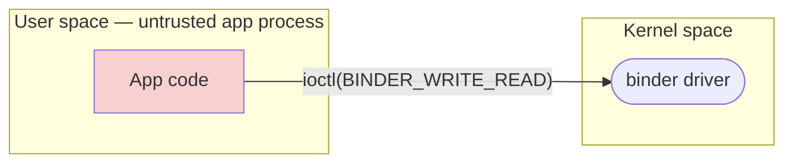

# Style Guide — how every chapter in this repository is written

This file is the contract. Every `README.md` under a numbered chapter folder follows it exactly.
If you are extending the repository, read this first.

---

## 1. The reader model

Write for **one specific person**: someone intelligent and motivated who has never written code,
never opened a terminal, and does not know what a "process" is — but who intends to become a senior
Android security researcher and will not be satisfied with hand-waving.

That means two obligations that pull in opposite directions, and you must satisfy both:

- **Never assume prior knowledge.** The first time a term appears, define it. "Heap" gets defined
  before it is used, even in chapter 49.
- **Never dumb it down.** After the plain-English explanation, give the real, byte-level,
  AOSP-accurate truth. The beginner explanation is a *ramp*, not a *substitute*.

The pattern is always: **analogy → plain definition → precise definition → internals → security
consequence.**

---

## 2. WHY before HOW — always

Every concept is introduced by answering, in this order:

1. **What problem existed before this?**
2. **What would break if this did not exist?**
3. **What is this, precisely?**
4. **How does it work internally?**
5. **How does it fail, and how is it attacked?**

A chapter that opens with "To hook a method with Frida, run…" is wrong. A chapter that opens with
"Apps make decisions in code you don't control, so you need to change those decisions at runtime;
the mechanism for that is…" is right.

---

## 3. Mandatory chapter structure

Each chapter `README.md` contains these sections, with these exact H2 headings, in this order:

```markdown
# NN — Chapter Title

> One-line statement of what the reader will be able to do after this chapter.

**Prerequisites:** links to prior chapters
**Applies to:** API levels / Android versions

## Table of Contents

## 1. Introduction
## 2. High-Level Architecture
## 3. Deep Internal Working
## 4. Source Code Walkthrough (AOSP)
## 5. Security Perspective
## 6. Reverse Engineering Perspective
## 7. Dynamic Analysis
## 8. Static Analysis
## 9. Examples
## 10. Common Interview Questions
## 11. Common Mistakes
## 12. Hands-on Labs
## 13. Summary
## 14. References
```

### What goes in each section

**1. Introduction**
Plain English. Analogies from the physical world. Real-world examples. Explain why the concept
exists, why Android needs it, and what would happen if it didn't. No code yet. This section should
be readable by someone's non-technical friend.

**2. High-Level Architecture**
At least two Mermaid diagrams. Choose from: `flowchart`, `sequenceDiagram`, `classDiagram`,
`stateDiagram-v2`, `block-beta`, `mindmap`, `erDiagram`. Memory layouts and filesystem layouts are
drawn with `block-beta` or fenced ASCII when Mermaid can't express them. Every diagram is followed
by prose explaining what the reader is looking at — never leave a diagram to speak for itself.

**3. Deep Internal Working**
The longest section. Cover **what / why / when / where / how** explicitly. Explain every relevant
component, object, class, public API, flag, and configuration value. State how Android executes it
internally, and describe interaction with: the Linux kernel, ART, Binder, native code, and
`system_server`, wherever each applies. Use tables for flags and constants.

**4. Source Code Walkthrough (AOSP)**
Real file paths from the AOSP tree (e.g.
`frameworks/base/core/java/android/app/ActivityThread.java`). Quote short, illustrative excerpts —
never dump whole files. Explain the call flow step by step. Include Java, Kotlin, C++, and JNI as
relevant. Trace at least one complete path from public API down to kernel or native.

**5. Security Perspective**
Cover, as sub-headings: how attackers abuse it; how developers misuse it; common mistakes; real
vulnerabilities; relevant CVEs (with IDs and one-line summaries); bug bounty patterns; OWASP
MASVS/MASTG mapping; how pentesters test it; how malware abuses it; how forensic analysts
investigate it.

**6. Reverse Engineering Perspective**
How the construct appears in JADX output, in the APK on disk, in Smali, and in a native library.
Give concrete recognisable patterns and at least one Smali listing. Show what obfuscation does to it.

**7. Dynamic Analysis**
Concrete, runnable instructions for the applicable subset of: Frida, Objection, ADB, Burp Suite,
MobSF, Drozer, Android Studio, Logcat, `strace`, `ltrace`, GDB, LLDB. Include at least one complete,
working Frida script per chapter where hooking is meaningful.

**8. Static Analysis**
How to find it in: source code, `AndroidManifest.xml`, resources, DEX, native libraries, Smali, XML,
Gradle files, and network security config. Include the actual grep/`apktool`/`jadx` invocations.

**9. Examples**
Five graded examples: simple → intermediate → advanced → real application → enterprise application.
Real code, not pseudocode.

**10. Common Interview Questions**
Five tiers with several questions each: Beginner, Intermediate, Senior, Staff Engineer, Principal
Engineer. Give a model answer or answer skeleton for each — not just the question.

**11. Common Mistakes**
Three sub-headings: developer mistakes, pentester mistakes, reverse engineer mistakes.

**12. Hands-on Labs**
Multiple labs of increasing difficulty, with objective, setup, steps, hints, and success criteria.
Include at least one CTF-style challenge. Lab material lives in `labs/`; the README links to it.

**13. Summary**
Key points as a bulleted list, a Mermaid `mindmap`, a condensed cheat-sheet table, and a "quick
revision" set of one-line recall prompts.

**14. References**
Grouped links: AOSP source, official Android documentation, OWASP MASVS/MASTG identifiers, RFCs,
CVEs, research papers, conference talks.

---

## 4. Supporting files in every chapter folder

| File | Contents |
|---|---|
| `cheatsheet.md` | Dense, printable, tables and commands only. No prose. |
| `mindmap.md` | A single large Mermaid `mindmap` covering the whole chapter. |
| `faq.md` | 10–20 real questions a learner asks, answered directly. Include the "dumb" questions. |
| `labs/` | One markdown file per lab, plus any needed source. |
| `examples/` | Runnable code files with the extension that matches the language. |
| `scripts/` | Frida `.js`, shell `.sh`, Python `.py` helpers. Every script has a header comment stating what it does and how to run it. |
| `references/` | `README.md` listing links with one-line annotations. |
| `images/` | Diagrams. Prefer Mermaid inline; use images only when Mermaid can't do it. |

---

## 4a. Reference chapters — the one permitted alternative shape

A small number of chapters are **lookup artefacts, not teaching chapters**. They are read
non-linearly, by someone who already knows what they are looking for and wants it fast. Forcing the
14-section template onto them produces filler — a "Hands-on Labs" section in a glossary, a "Reverse
Engineering Perspective" on a list of conference talks — and filler in a reference is worse than an
honest omission, because it buries the part that is actually useful.

These chapters follow their own contract instead. **This is a different standard, not a lower one:**
a reference chapter that omits its confusions section is incomplete exactly as a teaching chapter
missing its labs would be.

**Which chapters:** `79-Glossary`, `80-Appendix`, `76-CheatSheets`, `78-Diagrams`.
Nothing else. `75-InterviewQuestions` is *not* one of these — it has genuine labs, examples and
analysis to offer, and follows the standard 14-section template.

### Required shape

| Section | Why it is required |
|---|---|
| **Introduction** | What this is, and — critically — *when you would reach for it instead of the chapter itself* |
| **How to use it** | Reference material is navigated, not read. Say how: the entry format, the sort order, what the cross-references mean |
| **The body** | Whatever form fits — A–Z terms, a version matrix, templates, checklists |
| **Confusions and misuse** | The analogue of "Common Mistakes", and **the highest-value section in any reference.** Terms people conflate; a rubric people apply mechanically; a template people fill in without thinking |
| **Summary** | Including a quick-revision block and, where it helps, an inline Mermaid map |
| **References** | Annotated, ending with a Related-chapters table, exactly as everywhere else |

### Exempt from

`labs/`, `examples/`, `scripts/`, `cheatsheet.md`, `mindmap.md`, `faq.md` and `references/README.md`
— **provided the equivalent material is present inline.** A glossary *is* a cheatsheet; shipping a
second one that condenses it is duplication. The mind map and quick-revision blocks live inside the
Summary section for the same reason.

The exemption is conditional. A reference chapter with no confusions section and no inline mind map
does not qualify for it — it is simply unfinished.

---

## 5. Writing rules

- **Complete sentences.** No arrow-chain shorthand (`A → B → fails`) in prose. Diagrams are for that.
- **Tables** for anything enumerable: flags, constants, API levels, comparisons.
- **Callouts** using the repository's five blockquote types:
  - `> **📖 Definition**`
  - `> **⚠️ Warning**`
  - `> **🔍 Pentester's Note**`
  - `> **🧠 Mental Model**`
  - `> **🔬 Under the Hood**`
- **Version awareness.** When behaviour differs across API levels, use a Version Matrix table.
- **Jargon is explained on first use**, in the same paragraph, in parentheses or a Definition callout.
- **No filler.** Do not write "In this section we will discuss…". Just discuss it.
- **Code blocks are labelled** with a comment on the first line stating where the command runs
  (host, `adb shell`, device root, Frida REPL).
- **Cross-link chapters** with relative links: `[Binder](../25-Binder/README.md)`.
- **Accuracy over completeness.** If you are not certain a CVE number or AOSP path is correct, describe
  the class of issue rather than inventing an identifier. Never fabricate a CVE ID, a bug bounty
  report URL, or an AOSP line number.

---

## 6. Diagram conventions

- Trust boundaries are drawn as `subgraph` blocks with the boundary named.
- Attacker-controlled input is coloured with `style X fill:#f9d0d0`.
- Kernel-space components use `stadium` shape `([ ])`; user-space processes use rectangles;
  hardware/TEE uses `[[ ]]`.
- Sequence diagrams label the transport (`Binder`, `socket`, `syscall`) on each arrow.

Example:



---

## 7. What "senior level" means in this repository

A chapter is finished when a reader who absorbs it can:

- Explain the mechanism to a developer **without** using the words "somehow" or "under the hood".
- Find the relevant code in AOSP unaided.
- Test it manually, with no automated tool.
- Explain why an automated tool's finding is a false positive.
- Write the remediation the developer should apply, as code.
